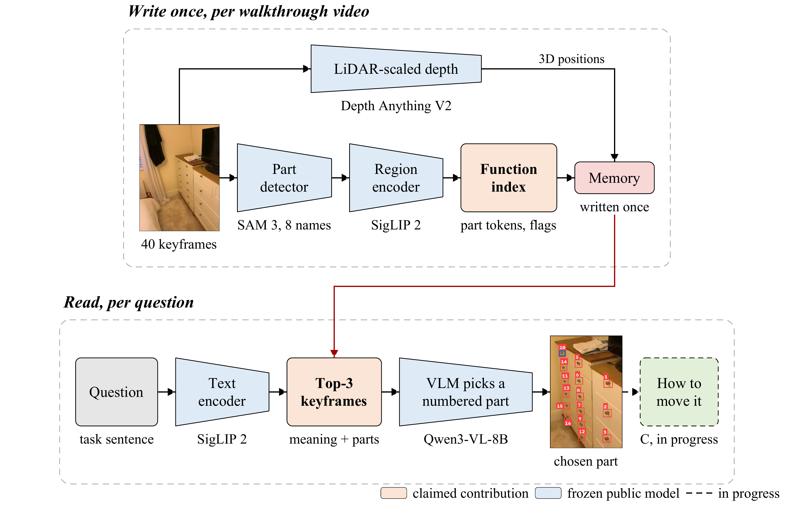

# 当前 pipeline 图（每个阶段之后更新）

这张图记录记忆方向**此刻真正在跑的** pipeline：每个方块写的是今天实际用的模型或数据，不是计划中的样子。每个阶段的结果出来、流程有变化时更新一次；旧版本看 git 历史（`git log -- docs/mem/figures/pipeline/`）。



## 图里各部分的意思

- **上半部分（写入，每段走动视频一次）：** 从视频里选 40 张关键帧；部件检测器（SAM 3，用 8 个部件名各提示一次，不训练）在每张关键帧上框出可操作的部件；区域编码器（SigLIP 2）把每个区域变成 token；功能索引存下部件 token 和"这张关键帧有没有可操作部件"的标记；深度（Depth Anything V2，用设备的 LiDAR 校准尺度）和关键帧位姿一起存下，用来定出每个部件的三维位置；接触点、法向这些几何量在读取时现算，不做稠密重建。
- **下半部分（读取，每个问题一次）：** 问题经文本编码器（SigLIP 2）和记忆比对，取出 3 张关键帧（整帧语义加部件 token）；在这 3 张上给候选部件画编号框，视觉语言模型（Qwen3-VL-8B）选一个编号；"怎么动它"（方向 C）还在做，所以是虚线。
- **颜色：** 橙色是论文要主张的部分（功能索引和按功能检索）；蓝色是直接拿来用、不训练的公开模型；红线是记忆被读取的路径；虚线是还在做的部分。
- **示例图片：** 场景 421254 的一张关键帧，问题是"Open the top left drawer of the cabinet located to the left of the TV"；右边是模型看到的编号框（SAM 3 的框），它选的 10 号（蓝框）是对的。

- **标注的位置：** 部件图原先用标注（上限），现在换成了 SAM 3；标注只用来打分。用标注建图的结果（54.4%）作为上限保留在讨论稿 24.8、24.9 节里，不在图上。

## 现在这一版的图注（英文，可直接用于报告；数字见讨论稿 24.9 节）

> **The memory pipeline as of 2026-11-16.** Top: each walkthrough video is written once. SAM 3, prompted with eight part names, boxes the parts on 40 keyframes; each box becomes a region token, and metric depth places each part in 3D. Bottom: a question retrieves three keyframes, their boxes are numbered and Qwen3-VL-8B picks one. Orange is the claim. Over 30 rooms this memory picks the right part for 35.9% of questions, against 27.7% when the same model reads 40 raw frames; about half of that gain comes from the memory's choice of frames. Annotated part maps reach 54.4%.

## 怎么更新

1. 改 `pipeline.yaml`：换方块里的文字、颜色角色（`role`）或连线；图注写在同一个文件的 `caption` 里，数字要和讨论稿一致。
2. 示例图片要换时，在服务器上运行 `python docs/mem/figures/pipeline/make_crops.py`（只用 CPU，读 `runs/` 下的 SAM 3 部件图和 8B 工具版 P4 的读图结果；脚本会核对重画的编号和模型选的框一致）。
3. 用 cvpr-figure 工具重新出图并检查（在装了这个工具的机器上）：
   ```bash
   python3 <cvpr-figure>/scripts/render.py pipeline.yaml -o pipeline -f svg,pdf,png,pptx --dpi 600
   python3 <cvpr-figure>/scripts/validate.py pipeline.yaml --svg pipeline.svg
   ```
   检查没有 FAIL 再提交；在下面的更新记录里加一行。
4. 如果有人直接在 `pipeline.pptx` 里手改了图，从那以后 pptx 就是唯一的源文件：PDF 要从 pptx 导出，不要再用 yaml 重新生成覆盖它。

## 更新记录

| 日期 | 改了什么 |
| --- | --- |
| 2026-11-16 | 第一版：两段式（写入／读取）；部件图是标注（上限）；读取用 Qwen3-VL 4B／8B；方向 C 在做。检查结果：0 个 FAIL；1 个 WARN（图高 258 pt，超过双栏论文的高度建议，作为项目记录保留，放进论文时再压缩） |
| 2026-11-16（第二版） | 部件图从标注（金色）换成 SAM 3（蓝色，冻结的公开模型），图例去掉金色一项；读图的模型写成 Qwen3-VL-8B；右边的示例换成工具版 P4 对同一个任务的回答（SAM 3 的 36 个编号框里选了 10 号，对）；图注换成讨论稿 24.9 节的数字。检查结果：0 个 FAIL；1 个 WARN（图高，同第一版） |
