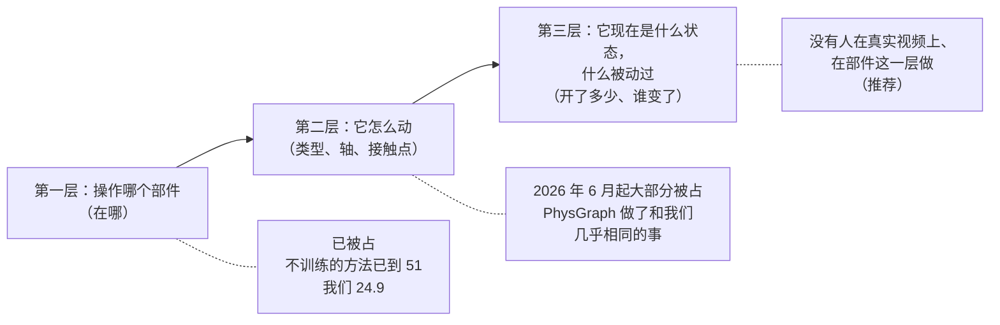
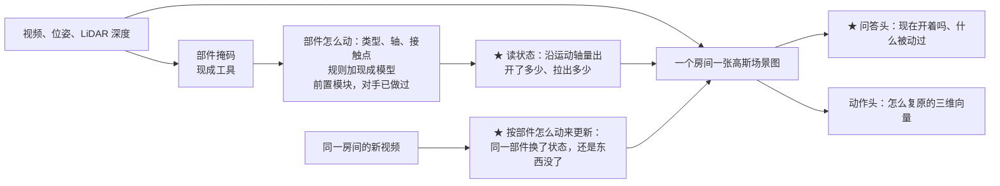

# 找这篇文章要解决的 gap：调研结果（2026-11-25）

> **用途。** issue AFFO-7 阶段 1 的全部内容：三个候选 gap 的对比、推荐、每个候选对应的数据集和 benchmark、要项目负责人定的事。
> **怎么做的。** 只读调研，没有用 GPU，没有下载数据，没有改代码。两路调研（视频理解一侧、affordance 一侧）加一次撞车检查，各由一个子 agent 完成，每个最多看 25 篇、只读摘要和主结果表。关键数字由总控再到 arXiv 上核对了一遍（第 7 节写明哪些核对过、哪些没有）。
> **日期。** 所有检索都在 2026-11-25 当天做。

## 0. 一页结论

**你提的矛盾是真的，而且可以说得更具体。** 现在的"环境理解"在物体和房间这一层，"动作"在部件这一层。把两边的工作排开看，动作粒度的理解其实有三层，三层被占的程度很不一样：

1. **第一层"在哪"已经很挤。** 根据一句话找到部件（SceneFun3D），不训练的方法里 UniFunc3D 做到 51.0、AffordMem 41.7，我们是 24.9。（这里的分数是 AP25：预测的三维部件区域和标注重合超过 25% 算找对，满分 100。）
2. **第二层"怎么动"在 2026 年 6 月被 PhysGraph（arXiv 2606.08655）占了大半。** 它用的输入和我们一样（没有人操作的 RGB-D 视频加位姿），同样不训练网络，同样逐场景拟合高斯，同样给每个部件存运动方式，而且就在 SceneFun3D 的 30 个场景上报了数字。**交接文档里"没有人做过不训练、整屋、存部件怎么动的地图"这条判断因此不再成立**，只剩"能在部件层更新"这一半还空着。
3. **第三层"状态和变化"是空的，而且 affordance map 在这里是必需的。** 部件的状态（门开了多少、抽屉拉出没有）只能沿着它的运动轴来量。没有"它怎么动"这份信息，变化只是"这一块几何不一样了"，分不清"门被打开了"和"东西被搬走了"。视频问答这边有公开数字证明模型在状态类问题上差得远；三维这边只有物体一层的做法，或者必须看到人手操作的做法。

**推荐：选第三层，即候选一「部件现在是什么状态、什么被动过」。** 第二层"怎么动"不丢，降为它的一个必要模块和一张副表。理由和风险见第 3、4 节。最大的风险是：还没有核实到一个"真实场景、多次来访、带部件状态标注"的现成公开榜，这是阶段 2a 要先查的第一件事。

## 1. 三个候选 gap 的对比

| | 候选一：现在是什么状态、什么被动过（推荐） | 候选二：怎么动 | 候选三：动作粒度的视频问答 |
| --- | --- | --- | --- |
| 一句话问题 | 只看没有人演示的普通视频，说出每个可动部件现在的状态（门开了多少、抽屉拉出没有）；再次来访时说出哪个部件被动过、动了多少、怎么复原 | 给一句任务和一段没人操作的视频，找到要操作的部件，并给出它怎么动（运动类型、轴、接触点） | 在现有的第一人称视频问答榜上，专攻需要动作粒度的题（东西被挪到哪、柜门开关了几次、操作的是哪个部件） |
| 现有模型做不好的公开数字 | EOC-Bench"刚发生的状态识别"：GPT-4o 52.9，它的总分 61.8，人 98.2。HD-EPIC 的三维感知题（含"这个柜门我开关了几次"）：Gemini Pro 32.5，人 93.8。跨来访的状态跟踪只在仿真里有人测，SpaMEM 的状态跟踪一项全部是 0。空间类视频 benchmark（VSI-Bench、OST-Bench）根本不问状态，OST-Bench 自己写明不覆盖 | SceneFun3D 上唯一同时报"找部件加运动"的是 AffordBot（用 72B 的模型）：找到部件 23.3，再要求运动类型和轴方向都对，只剩 10.8 | HD-EPIC 物体运动题：Gemini Pro 20.8，它的总分 37.6，人 92.7。HanDyVQA 部件题：Gemini 2.5 Pro 69.3，人 96.9 |
| 我们自己的证据 | 场景不变时，"最新一帧说了算"的更新会误删 14.4% 已找到的部件，说明更新必须知道部件怎么动。OpenEQA 里需要部件的题多数是"门开着吗" | 给定部件时运动类型和轴方向都对 48.8%，类型给对时 71.5%；铰链位置只对 24.5% | 无。之前在 HD-EPIC 上做的事件线因为手部事件检测不过关，11-13 已停 |
| affordance map 起什么作用 | **必需。** 状态是沿着部件的运动轴量出来的（绕铰链转了多少度、沿滑轨拉出多少）。更新时也靠它判断"是同一个部件换了状态"还是"东西没了" | **就是答案本身。** | **不确定，可能只是装饰。** 2026 年的挑战赛方案 EgoAdapt 没用任何三维表示，只靠推理技巧就把物体运动题从 20.8 做到 61.6。这些题多数考"跟踪人做了什么"，不是"环境能怎么被操作" |
| 数据集和 benchmark 候选 | MultiScan（117 个真实场景、273 次扫描，带 RGB-D 视频、位姿和部件运动标注；多次扫描之间部件状态是否不同，待核实）；GEMS-Bench（3 个真实环境各 4 次来访，473 道题；是否含门和抽屉，待核实）；HD-EPIC 的柜门开关题；EOC-Bench 和 OpenEQA 的状态题；我们已有的 52 段二访视频（没有变化标注） | SceneFun3D 运动估计（官方没有打分代码）；MultiScan 的协议；Articulate3D（有挑战赛）；OPDMulti | HD-EPIC VQA（真实厨房，有位姿，有挑战赛榜，没有 LiDAR）；EOC-Bench；HanDyVQA；EgoCoT-Bench |
| 最近的对手 | GEMS（2610.33158）：高斯记忆、只更新变了的区域、能问答，但在物体一层。Pandora（2603.28732）：部件一层，但必须看到人手操作才更新状态 | PhysGraph（2606.08655）：30 个 SceneFun3D 场景上关节类型对 96.0%，轴线距离 6.3 cm，方向误差 5.8°。Segment-Snap（2609.25247）：Articulate3D 挑战赛第一 | 一大批视频大模型的方法；HD-EPIC 上已有用场景图的方案（2506.08553、2606.25842） |
| 撞车检查的结论 | 部分被占：物体一层有人做了；部件一层、不靠人手操作、真实视频，没见到 | 大部分被占：只剩"用任务语句驱动、按官方口径、含旋钮按钮这类小部件、用开源模型"这一小块 | 没做正式检查（按计划只查前两名）；总控自己搜了一下，很挤 |
| 主要风险 | 没有现成的公开榜可以直接横向比，主表可能要从 MultiScan 的标注里派生；GEMS 离得近，可能很快做到部件一层 | 主体已被占，做出来像追赶；我们现在的数字明显落后 PhysGraph | 很挤；数据和我们的输入对不上（没有深度，41 小时厨房视频）；affordance 容易变成装饰，正是你说的"各种任务都涨一点" |

## 2. 对照六条标准

✔ 满足，△ 部分满足，✘ 不满足。

| 标准 | 候选一：状态和变化 | 候选二：怎么动 | 候选三：视频问答 |
| --- | --- | --- | --- |
| 1 有公开数字证明现有模型做不好 | △ 状态题上有；"跨来访的部件状态"在真实视频上没有任何公开数字，既是空白也是证据不足 | △ 有（10.8），但 PhysGraph 在它自己的口径下已经做得不错 | ✔ 数字最硬，但已被推到 61.6 |
| 2 affordance map 是必需的 | ✔ | ✔ | ✘ 或不确定 |
| 3 有能横向比的公开 benchmark | △ 待核实 | △ 运动估计没有官方打分；别的数据集有 | ✔ |
| 4 2025 到 2026 年没有人占住 | △ 物体一层被占，部件一层空 | ✘ | ✘ |
| 5 现有资源做得了，不训练 | ✔ 用几何就能量状态 | ✔ | △ 数据量大，输入不匹配 |
| 6 不和 VLA 仓库重叠 | ✔ | △ 输出就是给机器人用的动作向量，只能对着标注打分 | ✔ |

## 3. 为什么推荐候选一

1. **它正面回答了你提的那个矛盾。** 环境理解说的是"环境是什么样"，动作说的是"部件怎么动"。两者的交点正好是**状态**：状态是环境的属性，但它只能用动作的坐标来描述。所以这不是"加了 affordance 各种任务涨一点"，而是没有 affordance map 就没法定义答案。
2. **它是三层里唯一还空着的。** 第一、二层在 2026 年已经各有两三篇很强的不训练方法，我们的数字都落后。
3. **它接得上已有的东西。** 部件向量、高斯场景图、52 段二访视频、"有条件覆盖"的发现，都是它的前置。第二层"怎么动"是量状态的前提，所以已有工作不浪费。
4. **它符合你 11-10 的原话**："每个 object possible 的 action 结果""变为 4d 的 search 效果是否会比传统静态 3d 搜索好"。
5. **它让两个头都有事做。** 问答头回答"现在开着吗、什么变了"，这类题有公开的题目可用；动作头输出"怎么把它关回去"的三维向量。

**我不确定的地方：**
- MultiScan 的多次扫描之间，部件是否处在不同的开合状态。我记得是，但这次没有核实到原文。如果不是，主表就没有现成的数据，要退到 HD-EPIC 的柜门开关标注，或者从 SceneFun3D 的二访视频里人工标一小批。
- 旋钮、开关这类小部件的状态（转到哪一档、开还是关）单靠画面很难量。第一步可能只能做门、抽屉、窗、盖子这类大的可动部件。
- GEMS 是 2026 年 10 月的工作，代码和数据已公开。它离部件一层只差一步。

## 4. 如果选候选一，pipeline 上哪几块是论文的贡献

这是设想，不是已定的改动。框架第 4 版冻结的是每一块的输入和输出；下面带 ★ 的是会成为贡献的块，"读状态"是新增的一块，要等你定了 gap 再正式提。

| 块 | 证据现在有多强 | 还缺什么 |
| --- | --- | --- |
| 部件怎么动 | 有原型：类型和轴方向都对 48.8%，用的是标注掩码 | 运动类型和铰链位置要提上来；PhysGraph 的做法（让视觉语言模型在候选铰链线里选）可以借鉴并引用 |
| ★ 读状态 | 没有 | 全部要做；先在门和抽屉上试 |
| ★ 按部件怎么动来更新 | 只有反面证据：不加条件会误删 14.4% | 二访时的定位和更新都没做 |
| ★ 问答头 | 没有 | 题目从哪来，取决于阶段 2a 核实的数据 |

## 5. 每个候选的数据集和 benchmark（阶段 2a 要逐个核实）

| 数据 | 用于哪个候选 | 这次已知的 | 还要核实的 |
| --- | --- | --- | --- |
| MultiScan（NeurIPS 2022） | 一、二 | 117 个真实室内场景、273 次扫描；RGB-D 视频带每帧位姿；部件和部件运动参数的标注；完整数据 364 GB，benchmark 部分 4.1 GB | 多次扫描之间部件状态是否不同、有没有状态标注；许可；别人的数字 |
| GEMS-Bench（arXiv 2610.33158） | 一 | 3 个真实环境加 12 个合成环境，每个真实环境 4 次来访，473 道时空问答题；代码和数据公开 | 题目里有没有门、抽屉这类部件状态；输入有没有深度和位姿；许可 |
| SceneFun3D 的二访视频 | 一 | 30 个验证场景另有 52 段视频，关键帧和 SAM 3 部件图已备好 | 两次来访之间场景变了多少，从没查过；没有变化标注 |
| HD-EPIC VQA（arXiv 2502.04144） | 一（辅助）、三 | 26,650 道五选一；有"这个柜门开关了几次""从这个柜子里拿了或放了什么"的题型；有 SLAM 位姿和固定装置的数字孪生；没有 LiDAR，深度是估计的；标注许可是 CC BY-NC 4.0（见交接文档） | 柜门开关题的题数和各模型在这一小类上的分数 |
| EOC-Bench（arXiv 2506.05287） | 一（辅助）、三 | 656 段真实第一人称视频、3,277 题；有状态识别、状态回溯、状态变化预测三类题；没有位姿和深度 | 许可；各小类题数 |
| OpenEQA（CVPR 2024） | 一（辅助） | 我们自己数过：最相关的三类题里约 15% 需要部件，多是"门开着吗" | 物体状态这一类上各模型的分数，这次没读到 |
| SceneFun3D 运动估计 | 二 | 官方没有打分代码；验证集上没有公开数字；AffordBot 的表没写在哪个划分上测 | 和 AffordBot、PhysGraph 两种口径怎么对齐 |
| Articulate3D（arXiv 2412.01398） | 二 | 280 个室内场景，8 类关节标注；有挑战赛，第一名在验证集上"运动对了才算"的 AP 是 40.98 | 有没有配套的视频和位姿；许可 |
| OPDMulti（arXiv 2303.14087） | 二 | 真实多物体场景，单张图检测可开合部件并预测运动参数；论文自己说仍然很难 | 具体数字这次没取到 |
| HanDyVQA（arXiv 2512.00885） | 三 | 11,092 题，Ego4D 的 5 秒片段，有约 1 万个物体和部件的掩码 | 许可 |
| EgoCoT-Bench（arXiv 2605.19559） | 三 | 351 段视频、3,172 题 | 许可 |

## 6. 这次调研改变了哪些已有的判断

1. **"没有人做过不训练、整屋、能在部件层更新、还存部件怎么动的地图"**（交接文档第 1.4 节第 6 条）：前三样加"存部件怎么动"，PhysGraph 在 2026 年 6 月已经做了。只有"在部件层更新"还空着。
2. **"高斯场景图加再次来访时局部更新"**：GEMS 在 2026 年 10 月做了物体一层的版本，带问答。
3. **"记忆加现成部件工具来找部件"**：AffordMem（2026 年 5 月）用同样的两样东西（Qwen3-VL 加 SAM 3）做到 41.7，我们是 24.9。它多了一个跨场景的类别记忆库：存别的场景里同类部件的图，查询时拿出来给模型看。这一点和"affordance 提取"那条线直接相关。
4. **"和 affordance 提取那条线相连的类别级迁移"**：没有找到视频理解式的 benchmark，只有图像上的（AGD20K 的未见类别划分）。它不适合当论文的主 gap，留在阶段 2b 里当方法来调研。

## 7. 调研的范围、核实情况和局限

**总控直接到 arXiv 上核对过的**（摘要或结果表原文）：AffordBot 的表 1（找部件 23.3、加运动类型 18.3、再加轴方向 10.8）；PhysGraph 的摘要、表 2、表 5 和耗时（每个场景约 25 分钟，其中 8 分钟调用 GPT-5）；AffordMem、PAWS、EgoFun3D、Pandora、GEMS、Segment-Snap、Functional-SLAM、QueryArt（2610.01726）、EgoAdapt、Articulate3D、OPDMulti 的摘要；HD-EPIC 的题型定义；MultiScan 项目页上的规模。

**子 agent 打开过页面、总控没有复核的：** HD-EPIC 表 2 的各类分数；EgoAdapt 的 61.6 和 67.2；EOC-Bench、HanDyVQA、EgoCoT-Bench、Embodied3DBench、VSI-Bench、OST-Bench、SpaMEM、ObjChangeVR 的数字；Fun3DU、UniFunc3D、AffordMem、OpenFunGraph、PAWS 的结果表。

**只在搜索结果里见过、没有打开的**（只能当线索）：SceneDiff（2512.16908）、VSCD（2605.20821）、Situat3DChange（2510.11509）、MonoMobility（2505.11868）、ArtiSG（2512.24845）、Lost & Found（2411.19162）。

**局限：**
- 每个子 agent 最多看 25 篇，只读摘要和主表，可能有遗漏。投稿前要再查一次。
- 候选三没有做正式的撞车检查。
- 不同论文在 SceneFun3D 上用的划分和打分口径不一致。例如 AffordBot 找部件的分数在它自己的表里是 23.3，在 UniFunc3D 的表里是 24.76。引用时要写明出处。
- PhysGraph 的 96.0% 是关节类型（转动还是平移）的准确率，在它检测到的 429 个部件上算（标注共 501 个）；我们的 48.8% 是"给定部件、运动类型和轴方向都对"。两个数不能直接比，但差距的方向是清楚的。
- OpenEQA 各类别的分数这次没有读到。

## 8. 两路调研的原始结果

### 8.1 视频理解一侧

题型字母：a 操作哪个部件；b 碰哪里；c 怎么动；d 怎么用；e 交互造成的状态。

| 名称 | 编号 | 规模 | 需要动作粒度的题型 | 最强模型在该类题的分数、它的总分、人 | 数据形式 |
| --- | --- | --- | --- | --- | --- |
| HD-EPIC VQA | 2502.04144 | 26,650 题 | 细粒度动作（a、d）、物体运动（c、e）、三维感知（b、e） | Gemini Pro：物体运动 20.8、细粒度动作 39.6、三维感知 32.5；总分 37.6；人分别是 92.7、92.5、93.8，总 90.3。EgoAdapt（2605.24500）：物体运动 61.6，总 67.2 | 真实厨房第一人称视频；SLAM 位姿；数字孪生；五选一 |
| HanDyVQA | 2512.00885 | 11,092 题 | 物体部件（a）、状态（e） | Gemini 2.5 Pro：部件 69.3、状态 73.9；总 72.6；人：部件 96.9、状态 95.3、总 96.6 | Ego4D 的 5 秒片段；二维掩码；无位姿深度；选择题 |
| EOC-Bench | 2506.05287 | 656 段视频、3,277 题 | 用途和功能（d）、刚发生的状态、状态回溯、状态变化预测（e）、运动预测（c） | GPT-4o：刚发生的状态 52.9、物体关系演变 34.5、用途和功能 62.8；总 61.8；人：刚发生的状态 98.2、总 94.6 | 真实第一人称视频；无位姿深度 |
| EgoCoT-Bench | 2605.19559 | 351 段视频、3,172 题 | 操作状态、下一状态、手和物体的对应（b、e） | 各小类最强：操作状态 87.8、手物对应 63.2、目标物体追踪 45.3；整体最强 71.3；人总 95.9 | 真实第一人称视频；无位姿深度；四选一 |
| Embodied3DBench | 2605.29074 | 21,000 题 | affordance、抓取点、轨迹（a、b、c） | GPT-5：三维 affordance 32.0；总 47.8；人总 61.2（原表表头含糊） | 仿真，机器人视角 |
| VSI-Bench | 2412.14171 | 288 段视频、5,000 多题 | 没有 | Gemini 1.5 Pro 45.4，人 79.2 | 真实室内视频 |
| OST-Bench | 2507.07984 | 约 1,400 个场景、10,000 题 | 没有；论文写明不覆盖状态变化和交互 | 最强 54.2，人 83.5 | 真实室内视频 |
| SpaMEM | 2604.22409 | 1,000 栋生成的房屋 | 物体被放、被拿、被移之后的状态（e，跨时间） | 状态跟踪一项全部是 0 | 仿真 |
| ObjChangeVR | 2603.06648 | 5 个 VR 场景、5,000 题 | 物体消失或一直在（e，跨来访） | 0.754（它自己的方法） | 仿真；写明不覆盖"被移动" |

小结：模型在"物体运动""刚发生的状态""三维感知"三类题上和人差 40 到 70 个点。但 5 秒片段里的选择题（HanDyVQA、EgoCoT-Bench 的状态题）并不难，模型能到 70 到 88。真正空着的是：用三维真值（轴、接触点、开合程度）打分的题，以及真实视频上跨来访的状态变化。

### 8.2 affordance 一侧

| 名称 | 编号 | 做什么 | 输入 | 训练网络 | 最好成绩 |
| --- | --- | --- | --- | --- | --- |
| Fun3DU | 2411.16310 | 找部件 | 点云加 RGB-D | 否 | 验证集 33.3（AP25） |
| UniFunc3D | 2603.23478 | 找部件 | 视频帧 | 否 | 30B：51.0；8B：44.0 |
| AffordMem | 2605.11616 | 找部件，带记忆 | RGB-D 序列 | 否 | 41.7 |
| AffordBot | 2511.10017 | 找部件加运动 | 点云 | 部件分割器是训练的 | 23.3；加运动类型 18.3；再加轴方向 10.8 |
| OpenFunGraph | 2503.19199 | 功能场景图 | RGB-D | 否 | 节点召回 73.0（前 3） |
| PhysGraph | 2606.08655 | 物理场景图：部件、材质、关节 | RGB-D 加位姿 | 否，用 GPT-5 | 关节类型 96.0%，轴线距离 6.3 cm，方向误差 5.8°；按任务找部件 50.7（它自己的口径） |
| Segment-Snap | 2609.25247 | 可动部件、把手、运动 | 场景点云 | 感知网络是训练的，运动解码不训练 | Articulate3D 验证集 40.98 |
| PAWS | 2603.25539 | 从人手操作的视频里取出关节 | 第一人称视频 | 否 | HD-EPIC 上轴方向对 0.46 |
| Pandora | 2603.28732 | 带关节的场景图，状态随来访更新 | 智能眼镜视频加手部位姿 | 否 | 轴误差约 3° 到 4.3° |
| GEMS | 2610.33158 | 高斯记忆，只更新变化区域，问答 | 多次来访的视频 | 未读到 | 摘要没给数字 |
| FunRec | 2604.05621 | 从交互视频重建可动物体 | 第一人称 RGB-D，要有交互 | 未读到 | 摘要只给相对提升 |
| EgoFun3D | 2604.11038 | 从第一人称视频建可交互物体，含"旋钮控制灶眼"这类功能 | 517 段视频 | 未读到 | 摘要说现成方法做不好 |
| Functional-SLAM | 2609.07497 | 在线维护功能场景图 | 视频 | 未读到 | 摘要没给数字；没提运动参数和跨来访更新 |
| T-FunS3D | 2606.05975 | 找部件，偏速度 | 点云加 RGB-D | 未读到 | 摘要说和最好的相当 |
| AFUN | 2606.02551 | 单张 RGB-D 找部件加运动曲线 | 单张图 | 是 | 偏机器人 |
| AffordMatcher | 2603.27970 | 场景里找 affordance | 点云加图像 | 是 | 主要是数据集（685 个场景） |
| VideoAfford | 2602.09638 | 从人操作的视频到单个物体的三维 affordance | 视频 | 是 | 单物体，不是场景 |
| QueryArt | 2610.01726 | 单张图加一个点，估计关节参数 | 单张 RGB | 是 | 机器人实验 70.2% 成功 |

各种"输入 × 任务"的组合里谁做过：

| 输入 \ 任务 | 找部件 | 问答 | 检索或记忆 | 交互造成的状态变化 | 运动参数 |
| --- | --- | --- | --- | --- | --- |
| 扫描好的场景 | 有（Fun3DU、AffordBot） | 没查到 | 有（OpenFunGraph） | 空 | 有（AffordBot、Segment-Snap） |
| 随手拍的房间视频 | 有（UniFunc3D、AffordMem） | 只有很粗的 | 有（OpenFunGraph、Functional-SLAM、PhysGraph） | 空 | 没人操作时：PhysGraph。有人操作时：PAWS、Pandora、FunRec |
| 长视频或多次来访 | 空 | 物体一层有（GEMS） | 只到区域一层（Ego-Topo、EPIC-Aff） | 物体一层有（GEMS）；部件一层要看到人手（Pandora） | 空 |

### 8.3 撞车检查

只给了检查者两句话的想法描述，没有给总控的推理。

- **"怎么动"：大部分被占。** 最近的是 PhysGraph 和 Segment-Snap。剩下没人做的一小块：用任务语句驱动，按 SceneFun3D 运动估计的官方口径，报不训练的数字。最要紧的限定词是"没有人操作"加"由任务语句驱动"；"不训练"本身已经被占。
- **"状态和变化"：部分被占。** 物体一层有 GEMS 和 FOCUS（2610.05639）；部件一层只有 Pandora，它需要看到人手操作，也没有"什么变了"的问答。剩下没人做的：不靠人手操作，只用再次来访的视频，检测部件的开合和开关状态变化，并在真实数据上评测。"物体被移动"这一半已被占。

## 9. 要项目负责人定的事

**决定 1：选哪个 gap**
- [ ] (a) 候选一：部件现在是什么状态、什么被动过（推荐）。"怎么动"作为它的模块和副表保留
- [ ] (b) 候选二：怎么动。主体已被 PhysGraph 占，做剩下的那一小块
- [ ] (c) 候选三：动作粒度的视频问答，接到 HD-EPIC 这类榜上
- [ ] (d) 都不合适，按你给的方向再找一轮

选 (a) 之后总控会做的事（不需要你另外决定）：阶段 2a 先核实 MultiScan 和 GEMS-Bench 有没有可用的部件状态标注；如果都没有，在阶段 2a 的汇报里把退路一并给出。阶段 2b（affordance 提取的调研）和选哪个 gap 无关，同时进行。

## 10. 主旨核对

| 主旨 | 这一轮 | 结论 |
| --- | --- | --- |
| M1 affordance map 是可解释的向量 | 候选一把"状态"定义成沿这个向量的一个量 | 符合 |
| M2 用 affordance 向量挑关键帧 | 没有涉及 | 没覆盖 |
| M3 affordance map 和深度一起算出动作向量 | 候选一用同样两样东西算状态和复原动作 | 符合 |
| M4 两个头：开放式问答和动作向量 | 候选一给问答头找到了有公开题目的问题类型 | 符合 |
| M5 不训练网络 | 三个候选都可以不训练；这一轮没有训练 | 符合 |
| M6 用尽量少的资源 | 只读调研，3 个子 agent | 符合 |

**可能的偏移，请留意：** 候选一把论文的重心从"输出动作向量"挪到了"读出状态和变化"，动作向量变成前置模块。如果你心里这篇文章的主角仍然是动作向量本身，那更接近候选二，但候选二已经大部分被占。
