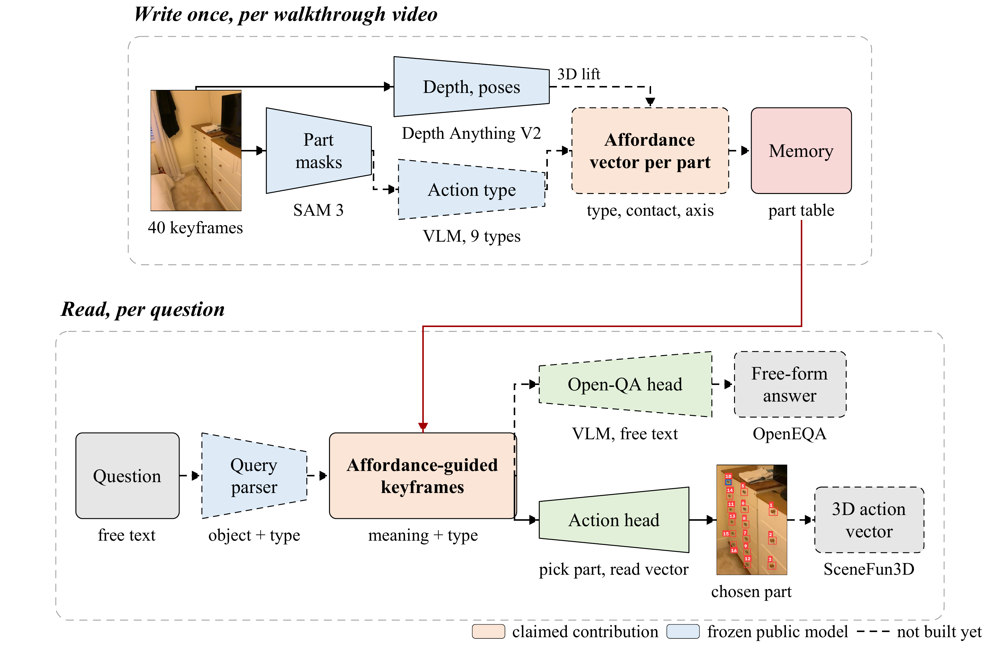
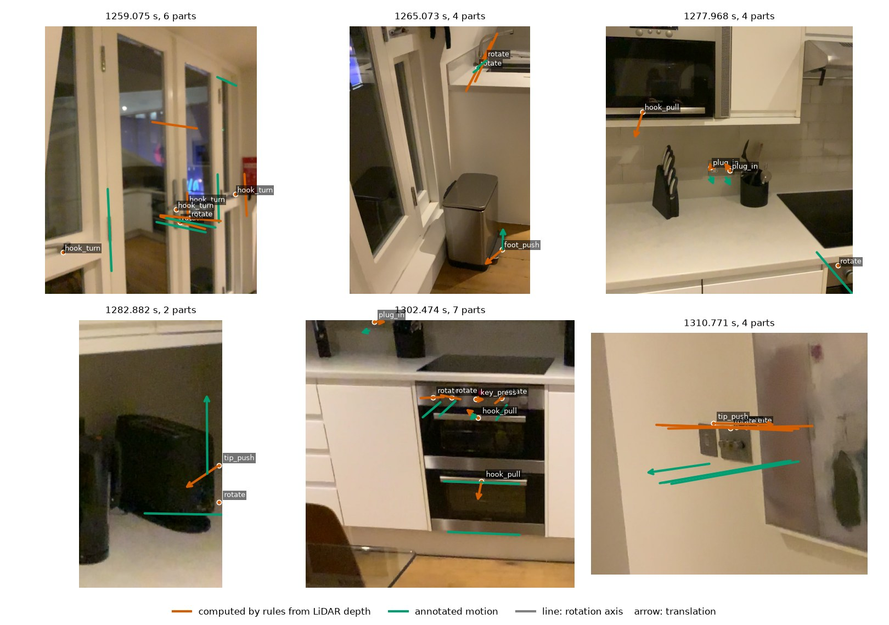
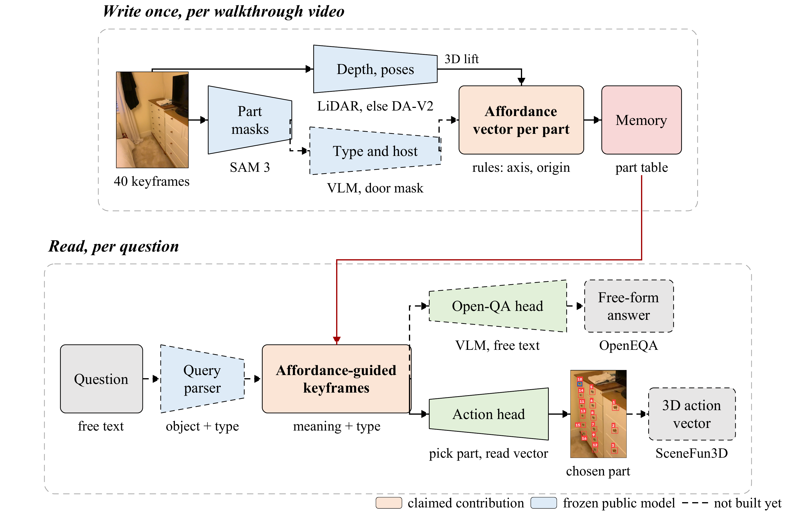
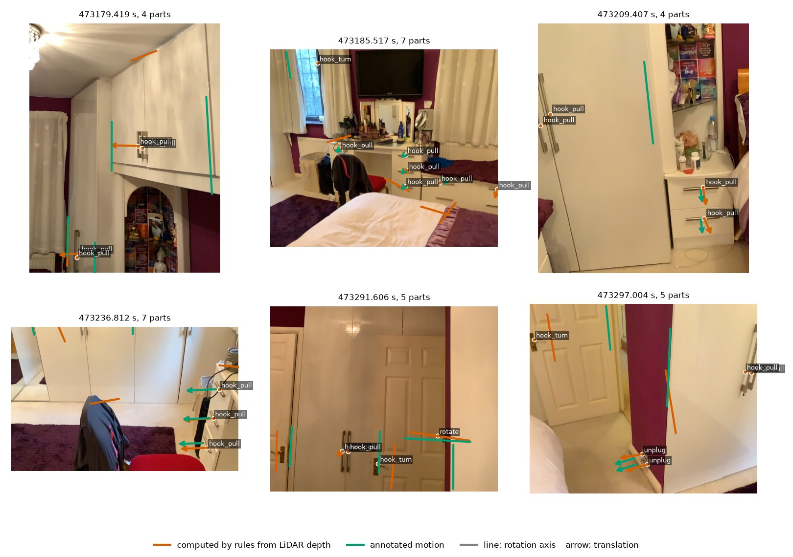
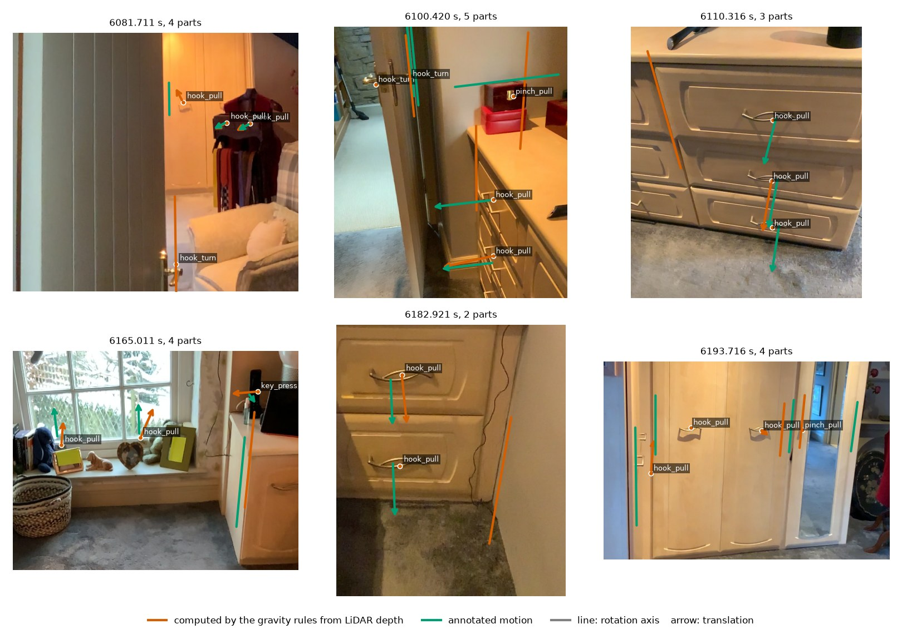

# 新 pipeline：差异留存、相关工作、推荐方案（2026-11-18）

> **状态：提议。** 这里没有做任何决定，也没有开始跑任何东西、改任何代码。需要你决定的事在第 5 节，聊天里也会逐条列出。
>
> **更新（2026-11-18 下午）：** 项目负责人答复"1 b，2 a，3 b，4 a"，见第 5 节。服务器连不上，S0 改在本机跑（场景 421069，只用 CPU），结果和"主旨核对"在第 7 节，第 7 节末尾有新的待决定事项。
>
> **更新（2026-11-19）：** 项目负责人答复"1 c，2 b"。本机先做了 S0b：同样的检验换 3 个验证场景，并诊断了门窗错在哪一步。结果、主旨核对和新的待决定事项在第 8 节。
>
> **更新（2026-11-19 晚）：** 项目负责人答复"1 b，2 b"。服务器恢复了，第 7、8 节的代码和文档已从服务器提交。S0c（事先定好的门轴规则，换 3 个没用过的验证场景检验）在第 9 节，在服务器上跑：四条预测都成立，其中两条刚好过线。按事先定的采用规则，第 4 节的推荐 pipeline 改了 5 处（见 9.6）。
>
> **更新（2026-11-20）：** 项目负责人给了另一个 pipeline（VLA 方向）里的 affordance map 设计，问这边能不能借鉴。看过以后借了几条，第 4 节略改，见第 10 节。9.8 的两条决定还在等答复。
>
> **更新（2026-11-20 晚）：** 讨论稿 27.2 的公开评测跑完了（Task 2，445 条任务）：用 SAM 3 的部件图时，明显落后于 UniFunc3D 8B；用标注的部件图时分不出高低。按事先写定的读法要停下来讨论，见第 11 节。第 2 周的汇报 notebook 是 `report/week2_2026-11-16_to_11-22.ipynb`。
>
> **依据：** 项目负责人 2026-11-18 在聊天里的要求（原话）："如果是新的pipeline的话，帮我首先留存一下这个的差异性，然后帮我做一下相似的literature review并将title和teaser figure记录在同一个文件中，这样我能够直观地看到其他的pipeline到底是怎么做的，然后再给我一个你推荐的pipeline内容，使用/cvpr-figure的skills给我你推荐的pipeline的图像放在最后"
>
> **图片说明：** 第 2 节的 teaser 图直接链接到 arXiv 或论文主页，没有存进仓库，因为版权属于原作者，而这个仓库是公开的。所以要联网才能显示。每个链接都检查过能打开（HTTP 200，内容是图片）。

---

## 0. 一页速览

**这份文档做了三件事：**
1. 把这次逐块过 pipeline 时发现的"你的理解 / 你的预期"和"代码实际做的"之间的差别，存一份快照（第 1 节）。
2. 看了 29 篇相关工作，每篇给出标题、teaser 图和"他们的 pipeline 怎么做"（第 2 节），然后总结看到了什么（第 3 节）。
3. 给出我推荐的 pipeline（第 4 节），图放在最后（第 6 节）。

**从文献里看到的三件事：**
- **没有人同时做到下面这四点：** 从走动视频出发、不训练、给每个部件一个三维的动作向量（动作类型、接触点、运动方向或转轴、原点），并且写一次记忆、同时服务开放式问答和动作输出。每一点单独都有人做过，组合起来是空位。这正好对应你想立住的"affordance map"。
- **"动作向量"可以用现成模型加规则算出来，而且有成熟做法可借。** 例如 RAM 把二维方向对到三维法线上；REACT3D 用部件的包围盒定出转轴和原点；PAWS 让几何先给出几个候选轴，VLM 只负责选。
- **开放式问答的公认打分方式是 OpenEQA**，用大模型给自由回答打分。它有"功能推理""物体状态"两类问题，是 affordance 记忆最可能占优的地方。另外有一个值得注意的结果：把记忆整理成纯文字交给模型，分数反而比完全不看要低；给模型看挑出来的关键帧效果最好。

**我推荐的 pipeline，一句话：** 每段视频写一次，给每个部件存一条**可解释的三维 affordance 向量**（动作类型、接触点、方向或转轴、原点，都在世界坐标里），再用它来挑关键帧；读取时两个"头"读同一份记忆：**问答头**给自由文字回答，**动作头**给出三维动作向量。全部用现成模型加规则，不训练。

**最大的风险：**
- 你预期的第二点（用动作类型帮忙挑关键帧），我们在单个房间里测过，只多约 3.8 个点。所以它要作为一项检验来做，不能默认它成立。
- 部件检测（SAM 3）会漏掉约四分之一的部件，后面的向量再好也救不回来。

---

## 1. 差异留存（快照）

活的记录在 [`理解差异记录.md`](理解差异记录.md)，统一审核时以那份为准。这里是 2026-11-18 的快照。

### 1.1 你的理解和代码实际做的（6 条）

| # | 你的理解 | 代码实际做的 |
| --- | --- | --- |
| 1 | 用"同类部件（例如把手）的 affordance map 彼此相似"来反向找关键帧 | 关键帧得分 = 整帧语义分 + 最像问题的那个部件框的分。部件框的分是"问题文字"和"框周围裁出的小图"的相似度；**不用动作类别**，也不用"同类部件彼此相似" |
| 2 | affordance map 现在是"动作分类" | 现在是 SAM 3 按 **8 个部件名**框出的部件框，分的是部件，不是动作；检索时连部件类名也不用 |
| 3 | 关键帧和问题的向量"做 loss"来对应 | **不训练，没有 loss**。现成的 SigLIP 2 直接算相似度，排序后取前 3 张 |
| 4 | Qwen 的回答是开放式问答 | 是**选择题**：在编号框里选一个号 |
| 5 | 因为有 Depth Anything，能回答三维动作信息，并和 SceneFun3D 比 | 和 SceneFun3D 比的是 **Task 2（部件在扫描上的位置）**，不是动作。动作（Task 3）属于方向 C，**已搁置** |
| 6 | 能和传统问答（物体检索等）比 | 现在**所有比较都在 SceneFun3D 上**；HD-EPIC 问答（方向 B）已暂停 |

### 1.2 你的预期（E1–E4）和追问的回答

| # | 预期 | 现在的做法 |
| --- | --- | --- |
| E1 | affordance map 是论文要立住的部分。它是**可解释的向量**，以后接机器人也方便 | 部件图是现成的 SAM 3 部件框，不算贡献 |
| E2 | 用 affordance 向量帮忙挑关键帧 | 挑关键帧不用动作类别 |
| E3 | affordance 向量和深度一起算出动作向量 | 方向 C 用"深度法线 + 按类别的规则"，类别来自标注；方向 C 已搁置 |
| E4 | 两个头：一个接大模型做**真正的开放式问答**，一个**输出动作向量**回答任务 | 读图是选择题；没有开放式问答的评测 |

**追问的回答（原话）：** "1 是前者，可解释的量。如果可以的话我希望是那种实际三维的vector，这样能够直接通过坐标系转换给到后续的robotics领域，这个作为bonus吧暂时不强求；2 先用现成模型加规则"

所以：
- 向量的每一维都是能看懂的量。最好直接在三维坐标里，这是加分项，暂不强求。
- 两个头先用现成模型加规则拼出来，不训练。

---

## 2. 相关工作：别人的 pipeline 怎么做

按和你四个预期的关系分成四组：

| 组 | 主题 | 关系最近的预期 |
| --- | --- | --- |
| 2.1 | SceneFun3D 这一族（同一个评测，我们要对比的对手） | E4 的动作头 |
| 2.2 | 功能场景图（"写一次"的功能记忆） | E1、E4 |
| 2.3 | 可解释的三维动作向量 | E1、E3 |
| 2.4 | 场景记忆 + 开放式问答 | E4 的问答头 |

每篇的格式都一样：标题 → teaser 图 → **怎么做**（输入 → 步骤 → 输出）→ **训练吗** → **输出什么** → **对我们有什么用**。

### 2.1 SceneFun3D 这一族（同一个评测）

#### 2.1.1 SceneFun3D: Fine-Grained Functionality and Affordance Understanding in 3D Scenes
*CVPR 2024 · 没有 arXiv 版 · [论文](https://openaccess.thecvf.com/content/CVPR2024/papers/Delitzas_SceneFun3D_Fine-Grained_Functionality_and_Affordance_Understanding_in_3D_Scenes_CVPR_2024_paper.pdf) · [主页](https://scenefun3d.github.io)*

- **是什么：** 数据集和评测。710 个场景，激光扫描加 iPad 视频；1.48 万个可操作部件，9 类 affordance 标签。
- **三个任务：**
  - Task 1：部件分割
  - Task 2：给一句任务描述，找出部件的掩码
  - Task 3：运动估计，即运动类型（转动或平移）、轴、原点
- **基线方法：** 训练的 Mask3D-F；加运动头的 Mask3D-FM；不训练的 LERF、OpenMask3D-F。
- **输出：** 扫描坐标里的点掩码，加上类型、轴、原点。没有接触点。
- **数字（测试集 85 个场景）：** Task 3 的 Mask3D-FM，AP25 26.5，+M 24.0，+MA 10.2，+MAO 8.1。"轴对"指夹角不超过 15 度，"原点对"指距离小于 0.25。
- **对我们：** E1 里"类型、轴、原点"的**定义和标准答案**都在这里，Task 3 的 +M、+MA、+MAO 可以直接拿来给动作头打分。

#### 2.1.2 Fun3DU: Functionality understanding and segmentation in 3D scenes
*CVPR 2025 Highlight · [arXiv 2411.16310](https://arxiv.org/abs/2411.16310)*

- **怎么做：**
  1. LLaMA-3.1 读任务，说出要找的部件（比如把手）和它所在的物体（比如柜子）
  2. 在约 1800 张视图里找到这个物体；按"物体是否清楚、是否居中"的规则给视图打分，留前 50 张
  3. Molmo 在每张图上指出部件，SAM 分割出来
  4. 多视角投票，投回点云
- **训练吗：** 不训练，全是现成模型加规则。
- **输出：** 点云上的掩码。没有运动。
- **数字（split0，即我们用的 30 个验证场景）：** AP25 33.3 / AP50 16.9 / mIoU 15.2
- **对我们：** 最基本的"不训练"模板。它挑视图的规则看的是**物体**清不清楚，不是 affordance 本身，这正是 E2 可以不同的地方。

#### 2.1.3 UniFunc3D: Unified Active Spatial-Temporal Grounding for 3D Affordance Segmentation
*NeurIPS 2026 · [arXiv 2603.23478](https://arxiv.org/abs/2603.23478)*

- **怎么做：**
  1. 粗看：Qwen3-VL 看 64 张低分辨率帧，给出物体名、最好的帧和二维点
  2. 细看：在候选帧附近用原分辨率重新指点
  3. SAM 3 出掩码，同一个模型再检查一遍对不对
  4. 用 Fun3DU 的方法多视角投票投回点云
- **训练吗：** 不训练。
- **输出：** 点云掩码。没有运动。
- **数字（split0）：** 8B 版 AP25 44.04 / mIoU 20.92；30B 版 51.01 / 24.30。
- **对我们：** SceneFun3D 上不训练方法里最强的。§27 的对齐就是对着它的 8B 版做的。它让大模型直接挑帧，是 E2 要打败的基线。

#### 2.1.4 AffordBot: 3D Fine-grained Embodied Reasoning via Multimodal Large Language Models
*NeurIPS 2025 · [arXiv 2511.10017](https://arxiv.org/abs/2511.10017)*

- **怎么做：**
  1. 训练过的 Mask3D 在点云上提出候选部件，每个带中心、大小、affordance 类型
  2. 从场景中心渲染 360 度视图，画上带编号和类型的框
  3. Qwen2.5-VL-72B 选视角、选编号，再判断运动类型和方向。方向只有 6 类：水平或竖直，平移时往里或往外
- **训练吗：** 分割器训练过，大模型不训练。
- **输出：** 掩码 + 运动类型 + 粗的方向类别。没有原点，没有接触点。
- **数字（验证集 30 个场景）：** AP25 23.3 / mIoU 14.0；AP25+类型 18.3；AP25+类型+方向 10.8。
  - 别人的论文引用的是另一套数字（20.91 / 24.76 / 14.42）。
  - 它的表把 Fun3DU 在 split1 上的数字放在一起比。
- **对我们：** 输出格式离 E1、E4 最近：大模型选编号，然后给运动。但方向只是 6 类粗分类，不是三维向量，而且要训练分割器。

#### 2.1.5 AffordMem: Grounding by Remembering: Cross-Scene and In-Scene Memory for 3D Functional Affordances
*arXiv 2026 · [arXiv 2605.11616](https://arxiv.org/abs/2605.11616)*

 

- **怎么做：**
  1. Qwen3-VL-32B 把问题拆成：物体、部件、空间限定词
  2. "跨场景记忆"：每一类部件存 20 张**别的场景**里画好标准答案区域的帧，当作示例给模型看。模型给出正、负框，SAM 3 分割
  3. 投票和聚类，得到三维候选
  4. "场景内记忆"：一个 JSON 图，存中心、包围盒、"属于"关系，再加俯视图和裁图。大模型返回一个节点编号
- **训练吗：** 不微调，但记忆里用了其他场景的标准答案。
- **输出：** 掩码。节点带世界坐标的中心和包围盒。没有运动。
- **数字（split0）：** AP25 41.66 / mIoU 17.32
- **对我们：**
  - "JSON 场景图 + 大模型选编号"就是 E4 动作头的样子。
  - 名字里也有"memory"，写论文时要和它分清楚。

#### 2.1.6 T-FunS3D: Task-Driven Hierarchical Open-Vocabulary 3D Functionality Segmentation
*arXiv 2026 · [arXiv 2606.05975](https://arxiv.org/abs/2606.05975)*

- **怎么做：**
  1. 每个场景做一次：Mask3D 分出物体，取最好的 5 张视图，算 FG-CLIP 特征，建成场景图
  2. 每个问题：Qwen3-14B 拆出物体、部件、关系 → 用 FG-CLIP 相似度选节点 → Molmo 在这个节点存好的视图上指点 → SAM → 投回点云
- **训练吗：** 不训练。
- **输出：** 点云掩码。没有运动。
- **数字（30 个场景、445 条任务）：** AP25 34.5 / mIoU 15.7；每个问题 78 秒，Fun3DU 是 167 秒（A40 显卡）。
- **对我们：** 也是"写一次、问多次"，这是之前审稿就提到的同类工作。

### 2.2 功能场景图（"写一次"的功能记忆）

#### 2.2.1 OpenFunGraph: Open-Vocabulary Functional 3D Scene Graphs for Real-World Indoor Spaces
*CVPR 2025 · [arXiv 2503.19199](https://arxiv.org/abs/2503.19199)*

- **怎么做：**
  1. RAM++ 给物体打标签；GPT-4 列出每类物体可能有的部件（比如"门. 把手"）；GroundingDINO 检测
  2. 多视角融合成三维节点
  3. LLaVA 给裁图写描述，GPT-4 汇总
  4. 大模型推断"功能关系"，比如"开关控制吊灯"，并给出置信度
- **训练吗：** 不训练。
- **输出：** 节点（三维点和包围盒、文字描述），加上带置信度的关系边。没有运动。
- **问答：** 把图转成 JSON 交给大模型，回答"怎么打开吊灯"这类问题，答案带部件的位置。但只有演示，没有打分。
- **数字：** SceneFun3D 上，节点 R@3 73.0，三元组 R@5 60.4。
- **对我们：** **和 E4 问答头最像的现有工作。** 它缺的正是每个部件的动作向量。

#### 2.2.2 Functional-SLAM: Interaction-Aware Mapping with Online Functional Scene Graphs
*arXiv 2026 年 9 月 · [arXiv 2609.07497](https://arxiv.org/abs/2609.07497)。代码仓库名带 "CoRL_2026"，论文页没写会议，所以会议未核实*

- **怎么做：**
  1. 只用 RGB 视频，MASt3R-SLAM 给出位姿、关键帧、点图
  2. RAM++ 打标签 → DeepSeek 挑出功能部件 → SAM 3 分割 → 投到三维
  3. 每个节点挂在一张"观察最好的"关键帧上；跨帧匹配；证据够了才确定关系边
- **训练吗：** 不训练。
- **输出：** 在线的物体、部件、关系图（SLAM 坐标）。没有运动轴。
- **数字：** SceneFun3D 上节点 R@3 25.39；FunGraph3D 上 64.55。
- **对我们：** 第 9 轮审稿找到的就是它。它说明"从视频在线建部件图"已经有人做了，我们不能只靠"建图"立论，要靠**动作向量和两个头**。

#### 2.2.3 ArtiSG: Functional 3D Scene Graph Construction via Human-demonstrated Articulated Objects Manipulation
*arXiv 2025/2026 · [arXiv 2512.24845](https://arxiv.org/abs/2512.24845)*

- **怎么做：**
  1. 扫描后先分出物体，Grounding DINO + SAM 找把手、旋钮，投到三维，并存 SigLIP 2 特征
  2. 人拿一个带标记球的手持夹爪真的去开门、开抽屉，用头戴相机跟踪夹爪尖的轨迹
  3. 用轨迹拟合出转轴的中心和方向
  4. 把结果挂到最近的部件节点上
- **训练吗：** 不训练，但需要专门的硬件。
- **输出：** 每个部件的类型、轴（中心和方向）、演示轨迹、接触点，都在世界坐标里。用语言查到节点后，机器人重放轨迹。
- **对我们：** **它的节点格式和我们想要的部件记录几乎一样**（E1）。区别是它的轴靠人去操作得到，我们要靠规则从静态观察里算。

#### 2.2.4 ChronoGraph: Functional 4D Scene Graphs with Vision-Language Models for Interaction Understanding and Grounded Planning
*arXiv 2026 · [arXiv 2609.39665](https://arxiv.org/abs/2609.39665)*

- **怎么做：**
  1. 图里有物体节点和 affordance 部件节点（带状态、三维中心）；操作一个部件，图就从一个时刻变到下一个时刻
  2. 用 GPT 加 SAM 3、Depth Anything 等工具做数据，人工核对，生成 1.5 万道题
  3. 训练 Qwen3.5（4B/9B）：先写出图的变化，再写证据，最后给答案
- **训练吗：** 训练（监督微调 + 强化学习）。
- **输出：** 四选一的答案 + 二维或三维点。
- **对我们：** affordance 部件、动作带来的状态变化、三维点都是它的核心，和我们最近。但它要训练，是选择题，也不是"写一次的记忆"。

### 2.3 可解释的三维动作向量

这一组分两类：
- **(a)** 输出"接触点 + 运动方向"
- **(b)** 输出"铰链或滑轨的轴 + 原点"

#### (a) 接触点 + 运动方向

#### 2.3.1 VRB: Affordances from Human Videos as a Versatile Representation for Robotics
*CVPR 2023 · [arXiv 2304.08488](https://arxiv.org/abs/2304.08488)*

- **怎么做：**
  1. 从人的厨房视频里自动提取"手第一次碰到哪里"和"碰到之后手往哪里走"
  2. 训练网络预测接触点热图和之后的轨迹
  3. 在机器人上用深度相机把这两样投到三维，机器人抓接触点，沿轨迹动
- **训练吗：** 训练（标签从视频里自动提取）。
- **输出：** 接触点 + 接触后的方向，先在图像上，再用深度投到机器人坐标。
- **对我们：** "接触点 + 方向"是**最小的、有用的动作向量**（E1）；"用深度把它投到三维"就是 E3。

#### 2.3.2 Robo-ABC: Affordance Generalization Beyond Categories via Semantic Correspondence for Robot Manipulation
*ECCV 2024 · [arXiv 2401.07487](https://arxiv.org/abs/2401.07487)*

- **怎么做：**
  1. 从人的视频建一个记忆，存物体裁图和接触点
  2. 遇到新物体：先用 CLIP 找最像的记忆条目
  3. 用扩散模型的特征对应，把接触点"搬"到新物体上
  4. 用深度投到三维，选最近的抓取姿态
- **训练吗：** 不训练。
- **输出：** 三维接触点 + 抓取姿态。没有方向。
- **对我们：** 用"部件裁图"当记忆的钥匙来检索，不训练就能得到每个部件的接触点。

#### 2.3.3 RAM: Retrieval-Based Affordance Transfer for Generalizable Zero-Shot Robotic Manipulation
*CoRL 2024 · [arXiv 2407.04689](https://arxiv.org/abs/2407.04689)*

- **怎么做：**
  1. 从机器人数据、人手数据、人工点击建一个"affordance 记忆"
  2. 分层检索：先按任务文字，再按物体图像，最后按视角
  3. 用特征对应把示例的接触点和轨迹搬过来，拟合出二维接触点和方向
  4. **用深度把接触点投到三维；对局部点云的法线聚类，选二维投影和二维方向最一致的那个法线，作为三维方向**
- **训练吗：** 不训练。
- **输出：** 三维接触点 + 三维方向（相机坐标，再换到机器人坐标）。
- **对我们：** 第 4 步几乎可以原样拿来做 E3：二维方向 → 三维方向。它也有"记忆 + 检索"的结构。

#### 2.3.4 MOKA: Open-World Robotic Manipulation through Mark-Based Visual Prompting
*RSS 2024 · [arXiv 2403.03174](https://arxiv.org/abs/2403.03174)*

- **怎么做：**
  1. GPT-4V 先拆子任务，说出物体和运动描述（比如"从左到右"）
  2. GroundedSAM 出物体掩码；在掩码轮廓上取编号的候选点，空中铺 5×5 网格
  3. GPT-4V 从编号里选抓取点、作用点、目标点和接触前后的格子
  4. 用深度投到机器人坐标
- **训练吗：** 不训练。
- **输出：** 几个关键点 + 路径点 + 一个从固定列表里选的朝向（机器人坐标）。
- **对我们：** "画编号让 VLM 做选择题"，和我们现在读图的方式一样。它说明这种方式也能用来得到**动作**，不只是"哪个部件"。

#### 2.3.5 CoPa: General Robotic Manipulation through Spatial Constraints of Parts with Foundation Models
*IROS 2024 · [arXiv 2403.08248](https://arxiv.org/abs/2403.08248)*

- **怎么做：**
  1. 从点云得到抓取候选
  2. GPT-4V 由粗到细找到物体，再找到部件
  3. 把部件建模成"向量"（细长部件）或"平面 + 法线"，画在图上
  4. GPT-4V 写出约束（比如"共线""朝下"），求解器算出位姿
- **训练吗：** 不训练。
- **输出：** 抓取位姿 + 之后的一串位姿（机器人坐标）。
- **对我们：** 把部件表示成"向量或平面 + 法线"这类几何体，本身就是可解释的 affordance 向量。

#### (b) 铰链或滑轨的轴 + 原点

#### 2.3.6 OPDMulti: Openable Part Detection for Multiple Objects
*3DV 2024 · [arXiv 2303.14087](https://arxiv.org/abs/2303.14087)。前作 OPD 是 ECCV 2022（[arXiv 2203.16421](https://arxiv.org/abs/2203.16421)）*

- **怎么做：** 输入一张 RGB 或 RGB-D 图。Mask2Former 给出部件，每个部件有几个小头，分别预测掩码、类别（抽屉、门、盖子）、运动类型、轴和原点。
- **训练吗：** 训练。
- **输出：** 运动类型、三维轴方向、三维原点（相机坐标）。没有接触点。
- **数字：** +M 31.6 / +MA 19.4 / +MAO 16.0（RGB 输入）。
- **对我们：**
  - 每个部件存"类型、轴、原点"这个格式，以及 M/MA/MAO 这套打分。
  - 它有现成的预训练权重，可以当"初始猜测"，再用规则修正（REACT3D 就是这么做的）。

#### 2.3.7 REACT3D: Recovering Articulations for Interactive Physical 3D Scenes
*IEEE RA-L 2026 · [arXiv 2510.11340](https://arxiv.org/abs/2510.11340)*

- **怎么做：**
  1. 输入扫描和网格。RAM++ 打标签，LLaVA 留下能打开的东西，Grounded SAM 分割，融合到三维
  2. 用平面拟合把能动的门板分出来
  3. 预训练的 OPDMulti 给出初始的关节猜测
  4. **按部件包围盒的规则修正：**
     - 滑动轴 = 正面的法线
     - 转轴 = 最近的长边
     - 原点 = 这条边的中点
  5. 导出成可以仿真的场景文件
- **训练吗：** 不训练新东西（用预训练的 OPDMulti 加规则）。
- **输出：** 每个部件的关节类型、原点、轴、运动范围（世界坐标）。
- **数字（ScanNet++ 的 30 个场景）：** 类型准确率 91.5%，轴的方向误差 1.16 度。只覆盖门和抽屉，不含旋钮。
- **对我们：** **E3 最好的模板。** "包围盒规则"就是"affordance + 深度 → 按规则算轴"。

#### 2.3.8 PAWS: Perception of Articulation in the Wild at Scale from Egocentric Videos
*arXiv 2026 · [arXiv 2603.25539](https://arxiv.org/abs/2603.25539)*

 

- **怎么做：**
  1. 从视频里重建出手的三维轨迹
  2. 单目深度和法线；图像里的直线投到三维，作为转轴候选；法线聚类，作为滑动方向候选
  3. GPT-4o 判断运动类型，并在画了编号的候选轴里选一条
  4. 用手的轨迹定出原点；同一个部件被操作多次时可以合并
- **训练吗：** 不训练。
- **输出：** 运动类型、轴、原点（世界坐标）。
- **数字：** 在 HD-EPIC 上做过评测。
- **对我们：** "**几何给候选，VLM 只做选择**"的分工很适合我们的动作头。但它要靠视频里有人真的去操作这个部件。

#### 2.3.9 ArtiPoint: Articulated Object Estimation in the Wild
*CoRL 2025 · [arXiv 2509.01708](https://arxiv.org/abs/2509.01708)*

- **怎么做：**
  1. 从带位姿的 RGB-D 视频里，靠手的分割找到"正在操作"的片段
  2. 跟踪部件上的点
  3. 用深度把点投到三维
  4. 拟合出关节
- **训练吗：** 不训练。
- **输出：** 关节类型、轴、位置（世界坐标）。
- **对我们：** 同 PAWS，要视频里有人操作。SceneFun3D 的走动视频里没有人操作，所以只能作参考。

#### 2.3.10 FunRec: Reconstructing Functional 3D Scenes from Egocentric Interaction Videos
*CVPR 2026 · [arXiv 2604.05621](https://arxiv.org/abs/2604.05621)*

- **怎么做：**
  1. Gemini 把视频分成"静止"和"操作"两种片段，并判断关节类型
  2. 估计相机位姿、跟踪三维点、拟合轨迹，得到轴和转动中心
  3. 生成可以仿真的数字孪生
- **训练吗：** 不训练。
- **输出：** 轴、转动中心、每一帧的关节状态（世界坐标）。
- **对我们：** 同样要视频里有人操作，只作参考。

### 2.4 场景记忆 + 开放式问答

#### 2.4.1 OpenEQA: Embodied Question Answering in the Era of Foundation Models
*CVPR 2024 · 没有 arXiv 版 · [论文](https://openaccess.thecvf.com/content/CVPR2024/papers/Majumdar_OpenEQA_Embodied_Question_Answering_in_the_Era_of_Foundation_Models_CVPR_2024_paper.pdf) · [主页](https://open-eqa.github.io)。论文的图 1 在 PDF 第 1 页；下面两张取自主页，分别是题目类别和评测流程*

- **是什么：** 开放式问答的评测，1600 多道人工写的题。场景来自 ScanNet 和 HM3D 的走动录像，带 RGB-D 和位姿。
- **7 类题：** 物体识别、属性识别、**物体状态**（比如"微波炉门开着吗"）、物体定位、空间推理、**功能推理**（比如"钥匙可以放在哪"）、常识。
- **怎么打分（LLM-Match）：** GPT-4 拿模型的自由回答和人写的答案比，给 1 到 5 分，换算成 0 到 100。
- **基线（EM-EQA，全部场景）：**
  - GPT-4V 49.6（在一个子集上）
  - 看 LLaVA 描述的 GPT-4：43.6
  - 读 ConceptGraphs 文字的 GPT-4：36.5
  - 什么都不看的 GPT-4：33.5
  - 人：86.8
- **对我们：** **问答头最公认的打分方式。** "功能推理"和"物体状态"两类是 affordance 记忆应该占优的地方。不同论文用的打分模型不一样，比较时要写明。

#### 2.4.2 3D-Mem: 3D Scene Memory for Embodied Exploration and Reasoning
*CVPR 2025 · [arXiv 2411.17735](https://arxiv.org/abs/2411.17735)*

- **怎么做：**
  1. 写入：从 RGB-D 和位姿检测物体，记下类别和三维位置；按"哪些物体能同时被看到"聚类，留下最少的一组真实帧（叫"记忆快照"），覆盖所有物体
  2. 检索：VLM 看问题和所有物体类别，挑出相关的几类，只保留含这些类别的快照
  3. 回答：GPT-4o 看保留下来的快照，给出回答
- **训练吗：** 问答部分不训练。
- **输出：** 自由回答，用 LLM-Match 打分。
- **数字：** OpenEQA EM-EQA 57.2，平均只用约 3.1 张帧。
- **对我们：** "记忆是一个指向少数证据关键帧的索引"，和我们挑 3 张关键帧是同一个思路。区别在于：它按**物体类别**预筛，我们想按 **affordance** 预筛（E2）。

#### 2.4.3 SpatialMem: Metric-Aligned Long-Horizon Video Memory for Language Grounding and QA
*arXiv 2026 · [arXiv 2601.14895](https://arxiv.org/abs/2601.14895)*

- **怎么做：**
  1. 只用 RGB，得到位姿和深度，并对齐到真实尺度
  2. 墙、门、窗作为第一层锚点
  3. 物体存成三维框和裁图，带两层描述，组织成一棵树
  4. 问答时，问题里的实体对到存好的证据帧（8 张），GPT-4o 看着这些帧回答
- **训练吗：** 不训练。
- **数字（OpenEQA EM-EQA 的 ScanNet 部分）：**
  - 检索证据帧：**62.0**
  - 均匀取帧：61.6
  - **把记忆写成纯文字：35.1**，比什么都不看的对照（44.5）还低
- **对我们：** **问答头的设计依据**：要给模型看挑出来的关键帧和简短的部件记录，不能只给一大段文字。

#### 2.4.4 ConceptGraphs: Open-Vocabulary 3D Scene Graphs for Perception and Planning
*ICRA 2024 · [arXiv 2309.16650](https://arxiv.org/abs/2309.16650)*

- **怎么做：**
  1. SAM 掩码加 CLIP/DINO 特征，多视角融合成三维物体
  2. LLaVA 描述，GPT-4 汇总
  3. 物体之间连边
  4. 问题来了，每个物体变成一条 JSON，GPT-4 选出最相关的那个
- **训练吗：** 不训练。
- **输出：** 一个物体编号。在 OpenEQA 上作为基线时是自由回答。
- **数字：** OpenEQA EM-EQA 36.5。
- **对我们：** "每个节点一条 JSON"是最简单的接口，但光给文字不够，要加证据图。

#### 2.4.5 Embodied VideoAgent: Persistent Memory from Egocentric Videos and Embodied Sensors Enables Dynamic Scene Understanding
*ICCV 2025 · [arXiv 2501.00358](https://arxiv.org/abs/2501.00358)*

- **怎么做：**
  1. 检测物体，用深度和位姿投到三维；每个物体存编号、**状态**、关系、三维框和特征
  2. 从动作描述里解析出"对哪个物体做了什么"，更新状态，并记进动作日志
  3. GPT-4o 通过几个工具查记忆，然后回答
- **训练吗：** 不训练。
- **输出：** 自由回答，用 LLM-Match 打分。
- **数字：** OpenEQA EM-EQA 47.0（在五分之一的子集上）。
- **对我们：** "可变的状态字段 + 动作日志 + 小工具接口"可以直接对到部件级的 affordance 记录上。

#### 2.4.6 VL-KnG: Spatiotemporal Knowledge Graphs as Persistent Scene Memory for Embodied Question Answering
*arXiv 2025/2026 · [arXiv 2510.01483](https://arxiv.org/abs/2510.01483)*

- **怎么做：**
  1. 视频切成 8 帧一段，Gemini 抽出每个物体的帧、框、颜色、材质、大小和 **affordance**（一段文字）
  2. 合并成跨时间的统一编号，存 SigLIP 2 特征
  3. 问题来了，先检索子图，再做视觉搜索，最后 Gemini 回答，并返回证据帧
- **训练吗：** 不训练。
- **数字：** OpenEQA EM-EQA 55.2（打分模型是 GPT-4 Turbo，和别人的不同）。
- **对我们：** 节点上已经有 affordance，但只是一段自由文字，不是可解释的三维向量。这正是我们可以不同的地方。

#### 2.4.7 ReMEmbR: Building and Reasoning Over Long-Horizon Spatio-Temporal Memory for Robot Navigation
*ICRA 2025 · [arXiv 2409.13682](https://arxiv.org/abs/2409.13682)*

- **怎么做：**
  1. 每约 3 秒的视频写一段描述，连同位置和时间存进向量库
  2. 大模型分几轮调用检索（按文字、位置或时间），直到觉得能回答
  3. 输出 JSON：文字、位置、时间或时长
- **训练吗：** 不训练。
- **对我们：** "答案是**有类型的 JSON**（文字或三维点）"，一个格式就能同时服务两个头。

#### 2.4.8 HD-EPIC: A Highly-Detailed Egocentric Video Dataset
*CVPR 2025 · [arXiv 2502.04144](https://arxiv.org/abs/2502.04144)*

- **是什么：** 41 小时厨房视频，有 413 个标好的固定设施（柜门、抽屉等）。动作描述和设施对应，比如"开抽屉"会更新那个抽屉的状态。用模板生成了 2.6 万道题。
- **答案形式：** **五选一**，按准确率打分。
- **数字：** Gemini Pro 平均 37.6%，人 90.3%。
- **对我们：** 题目里有"对哪个设施做了什么"，和动作相关。但它是选择题，**没法给自由回答打分**，所以不适合问答头。这也是方向 B 原来要用的数据。

### 2.5 横向对比

✓ = 有；～ = 部分有；✗ = 没有

| 工作 | 输入 | 不训练 | 写一次的记忆 | 三维动作向量（类型/接触点/轴/原点） | 开放式问答 | 关键数字 |
| --- | --- | --- | --- | --- | --- | --- |
| SceneFun3D 基线 | 扫描 + 视频 | 多数训练 | ✗ | ✓ 类型/轴/原点（Mask3D-FM） | ✗ | Task 3 +MAO 8.1（测试集） |
| Fun3DU | 点云 + 视频 | ✓ | ✗ | ✗ | ✗ | split0 AP25 33.3 |
| UniFunc3D | 点云 + 视频 | ✓ | ✗ | ✗ | ✗ | split0 AP25 44.0（8B）/ 51.0（30B） |
| AffordBot | 点云 | 分割器训练 | ✗ | ～ 类型 + 6 类粗方向 | ✗（选编号） | AP25 23.3，+类型+方向 10.8 |
| AffordMem | 视频 | ✓（用了别的场景的标注） | ～ 场景内 JSON 图 | ✗ | ✗（选编号） | split0 AP25 41.7 |
| T-FunS3D | 点云 + 视频 | ✓ | ✓ 场景图 | ✗ | ✗ | AP25 34.5 |
| OpenFunGraph | 视频 | ✓ | ✓ 功能场景图 | ✗ | ～ 演示 | 三元组 R@5 60.4 |
| Functional-SLAM | RGB 视频 | ✓ | ✓ 在线图 | ✗ | ✗ | 节点 R@3 25.4 |
| ArtiSG | 扫描 + 人的演示 | ✓（要硬件） | ✓ 场景图 | ✓ 类型/轴/接触点/轨迹 | ✗ | 转轴误差 1.6 度 |
| ChronoGraph | 视频 | ✗ 训练 | ～ | ～ 部件三维点 + 状态 | ✗（四选一） | 75.2% |
| RAM | 单张 RGB-D | ✓ | ✓ 示例记忆 | ✓ 接触点 + 方向 | ✗ | 仿真成功率 52.6% |
| REACT3D | 扫描 + 网格 | ✓（加预训练 OPDMulti） | ～ | ✓ 类型/轴/原点（只有门和抽屉） | ✗ | 类型 91.5%，轴 1.16 度 |
| PAWS | 有人操作的视频 | ✓ | ～ | ✓ 类型/轴/原点 | ✗ | HD-EPIC M/MA/MAO |
| 3D-Mem | RGB-D 探索 | ✓ | ✓ 快照 | ✗ | ✓ | OpenEQA 57.2 |
| SpatialMem | RGB 视频 | ✓ | ✓ 树 | ✗ | ✓ | OpenEQA（ScanNet）62.0 |
| VL-KnG | 视频 | ✓ | ✓ 知识图 | ～ affordance 文字 | ✓ | OpenEQA 55.2 |
| Embodied VideoAgent | 视频 + 传感器 | ✓ | ✓ 状态 + 动作日志 | ～ 状态 | ✓ | OpenEQA 47.0（子集） |
| **推荐的方案** | 走动视频 + 位姿 | ✓ | ✓ 部件表 | ✓ 类型/接触点/轴/原点（世界坐标） | ✓ | 待测 |

---

## 3. 从文献里看到的

1. **空位在"组合"上，不在单个零件上。** 上表里没有一行四项全有：不训练、写一次、可解释的三维动作向量、开放式问答。离得最近的几个，各缺一块：
   - OpenFunGraph：有图、有问答演示，没有运动
   - AffordBot：有运动，但方向只有 6 类，要训练分割器，也不是记忆
   - REACT3D：有轴和原点，但要扫描和网格，只有门和抽屉，没有问答
   - ArtiSG：节点格式最像，但要人拿专门设备去演示
   - ChronoGraph：要训练，是选择题

   这和你说的 application 类型一致：创新在"构建和整合"，不是新算法。

2. **动作向量可以用"现成模型 + 规则"算出来。** 四种可借的做法：
   - RAM：二维方向 → 对上三维法线
   - REACT3D：用包围盒定出轴和原点
   - PAWS：几何给候选，VLM 只做选择
   - MOKA：画编号让 VLM 选

   我们方向 C 的几何规则（按类型：沿法线往里或往外、旋钮轴等于法线、门把手轴取竖直）是同一类，只是更粗。

3. **问答头的打分用 OpenEQA**（自由回答，LLM-Match）。有三点要注意：
   - 要固定打分模型，不同论文用的不一样
   - 场景是 ScanNet 和 HM3D，不是 SceneFun3D，所以要另外下载数据。ScanNet 要签使用条款
   - SpatialMem 的结果说明：要给模型**看证据帧**，不能只给文字

4. **动作头的打分用 SceneFun3D Task 3 的定义**：在 AP25 之上，再要求运动类型对、轴的夹角在 15 度内、原点距离小于 0.25。
   - 官方打分代码还没公开，要按论文定义自己实现
   - C-0 发现标注里"往里"的正负号不统一，所以先只比轴所在的直线，不分正反

5. **E2（用动作类型挑关键帧）没有现成证据支持。** 文献里挑帧靠的都是物体或语义（Fun3DU、UniFunc3D、3D-Mem）。我们自己第 10 轮测过：单个房间里即使给正确的动作类型，也只多约 3.8 个点。所以 E2 要作为一项检验来做。最可能看出差别的地方，是"同一个房间里同类部件很多"的问题，比如一排抽屉里的某一个。

---

## 4. 推荐的 pipeline

> **2026-11-19 修改：** 按 7.7、8.5 的建议和第 9 节 S0c 的结果（你的决定 2(b)），改了 4.2 的"动作类型""方向或转轴""原点"三行、4.3 的 W3、W4、W5 和 4.8 第 3 条。改了什么、依据是什么，见 9.6。
>
> **2026-11-20 修改：** 借鉴 VLA 方向的 affordance map，4.2 加了"接近方向""抓握轴""接触区域"三个字段和"解码成给机器人的计划"一段，4.4 加了问答头的反事实记忆检验，4.5 加了接触点和失败归类的指标。见第 10 节。

### 4.1 一句话

每段走动视频写一次，给每个部件存一条**可解释的三维 affordance 向量**，并用它帮忙挑关键帧。读取时两个头读同一份记忆：**问答头**给自由文字回答，**动作头**给出部件和它的三维动作向量。全部用现成模型加规则。

### 4.2 affordance 向量：每个部件存什么

都在世界坐标里（设备的 ARKit 坐标，竖直方向已知）。接机器人时只要乘一个刚体变换，这是加分项。

| 字段 | 意思 | 怎么算（现成模型 + 规则） | 现在有没有 |
| --- | --- | --- | --- |
| 部件编号 | 同一个物理部件在多张帧里合成一条记录 | SAM 3 掩码 + 三维距离不超过 0.3 米 + 外观相似 | 原型代码有（`link_tokens`），主流程没用 |
| 动作类型和所装的东西 | 9 类 SceneFun3D 标签的概率，比如"拉 0.8、转 0.1……"；再加它装在什么上：门（铰链在哪一边）、抽屉、固定面板、烤箱门或翻盖 | 部件名先验（旋钮 → 转，按钮 → 按，插座 → 插……）+ VLM 在带编号的裁图上从 9 类里选（用 C-1 已经修好的提问格式），再问一句"它装在什么上"。**拉手是平移还是转动，由"装在什么上"定，不由标签定**：只看标签最多对 80%（8.2）；靠把手在门面上的位置猜，在抽屉多的场景里比只看标签还差（9.4） | 新（2026-11-19 改） |
| 接触点 | 手碰的那个点（x, y, z） | 掩码中心的像素 + 深度 + 位姿 | 有（`affordance3d/mem/pipeline.py` 的 `contact_and_normal`） |
| 接触区域 | 部件上能碰的一片，不只一个点 | 部件的三维点（掩码 + 深度），每个点一个分数，以接触点为中心往外递减；它同时就是 Task 2 要输出的掩码 | 点有（投到扫描上打分时用），分数新（2026-11-20 加） |
| 法线 | 接触面朝哪边 | 深度图局部拟合平面 | 有 |
| 接近方向 | 手或夹爪从哪边靠近 | 法线反过来 | 有（2026-11-20 加，只是换个名字存） |
| 抓握轴 | 手指或夹爪闭合的方向，是一条线，没有正负号 | 部件掩码在图像里的长轴，抬到部件所在的平面上，取和长轴垂直的方向；长不到宽两倍的部件（圆旋钮、小捏手）记为"任意方向"。主要对勾着拉、勾着转的把手有用（10.1） | 新（2026-11-20 加） |
| 方向或转轴 | 推拉的方向，或转轴的方向（单位向量，存成没有正负号的线；平移往里还是往外由类型定，2026-11-20 写明） | 按类型规则：按类沿法线往里；拉类沿法线往外；旋钮的轴等于法线；**门、窗、柜门的轴取设备给的重力方向（竖直）**；烤箱门、翻盖这类轴是水平的，由"装在什么上"给出 | 规则原型有（`affordance3d/mem/part_vectors.py` 的 gravity 规则）；门轴竖直在 S0c 上事先定好检验过（第 9 节） |
| 原点 | 转轴经过的点 | 旋钮：接触点。门：第一版（临时）取门面在水平方向上离把手远的那一端，只靠深度，S0c 上不比旧规则差，但只对约 1/5；第二版用 SAM 3 门板掩码，取门板上离把手最远的那条竖边（REACT3D 的规则） | 第一版有原型；第二版新，是下一步（9.8） |
| 所属物体 | 这个部件属于什么，比如"电视左边柜子的左上抽屉" | VLM 一句话描述；或用 SAM 3 分出物体 | 新 |
| 证据帧 | 看得到这个部件的关键帧和时间 | 写入时记下 | 有 |
| 语义向量 | 部件裁图的 SigLIP 2 向量（用来和文字比） | 现有 | 有 |

**能直接给机器人用（2026-11-20 加）：** 一条记录可以解码成一个动作计划：接触点、夹爪朝向（由接近方向和抓握轴定）、接近方向、事件（拉和转的部件是"抓"，按的部件是"按"），后面再接"抓住以后怎么动"（类型、轴、原点）。需要时，把记录投影到任意一帧，就得到逐像素的分数图和方向图。见 10.2。

**为什么说它可解释：** 每个字段都能直接画出来，比如在图上画接触点和箭头，或在三维里画轴。看错在哪也一目了然：是类型错了、点偏了，还是方向反了。

### 4.3 写入（每段视频一次）

| 步骤 | 做什么 | 用什么 | 状态 |
| --- | --- | --- | --- |
| W1 | 选 40 张稳定的关键帧，带位姿 | 位姿 | 有 |
| W2 | 部件掩码 | SAM 3，8 个部件名 | 有（现在只存框，改成存掩码） |
| W3 | 深度 | 有 LiDAR 时直接用 LiDAR；没有时用 Depth Anything V2 + LiDAR 校准尺度 | 有 |
| W4 | 动作类型和所装的东西 | VLM 选择题 + 部件名先验 + 问"装在什么上"；门窗再用 SAM 3 分出门板 | 新 |
| W5 | 算出 affordance 向量，写进部件表；同一个部件先只用画面最大的一帧 | 规则（4.2 的表），门轴用重力方向 | 规则原型有（S0 到 S0c），**论文贡献（橙色）** |

### 4.4 读取（每个问题一次）

| 步骤 | 做什么 | 用什么 | 状态 |
| --- | --- | --- | --- |
| R1 问题解析 | 从问题里拆出：物体、部件、想要的动作类型、空间关系词 | 现成大模型，和 Fun3DU、AffordMem、T-FunS3D 的做法一样 | 新 |
| R2 按功能挑关键帧（E2） | 关键帧得分 = 整帧语义 + 最像的部件分；部件分 = 文字对裁图的相似度 + λ × 类型匹配。另一条路是直接在部件表里按"类型 + 语义"找部件，再取它们的证据帧，也就是你说的"反向定位"。λ = 0 就是现在的版本，所以这一步自带对照 | SigLIP 2 + 部件表 | 部分有，**论文贡献（橙色）** |
| R3b 动作头 | VLM 在编号框里选部件（现在的读图）→ 从部件表读出它的向量 → 输出：扫描上的掩码（Task 2）+ 类型、轴、原点（Task 3）+ 接触点 | Qwen3-VL-8B + 部件表 | 选部件有，读向量新 |
| R3a 问答头 | VLM 看问题、挑出的关键帧（相关部件画编号框），再加每个编号一行简短记录（比如"3 号：把手，拉，往外开，在电视左边柜子的左上抽屉"）→ 自由回答 | Qwen3-VL-8B（也可以换更大的） | 新 |

问答头**给图加简短记录**，不只给文字，依据是 SpatialMem 的结果（2.4.3）。

问答头做好以后，加一项检验（2026-11-20 加）：故意改一条记忆，比如把"抽屉"改成"门"，看回答跟不跟着变。这样能确认它在用记忆，而不是绕过记忆自己猜。

### 4.5 怎么评

| 头 | 基准 | 指标 | 对手（公开数字） | 状态 |
| --- | --- | --- | --- | --- |
| 动作头：定位 | SceneFun3D split0，445 条任务，Task 2 | AP25、mIoU | UniFunc3D 8B 44.0/20.9，30B 51.0/24.3；AffordMem 41.7/17.3；T-FunS3D 34.5/15.7；Fun3DU 33.3/15.2 | §27.2 在排队 |
| 动作头：运动 | 同上，Task 3（按论文定义） | AP25 之上的 +类型、+轴、+原点（先只比轴的直线） | AffordBot AP25+类型 18.3、+方向 10.8（粗 6 类，不完全可比）；我们自己的"只看一帧的 VLM"对照（C-1 的 V 组） | 没做；官方打分代码未公开 |
| 动作头：接触和失败归类（2026-11-20 加） | 同上；先用 S0 系列的场景 | 接触点在不在标注的部件上；接触点误差，沿视线和垂直视线分开；每个部件停在哪一步（没有深度 → 接触点不在部件上 → 类型错 → 轴错 → 原点错）；抓握轴和激光扫描参考方向的夹角，取 180° 对称里较小的 | 无，是自己的诊断 | 没做（S0d，10.2） |
| 问答头 | OpenEQA EM-EQA（先做 ScanNet 部分） | LLM-Match，固定打分模型；单独报"功能推理""物体状态"两类 | 3D-Mem 57.2；VL-KnG 55.2；SpatialMem 62.0；GPT-4V 49.6 | 没做；要下载数据 |
| E2 挑帧 | SceneFun3D 内部 | 第一张关键帧对不对、最后选对部件的比例；λ 设成 0 和不为 0 各跑一次 | 现在的版本（λ = 0） | 没做 |

### 4.6 和现在相比

| | 内容 |
| --- | --- |
| **保留** | 选关键帧、SAM 3、SigLIP 2、深度和位姿、编号框读图、投到扫描上打分（§27.2） |
| **新增** | 动作类型、affordance 向量（接触点、方向或转轴、原点）、同一部件合并、问题解析、类型匹配挑帧、问答头、Task 3 打分、OpenEQA |
| **改变** | 论文中心从"按功能检索"变成"**可解释的部件级 affordance 向量记忆 + 两个头**"；部件图从"不算贡献"变成核心之一 |
| **重新打开的决定** | 第 9 轮的"乙"和 DF-4（建图算不算贡献）；第 10 轮采纳的主张；章程里的贡献描述 |

### 4.7 论文贡献在哪（图里的橙色）、证据有多强

1. **affordance 向量记忆（W5）**：
   - 现在没有证据。
   - 方向 C 的几何规则在 1 个场景、19 个任务上试跑过：联合成功 26% 到 37%，而 VLM 自己画方向是 0%。这说明"方向靠规则"可行，但样本太小。
2. **按功能挑关键帧（R2）**：
   - 部件对挑帧有用，这一点有证据：阶段 1 和 §24 里，关键帧加部件比只看整帧好。
   - "按动作类型挑帧"的证据很弱（单个房间只多约 3.8 个点）。
3. **两个头读同一份记忆**：没有证据，是设计上的主张，要靠 4.5 的两个评测来撑。

### 4.8 风险和局限

1. **部件漏检。** SAM 3 的召回是 74.8%，约四分之一的部件哪张帧都没框到，后面的向量再好也救不回来。
2. **动作类型靠 VLM，准确率不知道。** 试跑里 VLM 自己画方向几乎全错，所以方向改用规则；类型让 VLM 做 9 选 1，准不准要先测。
3. **铰链的原点难。** 要找到门板和它的铰链边，规则可能不稳。另外标注里"往里"的正负号不统一，所以先只比轴的直线。S0b、S0c 证实了：只靠深度找门面的边，原点只对 1/5 到 1/3；就算告诉它铰链在哪一边，也只有 1/3 到一半。所以第二版的门板掩码是必需的。
4. **E2 可能在单个房间里看不出好处。** 要准备好"它只在同类部件多的问题上有用"这种结果。
5. **问答头要新数据和外部打分模型。** ScanNet 要签使用条款；用 GPT-4 打分要付费，题目和答案会发到外部服务（虽然 OpenEQA 是公开数据）；如果用本地模型打分，就没法和别人的数字直接比。
6. **新颖性。** OpenFunGraph、Functional-SLAM、ArtiSG、REACT3D 各占一部分。论文要靠"组合 + 两个头 + 可解释三维向量 + 公开评测"站住；审稿可能会说"是拼装"。application 类型可以接受这一点，但要讲清楚。
7. **数字口径不一。** AffordBot 有两套数字；OpenEQA 各家用的打分模型不同。对比时都要注明。

### 4.9 如果你同意，先做什么

都是小步，先给你看图，再决定下一步。**你决定之前不开始。**

| 步 | 做什么 | 资源 | 给你看什么 |
| --- | --- | --- | --- |
| S0 | 在场景 421254 上，用已有的 SAM 3 结果和深度建部件表；在 6 张关键帧上把每个部件的向量画出来（接触点 + 箭头或轴） | 只用 CPU，可能要一次很小的 GPU 作业来给类型 | 6 张图，和之前工具检查的流程关口一样 |
| S1 | 30 个场景都给出动作类型；按论文定义写 Task 3 的打分代码，先用标准答案自测得 100 分 | GPU 不到 1 小时；打分只用 CPU | 类型准确率；打分代码自测结果 |
| S2 | 动作头在 445 条任务上跑：Task 2（来自 §27.2）+ Task 3 | 主要是 CPU | 对 UniFunc3D、AffordBot 的表 |
| S3 | 问答头在几段 OpenEQA ScanNet 录像上做演示 | 等第 5 节问题 3 的决定 | 几道题的回答 |

---

## 5. 需要你决定的事（聊天里也会列）

**项目负责人的决定（2026-11-18，聊天里，原话）：** "回答你的问题 1 b，2 a，3 b，4 a。看下你能否用本机进行一下比较小的测试，目前这个主要的任务是用尽量少的资源来确定一个合理的pipeline。并且每次给我汇报的时候记得审核我给你的main idea，看是否符合或者偏移"

- 1 b：先只做 S0，看了图再定方向；已有的决定都不改。
- 2 a：Task 3 按 SceneFun3D 论文的定义自己打分，先只比轴的直线。
- 3 b：问答头的基准先不定。
- 4 a：§27.2 的作业照常跑（服务器连不上，现在看不到进度）。
- 以后每次汇报都核对项目负责人的主旨（见 7.6）。

1. **要不要采用这个方向？**
   - (a) 现在就采用为新的主线：第 9 轮的"乙"、DF-4、第 10 轮的主张和章程都要改，我写提案 P-5
   - (b) **先只做 S0（单场景演示），看了图再定**
   - (c) 不采用，维持现在的方向

   我推荐 **(b)**：S0 只用 CPU、能很快看到"可解释的向量"到底长什么样，而且不改变任何已有的决定。

2. **Task 3 的打分：** 官方代码没公开，按 SceneFun3D 论文的定义自己实现（先只比轴的直线）？
   - (a) 同意
   - (b) 等官方代码

   我推荐 **(a)**，并在论文里写明。

3. **问答头的基准：**
   - (a) 现在就定 OpenEQA EM-EQA 的 ScanNet 部分（要签 ScanNet 使用条款、下载数据），打分用 GPT-4 系，和别人可比
   - (b) 先不定，等动作头有结果再说

   我推荐 **(b)**，先集中做动作头。

4. **§27.2（Task 2 对齐）正在排队的作业：**
   - (a) 照常跑。它就是动作头的定位部分，新方向也用得上
   - (b) 暂停

   我推荐 **(a)**。

---

## 6. 推荐 pipeline 的图

**怎么看这张图：**
- **上半部分（写入，每段视频一次）：** 关键帧 → SAM 3 部件掩码 → VLM 给动作类型；深度和位姿把每个部件放到三维 → 每个部件一条 affordance 向量（类型、接触点、轴）→ 存进记忆的部件表。
- **下半部分（读取，每个问题一次）：** 问题 → 问题解析（物体 + 动作类型）→ 按功能挑关键帧（语义 + 类型匹配）→ 分成两个头：
  - 上面是问答头，给自由回答，用 OpenEQA 打分
  - 下面是动作头，选部件、读出它的向量，给出三维动作向量，用 SceneFun3D 打分
- **颜色：** 橙色是论文要主张的部分；蓝色是直接拿来用、不训练的公开模型；绿色是两个头；红线是记忆被读取的路径。
- **虚线：** 还没做的部分（方框和箭头都是）。
- **示例图片：** 都是现在 pipeline 的真实图片：输入关键帧，以及它对"Open the top left drawer of the cabinet located to the left of the TV"选出的部件（10 号，对的）。动作头输出的三维向量还没有真实结果，所以没有画。

**英文图注（可直接用于报告）：**

> **Recommended pipeline (proposal, 2026-11-18).** Top: each walkthrough video is written once into a table of parts; SAM 3 masks each part, a vision-language model gives it one of nine action types, and depth with the device poses gives its contact point and motion direction or axis in world coordinates. Bottom: a question is parsed into an object and an action type, keyframes are ranked by meaning and type match, and two heads read the same memory: free-text answers and a 3D action vector. Orange is the claim, blue are frozen public models, dashed is not built yet.

**图的源文件：** `figures/proposal_2026-11-18/proposal.yaml`（cvpr-figure 的格式），另有 svg、pdf、png、pptx。
- 检查结果：0 个 FAIL；1 个 WARN，图高 262 pt，超过双栏论文的高度建议。这张图是项目记录，和现在的 pipeline 图同样处理，放进论文时再压缩。
- 如果有人直接在 pptx 里手改了图，从那以后 pptx 就是唯一的源文件。

---

## 7. S0 本机版：规则能不能算出三维动作向量（2026-11-18，场景 421069，只用 CPU）

> 依据：第 5 节的决定"1 b"；项目负责人同时说"服务器连不上，先用本机做比较小的测试，用尽量少的资源定出合理的 pipeline"。

### 7.1 做了什么、和原计划差在哪

- **原计划的 S0：** 场景 421254，用服务器上已有的 SAM 3 结果建部件表，在 6 张关键帧上画出每个部件的向量。
- **实际做的（服务器连不上；本机只有场景 421069，没有 SAM 3 和 VLM）：**
  - 场景换成 421069。它是训练集的场景，以前用来调试，**不是** split0 的 30 个验证场景之一。
  - 部件掩码和 9 类标签直接用标注（ORACLE）。所以这一步只检验"有了部件和标签以后，规则 + 深度 + 位姿能不能算出向量"；SAM 3 和 VLM 那两步没有检验。
  - 比原计划多做一件事：按 Task 3 的论文定义给每个部件打分，这就是决定"2 a"的打分代码的第一版。
- **跑之前写定的：** `configs/part_vectors/s0_421069.yaml`，里面有规则、阈值、深度来源和帧的用法。代码是 `affordance3d/mem/part_vectors.py` 和 `scripts/run_part_vectors.py`，测试在 `tests/test_part_vectors.py`（11 条，全部通过）。一次运行约 10 秒，没有下载任何东西。
- **看过第一版图以后改的（只改了图，不影响任何数字）：** 关键帧改成"每张尽量多出现还没画过的部件"，每张图放大到部件所在的区域。之前选的 6 张里有两对几乎是同一个画面。
- **结果文件：** 在本机 `runs/part_vectors/s0_421069/`，不进 git。图复制到 `figures/s0_2026-11-18/keyframes.jpg`。

### 7.2 每个部件存了什么（这就是"可解释的向量"）

以一个旋钮（部件 4）为例：

| 字段 | 值 |
| --- | --- |
| 运动类型 | 转动 |
| 接触点 | (2.15, −2.91, 0.35) 米 |
| 转轴 | (0.06, 0.99, 0.16) |
| 原点 | 接触点 |
| 证据帧 | 3 张关键帧 |

- 坐标是设备的世界坐标（ARKit，z 朝上）。接机器人时只差一个刚体变换，所以你说的"加分项"在数据格式上已经满足。
- 29 个部件都在 `part_table.json` 里。

### 7.3 怎么打分

**哪些部件打分：** 场景里有 38 个部件。1 个没有运动标注，8 个在 40 张关键帧里都看不到（少于 10 个像素），剩下 29 个。其中 19 个是转动，10 个是平移。按部件分 4 组：

| 组 | 个数 | 是什么 |
| --- | --- | --- |
| 按 | 10 | 按键、插座、开关、踏板 |
| 拉 | 4 | 全是门：上下两个烤箱门、微波炉门、一扇玻璃门 |
| 旋钮类（rotate） | 11 | 旋钮、水龙头、门上的锁钮、烤面包机的旋钮 |
| 转把手（hook_turn） | 4 | 2 扇阳台门、2 扇窗 |

**三项分数（论文定义，按部件算）：**
- **+M：** 运动类型对。
- **+MA：** 再加上轴的方向对，即按直线比夹角不超过 15 度。
- **+MAO：** 再加上转动的原点离真实转轴不到 0.25 米。平移没有原点，不打这一项。

**三套规则：**
- **c1：** C-1 用过的规则，只看标签。按类沿法线往里；拉类沿法线往外；旋钮绕法线转；转把手绕竖直轴转。原点都取接触点。
- **几何：** 这次新写的，在 c1 上加两条：
  - 拉类部件如果偏在它所在平面的一边，就当成门（转动），否则当成抽屉（平移）。
  - 门和转把手的铰链，取那块平面离部件最远的那条边。
- **类型给对：** 运动类型直接用标注，只看"类型对了以后，几何能不能对"。

**其他对照：**
- **两种深度：** 设备 LiDAR + ARKit 位姿（输入）；从激光扫描渲染的深度 + 对齐的位姿（上限）。
- **两种帧的用法：** 只用像素最多的一帧；或者把看到这个部件的所有关键帧合起来。

### 7.4 结果

**全部 29 个部件（LiDAR 深度）：**

| 规则 | 帧 | +M | +MA | +MAO |
| --- | --- | --- | --- | --- |
| c1 | 一帧或合并 | 86.2 | 48.3 | 41.4 |
| 几何 | 一帧或合并 | 89.7 | 48.3 | 41.4 |
| 类型给对 | 一帧或合并 | 100 | 58.6 | 44.8 |

**分组（LiDAR 深度；每格是 +MA / +MAO）：**

| 组 | 个数 | c1，一帧 | 几何，一帧 | 几何，合并 | 类型给对，合并 |
| --- | --- | --- | --- | --- | --- |
| 按 | 10 | 60 / 60 | 60 / 60 | 40 / 40 | 40 / 40 |
| 旋钮类 | 11 | 54.5 / 54.5 | 54.5 / 54.5 | 72.7 / 72.7 | 72.7 / 72.7 |
| 拉（都是门） | 4 | 0 / 0 | 25 / 0 | 25 / 0 | 100 / 25 |
| 转把手（门、窗） | 4 | 50 / 0 | 25 / 0 | 25 / 0 | 25 / 0 |

**底线（只看 19 个转动，只看轴的方向）：**
- 总是答"竖直"：15.8%
- 总是答"表面法线"：42.1%
- 我们：几何规则合并多帧 52.6%；类型给对、合并多帧 68.4%

**深度来源：** 渲染深度（上限）并不比 LiDAR 好。几何规则、一帧时：
- +MA：渲染 44.8，LiDAR 48.3
- +MAO：两者都是 41.4

**其他描述：**
- 每个部件中位只在 2 张关键帧里出现；29 个里有 20 个至少出现在 2 张。
- 单帧之间的差别：法线差 11 度（LiDAR）或 7 度（渲染）；接触点差 1.3 厘米或 0.3 厘米。
- 动作类型的筛选力（上限）：如果类型判对，场景里同类型的部件中位占 14%。

### 7.5 读法

只有一个场景、29 个部件，下面都只说明方向，不作结论。

1. **原地动的部件，规则就够用。** 按键、插座、开关、旋钮共 21/29 个，规则 + 深度能给出能用的三维向量：约一半到七成的轴在 15 度以内。错的主要有两种：水龙头（它的转轴不沿台面的法线）；斜着看到的小部件。
2. **绕铰链转的部件是短板。** 门、窗、烤箱门共 8/29 个，而它们正好对应最常见的任务：这个场景 24 条任务里有 12 条是 "Open …"。
   - **类型：** 标签是"拉"，实际是绕铰链转。只看标签，4 扇门全错。新加的"偏在一边就是门"的规则只救回 1 扇：烤箱门的把手在门的正中间，被判成了抽屉。
   - **轴的方向：** 类型给对时，4 扇门的轴全在 15 度以内。
   - **铰链在哪（原点）：** 类型给对时，4 扇门只对 1 扇（下烤箱门）；转把手 4 个全错，误差中位 0.95 米。原因有两个：
     - 阳台门、窗和那扇玻璃门是玻璃，深度穿过玻璃，量不出门板。
     - 不是玻璃的 3 扇里，找到的边也不准：微波炉差 0.28 米，刚过 0.25 米的线；上烤箱门差 0.44 米。
     - 找到的边都在画面以内，所以问题不在"门板出了画面"。
3. **深度来源不是瓶颈。** LiDAR 和从扫描渲染的深度结果差不多。有 LiDAR 的录像，写入时可以先不跑 Depth Anything，省一步 GPU。不过这只是一个场景；而且 LiDAR 让三个小旋钮的接触点偏了约 13 厘米，还在 0.25 米以内。
4. **多帧合并帮助有限。** 每个部件只在约 2 张关键帧里出现。合并后旋钮类多对 2 个，按类少对 2 个，样本太小，看不出方向。按类变差的 2 个部件（两个插座）都是一张帧的法线对了（差 4 度），另一张差 42 度或 88 度，平均以后两张都不对。代码核对过，不是错误，是平均的办法太简单。如果要合并，应该从视频里多取几帧，并且用多数一致的方向，不用简单平均。
5. **动作类型帮忙挑帧的潜力（上限）：** 类型判对时，候选部件能缩到约七分之一。这只是上限；之前在服务器上实测，单个房间里只多约 3.8 个点。

图：橙色是规则算出的向量（LiDAR 深度），绿色是标注；直线是转轴，箭头是平移方向。

### 7.6 主旨核对（每次汇报都做）

| # | 你的主旨 | 这一轮做了什么 | 判断 |
| --- | --- | --- | --- |
| M1 | 立住 affordance map：它是向量、可解释；最好是真实三维向量，坐标变换后能直接给机器人（加分项） | 每个部件存了类型、接触点、法线、轴、原点，都在设备的世界坐标里；画在图上一眼能看出对错 | **符合**。注意：这一轮的部件掩码和标签来自标注，只有向量是规则算的 |
| M2 | 用 affordance 向量辅助挑关键帧（反向定位） | 没测，只算了上限：类型判对时，候选缩到约 14% | **没覆盖，不算偏移**；要等 VLM 给出类型以后再测 |
| M3 | affordance map 和深度一起算出最终的动作向量 | 这一轮测的就是这一点：原地动的部件能算，门和窗的铰链位置算不准 | **符合**；找到了要补的地方（门和窗） |
| M4 | 两个头：一个真正的开放式问答，一个输出动作向量 | 只做了动作头里"算向量"这一半；问答头没动（决定 3 b） | **没覆盖，不算偏移** |
| M5 | 先用现成模型加规则，不训练 | 这一轮连现成模型都没用，只用规则 | **符合** |
| M6 | 用尽量少的资源定出合理的 pipeline | 本机 CPU 约 10 秒，没有下载 | **符合** |

**要提醒的两处可能偏移：**
1. 7.7 里"有 LiDAR 时先不用 Depth Anything"会改变差异记录第 5 条里"Depth Anything 带来 3D 能力"的理解：3D 能力来自深度（LiDAR 就够）加位姿，不一定要 Depth Anything。这里只是建议，没有改任何东西。
2. 门和窗的修补会让写入多一步"门板掩码"，部件表就不只记部件，还要记"它装在什么上"。这和 M1 一致（向量更完整），但写入会重一点。

### 7.7 对推荐 pipeline 的修改（建议，还没采用）

| 步骤 | 原推荐 | 建议改成 | 依据 |
| --- | --- | --- | --- |
| W3 深度 | Depth Anything V2 + LiDAR 校准尺度 | 有 LiDAR 时直接用 LiDAR；没有时才用 Depth Anything V2 | 7.5 第 3 条 |
| W4 动作类型 | VLM 从 9 类里选 | 除了 9 类，再问一句"它装在什么上：门（铰链在哪一边）、抽屉、还是固定的面板"；运动类型由这个答案决定，不由标签决定 | 7.5 第 2 条：标签"拉"在这里全是门 |
| W5 铰链 | 第二版借 REACT3D 的规则 | 门和窗用 SAM 3 按 "door / window / oven door" 给出门板掩码，铰链取门板离把手最远的那条边；用彩色图的掩码，不靠深度找门板，玻璃也能处理 | 7.5 第 2 条：玻璃让深度规则失效，不是玻璃的门找到的边也不准 |
| 多帧 | 合并同一部件 | 先用一帧；要合并就从视频里多取帧 | 7.5 第 4 条 |

按这些修改重画的 v2 图在下面（源文件 `figures/proposal_2026-11-18/proposal_v2.yaml`）。和第 6 节的图相比，"深度"改为 LiDAR 优先，"动作类型"改为"类型和所装的东西"，向量这一步有了只用规则的原型，所以不再是虚线。检查结果：0 个 FAIL，1 个 WARN（图太高，和第 6 节那张一样）。

### 7.8 需要你决定的事

1. **下一步的最小检验放在哪？**
   - (a) 等服务器：在 30 个验证场景上跑 S1 的一部分，即 SAM 3 门板掩码 + VLM 问"装在什么上"，再用这次的打分代码给所有门窗部件打分。GPU 不到 1 小时。
   - (b) 本机先多下 2 到 3 个验证场景（每个约 180 MB，只取关键帧），用同一个脚本看 7.5 的规律是不是只在这个场景成立。只用 CPU，不需要 SAM 3。
   - (c) 先做 (b)，服务器回来后再做 (a)。

   我推荐 **(c)**。(b) 只花下载流量，能先回答"规律是不是巧合"；(a) 才能回答"门窗能不能修好"。
2. **7.7 的修改要不要写进推荐 pipeline？**
   - (a) 现在就写进去
   - (b) 等下一步的检验有结果再定

   我推荐 **(b)**：现在只有一个场景、4 扇门。

**另外：** 服务器连不上，这一轮的代码、配置、测试和文档都还在 Mac 上，没有提交。按原来的规矩，等服务器恢复后从服务器提交。

**你的答复（2026-11-19）：** "目前服务器还是连不上，选择c；2 b"。也就是：先在本机做 (b)，服务器恢复后再做 (a)；7.7 的修改先不写进推荐 pipeline，等检验结果再定。(b) 的做法和结果见第 8 节。

---

## 8. S0b：同样的检验换 3 个验证场景（2026-11-19，本机，只用 CPU）

### 8.1 做了什么

- **场景是下载前按规则定的：** 30 个验证场景里，"绕部件外的轴转"的部件（门、窗、柜门，标签是 hook_pull、pinch_pull 或 hook_turn，运动类型是转动）最多的 3 个：422842、467115、466916。门窗是 S0 找到的短板，所以特意挑门多的场景。这 3 个场景里也有抽屉和按键、插座这类原地动的部件。
- **设置和 S0 完全一样：** 同一个脚本，同样的阈值。配置是 `configs/part_vectors/s0b_val3.yaml`，命令记在 `EXPERIMENTS.md`。
- **资源：** 每个场景只下 40 张关键帧和扫描文件，3 个场景一共约 0.5 GB，几分钟下完。运行 22 秒，只用 CPU。
- **部件掩码和标签还是来自标注（ORACLE）。** 和 S0 一样，这一轮只检验"有了部件和标签以后，规则加深度能不能算出向量"。
- **脚本改动：** 现在一份配置可以写多个场景，结果按场景分开存，另存一份合并的汇总。用改后的脚本重跑 S0，每个部件的结果都和原来一样。画图时箭头原来会画出小图的边界，现在不会了；S0 的图也重新生成了，分数不变。

### 8.2 先只用标注文件算的一个数（30 个验证场景，不用图像）

命令：`python scripts/count_label_motions.py --scenes third_party/scenefun3d/benchmark_file_lists/val_scenes.txt`。549 个有运动标注的部件：

| 标签 | 平移 | 转动 | 转动占比 |
| --- | --- | --- | --- |
| pinch_pull（捏着拉） | 104 | 43 | 29% |
| hook_pull（勾着拉） | 75 | 65 | 46% |
| hook_turn（勾着转） | 0 | 60 | 100% |
| rotate（旋钮） | 0 | 58 | 100% |
| tip_push、plug_in、unplug、key_press、foot_push | 144 | 0 | 0% |

- 9 类标签里有 7 类，看标签就知道是平移还是转动。
- 两类"拉"不行：勾着拉的有将近一半是门，捏着拉的约三成是门。
- 所以**只看标签判运动类型，最多对 80.3%**。剩下约 20% 全是同一个问题：这个拉手装在门上还是抽屉上。

### 8.3 结果

3 个场景一共 110 个部件，打分 89 个：20 个在 40 张关键帧里一次都没出现，1 个没有运动标注。89 个里有 44 个是门窗这类绕外面的轴转的部件（S0 是 29 个里 4 个），所以**整体分数不能和 S0 直接比**，要按部件类型看。

下表是 LiDAR 深度、每个部件用画面最大的一帧，单位是百分比。每格依次是 +M / +MA / +MAO：类型对；类型对且轴在 15° 以内；再加上转动的原点离真轴不到 0.25 m。

| 部件 | 个数 | c1（只看标签） | geometric（标签 + 门/抽屉几何判断） | 类型给对（oracle_kind） |
| --- | --- | --- | --- | --- |
| 按键、开关、插座（按） | 17 | 94 / 53 / 53 | 94 / 53 / 53 | 94 / 53 / 53 |
| 旋钮 | 6 | 67 / 33 / 33 | 67 / 33 / 33 | 67 / 33 / 33 |
| 门、窗、柜门（轴在部件外） | 44 | 7 / 7 / 0 | 36 / 18 / 9 | 93 / 54 / 20 |
| 全部 | 89 | 49 / 34 / 30 | 54 / 33 / 28 | 92 / 57 / 40 |

"类型给对"一列的 +M 不到 100%，是因为有 7 个部件在 LiDAR 里没有深度，算不出向量。

*场景 422842，6 张关键帧。橙色是规则从 LiDAR 深度算的（geometric、多帧合并），绿色是标注。线表示转轴，箭头表示平移方向。衣柜门上，规则多数画成往外拉的箭头（当成抽屉），标注是竖直的门轴。*

### 8.4 S0 的结论换场景后还成立吗

| S0 的结论 | 3 个验证场景 |
| --- | --- |
| 按键、插座这类原地动的部件，规则能用 | **成立。** 按的部件 +MA 53%（S0 60%）。旋钮只有 6 个，33%，比 S0 差：旋钮周围的表面法线估不准，真轴和测到的法线差 26° 到 79°。 |
| 门窗是短板 | **成立，而且更清楚。** 44 个门窗类部件，只看标签，类型 93% 是错的；加上几何判断也只对 36%。 |
| LiDAR 和渲染深度差不多 | **成立。** 各组互有高低：按的部件渲染深度好（71% 对 53%），门窗 LiDAR 好（54% 对 48%）。但 LiDAR 有 7/89 个部件没有深度（3 个勾着转的把手、2 个旋钮、1 个拉手、1 个按键），渲染深度都有。 |
| 多帧合并帮助有限 | **成立。** 每一行合并后都不比只用最好一帧好（例如全部 +MA 57% → 54%）。 |

还有一个 S0 里没单独提的数：**40 张关键帧漏掉约 1/5 的部件**（这里 20/110，S0 是 8/38）。关键帧里没出现的部件，记忆里就没有。

### 8.5 门窗错在哪一步（事后诊断，不是事先定好的检验）

命令：`python scripts/diagnose_door_hinges.py --config configs/part_vectors/s0b_val3.yaml`。44 个门窗类部件，LiDAR 深度。先说一个事实：**真门轴 44 个里 42 个是竖直的。**

| 门轴怎么定 | 轴对 | 轴和原点都对 |
| --- | --- | --- |
| 现在的铰链规则（门面远边，轴在门面里） | 21 | 9（20%） |
| 轴 = 竖直方向（重力），原点 = 把手 | 39 | 5 |
| 轴 = 竖直，原点 = 门面水平方向的远端 | 36 | 13（30%） |
| 轴 = 竖直，原点 = 两端里对的那一端（相当于告诉它门轴在哪一边） | 36 | 21（48%） |

"轴对"在后三行到不了 42，是因为有 3 个部件没有 LiDAR 深度，还有几个找不到水平方向的门面。

**读法：门窗的问题可以拆成三步，难度不一样。**

1. **门还是抽屉（运动类型）：** 只看标签最多对 80%（8.2），几何判断在门上只对 36%。需要一个"这个拉手装在什么上"的回答，例如问 VLM。
2. **门轴方向：** 几乎免费就能修。门轴差不多都是竖直的，直接用设备给的重力方向，轴对的比例从 21/44 升到 39/44。例外是烤箱门、洗碗机门、翻盖，轴是水平的；第 1 步问"装在什么上"时可以一起问出来。
3. **门轴位置（原点）：** 最难。就算告诉它门轴在哪一边，靠深度找门面的边，也只有 48% 对。测到的门面宽度中位数只有 0.36 m，比真门窄，说明边找早了；原因是把手、玻璃、遮挡，还有 11/44 的门面伸出画面。要找准门轴，需要把整块门板分出来（门板掩码，例如 SAM 3），这就是服务器上的那一步。

### 8.6 主旨核对

| 你的主旨 | 这一轮 |
| --- | --- |
| M1 可解释的三维向量，能给机器人用 | **符合。** 每个部件的向量还是接触点、法线、类型、轴、原点，都在设备的世界坐标里。门窗的向量现在不可靠，但 8.5 说明了错在哪一步、各要什么来修。 |
| M2 用向量帮忙挑关键帧 | **没覆盖。** 相关的一个发现：40 张关键帧漏掉约 1/5 的部件。用向量挑关键帧之前，要先保证关键帧能覆盖部件。 |
| M3 affordance 加深度算出动作向量 | **符合**，测的就是这一步。但见下面第一条提醒。 |
| M4 两个头 | **没覆盖。** 问答头没动（决定 3b）。 |
| M5 现成模型加规则，不训练 | **符合。** 这一轮只用规则；8.5 的三个修法也都是现成模型（VLM、SAM 3）加规则，不需要训练。 |
| M6 用尽量少的资源 | **符合。** 本机 CPU，下载约 0.5 GB，运行 22 秒。 |

**两处可能偏移，提醒你看一下：**

1. **"affordance 加深度"不够，还要知道部件装在什么上。** 你的理解（M3）是 affordance map 加深度就能算出动作向量。这一轮的数显示，对拉手来说，9 类 affordance 标签加深度定不了是门还是抽屉，至少还要一个"装在什么上"（门、抽屉、烤箱门……）的信息，再加上设备的重力方向。也就是说，记忆里每个部件除了 affordance 类别，最好还存它所在的物体。这会改变"affordance map 存什么"，需要你确认能不能接受。
2. **这 3 个场景是特意挑的门多的场景**，整体分数比 30 个验证场景的平均水平低，不代表整体。门轴竖直这条规律是在这 3 个场景上事后发现的，还没有在别的场景上验证。

### 8.7 需要你决定的事

1. **服务器恢复前，本机还要不要再做一步？**
   - (a) 不做了，等服务器：用 SAM 3 门板掩码和 VLM 问"装在什么上"，在 30 个验证场景上检验。
   - (b) 先把"门轴 = 重力方向、原点 = 门面远端"作为新规则写进配置（下载前定好），在另外 3 个没用过的验证场景上检验，看 8.5 的规律是不是只在这 3 个场景成立。这 3 个场景是门类部件第 4 到第 6 多的：466880、466437、466841。下载约 0.5 GB，只用 CPU，运行一分钟以内。
   
   我推荐 **(b)**：门轴竖直这条规律是事后看出来的，换新场景验证一次，几乎不花资源。
2. **7.7 和 8.5 的修改，要不要写进推荐 pipeline？** 修改有四条：LiDAR 优先；问"装在什么上"；门轴用重力方向；门轴位置用门板掩码。
   - (a) 现在写进去
   - (b) 等 1(b) 有结果再写

   我推荐 **(b)**：1(b) 只要几分钟，可以确认门轴竖直这条规则站得住再写。如果你选 1(a)，这里我就改成现在写。

**另外：** 服务器还是连不上，这一轮的代码、配置、测试和文档都还在 Mac 上，没有提交。等服务器恢复后，按原来的规矩从服务器提交。

## 9. S0c：事先定好的门轴规则，换 3 个没用过的验证场景检验（2026-11-19，服务器，只用 CPU）

你的答复是 8.7 的 1(b) 和 2(b)：先检验，再决定要不要写进推荐 pipeline。服务器这时恢复了，所以这一轮在服务器上跑。这 3 个场景的数据服务器上已经有，不用下载。

### 9.1 检验什么（运行前写好）

- **新规则 gravity：** 门还是抽屉，判断方法和 geometric 完全一样。被判成门的拉手，以及所有勾着转的把手：转轴取竖直方向（设备给的重力方向）；转轴经过门面在水平方向上离把手远的那一端。这就是 8.5 表里的第三行。
- **新规则 oracle_gravity：** 类型用标注，轴和原点用 gravity 的办法。它和 oracle_kind 只差轴和原点怎么算，所以两者一比，就是新办法本身的效果。
- **场景（8.7 里事先定好）：** 466880、466437、466841，门类部件第 4 到第 6 多。按标注文件数，门类转动 25 个（S0b 是 47 个），抽屉 36 个，比 S0b 门少、抽屉多。
- 其他设置和 S0b 一样。配置 `configs/part_vectors/s0c_gravity_val3.yaml`，预测也写在配置里，和代码一起在运行前提交。

### 9.2 预测和采用规则（运行前写好）

只看 LiDAR 深度、每个部件画面最大的一帧、真轴在部件外的部件：

| 编号 | 预测 | S0b 上的数（事后） |
| --- | --- | --- |
| P1 | 真轴大多是竖直的：至少 80% 和重力方向差 15° 以内 | 42/44 |
| P2 | 轴：oracle_gravity 的 +MA 比 oracle_kind 高至少 15 个百分点 | 39 对 24（共 44） |
| P3 | 原点：oracle_gravity 的 +MAO 不低于 oracle_kind | 13 对 9（共 44） |
| P4 | 构造上的检查：别的标签的部件、被判成抽屉的拉手，在 gravity 和 geometric 下分数一样 | — |

**采用规则：** P1 和 P2 都成立，"门轴 = 重力方向"写进推荐 pipeline。P3 也成立，"原点 = 门面远端"才一起写进去，否则原点仍记为"要门板掩码"。

**代码检查（运行前）：**
- 新代码在 S0b 的 3 个场景上重跑旧规则，每个部件的结果、汇总和部件表都和原来一样。
- oracle_gravity 在 S0b 场景上跑了一次，门轴和原点都对 13/44，和 8.5 第三行一致。轴对 39/44，比 8.5 的 36 多 3 个：那 3 个找不到水平的门面，退回"竖直轴过把手"。表里 S0b 那一列就是这次的数。

### 9.3 结果

**运行：** 服务器 CPU，35 秒，代码是事先提交的 `9cd8daf`。先在服务器上重跑了 S0 和 S0b，每个部件的结果都和 Mac 上一样。

**部件：** 3 个场景一共 80 个部件，打分 64 个。12 个在 40 张关键帧里一次都没出现（15%），4 个没有运动标注。64 个里有：
- 19 个门窗类部件（轴在部件外）：7 个捏着拉、7 个勾着转、5 个勾着拉；
- 35 个抽屉（拉、平移）；
- 6 个按的部件、3 个旋钮、1 个拔插头。

**事先定的四条预测**（LiDAR 深度、每个部件画面最大的一帧、19 个门窗类部件）：

| 编号 | 预测 | 结果 | 成立吗 |
| --- | --- | --- | --- |
| P1 | 真轴至少 80% 是竖直的 | 16/19 = 84% | 成立，刚过线 |
| P2 | 轴：oracle_gravity 的 +MA 比 oracle_kind 高至少 15 个百分点 | 84% 对 68%（16 对 13 个），高 16 个点 | 成立，刚过线：差 3 个部件 |
| P3 | 原点：oracle_gravity 的 +MAO 不低于 oracle_kind | 21% 对 16%（4 对 3 个） | 成立，但两个都很低 |
| P4 | 别的部件分数不变（构造上的检查） | 330 次比较，0 处不同 | 成立 |

**各组分数**（LiDAR、最好一帧，百分比，每格是 +M / +MA / +MAO；抽屉是平移，没有原点，只写 +M / +MA）：

| 部件 | 个数 | c1（只看标签） | geometric | gravity（新） | oracle_kind | oracle_gravity（新） |
| --- | --- | --- | --- | --- | --- | --- |
| 按的 | 6 | 100 / 83 / 83 | 同左 | 同左 | 同左 | 同左 |
| 抽屉 | 35 | 89 / 77 | 57 / 46 | 57 / 46 | 89 / 77 | 89 / 77 |
| 门窗类（轴在部件外） | 19 | 37 / 37 / 5 | 74 / 58 / 11 | 74 / 63 / 11 | 95 / 68 / 16 | 95 / 84 / 21 |
| 全部 | 64 | 73 / 61 / 52 | 67 / 50 / 36 | 67 / 52 / 36 | 91 / 70 / 55 | 91 / 75 / 56 |

- 渲染深度上差别更大：门窗类的 +MA，oracle_gravity 84%，oracle_kind 42%。
- 两轮合起来（S0b 那部分是事后看出来的）：63 个门窗类部件，给对类型时轴对 87% 对 59%，原点对 27% 对 19%。

**门窗诊断**（`scripts/diagnose_door_hinges.py`，LiDAR，有深度的 18 个）：
- 竖直轴过把手：原点对 4 个。
- 竖直轴过门面远端：原点对 2 个。
- 告诉它铰链在哪一边：原点对 6 个（33%）。
- 测到的门面宽度中位数 0.29 m，比真门窄。

### 9.4 读法

1. **"门轴 = 重力方向"在新场景上站住了。** 真轴 19 个里 16 个竖直。给对类型时，轴对的比例从 68% 升到 84%；渲染深度从 42% 升到 84%。不竖直的 3 个是一扇烤箱门和两个小盒子的盖子（首饰盒、收纳盒），轴是水平的，要靠"装在什么上"来区分。
2. **原点还是做不出来。** 19 个里只对 4 个，而且 4 个里只有 2 个来自"门面远端"，另外 2 个来自找不到水平门面时退回的"竖直轴过把手"。也就是说，"原点 = 门面远端"按规则算是成立，但证据很弱。就算告诉它铰链在哪一边，也只对 1/3。要找准门轴位置，得先把整块门板分出来（第二版，门板掩码）。
3. **新发现：在抽屉多的场景里，几何判断"门还是抽屉"比只看标签还差。**
   - 35 个抽屉：只看标签对 31 个，几何判断只对 20 个，把 11 个抽屉当成了门。
   - 19 个门窗类部件：几何判断多对了 7 个（7 → 14）。
   - 合起来，全部部件的 +M 从 73% 降到 67%。S0b 的场景门多，所以当时几何判断看起来有用。
   - 结论：门还是抽屉，不能靠把手在门面上的位置猜，要问"它装在什么上"。这让 8.6 的第一条提醒更明显了。
4. **其他和前两轮一致：**
   - 按的部件 +MA 83%。
   - 3 个旋钮全错，还是法线估不准。
   - 多帧合并和只用一帧差 3 个点以内；这次合并略好，S0b 略差。
   - 关键帧漏掉 15% 的部件。
   - LiDAR 有 6/64 个部件没有深度。

### 9.5 图

*场景 466437，6 张关键帧。橙色是 gravity 规则从 LiDAR 深度算的（每个部件画面最大的一帧），绿色是标注。线表示转轴，箭头表示平移方向。*
- *上中的房门：橙色轴是竖直的，和标注的门轴几乎重合。*
- *右下的衣柜门：轴的方向对了，但橙色轴画在把手旁边，真门轴在门的另一边。这就是原点的问题。*
- *上右、下中的抽屉：被几何判断当成了门，画成竖直轴。错在第一步"门还是抽屉"，不在轴。*

### 9.6 写进推荐 pipeline 的修改（按 2(b) 和事先定的采用规则）

P1、P2、P3 都成立，所以按 9.2 的规则，"门轴 = 重力方向"和"原点 = 门面远端"都写进第 4 节。7.7 的另外几条也一起写进去：

| 步骤 | 原来 | 现在 | 依据 |
| --- | --- | --- | --- |
| W3 深度 | Depth Anything V2 + LiDAR 校准尺度 | 有 LiDAR 时直接用 LiDAR | 7.5、8.4：两种深度差不多，LiDAR 是设备直接给的 |
| W4 类型 | VLM 从 9 类里选 | 再问"它装在什么上"；拉手的运动类型由这个答案定 | 8.2：只看标签最多 80%；9.4 第 3 条：几何判断不可靠 |
| W5 门轴方向 | 第一版"门把手和铰链的轴取竖直"，第二版借 REACT3D | 门、窗、柜门取设备的重力方向；水平轴（烤箱门、翻盖）由"装在什么上"给出 | P1、P2 |
| W5 门轴原点 | 第二版：门板掩码 | 第一版（临时）：门面远端；第二版不变：门板掩码 | P3 成立但证据弱（9.4 第 2 条） |
| 多帧 | 合并同一部件 | 先只用画面最大的一帧 | 7.5、8.4、9.4：差别在 3 个点以内 |

- 原推荐的第一版其实写的就是"门轴取竖直"。S0 的代码改用了门面边的方向，结果更差；S0c 证实竖直（重力方向）更好。
- 第 6 节和 7.7 的 v2 图不用重画。图里已经写的是"LiDAR, else DA-V2""Type and host""rules: axis, origin"，这次改的是"rules"框里面的规则。

### 9.7 主旨核对

| 你的主旨 | 这一轮 |
| --- | --- |
| M1 可解释的三维向量，能给机器人用 | **符合。** 向量还是接触点、法线、类型、轴、原点。门轴现在直接用设备的重力方向，在世界坐标里更稳。门窗的原点还不可靠（见下面第二条提醒）。 |
| M2 用向量帮忙挑关键帧 | **没覆盖。** 关键帧漏掉 15% 的部件（S0b 是 18%）。 |
| M3 affordance 加深度算出动作向量 | **符合**，测的就是这一步。但下面第一条提醒更明显了。 |
| M4 两个头 | **没覆盖。** |
| M5 现成模型加规则，不训练 | **符合。** 只用规则和设备给的重力方向。 |
| M6 用尽量少的资源 | **符合。** 服务器 CPU 35 秒；数据服务器上已经有，不用下载。 |

**提醒：**
1. **偏移（比 S0b 更明显）：只有 affordance 标签加深度不够。** 在抽屉多的场景里，用几何猜门还是抽屉，比只看标签还差，35 个抽屉错了 11 个。记忆里每个部件最好也存"装在什么上"。这会改变 affordance map 存什么，需要你确认（9.8 第 2 条）。
2. **没覆盖：门窗的动作向量目前只有方向可靠，位置不可靠。** 机器人开门时，转动半径取决于门轴在哪里。所以对门窗来说，"最终的动作向量"要等第二版的门板掩码。
3. **说明，不算偏移：重力方向来自设备。** ARKit 视频和机器人都有重力方向；没有 IMU 的普通网上视频要另外估计。
4. **S0b 的第二条提醒解决了：** "门轴竖直"不再只是事后看出来的，这次在新场景上事先定好检验过。

### 9.8 需要你决定的事

1. **服务器上的下一步 (a)：用 SAM 3 门板掩码和 VLM 问"装在什么上"，在 30 个验证场景上检验。** 你在 7.8 选的 (c) 已经包括"服务器恢复后做 (a)"。这一步要用 GPU，在队列里不到 1 小时。
   - (a) 我先把检验方案写好给你看，你确认后再排队。方案包括场景、提问方式、打分方法和事先的预测。
   - (b) 写好方案就直接排队，排在你自己的 vid_tokenizer 作业前面，和阶段 1 一样。

   我推荐 **(a)**：这是第一个要用 GPU 和 VLM 的检验，提问方式会直接影响结果，值得你先看一眼。
2. **记忆里每个部件要不要也存"装在什么上"（门、抽屉、固定面板、烤箱门或翻盖）？**
   - (a) 存。affordance map 每个部件多一个字段。
   - (b) 不存，只用 affordance 标签加深度。这样拉手的运动类型最多对 80%。

   我推荐 **(a)**：三轮检验都指向这一点，而且问一句 VLM 的成本很低。

---

## 10. 对照另一条 pipeline 的 affordance map 后的修改（2026-11-20）

项目负责人给了 VLA 方向（独立仓库 `affordance-vla`）里的 affordance map 设计做参考，问这边能不能借鉴，或者用相似的数据类型和方法。那个项目还没公开，这个仓库是公开的，所以这里只写这边改了什么、为什么，不描述那边的设计。两边的对照写在给项目负责人的聊天里。

### 10.1 借来的几条（都不用训练）

| 改动 | 内容 | 公开工作里的同类做法 |
| --- | --- | --- |
| 所有轴存成没有正负号的线 | 转轴和抓握轴都是线，比较时取 180° 对称里较小的角。平移往里还是往外，由类型定：按 = 往里，拉 = 往外。打分已经这样做，现在写成存储规定 | GG-CNN 用 cos2θ、sin2θ 表示抓取角，处理的是同一个问题 |
| 加接近方向和抓握轴 | 接近方向 = 法线反过来。抓握轴：部件掩码在图像里的长轴，抬到部件所在的平面上，取和长轴垂直的方向。长不到宽两倍的部件（圆旋钮、小捏手）记为"任意方向" | GG-CNN 的抓取角和抓取宽度 |
| 记录能解码成给机器人的动作计划 | 接触点、夹爪朝向（由接近方向和抓握轴定）、接近方向、事件（拉和转的部件是"抓"，按的部件是"按"），后面再接"抓住以后怎么动"（类型、轴、原点）。这就是 M1 说的"能给机器人用"的具体形式 | — |
| 接触位置存成一片分数，不只一个点 | 每个部件存它的三维点（掩码 + 深度）和以接触点为中心的分数。它同时就是 Task 2 要输出的掩码。投影到任意一帧，就得到逐像素的分数图和方向图 | Where2Act 的逐像素可操作性图 |
| 评测分开看，并把失败分类 | 加接触点和失败归类的指标，见 10.2 | — |
| 检查问答头是不是真的在用记忆 | 问答头做好以后：故意改一条记忆，看回答跟不跟着变 | — |

**以后再说，先不做：** 同一个物体上的同类部件（一排抽屉、一个灶台的旋钮）共享一个轴。轴没有正负号，所以平均时把每个轴 a 的 a aᵀ 加起来，取主方向。要先知道"装在什么上"才能分组。旋钮的法线估不准（8.4、9.4），可能靠这个修。这是 Dense Object Nets、Neural Descriptor Fields、kPAM 一类"同类物体共享抓法"思路的场景内版本。

**不借：** 需要训练的部分，和 M5 冲突。

上面的公开工作是按记忆列的，引用前要核对原文。

**抓握轴对多少部件有用？** 用标注的激光扫描点数了一下：30 个验证场景，550 个部件，服务器 CPU 33 秒。命令：`python scripts/count_part_shapes.py --scenes third_party/scenefun3d/benchmark_file_lists/val_scenes.txt`。

| 标签 | 部件 | 长至少是宽的两倍 | 长（中位数） | 宽（中位数） |
| --- | --- | --- | --- | --- |
| hook_pull（勾着拉） | 142 | 88% | 14.3 cm | 2.0 cm |
| hook_turn（勾着转） | 66 | 98% | 10.9 cm | 2.6 cm |
| key_press（按键） | 26 | 85% | 13.9 cm | 3.9 cm |
| tip_push（指尖按） | 50 | 24% | 5.1 cm | 3.4 cm |
| rotate（旋钮） | 55 | 20% | 4.2 cm | 3.5 cm |
| pinch_pull（捏着拉） | 143 | 6% | 3.5 cm | 2.8 cm |
| plug_in、unplug、foot_push | 68 | 0 到 13% | 4 到 5 cm | 3 到 4 cm |

- 抓握轴主要对两类"勾"的把手有用：一共 208 个，占 38%。
- 按键虽然也是长条，但只按不抓。
- 捏着拉的小把手几乎都是圆的，从哪个方向抓都行。

### 10.2 对计划的修改

第 4 节改了 3 处，都标了"2026-11-20"：

1. **4.2 部件记录：** 加"接近方向""抓握轴""接触区域"三个字段；"方向或转轴"写明存成线。表后加了一段，说明每条记录怎么解码成给机器人的计划。
2. **4.4 问答头：** 加反事实记忆检验。
3. **4.5 怎么评：** 动作头加三个指标：
   - 接触点在不在标注的部件上；
   - 接触点误差，沿视线（主要是深度误差）和垂直视线（主要是掩码误差）分开；
   - 每个部件停在哪一步：没有深度 → 接触点不在部件上 → 类型错 → 轴错 → 原点错。

   抓握轴没有标注，只能和激光扫描上标注部件的点算出的方向比。这只能看出深度和掩码的误差，看不出"这样抓对不对"。抓得对不对，要到机器人或仿真里测，也就是 VLA 那边。

**下一步也略改：** 在服务器上的 (a) 之前，插一个只用 CPU 的 S0d。在 S0b、S0c 的 6 个场景上，补算抓握轴和接触区域，再用新指标给已有结果重新打分。几分钟，不用下载，不用 GPU。

### 10.3 主旨核对

| 你的主旨 | 这一次 |
| --- | --- |
| M1 可解释的三维向量，能给机器人用 | **符合，而且更具体了。** 每条记录能解码成给机器人的计划：接触点、夹爪朝向、接近方向，再加抓住以后怎么动。 |
| M2 用向量帮忙挑关键帧 | **没覆盖。** |
| M3 affordance 加深度算出动作向量 | **符合。** 抓握轴和接触区域也是从掩码加深度算的。 |
| M4 两个头 | **没覆盖。** 计划里给问答头加了一项检验。 |
| M5 现成模型加规则，不训练 | **符合。** 只借不用训练的部分；要训练的部分明确不借。 |
| M6 用尽量少的资源 | **符合。** 形状统计 CPU 33 秒；S0d 也只要几分钟 CPU。 |

**提醒：**
1. **可能的理解差异："affordance map"可以指两种东西。** 一种是图像上逐像素的稠密图，由网络预测（像 GG-CNN、Where2Act）；这边是逐部件的记录，由规则算出，需要时可以投影成逐像素的图。如果你希望记忆本身就是网络预测的稠密图，就要训练，和 M5 冲突。需要你确认（10.4 第 3 条）。
2. **抓握轴在 SceneFun3D 上评不了对错**，只能看测得准不准。

### 10.4 需要你决定的事

9.8 的两条还在等你：

1. **服务器上的 (a)**（SAM 3 门板掩码 + VLM 问"装在什么上"）：(a) 先写方案给你看，确认后再排队；(b) 写好直接排队。我推荐 (a)。
2. **记忆里存不存"装在什么上"：** (a) 存；(b) 不存。我推荐 (a)。

新加两条：

3. **记忆里的 affordance map 用哪种形式？**
   - (a) 逐部件的记录（现在的做法），需要时投影成逐像素的图。不用训练。
   - (b) 由网络预测的逐像素稠密图。要训练。

   我推荐 **(a)**：M5 是先不训练；而且投影出来的逐像素图，以后可以交给需要这种输入的下游。
4. **S0d 做不做？**
   - (a) 做：只用 CPU，几分钟，放在服务器的 (a) 之前。
   - (b) 不做：等服务器的 (a) 时一起算。

   我推荐 **(a)**：抓握轴和新指标都不用 GPU。先算出来，服务器那一步的方案就能把它们写进事先的预测。

---

## 11. 公开评测（讨论稿 27.2）的结果（2026-11-20）

**做了什么：** 上周的 pipeline 在 SceneFun3D Task 2 的 445 条任务（30 个验证场景）上跑：SAM 3 建记忆，挑 3 张关键帧，Qwen3-VL-8B 在编号框里选部件，SAM 3 分出部件，投到激光扫描上，和 UniFunc3D 8B 公开的预测用同一套打分代码比。GPU 那一步 11-17 走队列跑完，投到扫描上和打分这周五补完，只用 CPU。怎么读在 27.2 里跑之前就写定了。

| 组 | AP25 | mIoU |
| --- | --- | --- |
| 记忆，SAM 3 的部件图（P4，主要的一组） | 24.9 | 10.5 |
| UniFunc3D 8B（他们公开的预测，我们的打分代码） | 44.0 | 20.9 |
| 模型直接看 40 张均匀帧（c3） | 19.3 | 9.9 |
| 记忆，标注的部件图（上限） | 43.1 | 18.1 |
| 投法上限：最好的那一帧上的完美掩码 | 88.1 | 45.2 |

| 成对比较（同样 445 条任务，差值和 95% 区间，单位是百分点） | AP25 差 | mIoU 差 | 按事先的规则 |
| --- | --- | --- | --- |
| 记忆（SAM 3）减 UniFunc3D 8B | −19.1（−25.9 到 −12.4） | −10.4（−14.2 到 −7.0） | 明显落后 |
| 记忆（标注部件图）减 UniFunc3D 8B | −0.9（−7.0 到 6.4） | −2.8（−5.8 到 0.2） | 说不清 |
| 记忆（SAM 3）减 直接看原视频 | +5.6（0.2 到 11.0） | +0.6（−1.5 到 2.8） | 相当 |

**读法：**
- 按 27.2 的规则，主要的一组"明显落后"：停下来讨论，论文不能靠准确度，只能看代价站不站得住。
- 差距主要在部件图：标注的部件图和 UniFunc3D 8B 分不出高低；SAM 3 只找到 74.8% 的部件。投到扫描上这一步损失不大。
- 官方打分器（参照）没算出来：它发现我们导出的一个任务的点数和标注对不上，报错停了。上面的数来自和 UniFunc3D 相同的打分代码，不受影响；导出的问题下周修。
- 对新 pipeline：S0 到 S0c 都用标注的部件掩码，而 Task 3 的打分也要先定位对。所以"部件找不找得到"是新 pipeline 绕不开的问题。

**需要你决定（第 5 条，接在 10.4 的 4 条后面）：公开评测"明显落后"以后怎么走？**
- (a) 接受落后，不把 Task 2 的准确度当卖点，如实报告；继续新 pipeline。
- (b) 先只用 CPU 看 SAM 3 漏掉的是哪些部件（按标签、大小、离相机多远分开数，用已有的结果，几分钟），再决定要不要花 GPU 补部件图。
- (c) 直接花 GPU 补部件图（换提示词、多帧合并），争取追上。不训练。

我推荐 **(b)**：不花 GPU，先弄清差在哪类部件。

---

## 12. 三维表面 affordance map（决定 6）和未来方向（2026-11-20）

- **想法（项目负责人，11-20，读了 AROS 以后）：** affordance map 做成三维表面图，帮忙搜索目标（物体和动作的可能性都要能搜），也给问答当掩码。
- **我的方案：** 视频看到的全部表面，用粗体素（2 到 5 cm），每个表面点记住哪些帧看见过它。上面三层：
  - 几何层：朝向、高度、前方空地，用规则判断；
  - 语义层：SAM 3 掩码投到表面上，多帧投票；
  - 向量层：部件的动作向量挂到部件的点上。

  三维图负责"在哪、哪一帧看得清"；精确的接触点和门轴仍从单帧读，因为阶段 1 里融合以后读接触点并没有更准（中位 5.4 cm，单帧 4.1 cm）。
- **决定 6** 的选项和推荐见第 2 周 notebook（`report/week2_2026-11-16_to_11-22.ipynb`）第 4.2 节。它会推翻 11-11 第 3 轮的"不融合稠密几何"，需要确认。
- **未来方向：** 横向对比的候选卖点和 bench，以及四篇 2026 年新工作（AFUN、AffordMatcher、Embodied3DBench、VideoAfford）的阅读结论，见同一个 notebook 第 5 节。主表按实验结果再定；所有跑过的结果都留档。

---

## 13. 实验推进计划和阶段 0（2026-11-20，跑之前写定）

**计划（项目负责人同意，原话）：** "1 同意；2 现在做；3 等阶段0的结果出来之后你重新帮我分析一下，然后给我你的recommendation"

分五个阶段：
- 阶段 0：零成本测试（只用 CPU 或查资料），和定框架同时做；
- 阶段 1：定框架。冻结接口，不冻结块的内部；
- 阶段 2：跑通。每块先接最简单的真实版本，在 30 个验证场景上端到端出数；
- 阶段 3：每个候选 bench 按事先写好的标准做基础测试，出一张适配表；
- 阶段 4：项目负责人选定 final bench 和 task；
- 阶段 5：针对性改进和创新点，所有结果留档。

决定 2、3、6 和"v3 是否作为主线"，等阶段 0 的结果出来，我重新分析以后再给推荐。

**阶段 0 的五个测试**（预测和读法都写在各自的配置文件里，下面是摘要）：

| 编号 | 测什么 | 配置 | 预测 | 读法（只用来选 bench，不改 pipeline） |
| --- | --- | --- | --- | --- |
| T1 | Task 2 输在哪一步：SAM 3 没找到 / VLM 没选中 / 选中了但掩码没投准；漏检的部件是什么样的 | `configs/stage0/task2_losses.yaml` | 标注部件图能对、SAM 3 部件图不对的任务里，"没找到"最多，至少占一半；没找到的部件更小（面积中位数不到找到的一半）；不同标签的漏检率相差至少 20 个点 | 漏检集中（小部件或某几类标签）→ 有明确的修法，Task 2 保留为候选，试一次 GPU（决定 5 的 c）。漏检分散 → Task 2 只当辅助指标。如果最多的是"没选中"或"掩码没投准" → 问题在读取，不在部件图 |
| T2 | 记忆比直接看原视频强在哪（M2） | 同上 | 记忆对小部件、对同类部件多的场景，比直接看视频多出的更多 | 增益集中在预测的地方 → 支持"长视频里找小部件、相似部件多"是最占优的任务。增益均匀 → 卖点改成"读的帧少"，而不是"更准" |
| T3 | 给定部件时，动作向量对不对（30 个场景，标注掩码） | `configs/part_vectors/t3_val30.yaml` | 关键帧里从没出现的部件占 12% 到 22%；用标签给类型时 +MA 在 35% 到 60%、+MAO 在 28% 到 50%；类型给对以后 +MA 至少高 15 个点；门的原点 +MAO 不超过 30% | 和唯一公开的参照（Mask3D-FM，测试集，按 AP25 折算：+MA 约 38.5%、+MAO 约 30.6%，只是粗比）相比：两项都不低于它 → Task 3 保留为候选；两项都低于它 → 先把类型做好（W4）；介于两者之间 → 说不清 |
| T4 | Task 3 能不能和别人公平地比：官方打分代码、验证集上的公开数字、测试集的提交方式 | 查资料 | 不预测 | 没有可比的数字 → 要么自己跑一个对手，要么作为新指标报 |
| T5 | OpenEQA 问不问部件和它的用法 | `configs/stage0/openeqa_fit.yaml` | 用关键词标出的题占全部题目的 10% 到 25%；物体状态类最多 | 按人工抽查（标出、没标出的各 30 题）校正以后，物体状态、功能推理、物体定位三类里部件题至少 30% → 适合当问答头的 bench，部件子集作为主结果；10% 到 30% → 部件子集作为辅助结果；不到 10% → 只用来证明"别的题没退步" |

资源：都只用 CPU，或者只是查资料。T1、T2 用公开评测已有的结果，什么都不重跑；T3 和 S0c 是同一套代码；T5 只下载 OpenEQA 的题目文件。

---

## 14. 阶段 0 的结果（2026-11-20）

五个测试都按第 13 节事先写定的预测和读法跑完，全部只用 CPU。逐项的表、图和数字核对在第 2 周 notebook（`report/week2_2026-11-16_to_11-22.ipynb`）第 6 节。

- **T1 Task 2 输在哪一步：** 445 条任务，对 111 条，目标不在关键帧里 54 条，SAM 3 没找到 100 条，找到了但没选中 148 条，掩码没对上 32 条。标注部件图对、SAM 3 部件图错的 105 条里，没选中 44 条、没找到 41 条、掩码 19 条。三条预测成立一条（标签之间的漏检率相差 51 个点）。读法：差距主要在读取和投到扫描上，不全在部件图。
- **T2 记忆比原视频强在哪：** 全部 +5.6；小部件 +10.3，场景里有同类部件 +6.6。两条预测都成立。
- **T3 30 个场景的动作向量（标注掩码）：** 类型用标签时 +MA 48.8、+MAO 38.4；类型给对时 71.5、53.9。四条预测都成立。读法：Task 3 保留为候选。
- **T4 Task 3 的可比性：** 官方没有 Task 3 的打分代码和评测服务器，验证集上没有公开的 +M、+MA、+MAO 数字。最接近的口径是 AffordBot（同样 30 个验证场景，按指令算 AP25、加类型、加 6 类方向）。
- **T5 OpenEQA：** 校正后部件题约占 15%，多是"门、抽屉、窗开着吗"。读法：只当辅助。

**推荐**（等项目负责人决定，见 notebook 6.2）：
- v3 正式作为主线，冻结接口；
- 决定 2 选 (a)：存"装在什么上"；
- 决定 3 选 (a)：逐部件记录，加一个"可见性列表"字段；决定 6 的整屋三维表面图暂缓，留作阶段 5 的候选创新点；
- 决定 5：接受现在落后，到阶段 5 按 T1 的分解定改进顺序；
- 决定 1、4 并进阶段 2。

---

## 15. 你对决定 1 到 6 的答复，以及"一个场景一张图"的讨论（2026-11-20）

**答复原话（聊天里）：** "1 同意；2 存；3 需要讨论，逐个部件的记录会随着时间增常增大幻觉风险，我希望是一个隐性的features map一样的东西，一个场景只有一个大的map，之后在更新的时候可以通过环境相似度来定位大致位姿，然后细节的feature affordance可以直接用新的覆盖旧的，这样之后在查找对应的部件的时候仍然只有一个map的内容，但是他是最新的，帮我讨论一下这个是不是现实的，以及有没有过往研究做过相似的内容；4 加；5 同意，但是目前仍旧是pipeline的讨论，确定之后可以在使用GPU统一开始效果的追平；6 根据我第3点的回复同时讨论，给我你的看法以及其他相关的研究，如果没有整屋的affordance map的话，其他的pipeline又是怎么解决的呢，给我一些提示和建议，我可以在考虑如何去做，我个人比较不喜欢树形结构然后把所有信息存诚text格式的，这种格式本质上非常冗余且可能产生幻觉"

**已定：**
- 决定 1：并进阶段 2；
- 决定 2：存"装在什么上"；
- 决定 4：加抓握方向、接触区域和新指标，并进阶段 2；
- 决定 5：接受，pipeline 定了以后再统一用 GPU 追平。

"v3 正式作为主线"没有单独答。记忆的形式要改，所以先不冻结。

**讨论（详见第 2 周 notebook 第 7 节）：**
- **想法可行。** 比逐部件记录多一个实在的好处：能用任务里的词去图上搜还没被认出来的部件。测试 1 里 SAM 3 从没找到的有 41 条。
- **"隐性"的实现：** 建议体素挂特征，不训练。神经场或高斯场每个场景要拟合，LERF 约 45 分钟，LangSplat 约 25 分钟。
- **定位：** 先用 AnyLoc 检索最像的旧画面，再用 Reloc3r 或 MASt3R 算位姿，都不训练。
- **覆盖要有条件。** 覆盖模拟（`configs/stage0/overwrite_sim.yaml`，事后的描述性统计）：场景不变时，"最新一帧说了算"误擦 14.4% 已找到的部件，"看得最大的一帧说了算"误擦 10.3%。按 DynaMem、Khronos 的做法，要看得见、看得清、几何变了才改。
- **没有整屋 affordance 图的做法有四种：**
  - 文字的图或树：ConceptGraphs、OpenFunGraph、FunGraph；
  - 存画面：3D-Mem；
  - 每题重看视频：Fun3DU、UniFunc3D、AffordBot；
  - 稠密特征图：VLMaps、ConceptFusion、OK-Robot、DynaMem。
- **没人做过的部分：** 不训练的整屋稠密特征图，下次来时定位回去，在部件层面局部更新，并存"部件怎么动"。

**推荐与待决定（notebook 7.9）：**
1. 一个场景一张两层的图：底层格子挂特征，上层在部件处挂可解释的向量；
2. 有条件覆盖；
3. 下载其余 52 段验证视频，做"第二次来"的检验；
4. 底层隐性、上层可解释。这一条和 11-18 的 E1 有出入，记在《理解差异记录》第 7 条。

---

## 16. 第 15 节第 1 题的进一步讨论：体素和高斯能不能共存（2026-11-20）

**答复原话（聊天里）：** "1 a和b可以共存吗？我希望找到效果更好一些的，从论文的角度纯神经场或者高斯场会更加符合投稿标准，需要进一步讨论一下；2 a；3 a；4 a"

**已定：**
- 有条件覆盖；
- 下载其余 52 段验证视频，放进阶段 2；
- 底层是隐性特征，上层是可解释向量（《理解差异记录》第 7 条合上）。

**讨论要点（详见第 2 周 notebook 7.11）：**
- **能共存，有三种做法：**
  - 分工：高斯管几何和外观，体素管特征和记录（DGSG-Mind、VG-Mapping）；
  - 特征直接不训练地投到高斯上（Occam's LGS、LUDVIG、LightSplat）；
  - 两种按同一接口实现，互作对照。
- **逐场景训练特征已不是最好的做法。** SceneSplat++ 上，不训练地投特征得 0.418 和 0.356，逐场景训练特征的 Feature-3DGS 得 0.171，LangSplat 得 0.015。
- **高斯和体素之间没有干净的同条件比较。** SceneFun3D 上，唯一测过的特征场 LERF 得 0 AP，还没有高斯方法报过数。
- **高斯能做、体素做不到的有三件：**
  - 对着部件渲染特写给 VLM；
  - 渲染对比，判断几何有没有变；
  - 细化位姿。
- **代价：**
  - 几何要逐场景拟合，估计每段视频 5 到 20 分钟，未实测；
  - 原版每个房间 0.4 到 0.7 GB；
  - 服务器上还没装 gsplat。

**推荐与待决定（notebook 7.11）：**
1. 高斯做主体（特征不训练地投上去），体素版做对照，阶段 2 比完再定主线；
2. 逐场景拟合高斯几何算"重建"不算"训练"，需要项目负责人确认，这一条关系到 M5；
3. 现在先装 gsplat，并在 1 个场景上试拟合、计时（一个 GPU 队列任务）。

---

## 17. 阶段 1：框架冻结稿和高斯试拟合（2026-11-20，等项目负责人批准）

**答复原话（聊天里）：**
- 对第 16 节：选 1 (a) 高斯做主体、体素版做对照，2 (a) 逐场景拟合算重建，3 (a) 现在试拟合。
- 关于用卡："为了控制用卡的情况，这个任务优先用GPU3"。

**冻结稿：** 详见第 2 周 notebook 第 8 节，流程图是 `docs/mem/figures/proposal_2026-11-18/proposal_v4.*`。冻结的是接口，各块内部还可以改。
- 写入：W1 到 W5 不变；新加 W6 场景图（一个房间一张：高斯、特征、可见性、最后确认时间、部件记录）和 W7 再次来访（定位、有条件覆盖）。
- 读取：问题解析 → 图上查找（候选位置、最好的视角或渲染特写）→ VLM 选部件 → 两个头。
- 场景图对外只有五个操作：建图、更新、查找、取视角、读部件。体素版用同一组操作，作为对照。

**高斯试拟合**（`configs/gaussians/fit_trial.yaml`，预测在 aa53079 里写定；在 3 号卡上跑）：
- **验证场景 421254，80 帧：**
  - 拟合 14.7 分钟，峰值显存 3.7 GB；
  - 留出视角 PSNR 25.4 dB，深度误差中位数 1.6 cm；
  - 文件 201.5 MB。
  - 四条预测成立三条：存储比上限 200 MB 多了 1.5 MB。
- **演示场景 421069，129 帧：** PSNR 20.3 dB，有漂浮碎片和拉丝。画面覆盖稀的地方，渲染特写不可靠。
- **读法：** 82 段验证视频全部拟合约 20 个 GPU 小时，负担得起。阶段 2 比较渲染特写时，要按覆盖程度分开看。

**安全修正（提交 6c9518f）：**
- 问题：队列的禁用卡列表是空的，本项目的排队脚本又都没写允许用哪些卡。
- 修正：现在都从 `scripts/remote/allowed_cards`（0 1 4 5 6 7）读取，并有测试检查。
- 核查：以前 44 个任务都没有用过 2 号或 3 号卡。
- 3 号卡只用于项目负责人指定的这一个任务。

**待决定（notebook 8.7）：**
1. 批准冻结稿；
2. 阶段 2 的 GPU 任务怎么排队、用哪些卡。
