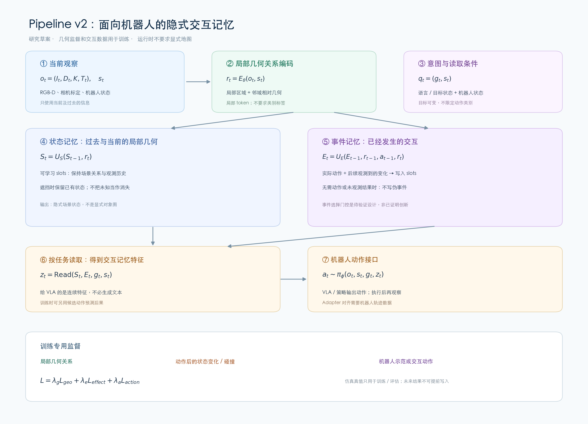

# Pipeline 与实验路线

**固定维护入口** · 更新日期：2026-11-06

本文索引研究流程、方法设计和实验方案。具体方案为工作假设，除非另有实验记录，否则不代表已经实现或验证。项目总体边界见[项目总控](项目总控.md)。

## 当前实施依据：Pipeline v3 + 环境记忆层补充设计

**开始测试先读 [2026-11-06实验前研究交接](research/实验前研究交接_2026-11-06.md)。** 最新澄清为：环境是主体，affordance是环境记忆中的可学习特征层，search是读取机制之一，VLA可作为后接任务。

- [环境记忆 Affordance 特征层设计（2026-11-05）](research/环境记忆Affordance特征层_可行性与实现建议_2026-11-05.md)：空间融合、上下文、隐式特征和视觉接口。
- [Mac→Isambard-AI快速验证计划（2026-11-05）](research/环境记忆Affordance层_快速验证实验计划_Mac_Isambard_2026-11-05.md)：当前资源、候选数据与首轮实验安排。

下文保留11月3日确认的整体流程；“search为算法核心”的较早表述应结合上述补充理解。

**整体流程参见 [Pipeline v3：任务驱动的 Affordance 交互检索](research/任务驱动Affordance检索_Pipeline_v3.md)，当前实施结合上方11月5日补充设计。** 项目负责人于 2026-11-03 确认的流程为：视频 → 感知 → 可检索交互记忆 → 结合当前环境与任务目标的 search → 核心视频片段、关键帧和 affordance maps / tokens → VLA → 目标机器人动作。

v3 曾将以局部几何、交互过程与状态变化为依据的示范检索作为算法核心，探索跨视角、跨机械臂与工具以及人类操作视频。结合11月5日补充，当前原型首先研究环境记忆及其 affordance 特征层，检索是读取方式之一；机器人与 VLA 是后续候选应用。目标机器人动作仍需适配；检索用于 VLA 训练还是执行时条件尚未确定。完整 v3 文档保存两张用户草图、接口、候选贡献及待验证问题。

本版是经确认的研究方向，尚未实现或验证；具体结构和训练方案仍可调整。2026-11-02 的 proposal 与综述作为背景参考。

## 历史算法草案：Pipeline v2

[Pipeline v2：隐式几何交互记忆](research/隐式交互记忆_Pipeline_v2.md) 保留为早期算法参考。它探讨从连续 RGB-D 观察、已知相机位姿、机器人状态和实际动作中构建隐式记忆，并利用局部几何与交互结果监督，研究其对交互预测和机器人策略的作用。该方案尚未实现、训练或验证；其具体结构不自动成为 v3 的确定设计。

- [训练与真实环境测试图解](research/隐式交互记忆_v2_训练与真实测试图解.md)：候选网络结构和接口。
- [首个对照实验：遮挡下交互预测](research/首个对照实验_遮挡下交互预测_v1.md)：拟议场景、对照和指标。
- [Affordance 记忆的创新与机器人接口](research/affordance记忆_创新与机器人接口.md)：待验证的贡献和接口选择。

## 早期设计与背景

- [初步研究问题与 Pipeline](research/初步研究问题与pipeline.md)：记忆、行动判断和观察证据的初始假设。
- [三维交互记忆算法设计 v1](research/三维交互记忆_算法设计_v1.md)：显式几何、关系与证据管理的候选方案。
- [几何交互理解调研与 Pipeline v1](research/几何交互理解_调研与pipeline_v1.md)：几何方法及早期技术路线。
- [AROS 融合路线图示说明](research/AROS融合路线_图示说明.md)：AROS 的启发和适用边界。

## 维护约定

新方案或实验结果应标注日期、输入假设、实现与验证状态，并更新本入口链接。保留不同版本及其差异，避免把候选设计写成已验证结论。涉及改变项目总控的内容，依总控的维护规则处理。

## 2026-11-06核对：实验阶段配套阅读

确认版Pipeline v3保持原文；以下11月5日文档补充当前实验理解和安排，不自动替换总控或升级pipeline版本：

- [环境记忆Affordance特征层：可行性与实现建议](research/环境记忆Affordance特征层_可行性与实现建议_2026-11-05.md)：环境为主体，学习局部功能特征并进行空间融合、上下文修正和时序维护；检索、区域定位与VLA是候选使用方式。
- [快速验证实验计划：Mac → Isambard-AI](research/环境记忆Affordance层_快速验证实验计划_Mac_Isambard_2026-11-05.md)：首轮SceneFun3D小子集，E0空间对齐、E1历史读取、后续E2轻量训练；模拟器和VLA不是E0–E2的前置要求。
- [英文pipeline与数据／仿真指南](research/Pipeline_Datasets_and_Simulation_Guide_2026-11-05.md)：资源分工和可视化入口。

实验方案尚未执行；后续需保存数据清单、配置、指标与失败样例，分别记录工程可用性、特征层增益和记忆机制增益。

### 首轮预期目标

| 阶段 | 拟验证的问题 | 预期检查与边界 |
| --- | --- | --- |
| E0：数据和空间对齐 | 同一功能部位在多视角 RGB-D 与相机位姿下能否正确投影和对应？ | 从 SceneFun3D 小子集开始；标注或完整扫描仅作单列 oracle 诊断与评估。对齐通过只说明数据链路可用。 |
| E1：历史记忆读取 | 当前视野之外、此前已经观察的功能区域能否从记忆中找回，并显示来源证据？ | 比较当前帧和普通视觉历史，按时间前缀建记忆；区分已见、当前不可见和从未观察。 |
| E2：Affordance 特征层 | 在相同历史与可比预算下，功能监督特征是否优于普通历史和参数匹配视觉分支？ | 比较 C0–C3，主要测功能区域 mIoU 和证据帧 Recall@3；测试标签不进入记忆。额外监督需单独报告。 |
| E3：环境与状态变化 | 观察到遮挡、占用或状态变化后，记忆能否保留或更新证据？ | 作为后续受控实验；几何兼容性与真实交互成功分开评价。 |

上述均为实验计划，不是已取得的结果；场景数量、门槛和训练预算是待验证建议。具体设置、继续条件及资源限制以[快速验证计划](research/环境记忆Affordance层_快速验证实验计划_Mac_Isambard_2026-11-05.md)为准。
