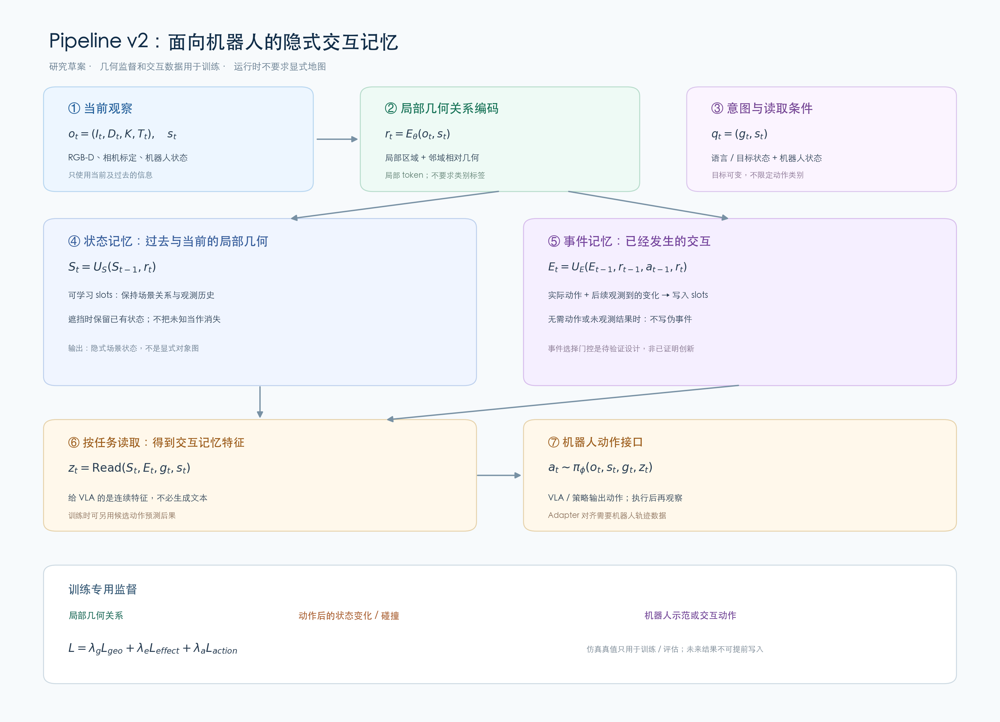

# Pipeline 与实验路线

**固定维护入口** · 更新日期：2026-10-29

本文索引研究流程、方法设计和实验方案。具体方案为工作假设，除非另有实验记录，否则不代表已经实现或验证。项目总体边界见[项目总控](项目总控.md)。

## 当前研究草案

当前较新的工作草案是 [Pipeline v2：隐式几何交互记忆](research/隐式交互记忆_Pipeline_v2.md)。它探讨从连续 RGB-D 观察、已知相机位姿、机器人状态和实际动作中构建隐式记忆，并利用局部几何与交互结果监督，研究其对交互预测和机器人策略的作用。该方案尚未实现、训练或验证，也不自动替代项目总控中的研究范围。

- [训练与真实环境测试图解](research/隐式交互记忆_v2_训练与真实测试图解.md)：候选网络结构和接口。
- [首个对照实验：遮挡下交互预测](research/首个对照实验_遮挡下交互预测_v1.md)：拟议场景、对照和指标。
- [Affordance 记忆的创新与机器人接口](research/affordance记忆_创新与机器人接口.md)：待验证的贡献和接口选择。

## 早期设计与背景

- [初步研究问题与 Pipeline](research/初步研究问题与pipeline.md)：记忆、行动判断和观察证据的初始假设。
- [三维交互记忆算法设计 v1](research/三维交互记忆_算法设计_v1.md)：显式几何、关系与证据管理的候选方案。
- [几何交互理解调研与 Pipeline v1](research/几何交互理解_调研与pipeline_v1.md)：几何方法及早期技术路线。
- [AROS 融合路线图示说明](research/AROS融合路线_图示说明.md)：AROS 的启发和适用边界。

## 维护约定

新方案或实验结果应标注日期、输入假设、实现与验证状态，并更新本入口链接。保留不同版本及其差异，避免把候选设计写成已验证结论。涉及改变项目总控的内容，依总控的维护规则处理。
