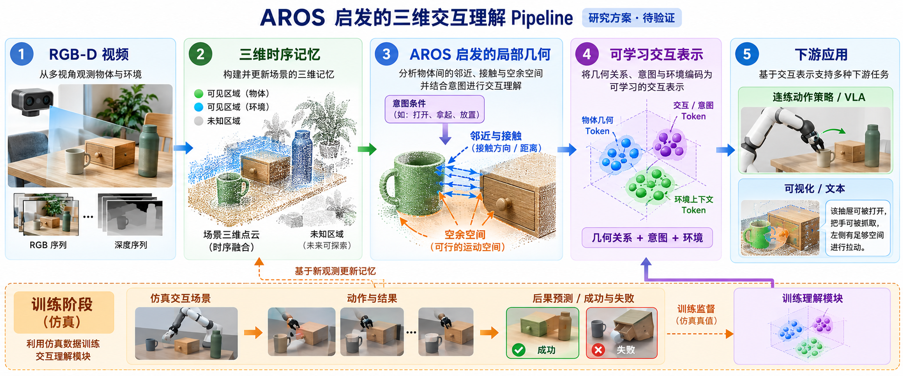

# AROS 启发的三维交互理解：图示说明

状态：研究方案，尚未实现或验证。图像使用内置 imagegen 生成，提示词为“绘制中文学术示意图，展示 RGB-D 视频、三维记忆、AROS 启发的接近与空余空间、意图条件的可学习交互表征、可选动作策略/VLA、仿真交互训练与记忆更新”。

## 与 AROS 的关系

[AROS](https://www.frontiersin.org/journals/robotics-and-ai/articles/10.3389/frobt.2023.1076780/full) 用已知人体姿态和场景构建静态几何交互描述符：交互中间曲面（IBS）上的 provenance vectors 描述与场景的接近关系；clearance vectors 补充人体周围需要保持无碰撞的空间。它匹配的是示范姿态及新场景的静态几何，不直接预测物理交互、行动轨迹或语言意图。

[Interaction Tensor](https://www.frontiersin.org/journals/neurorobotics/articles/10.3389/fnbot.2020.00045/full) 是相关研究脉络中直接处理物体—场景的几何方法，适合放杯子、挂伞等几何匹配参照。[NIFT](https://arxiv.org/abs/2210.10992) 在示范交互中从 IBS 取样并结合神经交互场，供物体位姿匹配与迁移使用。它与 AROS 同用 IBS 思想，不是 AROS 的官方后继，也不是直接实现开放意图或动态物理预测。[Learning Cross-Hand Policies](https://www.ecva.net/papers/eccv_2024/papers_ECCV/papers/04377.pdf) 将 IBS 表示用于跨夹爪的学习型抓取策略；它是更新的同类几何表示实例，但针对抓取并有自身的输入和任务假设。

## 图像读法与边界

- 图中间的“AROS 启发”是建议借用接近、相对方向和空余空间，建立局部物体—环境关系；并不意味着 AROS 本身已经提供可训练动作表征。IBS 精确构造需要区分两侧几何并处理观测不全；可先近似或在小规模真值数据做原型。
- 图上的“接触”指几何接近或候选接触；实际接触需依据交互记录判断。空余空间也只反映局部几何约束，不能单凭它证明整条动作轨迹可行、稳定或碰撞自由。
- 图中“打开、拿起、放置”仅是意图的示例，并非封闭动作标签。研究首版可用目标状态或示范来指定意图，VLA 和文本是后续可选接口。
- 训练时用仿真动作、观察结果和可选择的接触/碰撞真值生成监督；推理时只使用约定的可观测 RGB-D、位姿、意图和可用机器人状态，仿真真值不能直接输入。
- 对照包括：原始/适配几何模板或 NIFT、无几何关系的学习模型、加入关系几何但不学交互后果、完整模型。在同样观察、数据及预算下测跨物体、场景和意图迁移；要证明结果后才能判断研究贡献。

相关新工作还包括 [O³Afford](https://o3afford.github.io/) 对 object-object affordance 和语言接口的研究，以及 [AFUN](https://arxiv.org/abs/2606.02551) 关于意图条件、功能区域和接触后运动的研究。它们不是 AROS 的同一作者系列，且有不同监督及输入；应视为相关比较，不宜声称单个模块就是创新或已确定当前 SOTA。
