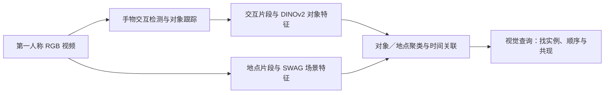
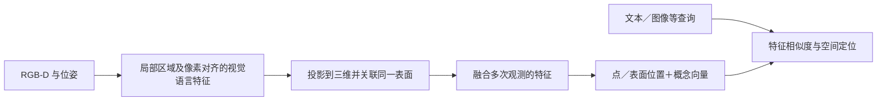
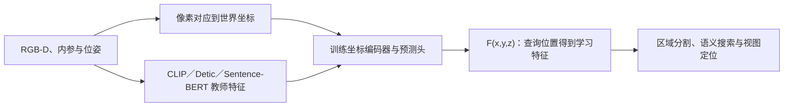
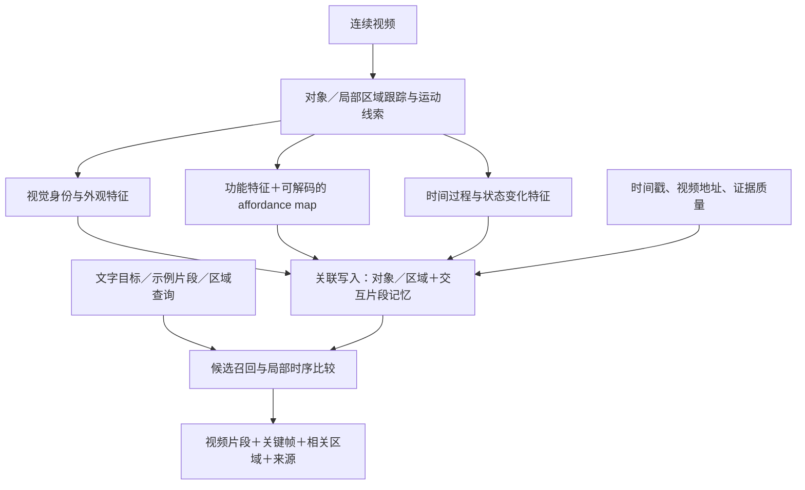

# 将 Affordance 特征写入视频记忆：构建范例与非机器人评估

**日期：2026-11-04｜针对当前构建问题的定向方法比较。**

这是独立讨论稿，补充[独立视频交互记忆综述](独立视频交互记忆_文献综述与必读10篇_2026-11-03.md)。下文的候选方案和实验是本项目建议，不是已完成的方法，也不修改项目总控或 Pipeline v3。论文来源、核查范围见[证据记录](Affordance特征写入记忆_检索与证据记录_2026-11-04.md)。

## 1. 直接回答：有类似先例，第一版可以先做混合记忆

你想做的可以表述为：

> 从连续视频建立带有局部功能信息的环境／交互记忆；未来查询既可以找到过去见过的对象，也可以找到“功能上适合这件事”的区域和经历。

这类思路有三个可拆开的参考：**AMEGO 参考视频经历怎么组织；ConceptFusion 参考学习特征怎么加入空间记忆；CLIP-Fields 参考真正的隐式空间表示怎么训练。** AFFORDMEM 则是 affordance 与 memory 结合的直接近邻，需要重点对照。

| 你需要解决什么 | 最适合先看的论文 | 可以借鉴的构建方式 | 原论文不直接解决什么 |
| --- | --- | --- | --- |
| 视频里记住“何时、何地、哪个对象” | AMEGO，ECCV 2024，P114 | 交互片段＋对象实例＋地点时间线 | 没有学习物理 affordance／动作后果 |
| 给已有空间记忆添加一个新的学习特征 | ConceptFusion，RSS 2023，P115 | 将局部神经特征关联并融合到三维表面 | 不是时序交互经历库，也不是完全隐式场 |
| 用神经网络本身保存空间特征 | CLIP-Fields，RSS 2023，P116 | 学习坐标到语义／视觉特征的函数 | 原方法不维护事件历史或动态状态版本 |
| 记住功能区域，服务后续区域查询 | AFFORDMEM，2026预印本，P11 | 带功能区域的来源示例＋场景内候选关系图 | 不是新学习的隐式 affordance 向量检索 |

**“隐式”要分两层理解。** 一是特征内容由网络学习，例如一组难以用人工规则解释的 tokens；二是整个场景由坐标网络表示，例如 `F(x,y,z)`。前者可以存进显式数据库，后者才是这里严格意义上的隐式空间场。两种方式都可以研究，不必为了使用隐式特征而先做完整神经场。

## 2. 四篇论文怎样构建，怎样评估？

### 2.1 AMEGO：最适合参考视频记忆的骨架

完整题名：[AMEGO: Active Memory from long EGOcentric videos](https://arxiv.org/html/2409.10917)；[作者项目页](https://gabrielegoletto.github.io/AMEGO/)。

**直观理解：** 视频拍到你拿起杯子，系统保存这段交互的时间、杯子的框和视觉特征；之后再次看到杯子，就尝试关联到同一个实例。另一条分支记录活动地点，再用时间重叠把对象与地点连起来。



**贡献对你的启发：** 记忆不仅是一堆向量，还需要知道向量属于哪个对象、哪次经历及哪个时间段。你可以沿用这个骨架，再增加功能特征。原方法的查询主要是视觉裁剪，不能直接当作已经实现自由文本交互检索。

**原文评价：** Active Memories Benchmark 用五选一问题评价顺序、共现及时间相关查询，主指标是准确率。另在两段人工标注视频上评价片段切分，使用预测段和真值段双向的平均最佳时间 IoU，以及片段数量差 ΔN；这部分规模较小。它没有用机器人动作成功率证明记忆能力。[原文 §5](https://arxiv.org/html/2409.10917)

### 2.2 ConceptFusion：最直观的“向记忆添加新 feature”范例

完整题名：[ConceptFusion: Open-set Multimodal 3D Mapping](https://arxiv.org/html/2302.07241)；[作者项目页](https://concept-fusion.github.io/)。

**直观理解：** 普通三维地图记住“这个位置有一个表面”；ConceptFusion 还给表面保存一个学习到的概念特征。以后不只按坐标查地图，还能用文字或图片找相关区域。



可以把它想成每个表面多了一栏 `concept_feature`。多视角重复看到同一表面时，按观测权重融合特征。你的类比是添加 `affordance_feature`，但还要解决功能随任务、对象状态变化的问题，不能直接把所有历史特征平均。

**原文评价：** 用查询得到的三维区域与标注比较，报告 3D mIoU、超过指定 IoU 阈值的比例；也评价语义分割，并消融特征融合设计。它还有机器人展示，但**特征记忆本身可以用离线定位／分割评价**。[原文 §IV–V](https://arxiv.org/html/2302.07241)

**边界：** 使用深度和位姿；学习特征挂在显式地图上，不等于全隐式表示，也不等于从 RGB 自动学会物理功能。

### 2.3 CLIP-Fields：如果你希望“记忆本身就是隐式函数”

完整题名：[CLIP-Fields: Weakly Supervised Semantic Fields for Robotic Memory](https://arxiv.org/html/2210.05663)；[RSS 原文](https://www.roboticsproceedings.org/rss19/p074.pdf)。

**直观理解：** 它不是给每个点存一条数据库记录，而是训练一个网络：输入空间位置，输出这个位置的语义／视觉特征。多个视角提供同一位置的训练信息。



**贡献对你的启发：** 语义可以成为空间网络的输出；同理，可以研究让网络输出功能特征。但训练信号、状态变化和原视频回溯都需要额外设计，不能只把输出头改名就认为问题解决。

**原文评价：** 在 HM3D 上检查少样本实例／语义分割、零样本语义能力、标签噪声鲁棒性等；少样本实例部分报告 IoU 0.5–0.95 范围的 mAP，也展示视图定位。少样本实验使用少量人工标注视图，不能统称全部无需标注；查询场时还利用深度和位姿。[原文 §IV–V](https://arxiv.org/html/2210.05663)

**适用判断：** 若首要目标是视频片段检索，先做对象／区域 token 记忆更容易定位问题；若首要目标是连续空间中的功能查询，再考虑坐标场。

### 2.4 AFFORDMEM：与你最接近，必须明确区别

完整题名：[Grounding by Remembering: Cross-Scene and In-Scene Memory for 3D Functional Affordances](https://arxiv.org/html/2605.11616)。截至本记录日期按预印本处理。

它已经结合 affordance 与 memory：从有标注的来源场景保存功能区域叠加示例；查询时按类别索引提供给冻结 VLM，辅助定位可操作部位。目标场景再利用 RGB-D 多视角融合形成三维候选，以空间关系图选择正确实例。

**尤其需要注意：** 原文按类别字符串匹配示例库，不是用新训练的隐式功能向量做近邻搜索；也不是无需任何来源标注。它在目标场景不需要功能标注或模型微调。[原文 §3.2–3.3](https://arxiv.org/html/2605.11616)

**原文评价：** SceneFun3D 三维功能区域定位，使用 AP25/AP50、AR25/AR50、mIoU；消融场景图、提示方式和示例数量。部分消融使用代表性子集，不能当作完整测试集上的单因素证明。[原文 §4](https://arxiv.org/html/2605.11616)

所以，“affordance＋memory”已有直接先例。你的研究价值需要落实到**学到了什么功能特征、如何随视频关联／维护、对哪些查询产生可验证收益**。

## 3. 建议你的第一版怎样构建？

以下为候选设计，不是上述论文已经实现的组合。

### 3.1 一个具体例子

历史视频包含三段：

- A：手从侧面接触杯子，杯子沿桌面移动。
- B：手接触同一个杯子，把它举离桌面。
- C：手推动一个盒子，盒子沿桌面移动。

查询是“找出物体被沿支撑面推动的经历，并指出参与交互的区域”。

希望系统优先找回 A 和 C，区分 B；返回原视频时间段与相关局部区域。这样才能说明它关注了交互过程，而不只是杯子外观。**静态接触热图往往不足以区分 A/B，还要结合运动、支撑关系和前后状态。** 视频中没有观察到某种动作时，模型的功能预测只是推测，不能写成已发生的经历。

### 3.2 数据流：在对象／区域记忆上增加功能分支



第一版最重要的四个选择：

1. **保留两个检索通道。** 视觉通道回答“是不是同一个杯子”；功能通道回答“是不是相似的交互”。两者不能共用一个不加区分的身份合并规则。
2. **既有摘要，也有局部 token。** 摘要向量快速召回，带时间／区域坐标的 token 进行细排和定位；只存一个平均向量容易丢失局部差别。
3. **保留历史版本。** 同一对象状态改变时，新状态另记；旧状态保留时间，不继续冒充当前状态。关联不可靠时保留待定，避免错误合并。
4. **功能特征必须真的参与训练与读取。** 可用来源标注、仿真或教师伪标签训练区域／功能头，再结合交互匹配和过程区分训练。只增加一个字段或拼接一个向量，不保证检索模型会利用它；伪标签也不能充当独立评测真值。

一条记忆可以表达为：

```text
对象／区域关联（可选三维锚点）
＋交互片段的起止时间与视频来源
＋视觉摘要、功能摘要、局部时序 tokens
＋状态版本、可见性与观测／预测标记
```

这里的功能 map 应理解为**对于某种动作／目标的区域适合程度**，例如“可按压”“可沿表面推动”；它受状态和条件影响，不是一张对所有任务通用的热图。若未来查询在写入时未知，可以先使用预定义功能通道，或训练可按查询解码的功能特征；不能默认写入阶段已经知道未来目标。

若使用 RGB-D＋位姿，可参考 ConceptFusion 做可靠空间关联；纯 RGB 第一版可以先用二维对象轨迹和跨视角对应，并报告关联不确定性。前者的深度／位姿优势必须在实验中说明，不能与不同输入的基线直接归因比较。

## 4. 不接 VLA 时，主要怎样评价？

**不需要机器人控制实验。** 评价终点由你声称的能力决定：如果贡献是记忆和检索，就直接评价记住、找回和定位的质量。来自机器人领域的地图方法和离线空间指标仍可参考；“不做控制”不意味着必须排除所有机器人来源的数据或方法。

### 4.1 首轮主任务：功能片段检索＋局部区域定位

| 要证明的能力 | 直观问题 | 建议指标／协议 |
| --- | --- | --- |
| 功能检索 | 能否找到 A/C，而不是只找到同一杯子的 B？ | Recall@K、mAP；多级相关性可用 nDCG，允许多个正确答案 |
| 时间定位 | 找对视频后，是否找对发生交互的时间段？ | 在规定时间 IoU 阈值下的召回／mAP；tIoU 为预测与真值时间段的交并比 |
| 局部定位 | 是否找对参与交互的区域？ | 有区域标注用 mIoU、AP@IoU；只有点标注就用点命中等相应指标 |
| 历史依赖 | 目标已离开当前画面，是否仍能找到过去证据？ | 当前帧基线、历史检索对照；同时检查返回片段／区域证据 |
| 记忆维护（若主张） | 视频增长、视角变化、对象移动后是否仍有效？ | 固定容量下质量曲线，错误合并／分裂、过时状态错误率与证据保留 |
| 实际成本 | 相同资源下值得保存这些特征吗？ | 写入／查询延迟、实际字节数、额外编码开销及随视频长度的增长 |

Recall@5 可以直观理解为：正确经历是否出现在前五个结果中。mIoU 检查区域形状的重叠。二者分别检查“找哪段”和“看哪里”，不会相互替代。

### 4.2 最关键的消融：收益究竟来自哪里？

| 实验组 | 目的 |
| --- | --- |
| 普通视觉记忆 | 基础对照 |
| 视觉记忆＋等容量普通视觉特征 | 排除只是增加容量／额外编码器的收益 |
| 视觉记忆＋预测的 affordance 特征 | 完整候选方法 |
| affordance 与区域／时间错配或打乱 | 检查对应关系是否真的被利用 |
| 同样保存视觉历史，查询时才生成 affordance | 区分“写入功能记忆”的价值与“临时感知”的价值 |
| 真值 affordance 特征 | 只作特权上限诊断，不混入主要结果 |

如果查询时生成的方案具有相同准确率但更慢，你可以研究计算与存储的取舍；不能因此声称学会了更好的长期记忆。如果两者在压缩／遗忘后出现差距，则更有理由研究**写入时保留功能信息**的机制。

可进一步比较“无历史／有历史 × 无 affordance／有 affordance”，检查功能特征收益是否依赖过去信息。测表征时固定记忆更新规则；测压缩／维护时固定前端特征，避免两个因素一起变动。

### 4.3 比单一总分更重要的测试设置

- 分别测试跨视角、跨对象和新场景；对象外观相近但交互不同是困难负样本，不同对象而交互相似可以是正样本。功能相似必须有明确标注标准。
- 专门保留必须读取过去才能回答的查询。移除／交换对应历史后结果应合理变化；若评价顺序，再测试时间打乱，不能要求本来无序的任务也受影响。
- 训练来源、教师伪标签、测试人工真值分开。测试场景的功能标注不得参与记忆写入；允许读取过去视频，不等于允许读取未来视频或测试答案。
- 固定输入、检索候选范围及预算。模型参数、索引、局部 token、缓存和原视频分别报告；token 缓存有界不等于整个视频档案有界。
- 先用可靠的对象关联／区域标注做诊断，再换预测输入；明确哪些是上限，哪些是可运行系统。对跨视频结果按视频／场景汇总不确定性，避免相邻帧重复造成虚高。

## 5. 当前最值得做的判断

**推荐先做 AMEGO 式经历索引＋ConceptFusion 式局部特征挂接，加入你训练的功能／过程特征，以功能片段检索和区域定位作为主评测。** 不必先做 VLA，也不必先承担完整三维隐式场的所有问题。

如果实验进一步表明：有限预算下，功能信息在写入、关联和压缩时有独特的保留价值，再将贡献推进为记忆机制。若只是换一个特征后检索更好，贡献更适合称为功能表征与检索。是否值得立项，应由上述对照决定，不能仅凭“affordance map 加入 memory”的结构命名判断。

建议阅读顺序：**ConceptFusion → AMEGO → AFFORDMEM → CLIP-Fields**。前两篇帮助把数据结构画清楚，第三篇帮助确定与直接近邻的区别，第四篇再决定是否需要真正的隐式场。
