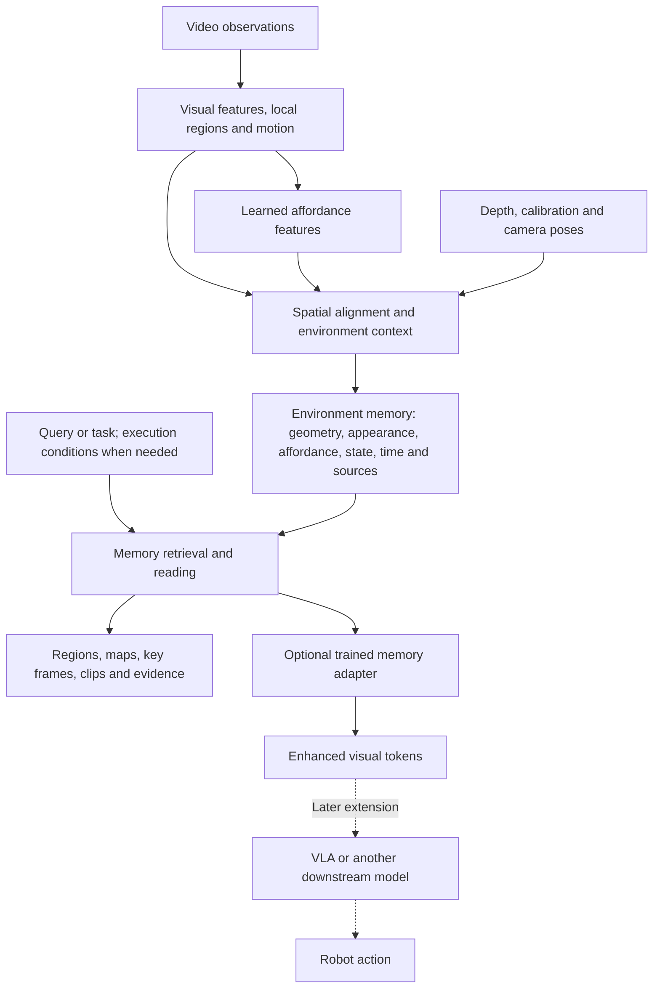

# Video-Based Environment Memory
## Pipeline, Datasets and Simulation Guide

**Updated: 5 November 2026**  
**Status:** research guide and proposed implementation route; no dataset download, simulator installation or experimental validation has been completed for this guide.

This document follows the confirmed [Pipeline v3](任务驱动Affordance检索_Pipeline_v3.md) and the latest architectural discussion: **the environment is the main subject, and affordance is a learned feature layer within its memory.** Retrieval is one way to read that memory. A VLA model can be connected later.

## 1. The project in one paragraph

Build an environment memory from video that retains spatial structure, visual information, functional regions, state changes and source evidence. An affordance layer describes which regions may support a particular interaction under relevant conditions. Later, a query can retrieve a region, an earlier observation, a key frame or an interaction clip. The same memory may eventually supply features or demonstrations to a vision–language–action model.

For example, the system should remember a drawer handle after the camera turns away, retrieve the earlier view supporting its location, and update the record when a later observation shows that the drawer has moved. A query such as “where could I pull?” should use the functional layer together with the remembered scene state.

## 2. Working pipeline

| Stage | Plain-language explanation | Proposed output |
| --- | --- | --- |
| Perception | Identify local surfaces, objects, motion and useful visual details. | Image features, regions and tracks. |
| Affordance encoding | Learn features associated with functional parts or interactions. | Local feature tokens; task-conditioned maps for supervision or visualization. |
| Spatial association | Connect observations of the same surface across viewpoints. | Spatially anchored patches or object regions. |
| Context and temporal update | Combine observations with surrounding geometry and state; keep historical versions when appropriate. | Current estimates, historical observations, uncertainty and provenance. |
| Retrieval and reading | Select evidence relevant to a question or goal. | Ranked regions, frames, clips or memory tokens. |
| Optional downstream connection | Train an adapter or policy interface to consume the selected memory. | Features for another model, potentially a VLA. |

**First prototype:** RGB-D observations with known camera poses make spatial association easier to diagnose. RGB-only video with estimated geometry is a subsequent condition. Depth, poses, simulator object IDs and evaluation labels must have explicit input permissions.

**Representation:** retain learned features before the final heatmap, plus spatial/time references. A single heatmap can lose the difference between contacting a surface, pushing along it and lifting an object. Functionally similar objects also need separate instance identities.

Useful construction references: [ConceptFusion](https://concept-fusion.github.io/) for adding learned features to spatial maps, [CLIP-Fields](https://arxiv.org/html/2210.05663) for implicit spatial feature fields, and [AMEGO](https://gabrielegoletto.github.io/AMEGO/) for video-instance timelines. The proposed affordance and temporal extensions still require implementation and testing.

## 3. Which resources should we start with?

| Research need | First candidate | Why it belongs here |
| --- | --- | --- |
| Functional regions within a real environment | **SceneFun3D** | Scene geometry, functional-element masks and language queries. |
| Memory over natural video and earlier interactions | **EPIC-KITCHENS + VISOR** | Continuous first-person video with action and hand/object annotations. |
| Interaction features with depth and object motion | **HOI4D** | RGB-D interaction sequences and rich geometric annotations. |
| Small local-affordance training/debugging task | **UMD Part Affordance** | Clear tool-part functional labels. |
| Controlled changes of viewpoint, occupancy and state | **ManiSkill / SAPIEN** | Scriptable scenes, cameras and physical objects. |
| Room-scale revisits and object-state sequences | **AI2-THOR** | Navigable indoor environments with observable state changes. |

These resources cover complementary tasks. They do not form a synchronized or automatically paired dataset.

## 4. Real datasets: what they provide and what they test

### A. SceneFun3D — environment-level functional grounding

[Project and examples](https://scenefun3d.github.io/) · [Getting started / downloads](https://scenefun3d.github.io/documentation/getting-started/) · [Annotation definitions](https://scenefun3d.github.io/documentation/dataset/annotations/)

**What it contains:** reconstructed indoor scenes, RGB/depth observations and poses, annotated 3D functional elements, language tasks and motion parameters. Examples include handles, switches and knobs.

**Use here:** check spatial feature fusion and whether a task query retrieves the correct functional region across views. This is the strongest starting point for the scene-level affordance layer.

**Boundary:** scene surveys and annotated possible interactions do not establish that an interaction happened in the recorded video. Its listed affordance categories also do not provide a general placement/support benchmark.

*Official SceneFun3D illustration. Source: [SceneFun3D project](https://scenefun3d.github.io/).*

### B. EPIC-KITCHENS + VISOR — temporal memory and historical retrieval

[EPIC-KITCHENS](https://epic-kitchens.github.io/2025) · [VISOR annotations and examples](https://epic-kitchens.github.io/VISOR/site) · [Optional EPIC-Fields geometry](https://epic-kitchens.github.io/epic-fields/site)

**What it contains:** natural first-person kitchen videos and action segments; VISOR adds hand/active-object masks and hand–object relations for a subset of the footage.

**Use here:** build a clip/frame index, test object revisits, and retrieve earlier interactions with source evidence. EPIC-Fields can add reconstructed camera geometry where video/frame coverage matches.

**Boundary:** object masks and contact relations are not complete affordance-region labels. Manual masks and interpolations must be distinguished. EPIC-Fields is reconstructed geometry, not measured dense RGB-D; verify shared video/frame IDs before combining annotations.

*Official VISOR illustration. Source: [VISOR project](https://epic-kitchens.github.io/VISOR/site).*

### C. HOI4D — geometric interaction and state-change features

[Project, examples and modality downloads](https://hoi4d.github.io/) · [Dataset instructions](https://github.com/leolyliu/HOI4D-Instructions)

**What it contains:** egocentric RGB-D interaction sequences with hand/object poses, action and motion annotations, segmentation, object meshes and scene point clouds.

**Use here:** study interaction phases, object movement and geometry-aware clip retrieval. It is useful for distinguishing similar-looking observations that have different temporal processes.

**Boundary:** it is not a ready-made long-term environment-memory benchmark. General affordance maps and retrieval relevance labels require additional annotation or clearly declared proxies.

*Official HOI4D illustration. Source: [HOI4D project](https://hoi4d.github.io/).*

### D. Auxiliary supervision — smaller feature-layer checks

| Resource | What it gives us | Appropriate first use | Important limit |
| --- | --- | --- | --- |
| [UMD RGB-D Part Affordance](https://users.umiacs.umd.edu/~fermulcm/affordance/part-affordance-dataset/index.html) | Tool images with functional-part labels, including grasp, cut, scoop and support. | Train/debug local maps before environment integration. | Static object views; manual ground truth is every third image, with automatic labels on other frames. See the [README](https://users.umiacs.umd.edu/~fermulcm/affordance/part-affordance-dataset/README.txt). |
| [ContactPose](https://contactpose.cc.gatech.edu/) | Recorded grasp contact maps, hand/object poses and RGB-D imagery. | Check alignment with observed contact. | One observed grasp does not identify every possible grasp region. Use the [official repository](https://github.com/facebookresearch/ContactPose) for current sample/access links. |

Earlier candidates such as 2HANDS and AFUN-derived subsets remain supplementary options. Generated interaction masks need independent checks, and processed frames do not replace continuous video for memory evaluation.

**Access notes:** SceneFun3D data assets use CC-BY-4.0 with additional ARKitScenes terms ([official license](https://scenefun3d.github.io/documentation/license/)). EPIC/VISOR and HOI4D specify non-commercial terms on their official pages. UMD reuse terms need confirmation; ContactPose object-model terms vary. Start with a small documented subset.

## 5. Simulation environments

### A. ManiSkill / SAPIEN — first controlled prototype

[Documentation](https://maniskill.readthedocs.io/en/latest/) · [Repository](https://github.com/mani-skill/ManiSkill) · [Observations and calibration](https://maniskill.readthedocs.io/en/latest/user_guide/concepts/observation.html) · [Custom tasks](https://maniskill.readthedocs.io/en/latest/user_guide/tutorials/custom_tasks/intro.html)

**What it provides:** configurable cameras, RGB/depth/segmentation observations, rigid and articulated objects, physical simulation and customizable tasks.

**Why choose it first:** a small tabletop scene can isolate changes in viewpoint, free space, object position and support conditions. Camera motion and scene changes can be scripted without training a robot policy.

**What we must build:** functional-region labels, paired scene layouts, temporal observation schedules, identity/state logs and retrieval queries. Segmentation IDs alone are not affordance labels. Physical-feasibility claims require an explicitly defined action and outcome test.

*Official simulator illustration, not a project result. Source: [ManiSkill repository](https://github.com/mani-skill/ManiSkill).*

### B. AI2-THOR — room-scale observation and state memory

[Project](https://ai2thor.allenai.org/) · [Camera and observation configuration](https://ai2thor.allenai.org/ithor/documentation/initialization/) · [Object states and metadata](https://ai2thor.allenai.org/ithor/documentation/environment-state/)

**What it provides:** navigable indoor scenes, RGB and optional depth/instance masks, object metadata and high-level state-changing interactions.

**Use here:** leave and revisit a room, hide/reveal an object, or observe changes such as a drawer opening. Keep privileged object state on the evaluator side unless explicitly testing an oracle condition.

**Boundary:** standard action calls return an observation after completion. Recording the intermediate process requires an appropriate physics-stepping/capture setup. High-level action success does not establish a particular robot's reachability or control ability.

*Official iTHOR illustration. Source: [AI2-THOR repository](https://github.com/allenai/ai2thor).*

### C. Other previously discussed options

| Environment | When it is useful | Current qualification |
| --- | --- | --- |
| [Habitat-Sim](https://github.com/facebookresearch/habitat-sim) + [ReplicaCAD](https://aihabitat.org/datasets/replica_cad/) | Reproducing room-scale RGB-D exploration/rearrangement studies. | Interactive ReplicaCAD assets differ from static scan datasets. The official repository reports archival on 26 October 2026 and ended Meta maintenance beyond v0.3.4; validate a pinned setup. |
| [LIBERO](https://libero-project.github.io/) | Later language-conditioned manipulation and policy comparisons. | A VLA/action benchmark; it does not supply our memory evaluation automatically. Depth is optional in its recording script, so check actual demonstration fields. |

For the first ManiSkill run, validate [installation and rendering](https://maniskill.readthedocs.io/en/latest/user_guide/getting_started/installation.html) on the intended Linux/NVIDIA machine. The available GPU name alone does not establish memory capacity, driver compatibility or usable throughput.

## 6. A minimal experimental route

| Step | Resource | Experiment | Main evidence |
| --- | --- | --- | --- |
| 1. Local feature check | UMD, or a small SceneFun3D subset | Predict task-relevant regions and compare with object-only localization. | Per-task IoU / precision–recall. |
| 2. Spatial memory check | SceneFun3D | Build memory from selected views, then query regions outside a held-out current view. | 3D region accuracy, source-frame correctness and input coverage. |
| 3. Controlled temporal check | Custom ManiSkill scene | Change viewpoint, introduce occlusion, alter occupancy, then revisit. | Memory retention, stale-state errors and region retrieval. |
| 4. Real-video check | EPIC + VISOR; HOI4D for geometric interactions | Retrieve earlier relevant clips and locate interaction phases. | Recall@K / mAP, temporal localization and evidence accuracy. |
| 5. Optional downstream check | Fixed task model; later LIBERO or another action environment | Compare ordinary memory and affordance-memory conditioning. | Task-specific improvement under the same model and budget. |

**Small simulation episode:** observe a clear support region → turn away → revisit under occlusion → observe a new obstacle occupying the region → revisit after it is removed. Before the change is observed, the memory should retain uncertainty rather than read hidden simulator state. A scripted reset can test state bookkeeping; a collision/stability claim requires physical validation.

For interaction retrieval, include “push a cup,” “lift the same cup,” and “push a box.” This tests whether the representation distinguishes process from appearance. Supporting surfaces, interaction regions and object motion all matter.

## 7. Evaluation without a VLA

Robot control is not required to evaluate the first memory system.

| Question | Suggested evaluation |
| --- | --- |
| Did the system retain the right functional region? | Region IoU/AP on independent functional labels. |
| Did it retrieve useful history? | Recall@K, mAP or nDCG, with multiple valid results and hard negatives. |
| Did it find the correct interval? | Temporal localization at specified time-IoU thresholds. |
| Does it distinguish current and historical state? | Update delay, stale-state errors and evidence-supported state queries. |
| Is the feature layer worth storing? | Quality versus actual bytes/tokens, write/read latency and video duration. |

Essential controls are ordinary visual memory, equal-capacity visual features, predicted affordance features, and mismatched/shuffled affordance features. Also compare **writing affordance into memory** with **generating affordance only when a query arrives**. This separates feature quality from the value of the memory construction itself.

Use held-out scenes/objects and complete episodes. Preserve the distinction between model inputs, teacher supervision and evaluation truth. Static functional labels, observed contact and verified physical success establish different claims.

## 8. Keeping the earlier video-to-action route available

The earlier action-oriented shortlist remains relevant after the memory experiments:

- [Zero-WAM / HumanGen](https://robbyant-research.github.io/Zero-WAM/) provides a video-conditioned action-model direction with generated human–robot examples and a RoboTwin evaluation path. Generated human footage must be distinguished from real human observations.
- [H2RBench](https://h2rbench.github.io/) provides real human demonstrations and reconstructed simulated manipulation tasks for human-to-robot transfer. Task matching does not imply frame-level correspondence.
- [LIBERO](https://github.com/Lifelong-Robot-Learning/LIBERO) provides an action-labelled manipulation benchmark for a later fixed-policy comparison.

None of these interfaces should be assumed to accept arbitrary memory tokens without adaptation and training.

## 9. How to use this guide

Start with **SceneFun3D + a small custom ManiSkill experiment** for environment-centred functional memory. Add **EPIC/VISOR or HOI4D** to test temporal retrieval on real video. Use UMD or ContactPose only where their labels match the local feature-learning objective.

All dataset and simulator illustrations above are externally hosted official visuals with source attribution. They require an internet connection; each project link also provides examples or videos. They show resource capabilities, not experiments run in this project.

Further local reading: [memory construction examples and non-robot evaluation](Affordance特征写入记忆_构建范例与非机器人评估_2026-11-04.md) and [the confirmed Pipeline v3](任务驱动Affordance检索_Pipeline_v3.md). The project charter and confirmed pipeline are unchanged by this guide.
