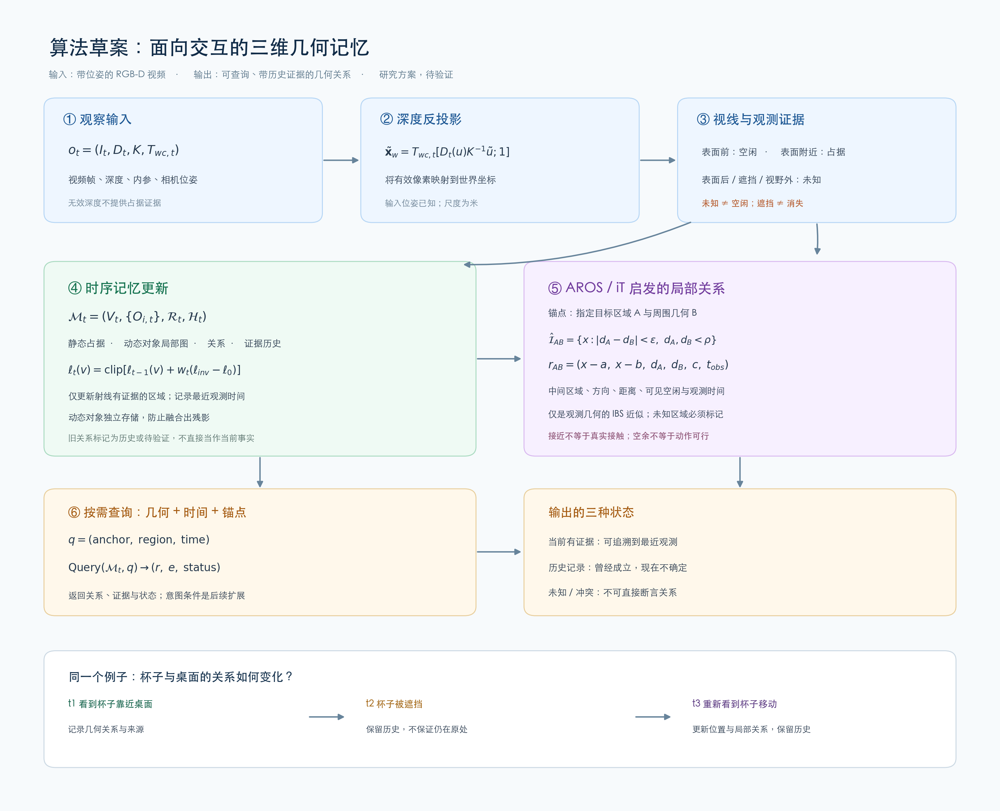

# 三维交互记忆：Algorithm Track v1

**状态：供讨论的算法设计；尚未实现和验证**  
**日期：2026-10-28**



[高清 PNG](figures/三维交互记忆算法_v1.png) · [可缩放 SVG](figures/三维交互记忆算法_v1.svg)

## 0. 研究范围与目标

首先研究一个可独立评测的 memory algorithm：给定**连续 RGB-D 图像与已知相机位姿**，不断维护三维几何及局部几何关系，并能回答有关当前或历史状态的查询。物体—物体、物体—环境间的局部几何是基本研究单元；这里的“atom”是一个可以被存取的局部关系记录，并不预设它与某一动作类别一一对应。

**本版目标不是训练出通用 affordance 或直接控制机器人。** 意图条件、从交互结果学习和 VLA 接口留作可选研究扩展；在此之前，需要先证明记忆能准确地保存、更新和返回关系证据。

研究问题：**在相同观察与预算下，显式维护局部几何关系、时间和可见性，能否比仅保存三维点云或占据图更可靠地回答跨视角、遮挡及场景变化下的几何关系查询？** 这是可证伪假设，而非已证明的新颖性或效果。

## 1. 输入、假设与输出

在时刻 \(t\)，输入为

\[
o_t=(I_t,D_t,K,T_{wc,t}),
\]

其中 \(I_t\) 为 RGB 图像，\(D_t\) 是以米为单位的有效深度，\(K\) 为相机内参，\(T_{wc,t}\) 把相机坐标变换到世界坐标。首版只考虑刚体桌面物体、可重复的场景和已知相机位姿；遮挡和物体移动逐步加入。

输出是记忆状态 \(\mathcal M_t\) 与查询接口。查询可请求某个锚点或区域的三维几何、它与周围空间的关系、观测时间和证据状态。**第一版假定锚点可由用户点击、指定 3D 点或类别无关候选生成器提供；自由语言定位不是本算法已解决的问题。**

对象分离和跨帧关联并非天然得到：为了先检验记忆本身，诊断版本可以接收仿真实例 mask 和位姿，作为**有额外特权信息的 oracle 上界**；之后替换为只依靠观察的类别无关分割与追踪，单独报告追踪误差。不可把 oracle 结果写作仅凭 RGB-D 得到的结果。

## 2. 观察：从视频到三维证据

对有效像素 \(u=(u_x,u_y)\)，设齐次坐标 \(\tilde u=[u_x,u_y,1]^\top\)，反投影为

\[
\tilde{\mathbf x}^w_{t,u}=T_{wc,t}\begin{bmatrix}D_t(u)K^{-1}\tilde u\\1\end{bmatrix}.
\]

其中 \(\tilde{\mathbf x}^w_{t,u}\) 是四维齐次坐标，其前三维为世界坐标。在相机射线上：测量表面之前的体素提供**空闲证据**；测量深度附近提供**表面/占据证据**；表面之后、视野外、无效深度和被遮挡区域没有新证据。深度噪声和表面厚度由传感器模型和阈值控制。这个划分是从当前观测出发，不等于知道场景中所有空间。

例如：看到桌面上一个杯子的正面，不代表杯子后方也为空；看不到杯子时，也不能推断杯子已经离开。

## 3. 记忆状态与更新

建议将记忆分成四个部分：

\[
\mathcal M_t=\big(V_t,\{O_{i,t}\},\mathcal R_t,\mathcal H_t\big).
\]

| 部分 | 内容 | 作用 |
| --- | --- | --- |
| \(V_t\) | 稀疏体素占据图和可见性 | 记录场景中哪里被观察为空闲、占据或未知 |
| \(O_{i,t}\) | 动态对象的局部几何、估计位姿、身份/版本 | 物体移动时跟随物体更新，不在世界图中留下多份残影 |
| \(\mathcal R_t\) | 局部关系记录及其所依赖对象和版本 | 保存区域之间的邻近方向、距离和已观测空余空间 |
| \(\mathcal H_t\) | 帧或关键帧来源、时间、可见性及状态历史 | 区分当前证据和过去曾观察到的状态 |

这四部分是概念设计；首版可以只对有查询价值的局部区域维护关系，而不是计算整个场景的所有区域对。

### 3.1 稀疏占据更新

对于体素 \(v\)，设 \(\ell_t(v)=\log[p_t(v)/(1-p_t(v))]\) 为占据概率的 log-odds。若当前有效射线对该体素提供证据，可使用下面的候选更新：

\[
\ell_t(v)=\operatorname{clip}\!\left(
\ell_{t-1}(v)+w_t(v)\,[\ell_{\mathrm{inv}}(v\mid o_t)-\ell_0],
\ell_{\min},\ell_{\max}\right).
\]

\(\ell_0\) 是先验 log-odds，\(\ell_{\mathrm{inv}}\) 是由深度射线给出的逆传感器模型，\(w_t\) 是观测权重，clip 防止数值无限增长；无新证据的体素保持原始占据值。逆传感器模型、阈值、裁剪上下界和权重都需实验确定。

注意此类更新依赖近似观测独立及传感器模型；相邻帧高度相关，直接累加可能过度自信。可以用关键帧、权重上限及校准测试缓解。**观测时间、可见性、占据数值是不同信息**：仅因为时间变久，不代表观察到了物体移动。若用时间衰减得到风险分数，它只是启发式，未经校准不能称为真实概率。

### 3.2 动态对象与遮挡

一个可行设计是让对象几何 \(P_i\) 存在其局部坐标中，并用当前估计变换 \(T_{wi,t}\) 放回世界：

\[
P^{w}_{i,t}=T_{wi,t}P_i.
\]

更新规则：

1. **当前看得到并成功匹配：** 更新局部几何、位姿和观测时间；关联到该对象的旧关系按需重新计算。
2. **被遮挡或视野外：** 保留最近一次观测和历史状态，当前位置及相关关系标记为待验证；不把它当成新观测到的空闲。
3. **原位置被可靠地再次看见为空：** 记录对旧位置的反证；若在别处重新识别该物体，再更新新位姿。
4. **关联有歧义：** 保留冲突或未确认状态；不强行合并身份。

动态区域不应持续写入静态图。若某物最初被误写入静态图，后来被识别为可移动，需要可删除子地图或按来源回滚对应观测，再重新融合；否则会产生残影。无类别追踪和准确回滚本身都是待验证难点。

## 4. AROS / Interaction Tensor 启发的局部关系 atom

### 4.1 原始思想与本方案的区别

[AROS](https://www.frontiersin.org/journals/robotics-and-ai/articles/10.3389/frobt.2023.1076780/full) 从示范的人体姿态与环境提取交互中间曲面附近的 provenance vectors，并增加人体表面的 clearance vectors，用来在新场景搜索静态几何匹配。[Interaction Tensor](https://www.frontiersin.org/journals/neurorobotics/articles/10.3389/fnbot.2020.00045/full) 的同类几何思想适用于物体—场景关系。

本方案**借用两侧几何及空余空间的思想**，把局部关系保存成记忆条目；它不是原 AROS 算法的复现，亦不宣称本阶段可以识别实际接触、成功操作或产生动作轨迹。

### 4.2 两个表面之间的近似关系

设 \(A,B\) 是同一坐标系下、当前已知的两个局部表面，分别表示目标区域及附近物体/环境。对采样点 \(x\)，定义至两表面的最近距离：

\[
d_A(x)=\min_{a\in A}\|x-a\|_2,\qquad
 d_B(x)=\min_{b\in B}\|x-b\|_2.
\]

在已观测且有效的局部区域 \(\Omega_{\mathrm{obs}}\) 内，取一个离散的等距中间区域：

\[
\hat{\mathcal I}_{AB}=\big\{x\in\Omega_{\mathrm{obs}}:
|d_A(x)-d_B(x)|<\epsilon,\quad d_A(x)<\rho,\quad d_B(x)<\rho\big\}.
\]

\(\epsilon\) 是等距容差，\(\rho\) 限制采样只关注局部邻域。真实 IBS 是连续的等距结构；这里仅是**由部分观测点云得到的离散近似**。遮挡、缺失和分割错误都可能造成虚假的最近距离；未观察几何不能当作已知空闲或完整表面。

令 \(a(x)\)、\(b(x)\) 为两侧最近表面点，关系 atom 可写成：

\[
r_{AB}(x)=\big[x-a(x),\ x-b(x),\ d_A(x),\ d_B(x),\ c(x),\ t_{\mathrm{obs}},\ s\big].
\]

它包含：相对方向与距离、空闲/未知支持信息 \(c(x)\)、最近观测时间，以及来源和可见性状态 \(s\)。可进一步添加估计法向、局部尺度和特征向量，但首版不必全部加入。

**明确 \(c\) 的一个可实现定义：** 在指定局部查询空间内均匀采样 \(N\) 个点，查询体素状态，令 \(c=(n_{free},n_{occ},n_{unknown})/N\)。这只是对该有限空间的观测覆盖统计，和动作轨迹没有直接对应关系；不应称为物理接触、实际承重或整个运动过程的 clearance。

对于每条关系还要保存其依赖的对象/子地图 ID 和版本；任一关联对象移动、几何改变或观测证据冲突时，令该记录过期或局部重算，而不是让历史关系继续充当实时事实。缺少可靠的物体关联时，返回可见局部几何及不确定状态，而不是伪造稳定 ID。

### 4.3 查询而不是固定语义

令

\[
q=(\text{anchor},\text{region},\text{time}),\qquad
\operatorname{Query}(\mathcal M_t,q)\rightarrow(r,e,\text{status}).
\]

- `anchor`：指定的 3D 点、局部区域或已关联对象；
- `region`：需检查的邻域大小，或指定对象—对象对；
- `time`：请求当前状态，或查询某次历史观察；
- 输出 `r` 是关系描述、`e` 是来源证据，`status` 区分当前可见、历史/待验证、未知/冲突。

这不需要给每个 atom 贴“杯子”“抓取”等类别标签。后续如果加入意图 \(g\)，可让查询根据 \(g\) 选择和聚合关系；但**仅有上面的几何算法还不能自动理解语言或推断交互意图**。

## 5. 贯穿示例：杯子与桌面

- \(t_1\)：相机看到杯子和桌面；记忆存下它们邻近的局部几何、相对方向、已观测空闲范围以及来源帧。
- \(t_2\)：杯子被遮挡；系统仍能回答“上次看到它靠近桌面”，但不能保证“它现在还在那里”。
- \(t_3\)：再次看到杯子，并在不同位置匹配到它；更新位姿和相关局部关系，历史查询仍可返回 \(t_1\) 的证据。
- 如果杯子在遮挡期间被移走但从未被再看见，系统无法仅靠旧视频知道它的新位置。

这里的“靠近桌面”是几何证据；如果还要说“杯子被桌面支撑”，需要进一步的接触、物理或交互证据。

## 6. 算法步骤：可执行的参考伪代码

```text
初始化：空的静态体素图 V、对象记忆 O、关系记忆 R、证据历史 H
for 每个 RGB-D 帧及相机位姿 o_t：
    校验深度与相机参数；反投影并构造有证据的射线
    根据可用关联结果区分静态、动态、无法确定的观测
    只用有效静态证据更新 V；动态或不确定区域不盲目并入静态图
    将新观测与已有局部对象/区域匹配；更新可见对象及来源
    检查先前区域：遮挡 → 保留历史；可靠空闲 → 记录反证
    对版本发生变化的对象/区域，使相关 R 过期或局部重算
    追加必要的关键帧和事件证据到 H（执行预算控制）
收到查询 q：
    解析已给定的锚点与时间，读取对应几何和可见性
    对所需区域提取关系 atom，或读取未过期的缓存
    返回关系、证据来源和当前/历史/未知状态
```

初始化、对象关联、深度反投影和查询可以先使用现成的库；动态回滚和关系缓存是实现风险较高的部分，不能假设现成组件一定满足。历史保留需要明确存储预算及淘汰策略；一旦裁剪历史，要同时评估查询正确率与存储开销。

## 7. 如何在不控制机器人的情况下检验？

可先用仿真器生成带 RGB-D、位姿和物体移动的短视频；仿真真值仅作标签/评估。测试由以下几类查询组成：

| 测试 | 需要检验 | 主要指标 |
| --- | --- | --- |
| 多视角静态场景 | 不同视角能否融合出一致几何 | 已观察区域的占据 IoU、表面距离误差 |
| 局部关系 | 两区域的距离、方向是否可恢复 | 关系距离/方向误差、有效覆盖率 |
| 遮挡与重现 | 能否回忆历史且不把遮挡当空闲 | 历史查询准确率、错误当前断言率 |
| 物体移动 | 新旧位置和关系是否正确更新 | 残影率、误删除率、更新延迟 |
| 长序列 | 历史保留与资源消耗是否合理 | 内存、更新时间、查询延迟、历史召回 |

基线使用相同 RGB-D、位姿、摄像机轨迹及查询预算：①当前帧；②简单时序点云/体素融合；③对象级动态记忆；④在③上加入关系 atom；⑤加入来源与可见性更新。必要时增加无时效记录、无动态分离及无 IBS 启发的消融。若使用实例 oracle，各对照须获得相同额外输入，另行报告无 oracle 的结果。

按场景、物体形状和轨迹划分训练/测试，不能只随机划分相邻视频帧。报告已观察与被遮挡区域分别的指标。只有引入可校准概率预测时，才使用 Brier score 或可靠性曲线；启发式分数不能直接宣称概率可信。

## 8. 算法创新位置与现有研究

已有工作已经覆盖动态记忆和几何关系的不同方面：[DynaMem](https://dynamem.github.io/) 更新动态三维点云并支持物体定位；[3D-Mem](https://umass-embodied-agi.github.io/3D-Mem/) 使用多视角记忆快照支持场景探索与推理；[RoboEXP](https://arxiv.org/abs/2402.15487) 将探索交互与场景图结合；[AFFORDMEM](https://arxiv.org/abs/2605.11616) 已结合跨场景 affordance 记忆和场景内空间记忆；[NIFT](https://arxiv.org/abs/2210.10992) 用 IBS 取样和神经交互场迁移示范关系。

所以不能把“动态三维记忆”“关系几何”“可查询 affordance”单独声称为首次。**待检验的机会**是：基于局部交互几何关系 atom，联合管理它的时间、可见性、版本和来源，检验这种记忆组织是否在跨遮挡和场景变化的关系查询中带来增益。是否需要显式存储 atom、是否能形成足够新颖的成果，必须通过近期文献细读与对照实验决定。

## 9. 实施次序与讨论点

- **M0：静态关系记忆。** 以简单静态场景、多视角 RGB-D 和指定锚点完成融合、关系构建和查询；先对仿真几何评测距离误差。
- **M1：时间与遮挡。** 保存观测来源、可见性和历史；检查历史查询与当前查询是否分开。
- **M2：动态更新。** 在相同观测条件下增加类别无关追踪、可回滚地图、关系失效/重算；分别报告 oracle 和观察输入。
- **M3：交互和意图的研究扩展。** 基础记忆稳定后，再研究如何把几何 atom 与观察到的状态变化、目标条件或学习式特征联系起来。

希望项目负责人重点审阅：①是否接受首版以已知相机位姿和 RGB-D 为起点；②atom 应更偏连续场，还是离散局部记录；③历史是否需要长期保留；④首轮查询是否更希望研究物体—物体关系还是物体—环境关系。
