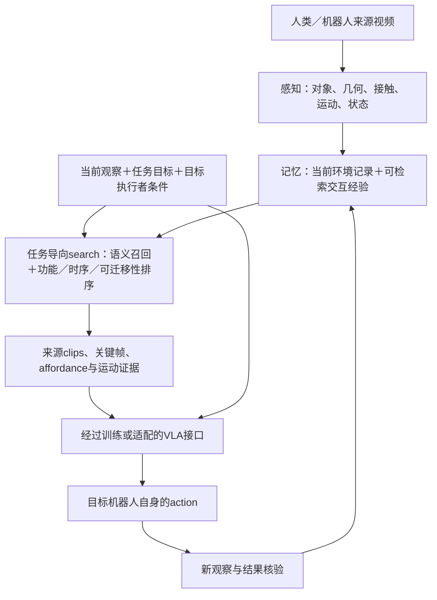

# Affordance驱动的交互视频检索与VLA行动学习：文献综述

**日期与检索截止：2026-11-03｜类型：定向范围综述（Scoping Review）｜候选研究方向，未实现或实验验证。**

本报告依据用户本轮两张草图及说明，集中研究“视频→交互记忆→任务/affordance导向检索→示范证据→VLA→动作”。这与此前只评价对象位置维护的讨论有所不同；保留旧文档，不自动修改项目总控。主体对照31篇研究，其中15篇新增至持续文献档案；数据资源为辅助线索，不计入31篇。并非穷尽式系统综述，也不按不同协议的成功率排列统一SOTA。

当前pipeline依据为[任务驱动Affordance检索：Pipeline v3](任务驱动Affordance检索_Pipeline_v3.md)；本报告提供对应文献证据，不另行指定替代架构。

**结论先行：** 这是一条有明确研究基础的路线，但RAM、Actron3D、R+X、ReCAP、RA-VLA与Robota-Embed已分别覆盖相当接近的检索、共享交互表示或策略接口。候选贡献应放在“affordance是否使跨视角、跨执行者的示范检索更有用，以及是否改善目标机器人的动作学习/执行”，不能仅靠串联模块。检索到相同结果的片段、检索到相同交互机制的片段，以及获得目标机器人可执行动作，是三个需要分别验证的层次。

## 1. 可转交给pipeline Agent的展开描述

系统以人类或不同机器人的交互视频作为经验来源，通过感知提取对象、局部几何、潜在交互区域、已发生的接触/运动及前后状态，并把相关视频、关键帧、空间线索和来源组织进记忆。新任务到来时，search结合任务目标与当前环境状态，先找到相关对象和交互候选，再根据affordance、对象相对运动、目标效果、视角对应及目标执行者条件排序，取出可供迁移的核心片段。

检索结果是一组有时间边界与来源的证据：keyframes、affordance表示/序列、对象运动与结果线索，以及原始clips。它们通过经过适配的接口，作为VLA训练资料或执行时示范条件，帮助目标机器人产生自身动作。执行后的观察再更新当前环境记忆及本次经验。视频可以跨人、机械臂和工具，但共享的是交互层面的线索；具体控制仍受机器人能力、工具作用及动作空间约束。

这里是对用户意图的解释，不是最终架构。图二的memory/tasks是search的两类依据；memory中的obj、cross-view和affordance相互支持，而不是三个互不相干的检索器。

用户原图已在v3归档，参见[整体pipeline草图](figures/Pipeline_v3_用户草图_总体流程.png)与[search草图](figures/Pipeline_v3_用户草图_检索模块.png)。

## 2. Search究竟应比较什么？

### 2.1 区分两种记忆用途

- **环境状态记忆（Scene/State Memory）：** 当前环境中有什么、最后见于哪里、哪个区域空闲、证据是否仍有效。
- **交互经验记忆（Interaction/Episodic Library）：** 某次视频中谁通过什么部位/工具、怎样改变对象，以及何时发生、结果如何。

二者可以共用存储和索引，逻辑职责仍须区分。只维护场景地图，不会自动获得能教动作的示范；只建立技能库，也不能保证知道当前桌面已经被占用。

### 2.2 单张affordance map不足以定义“相似action”

同一接触热区可能对应推、拉、抬起；相同目标位置也可能通过滑动或抓放到达。候选检索单元应至少考虑：

| 字段 | 对检索的作用 |
| --- | --- |
| 对象及功能角色 | 被移动物、支撑面、容器、作用工具；类别可辅助，但不是唯一匹配依据 |
| 动作/任务条件的交互区域 | 哪里可能接触、支撑或容纳；与一次实际接触证据分开 |
| 接触关系及对象相对运动 | 方向、轨迹、旋转、接触建立/解除及顺序 |
| 前后状态与目标效果 | 从何状态到何状态，是否达到任务；未核验结果不能直接标成功 |
| 空间/视角与来源 | 原始帧区间、对应坐标、尺度、可见性及估计置信度 |
| 执行者与工具条件 | 哪些线索可共享、哪些能力必须由目标系统满足 |

这是基于文献提出的工作表示，不宣称上述字段组合已是新算法。隐式特征、显式记录及连续场都可以实现；选择何种形式由检索效果和成本决定。

### 2.3 “跨本体”不等于消去全部工具信息

以桌面移动为例，人手推物与机器人推物可共享局部接触和对象轨迹；使用长工具时，工具末端—物体关系和机器人—工具关系还要分别处理。吸取、侧推、夹持的前提不同，不能因最后物体位置相同就都作为同一种动作标签。

应先声明检索目标：若任务只要求最终到达右侧，推和抓放都可能是正例；若要求保持支撑接触或不可抓取，抓放应被降权。**目标效果等价、交互机制相似、目标机器人可执行**是不同标签，不能用一个未经定义的“similar action”覆盖。

跨视角也需明确坐标：图像热图随相机改变；对象/接触坐标下的运动更易比较，但需要估计对应、尺度和对称歧义，不能默认完美规范化。

## 3. 最直接的检索与动作前例

以下各行的条件同样重要；“已有先例”不表示覆盖所有场景或无需进一步研究。

| 论文 | 方法与主要贡献 | 你的项目需要正面对照的部分 |
| --- | --- | --- |
| [RAM，P67](https://arxiv.org/html/2407.04689) | 从人、机器人及自采示范建立接触点/轨迹库；语言与视觉层次检索后迁移到目标三维场景 | **affordance＋检索＋跨来源执行已有。** 原始流程接RGB-D和规划器，不是VLA视频上下文 |
| [Actron3D，P15](https://arxiv.org/html/2510.12971) | 将人视频拟合成几何、视觉、接触及点流的连续函数，检索并与目标几何对齐 | **物体空间交互函数＋检索迁移已有。** 单目来源与目标RGB-D条件须分开 |
| [R+X，P78](https://arxiv.org/html/2407.12957) | 语言从长人视频检索动作clip，再用关键点/手轨迹与KAT进行执行 | **长人视频→clip检索→机器人执行已有。** 非VLA，仍有重定向与控制规则 |
| [Affordance RAG，P14](https://arxiv.org/html/2512.18987) | 场景层次记忆结合区域语义及功能排序，检索目标物和容器图像 | 是**场景证据检索**近邻；不能当成已经验证的跨本体动作clip检索 |
| [RICL，P79](https://arxiv.org/html/2508.02062) | 给预训练VLA补训上下文学习能力，从机器人示范读取相关部分辅助新任务 | 说明VLA通常需要先学会使用示范；新任务免更新不等于整个系统免训练 |
| [RA-VLA，P80](https://arxiv.org/html/2608.25585) | 用行为匹配监督学习检索，并训练VLA利用专家片段的动作线索 | **按行为而非只按外观检索已有。** 不能把action-oriented作为充分创新；实测并非通用跨人/工具 |
| [ReCAP，P81](https://arxiv.org/html/2606.15631) | 先以跨本体配对经验训练，之后冻结策略、扩充来源池，检索状态—动作块引导目标动作 | 与整体主张最接近。人手池含跟踪腕位姿，训练需目标动作；并非任意普通RGB片段即插即用 |
| [RoboTok，P83](https://arxiv.org/html/2609.03199) | 用actor坐标系手运动嵌入检索互联网示范，重定向后用于灵巧策略训练 | 接近“找可学习clip”的**训练数据检索**；不是在线VLA条件，也不是对象功能检索 |
| [Robota-Embed，P82](https://arxiv.org/html/2610.19495) | 联合交互图像、语言与原生动作，把当前交互对齐未来视频/动作经验，并接策略上下文 | 最新强近邻；需比较缺少动作通道的RGB条件。跨本体仅定性案例，四源平均检索成绩不是跨本体定量证明 |

**研究脉络：** Robo-ABC从接触对应出发；RAM扩展为接触＋运动检索；Actron3D进一步用连续空间函数迁移。R+X展示长视频检索后执行。RICL→RA-VLA/ReCAP则逐步把示范读取、行为相关检索与跨本体适配连接到VLA。RoboTok与Robota-Embed说明“用运动/动作而非外观索引经验”也已有明确实践。

### 如何阅读最新结果？

RA-VLA是ICML 2026论文；VLAff为IROS 2026；ReCAP、RoboTok、Robota-Embed等在本轮按预印本处理。它们的训练数据、动作通道、示范数量、策略骨干与真实任务均不同，不直接用百分比排列谁“最好”。

ReCAP的[作者页](https://recap-robot.github.io/)列代码、数据和权重入口；Robota-Embed的[作者页](https://robota-ai.github.io/robota-embed/)仍标代码/模型与benchmark待发布。入口存在、论文可读、完整复现和硬件可运行是不同状态，本轮没有运行验证。

## 4. Affordance和对象运动：哪些表示值得借鉴？

| 论文 | 表示及主要贡献 | 适用边界 |
| --- | --- | --- |
| [AROS，P03](https://doi.org/10.3389/frobt.2023.1076780) | 用接近关系及空余空间匹配人体—场景交互 | 保留其局部几何思想；静态人体姿态不是动态机器人动作示范 |
| [O³Afford，P04](https://arxiv.org/html/2509.06233) | 联合两物体语义特征和点云，预测双方功能区域并用于规划约束 | 对象—对象关系很相关；点级标量区域不独自表示时间和运动方向 |
| [VRB，P30](https://arxiv.org/html/2304.08488) | 从人视频接触与接触后轨迹学习交互先验，服务不同机器人学习方式 | 区分“哪里”和“怎样动”；不是当前环境的持久记忆 |
| [Robo-ABC，P85](https://arxiv.org/html/2401.07487) | 检索人视频来源接触示例，通过视觉/语义对应迁移到新类别 | 提供跨类别对应基线；外观对应不能直接当作功能或结果等价 |
| [FlowBot3D，P86](https://arxiv.org/html/2205.04382) | 用每点三维关节运动方向引导操作 | 说明向量比热图多表达方向；主要铰接物体，非任意视频技能 |
| [Track2Act，P87](https://arxiv.org/html/2405.01527) | 从视频学习目标条件点轨迹，再转为机器人计划及残差控制 | 借鉴运动中间表示；仍需目标图、几何和在域机器人适配 |
| [3DFlowAction，P88](https://arxiv.org/html/2506.06199) | 从人/机器人视频学目标物未来三维流，并优化生成动作 | 直接支持对象运动作为跨本体接口；没有自动解决clip检索 |
| [VidBot，P89](https://openaccess.thecvf.com/content/CVPR2025/papers/Chen_VidBot_Learning_Generalizable_3D_Actions_from_In-the-Wild_2D_Human_Videos_CVPR_2025_paper.pdf) | 将人视频估计运动转为接触/目标及三维轨迹预测，再结合场景执行 | 来源视频与部署RGB-D条件不同；不能直接推广任意工具 |
| [VLAff，P84](https://arxiv.org/html/2608.05215) | 统一学习视觉热区、抓取和接触后轨迹，面向人视频到机器人 | 接近你希望的共享交互接口；[作者页](https://ojh6404.github.io/vlaff/)的数据/模型/代码仍为soon |

**对本项目的具体启发：** 初版不宜只检索热图embedding。可先比较“语义”“语义＋热区”“热区＋对象相对运动”“再加状态效果”四种条件。接触、流和结果都可能由视觉估计得到，应保留可见性与置信度，避免把伪标签当真实物理事实。这里的比较方案是研究建议，不是文献已证明的最优组合。

## 5. Memory和cross-view文献怎样接到这条主线？

| 论文 | 记忆单元及读取接口 | 已证明什么／尚需补什么 |
| --- | --- | --- |
| [3D-Mem，P18](https://arxiv.org/html/2411.17735) | 共可视对象组＋原始snapshot；按任务选证据 | 有3D对象关联及证据图选择；不是动作示范表示 |
| [SpatialMem，P19](https://arxiv.org/html/2601.14895v4) | RGB估计空间结构、对象节点与来源图像；空间查询 | 可借鉴空间对齐和可追溯图像；未建立VLA动作接口 |
| [STaR，P13](https://arxiv.org/html/2602.09255) | 3D primitive＋视频描述＋关键帧；任务读取与去冗余 | 任务条件证据选择、功能性查询已有；原始输入含配准几何/位姿 |
| [SOMA，P48](https://arxiv.org/html/2605.22283) | 扫描RGB形成空间对象token，指令/当前视觉读取后产生动作 | 已覆盖环境视频→空间记忆→VLA；并非跨来源技能clip库 |
| [MemER，P91](https://arxiv.org/html/2510.20328) | 本episode历史关键帧→高层语言子任务→低层π0.5 | 是可用的间接接口参照；历史帧并非直接送入action expert |
| [MemoryVLA，P47](https://arxiv.org/html/2508.19236) | episode感知/认知token bank→注意力及门控→动作 | 示范隐式历史读取；不等同显式返回跨视角对象或原始clip |

环境完整度与动作知识是互补维度。多视角能补足对象几何和局部区域，但静态绕拍不会自然提供“推了以后怎样运动”的证据。当前环境记忆应帮助判断来源示范的前提是否满足；交互库则提供过程和结果线索。

若将全部贡献都放在这两个记忆系统、跨视角关联、检索器和VLA上，研究范围过大。可把已有空间建图和VLA作为固定组件，首先检验检索表示的增益。

## 6. 检索证据怎样进入VLA？两条路线不能混称

### 路线A：训练数据选择（Retrieval for Learning）

search挑选相关片段，供表示预训练、affordance教师、辅助损失或目标策略适配使用。人视频可提供接触、对象流、未来状态或latent action伪监督；没有目标机器人动作的片段不能直接充当标准机器人行为克隆的动作标签。

RoboTok更靠近这一用法。[UniVLA，P41](https://arxiv.org/html/2505.06111)从异构视频学习任务中心latent actions，再以目标机器人decoder接控制；[MimicPlay，P90](https://arxiv.org/abs/2302.12422)从人play学习高层计划，低层仍用机器人遥操作训练。这些都支持“人视频提供可迁移知识”，不支持“无需任何动作grounding即可控制新机器人”。

### 路线B：执行时检索条件（Retrieval-conditioned Execution）

每次任务/动作阶段检索，固定或适配后的VLA读取证据生成动作。RICL、RA-VLA、ReCAP是直接参照。其新任务可以免权重更新，但此前已经训练过读取上下文或跨本体适配能力。

[Vid2Robot，P40](https://arxiv.org/html/2403.12943)通过跨注意力读取给定人/机器人示范视频；训练使用同任务机器人轨迹动作，原模型不以语言为输入。这说明“能看视频”的接口可以训练出来，却不能默认任意VLA都能使用任意clip。

### 三种affordance接法也不同

| 论文 | 接口与贡献 | 对本项目的意义 |
| --- | --- | --- |
| [AffordVLA，P08](https://arxiv.org/html/2605.17517) | 训练期教师特征对齐，把功能先验融入VLA | 可做表示监督；不是执行时外部map token接口 |
| [AffordanceVLA，P55](https://arxiv.org/html/2606.06155) | Which/Where/How功能中间表示，经专门专家结构连接动作 | 可参考结构化条件；不代表能直接接你生成的外部token |
| [AffordanceWAM，P56](https://arxiv.org/html/2609.22332) | 人视频监督世界/时序功能，机器人数据监督动作 | 时序affordance与动作联合建模已有；action expert读RGB/标量latent，并非直接读取热图流 |

因此图中的“affordance map - tokens”需要约定：坐标、时间采样、目标条件、维度/编码器、置信度、来源索引，以及VLA通过什么adapter读取。首版可以先用显式关键帧/轨迹作为上下文，确认有价值，再研究更紧凑的latent tokens；token化本身不自动构成贡献。

## 7. 候选研究问题与创新判断

### 已有证据支持的部分

- 从人视频抽取接触和运动，并迁移到机器人，已有多条路线。
- 检索动作示范并引导执行，以及检索增强VLA，均已有直接工作。
- 任务条件记忆读取、跨视角空间对象记忆和功能表示接动作，也已有先例。

以上“已有”只指相应论文条件内的证据，不是任意人视频、工具、机器人均已解决。

### 仍值得检验的三个问题

1. **功能与过程是否比外观更能找到可迁移示范？** 匹配同预算下，显式功能角色、接触和对象运动能否超过语义、行为检索及RAM/RA-VLA风格适配基线？
2. **如何对跨来源clip进行任务相关的可迁移性排序？** 当目标效果相似而接触机制/工具不同，怎样根据当前任务和目标能力决定使用、降权或拒绝？“可执行”仍须独立验证。
3. **得到的检索收益是否真的传到VLA？** 在相同策略和动作数据下，提升检索是否减少所需机器人示范，或提高新对象/视角/执行者条件下的任务成功率？

它们都是待验证假设。**整体组合重复风险高；聚焦检索表示与可迁移性评价有条件值得做。** 当前证据不足以宣称“首个affordance-guided跨本体检索VLA”。AROS可作为几何关系与空余空间的启发，是否真正带来增量应由消融决定。

候选题目：*Affordance- and Object-Dynamics-Guided Demonstration Retrieval for Cross-Embodiment VLA Adaptation*。该名称用于讨论，不锁定方法或结果。

## 8. 怎样证明它有效，而不只是检索图看起来相似？

### 8.1 先定义正例，再建立检索评测

按任务分别标注目标效果、交互机制、对象角色、空间前提和目标执行者兼容性，允许多个正确示范。候选包含视觉相似但动作方向相反、同动作但空间前提不满足、不同类别却功能相近、相同效果但策略不同等情况。

“推”与“拿起再放”是否互为负例，取决于任务约束，不能一刀切。功能判断尽量由独立标注/仿真结果验证，不能只让生成affordance的同一模型给自己评分。

### 8.2 必需对照与消融

- 无检索、随机检索、全图语义/视频特征检索。
- 动作/运动相关检索，以及RAM、RA-VLA/ReCAP思路的可比适配；注明输入变化，不能称完整复现。
- 单帧热图、热图＋时序运动、再加前后状态/工具条件；共同使用感知和候选库。
- 当前帧与环境记忆条件，普通检索与任务/能力条件排序。
- oracle相关clip作上界诊断：用于分析策略是否会用证据，不作为可部署成绩。

[When Does Retrieval Help?，P92](https://arxiv.org/html/2610.05492)在RICL设置下发现，随机检索也可有收益，离线检索诊断不总能预测任务表现。故不能仅靠R@K或演示可视化宣称动作学习有效。

### 8.3 两层指标与公平条件

检索层报告Recall/nDCG、功能/机制匹配、动作方向/状态转移错误、片段边界、冗余和延迟。机器人层报告任务成功、过程约束违例、失败类型、数据效率、执行时间及重检索次数；辅助记录affordance质量，不用注意力热图代替因果证据。

固定策略骨干、目标机器人训练数据、候选库和查询可读信息；匹配top-K、帧/token预算，并计入离线建库与在线检索成本。跨场景、跨对象、跨视角、跨机械臂、跨工具分开报告，之后再测组合变化。按原始episode/采集场景/来源视频分割，防止同一动作相邻clip或同一实物重扫泄漏；相机视角切分也不能代替真正跨本体测试。

查询只读取当前及过去观察、任务给定目标与允许状态；历史库可读其已发生结果。查询episode的未来帧、未来动作或隐藏仿真状态不能进入部署检索器。RGB与带深度/位姿/原生动作组分列；数据量和计算预算固定后再讨论检索带来的增量。

## 9. 数据与实施范围对本轮问题意味着什么？

已有[数据与仿真需求清单](数据与仿真Agent_需求交接清单_2026-11-02.md)偏向场景维护；本轮额外需要**可切成完整交互事件的来源视频及跨来源评测**，不能只找静态重建环境。

| 资源方向 | 在此项目中的用途 | 缺失条件 |
| --- | --- | --- |
| [HOI4D](https://hoi4d.github.io/)、[HOT3D](https://facebookresearch.github.io/hot3d/) | 手—物时空几何与跟踪，构造来源片段 | 不直接提供目标机器人命令或完整潜在功能 |
| [VISOR](https://epic-kitchens.github.io/VISOR/site)、[EgoDex](https://github.com/apple-aiml-research/ml-egodex) | 自然交互片段/关系或人手轨迹 | 动作/接触/对象状态标签各不相同；需补任务相关对照 |
| [DROID](https://www.droid-dataset.org/)、[Open X-Embodiment](https://robotics-transformer-x.github.io/) | 带动作机器人经验与本体数据来源 | 多本体数据存在，不等于任务/对象配对或控制空间自动统一 |
| VLAff的EgoAffordance、RoboTok资源 | 功能监督或互联网动作检索候选 | 发布完整性和原始视频许可逐项核查；VLAff当前仍标soon |
| 可控桌面仿真 | 对象状态、工具条件、相机与失败反例，连接固定机器人策略 | 需自建公平查询/库划分和结果核验，不能以GT直接帮助RGB检索 |

数据资源说明沿用11/02核查并补充本轮作者页，不代表实际取得全部数据。本轮无下载、模型安装、训练、硬件实测或网站发布。学校SSH GPU与5060配置仍需平台侧核实。

推荐先做一个窄任务族：桌面目标物移动，明确是只要求最终位置，还是限定推动过程。固定一个目标机器人和一个可读示范的策略接口；先测来源视角/外观变化，再引入另一机器人或人视频。工具替换保留为单独后续轴，避免第一版同时承担重建、追踪、跨工具、VLA训练与完整机器人控制。

## 10. 建议阅读顺序与证据入口

先读 **RAM→Actron3D→ReCAP→RA-VLA**，确定最直接重复风险；再读 **VLAff/VRB→3DFlowAction→UniVLA**，决定共享表示和动作grounding；随后读 **SOMA/STaR/MemER**明确环境记忆、证据读取和策略接口，最后用 **When Does Retrieval Help?**检查评价设计。

以下参考表列出主体31篇的完整题名及原始来源。A表示核查相关方法和实验（含分工阅读及AROS既有正文核查），B表示原始摘要/作者概况；均不表示复现。详细输入、监督与限制见[结构化证据表](交互示范检索_VLA_文献证据表_2026-11-03.json)，实际查询与版本边界见[检索记录](交互示范检索_VLA_检索与证据记录_2026-11-03.md)。新论文及阅读补充只追加到[持续文献档案](相关文献档案_持续追加.md)。

| 档案 | 论文完整题名 | 作者 / 年份状态 | 阅读 |
| --- | --- | --- | --- |
| P03 | [AROS: Affordance Recognition with One-Shot Human Stances](https://doi.org/10.3389/frobt.2023.1076780) | Abel Pacheco-Ortega; Walterio Mayol-Cuevas；Frontiers 2023 | A |
| P04 | [O³Afford: One-Shot 3D Object-to-Object Affordance Grounding for Generalizable Robotic Manipulation](https://arxiv.org/html/2509.06233) | Tongxuan Tian; Xuhui Kang; Yen-Ling Kuo；CoRL 2025 | A |
| P30 | [Affordances from Human Videos as a Versatile Representation for Robotics](https://arxiv.org/html/2304.08488) | Shikhar Bahl et al.；CVPR 2023 | A |
| P85 | [Robo-ABC: Affordance Generalization Beyond Categories via Semantic Correspondence for Robot Manipulation](https://arxiv.org/html/2401.07487) | Yuanchen Ju et al.；2024 arXiv版 | A |
| P86 | [FlowBot3D: Learning 3D Articulation Flow to Manipulate Articulated Objects](https://arxiv.org/html/2205.04382) | Ben Eisner; Harry Zhang; David Held；RSS 2022 | A |
| P87 | [Track2Act: Predicting Point Tracks from Internet Videos Enables Generalizable Robot Manipulation](https://arxiv.org/html/2405.01527) | Homanga Bharadhwaj et al.；ECCV 2024 | A |
| P88 | [3DFlowAction: Learning Cross-Embodiment Manipulation from 3D Flow World Model](https://arxiv.org/html/2506.06199) | Hongyan Zhi et al.；2025预印本 | A |
| P89 | [VidBot: Learning Generalizable 3D Actions from In-the-Wild 2D Human Videos for Zero-Shot Robotic Manipulation](https://openaccess.thecvf.com/content/CVPR2025/papers/Chen_VidBot_Learning_Generalizable_3D_Actions_from_In-the-Wild_2D_Human_Videos_CVPR_2025_paper.pdf) | Hanzhi Chen et al.；CVPR 2025 | A |
| P84 | [VLAff: Vision-Language-Affordance Model for Unified Actionable Affordances](https://arxiv.org/html/2608.05215) | Jihoon Oh; Kento Kawaharazuka; Kei Okada；IROS 2026 | A |
| P67 | [RAM: Retrieval-Based Affordance Transfer for Generalizable Zero-Shot Robotic Manipulation](https://arxiv.org/html/2407.04689) | Yuxuan Kuang et al.；CoRL 2024 / PMLR 2025 | A |
| P15 | [Actron3D: Learning Actionable Neural Functions from Videos for Transferable Robotic Manipulation](https://arxiv.org/html/2510.12971) | Anran Zhang; Hanzhi Chen et al.；2025首发 / ICRA 2026；v2 2026-10 | A |
| P78 | [R+X: Retrieval and Execution from Everyday Human Videos](https://arxiv.org/html/2407.12957) | Georgios Papagiannis; Norman Di Palo; Pietro Vitiello; Edward Johns；2024首发 / ICRA 2025 | A |
| P14 | [Affordance RAG: Hierarchical Multimodal Retrieval with Affordance-Aware Embodied Memory for Mobile Manipulation](https://arxiv.org/html/2512.18987) | Ryosuke Korekata; Quanting Xie; Yonatan Bisk; Komei Sugiura；2025预印本 | A |
| P79 | [RICL: Adding In-Context Adaptability to Pre-Trained Vision-Language-Action Models](https://arxiv.org/html/2508.02062) | Kaustubh Sridhar; Souradeep Dutta; Dinesh Jayaraman; Insup Lee；CoRL 2025 | A |
| P80 | [RA-VLA: Retrieval-Augmented VLA for Test-Time Adaptation](https://arxiv.org/html/2608.25585) | Sanghwan Jang et al.；ICML 2026；arXiv v2 2026-10 | A |
| P81 | [Retrieve, Don’t Retrain: Extending Vision-Language-Action Models to New Tasks at Test Time](https://arxiv.org/html/2606.15631) | Jeongeun Park et al.；2026-06预印本 | A |
| P83 | [RoboTok: A Scalable Data Engine for Internet Demonstration Video Retrieval and Dexterous Manipulation Learning](https://arxiv.org/html/2609.03199) | Howard Qian et al.；2026-09预印本 | A |
| P82 | [Robota-Embed: Unified VLA Embeddings for Robot In-Context Learning and Evolution](https://arxiv.org/html/2610.19495) | Yunze Liu; Jing Wang; Shenrui Wu et al.；2026-10预印本 | A |
| P92 | [When Does Retrieval Help? A Study of In-Context Adaptation in Vision-Language-Action Models](https://arxiv.org/html/2610.05492) | Zixuan Liu; Joris Köster; Zizhan Zheng; Siavash Khajavi；2026-10预印本/工作坊稿 | A |
| P18 | [3D-Mem: 3D Scene Memory for Embodied Exploration and Reasoning](https://arxiv.org/html/2411.17735) | Yuncong Yang et al.；CVPR 2025 | A |
| P19 | [SpatialMem: Metric-Aligned Long-Horizon Video Memory for Language Grounding and QA](https://arxiv.org/html/2601.14895v4) | Xinyi Zheng et al.；2026预印本v4 | A |
| P13 | [STaR: Scalable Task-Conditioned Retrieval for Long-Horizon Multimodal Robot Memory](https://arxiv.org/html/2602.09255) | Mingfeng Yuan et al.；RA-L 2026 | A |
| P48 | [Spatial Memory for Out-of-Vision Manipulation in Vision-Language-Action](https://arxiv.org/html/2605.22283) | Pengteng Li et al.；ICML 2026 | A |
| P91 | [MemER: Scaling Up Memory for Robot Control via Experience Retrieval](https://arxiv.org/html/2510.20328) | Ajay Sridhar; Jennifer Pan; Satvik Sharma; Chelsea Finn；2025首发 / ICLR 2026 | A |
| P47 | [MemoryVLA: Perceptual-Cognitive Memory in Vision-Language-Action Models for Robotic Manipulation](https://arxiv.org/html/2508.19236) | Hao Shi et al.；2025首发 / ICLR 2026 | A |
| P40 | [Vid2Robot: End-to-end Video-conditioned Policy Learning with Cross-Attention Transformers](https://arxiv.org/html/2403.12943) | Vidhi Jain et al.；2024 | A |
| P90 | [MimicPlay: Long-Horizon Imitation Learning by Watching Human Play](https://arxiv.org/abs/2302.12422) | Chen Wang et al.；CoRL 2023 | B |
| P41 | [Learning to Act Anywhere with Task-centric Latent Actions](https://arxiv.org/html/2505.06111) | Qingwen Bu et al.；RSS 2025 | A |
| P08 | [AffordVLA: Injecting Affordance Representations into Vision-Language-Action Models via Implicit Feature Alignment](https://arxiv.org/html/2605.17517) | Weijie Kong et al.；2026-05预印本 | A |
| P55 | [AffordanceVLA: A Vision-Language-Action Model Empowering Action Generation through Affordance-Aware Understanding](https://arxiv.org/html/2606.06155) | Qize Yu et al.；2026-06预印本；v2 2026-10 | A |
| P56 | [AffordanceWAM: Affordance-Aware Joint World-Action Modeling for Robot Manipulation](https://arxiv.org/html/2609.22332) | Jiadi You; Qize Yu et al.；2026-09预印本 | A |

