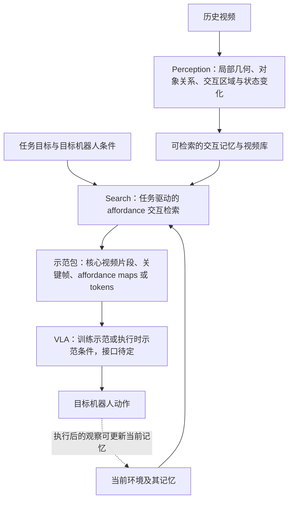
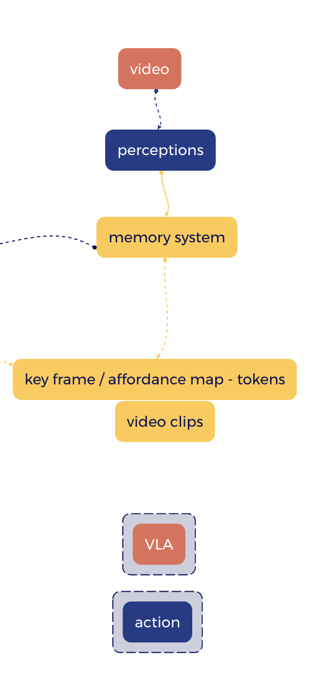
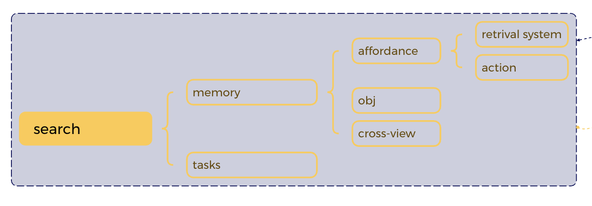

# Pipeline v3：从视频交互记忆到任务驱动的 Affordance 检索与机器人动作

**当前最新版 / 后续讨论的首要 pipeline 依据**  
**更新日期：2026-11-03**  
**状态：项目负责人确认的研究方向；算法、训练方式与实验效果尚未验证。**

> **后续阅读说明（2026-11-06核对）：**本文件保留11月3日的整体pipeline。最新澄清为“环境是主体，affordance是环境记忆中的可学习层，search是读取机制之一”；开始实验时优先读取[环境记忆特征层补充设计](环境记忆Affordance特征层_可行性与实现建议_2026-11-05.md)和[Mac→Isambard实验计划](环境记忆Affordance层_快速验证实验计划_Mac_Isambard_2026-11-05.md)。统一入口见[实验前研究交接](实验前研究交接_2026-11-06.md)。

## 1. 当前主线与核心研究问题

从视频建立可检索的交互记忆，结合当前环境和任务目标，通过以 affordance 为依据、面向动作的 search，找到可供目标机器人借鉴的核心示范片段，再交给 VLA 学习或生成动作。

**本版的核心算法研究对象是 search：如何表示、比较和检索对当前任务有用且有迁移价值的交互过程。** 记忆系统提供交互经历，search 选择值得借鉴的经历，VLA 将其用于目标机器人的动作。来源可以跨视角、机械臂与工具；人类操作视频是希望进一步支持的来源，不表示跨执行者迁移已得到验证。

研究问题：能否学习一种以局部几何、affordance、交互过程和状态变化为基础的时序表示，使系统根据当前环境与任务目标，跨视角、跨执行者检索可迁移的示范片段，并帮助 VLA 学习或生成动作？

## 2. 整体流程与用户草图

下图为项目负责人提供的整体流程草图。图中 memory system 到 key frame / affordance map / tokens / video clips 的筛选过程，由本版的自研 search 模块完成。

下图展开 search：同时使用 memory 与 tasks，关注 affordance、object、cross-view，以及与动作和检索的关联。它描述所需能力，尚未规定每个分支都对应一个独立网络。

## 3. 各环节的内容和接口

### 3.1 Video → perception → memory

历史视频经过感知，提取交互前的对象和环境状态、局部几何、可能的交互区域、接触与操作过程，以及交互后的状态变化。**局部几何仍是交互的基本单元**，不强制依靠物体类别或固定动作标签建立检索。

记忆需要关联可搜索的特征与原始视频来源，包括片段起止时间、关键帧和对应的 maps / tokens。学习得到的隐式特征仍是重要方向；视频索引和时间等可追溯信息可以显式保存。具体记忆结构、三维恢复方法和时序编码器尚未确定。

需在功能上区分：

- **当前环境记忆：** 当前任务所在环境的观察历史及状态，为查询提供条件。
- **历史交互记忆库：** 可被检索和借鉴的示范经历，来源可包括其他场景与执行者。

二者是否使用共享编码器或同一种存储结构，属于后续算法选择。

### 3.2 Memory + task → action-oriented search

查询同时包含当前环境、任务目标，以及与执行可行性有关的目标机器人条件。检索综合比较以下内容：

| 因素 | 要比较的内容 |
| --- | --- |
| Object / geometry | 与操作有关的对象形状、局部几何和环境关系 |
| Affordance | 哪些区域支持何种交互，以及交互所需条件 |
| Action / temporal process | 接触方式、操作过程、物体运动与关系变化 |
| Cross-view | 不同视角中能否对齐同一种交互关系 |
| Task / outcome | 示范中的状态变化和结果是否有助于当前目标 |
| Target feasibility | 目标机器人的末端、可达范围和控制方式是否支持借鉴该交互 |

这些是候选检索依据，不是已经确定的评分公式。后续需研究单帧 affordance map 如何扩展为可比较的时序交互表示，以及如何学习查询与片段之间的匹配。

**检索相似性应覆盖“操作前条件 → 可交互区域 → 交互过程 → 状态变化”。** 仅有相似外观、相同物体名、相同执行者或相同最终位置，都不足以说明片段适合借鉴。查询时不能使用当前任务尚未发生的真实结果；历史已完成示范的观察结果可以作为库中记录。

### 3.3 Search → 示范包

搜索输出一组相关候选，每个候选关联：核心视频片段、操作前／接触时／操作后的关键帧，以及时间对应的 affordance maps 或隐式 tokens。保留原视频及时间来源，便于解释和检查检索结果。

视频保留过程，关键帧突出变化，tokens 为后续模型提供可学习的输入。关键帧选择、片段边界、map 定义和 token 化方式都需要设计；不预设单张热力图足以表达完整交互。

### 3.4 示范包 → VLA → action

以 VLA 为主要下游，保留两条尚未确定的接口：

| 路线 | 检索结果的用途 | 仍需明确的内容 |
| --- | --- | --- |
| 训练时检索 | 选择或提供训练示范，帮助模型学习动作 | 视频监督如何与目标机器人动作对齐、怎样利用跨执行者示范 |
| 执行时检索 | 把示范片段或 tokens 作为当前动作生成的条件 | VLA 的示范接口、条件训练方式和执行时开销 |

二者可能组合，但不能把“检索训练数据”和“执行时接收示范”当成同一种学习方式。尚未选定 VLA、控制器或适配算法，不假定现有 VLA 无需训练即可使用这些输入。

## 4. 桌面移动物体的例子与迁移边界

当前任务是将桌面上的物体移向目标区域。历史示范可以来自人手、不同机械夹爪或工具，系统优先比较局部接触、支撑关系、运动过程和结果。

人手推动盒子与夹爪推动杯子，可能共享“接触侧面、施加作用、物体沿支撑面移动”的交互结构。把物体拿起来再放到相同终点，虽然最终位移相近，却有不同的接触方式和运动条件，应由任务和目标机器人能力判断是否相关。

**希望迁移的是可共享的交互信息，目标机器人动作仍需适配。** 人类视频可提供接触区域、物体运动和状态变化的观察证据，但普通视频不直接提供目标机器人的关节动作标签。Affordance 也受执行者、工具和环境影响，不能将不同执行者的 map 直接假定为完全相同。

## 5. 本版继承的要求与尚未锁定的选择

- 视频是主要信息来源，局部几何是交互基本单元；关注动作与状态变化，不局限于语义标签或 bounding box。
- 后续主要对接 VLA；学习得到的隐式表征仍重要，训练期允许显式几何或交互监督，检索输出也可以包含可视化 map。
- 自研 search 是当前算法主线；perception、存储和 VLA 可根据研究需要复用已有模块。
- 跨视角、跨机械臂和工具是希望研究的能力，人类视频是进一步的目标；应按难度分别验证。
- v2 的 RGB-D、已知相机位姿是早期仿真实验起点；本版没有将所有历史视频强制限定为 RGB-D，也没有承诺仅靠 RGB 即可恢复可靠三维信息。数据模态和监督权限需另行确定。
- 记忆结构、时序 affordance 表示、检索训练目标、视频片段切分、数据与 benchmark、VLA 接口以及真实部署范围仍待研究。

## 6. 候选贡献与验证方向

潜在贡献集中于：任务条件下的时序 affordance 交互表示、跨视角与跨执行者的示范检索，以及检索结果对同一 VLA 的实际帮助。**这些是研究目标，尚不能作为已确立的新颖性或性能结论。**

后续实验应分别回答：

1. 相比外观／语言检索，加入 affordance、交互过程和状态变化，是否更容易找到有用示范？
2. 在物体或终点相似但交互方式不同的例子中，能否检索到适合当前任务的过程？
3. 跨视角、机械臂、工具及人类来源时，哪些交互信息可以共享，哪些需要目标机器人适配？
4. 在相同 VLA 和预算下，相比无检索、随机示范及普通检索，本方法能否改善动作学习或任务执行？

检索相关性、可迁移性和机器人任务收益需要分别评估。新的具体贡献判断应结合针对本主线的文献核查与对照实验。

## 7. 版本与后续阅读约定

本文件记录 2026-11-03 在对话中确认的新主线，作为**当前最新版 pipeline**。后续讨论、文献筛选、算法细化和实验设计优先阅读本文件，再按需要查阅历史资料。

[Pipeline v2](隐式交互记忆_Pipeline_v2.md) 保留为隐式几何交互记忆的早期算法草案，其中局部几何、交互结果监督和机器人适配等内容可作为本版候选组件；v2 的双流 slots、固定记忆尺寸及训练安排不自动成为本版确定设计。2026-11-02 的相关综述与 proposal 作为背景或候选路线，不覆盖本文件确认的主线。

项目总体范围及维护约定见[项目总控](../项目总控.md)。
