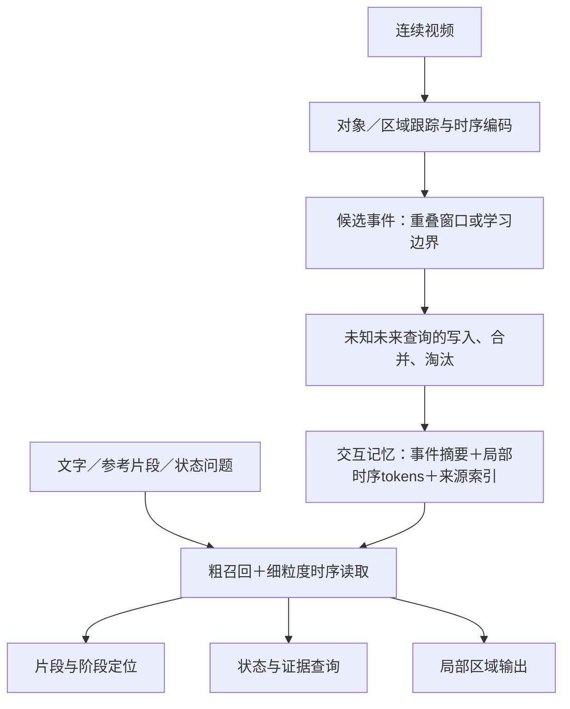

# 独立视频交互记忆：文献综述与最应先读的10篇

**截止日期：2026-11-03｜定向范围综述（Scoping Review）｜26篇主文献，10篇优先阅读。**

本报告将“不接机器人”的视频交互记忆作为独立研究分支。用户提供的构想是待检验设计，不直接当作已有论文结论。本文不改动[项目总控](../项目总控.md)或已确认的Pipeline v3；此前[机器人/VLA综述](交互示范检索_VLA_文献综述_2026-11-03.md)保留为另一份报告。

**判断：可以构成独立研究。** 初版最清楚的成果是“可增量构建、保留局部过程、可回指证据的视频交互记忆”，服务交互检索、阶段/时段定位与对象状态查询。是否接机器人不决定它是不是memory；写入、更新、压缩与信息保留有没有独立机制和评价，才决定记忆部分的研究力度。

## 1. 与机器人路线的区别

| 方面 | 本报告：独立视频交互记忆 | 先前机器人/VLA路线 |
| --- | --- | --- |
| 主要问题 | 看过什么、过程如何、何时/何处发生、记忆怎样保留 | 检索示范如何帮助目标机器人动作 |
| 必要输出 | clip、时间区间、关键帧、区域、状态及证据 | 目标本体可执行动作 |
| 主要监督 | 视频/文本、对应、对象状态、区域及时间标注或伪标签 | 还要动作grounding、控制/本体适配 |
| 主要评价 | 检索与定位、状态证据、有界记忆保真及成本 | 另外评价任务成功与动作约束 |
| 共用内容 | 局部几何、时序表示、来源索引与不确定性 | 可以以后复用，但不是本阶段前提 |

独立任务中，affordance可作为“任务条件的功能区域/交互条件”研究；视频实际呈现的接触、运动和状态变化是另一类证据。一次观察不能覆盖全部潜在可交互区域，视觉上的相关性也不足以证明物理接触、承重或因果结果。先研究可观察的交互过程与状态证据，能让评价更明确。

## 2. 这份构想对应五条文献线

| 文献线 | 回答的问题 | 重点参照 |
| --- | --- | --- |
| 帧级/跨视角过程表征 | 两段视频的哪个阶段对应？ | TCN→TCC→CARL/VAVA→AE2 |
| 局部对象与状态变化 | 变化发生在哪个区域、怎样展开？ | SPOC、VISOR；Ego-Topo提供区域功能组织 |
| 片段检索与时间定位 | 找哪个clip、从何时到何时？ | EgoVLP、Moment-DETR、对象中心VMR、TARA |
| 有界写入和读取 | 什么留下、如何合并、何时淘汰？ | MovieChat→MA-LMM→KeyRec、StreamMem、EventMemAgent |
| 对象/空间/证据记忆 | 对象历史状态如何回查？ | R4DSG、SpatialMem、3D-Mem；Ego4D/EgoMemReason作任务参照 |

这些工作处理不同层面，不能仅凭“用了tokens/graph/memory”就视为同一种方法，也不能按跨数据集的单个分数排序SOTA。

## 3. 我建议怎样把memory具体构建起来？

以下是**基于文献的候选模块划分**，不是任何一篇论文已验证的完整组合，也不代替pipeline Agent的算法设计。

### 3.1 一条经历记录

候选单元可写为：

**Episode = {来源视频与时间区间，粗检索向量，局部时序tokens，关键证据索引，估计质量}。**

- 粗向量负责快速召回；局部tokens保留区域和过程，供重排、对齐或定位。
- 可学习特征与显式时间/来源可以共存。显式索引不是手写语义规则；学习到的向量也不自动证明模型理解了交互。
- “学习特征库”“模型权重记住知识”“可按坐标查询的隐式三维场”是不同选择。本轮无需预先承诺完全隐式场。
- 几何是有价值的候选信息，不是所有视频都拥有精确三维。RGB估计和真实深度/位姿分组；没有证据的接触与状态保持未知。

### 3.2 写入和读取分开

| 环节 | 可借鉴的做法 | 需要自己验证的内容 |
| --- | --- | --- |
| 编码 | AE2/TCC的阶段特征；SPOC的局部状态信号 | 能否共同保留局部差异和跨视角过程 |
| 片段形成 | 重叠窗口起步，再比较事件边界方法 | 漏掉短暂接触、重复动作或无动作时段的影响 |
| 维护 | MA-LMM相邻合并；KeyRec的事件add/merge/evict | 合并后是否丢失方向、前后状态与失败例 |
| 检索 | 粗向量召回；对象关系/时序tokens重排 | 与全图特征、EgoVLP/TARA及对象VMR比较 |
| 输出 | 来源时段、阶段、区域或状态读取头 | 不默认同一套特征天然支持所有任务 |

记忆先写入、未来问题随后到来，是你构想中重要的协议。用户已提出问题后再扫全视频选帧，与事先不知道问题的保留机制不同。模型可以采用哪一种，但必须声明；在线定位还要单列query已知与未知的条件。

### 3.3 两类“历史”与持久化

当前环境状态应与已发生经历区分：物体移动后，旧位置仍可回答“之前在哪里”，却不能继续充当当前位置。可保留状态有效区间和证据链，不必删掉旧经历。

运行中的GPU token bank、磁盘上的经历索引、原视频档案是三类开销。原视频持续增长而神经bank固定，只能称**模型侧有界记忆**，不能称全部存储恒定。若要主张跨会话持久化，还需序列化、恢复、来源有效性和恢复前后结果一致性测试；本报告所列在线方法并非都已验证这些能力。

## 4. 最应先读的10篇

顺序兼顾理解memory机制与当前研究相关性，不代表统一性能排名。每篇都说明“借什么”和“不能直接推什么”。A=相关方法/实验核查（含分工阅读），不等于复现。

**通俗阅读提示：** 1–3主要讲“怎样存和维护”；4–6讲“特征应该记住什么”；7–9讲“怎样查回相关过程”；10讲“怎样组织环境功能”。下文杯子、厨房等例子用于说明机制，不代表对应论文都以这些场景做过实验。

### 1. MA-LMM｜MA-LMM: Memory-Augmented Large Multimodal Model for Long-Term Video Understanding

**Bo He et al.；CVPR 2024｜[原始论文](https://arxiv.org/html/2404.05726)｜P93，A。**

**方法与贡献：** 视觉bank＋逐层query-feature bank，相邻相似条目合并，Q-Former读取。顺序帧特征与训练后的查询Transformer；learned query非用户问题。

**浅显解释：** 把它想成一本页数有限的笔记本。模型逐帧看视频，保留两类笔记：画面特征，以及模型从历史中提炼的特征。如果杯子连续很多帧几乎不动，没有必要每帧都占一页；容量满时，它会找相邻且最相似的特征合并。之后，读取模块从笔记里取信息，再交给语言模型回答。这里的笔记是数值特征，不是人工写的文字摘要。

**贡献具体在哪里：** 给出了“边看、边存、边压缩”的具体神经记忆结构，使长视频理解不必总把全部画面同时送进语言模型。你可以借它搭建基础bank，再检验普通相似合并是否丢掉短暂接触和状态转折。

**为什么读：** 如何把逐帧特征变成可被模型读取的有界bank。它适合建立memory机制的基本概念和早期基线。

**阅读时带着的问题：** 比较视觉bank与逐层query bank的作用；检查相邻平均会不会抹掉短暂接触或状态转折。

**验证与边界：** LVU/Breakfast/COIN、视频QA及caption；固定bank不等于跨会话持久库，也未保留明确交互区域。

### 2. KeyRec｜KeyRec: Bounded Visual Memory for Streaming and Long-Video Understanding

**Zihan Chen et al.；2026-09预印本｜[原始论文](https://arxiv.org/html/2609.32182)｜P94，A。**

**方法与贡献：** 近历史cache＋事件token包，query未知时add/merge/evict；到问题后固定预算读取。training-free，已预训练视觉/语言模型；写入不读未来问题。

**浅显解释：** 它像“工作台＋事件档案”。刚看到的内容留在工作台，保存较多细节；较早内容整理成事件包。新内容与旧事件很相近，可以合并；有新信息则考虑新增；空间不够时按维护规则淘汰。问题来之前，系统并不知道以后会被问什么；问题来了，再决定有限的读取额度分给近期细节还是较远事件。

**贡献具体在哪里：** 它同时设计了“信息怎样留下”和“问题来了读多少”，并把存储预算与回答时的输入预算分开。对你而言，最值得借鉴的是可逐项评价的写入、合并、淘汰机制，而不是仅建立一个不断增大的视频向量库。

**为什么读：** 把写入、合并、淘汰和问题到来后的读取分开，是本轮最直接的记忆维护对照。

**阅读时带着的问题：** 跟踪一个事件从候选到保留/合并/淘汰的路径；分别统计写入容量与decoder读出容量。

**验证与边界：** 流式/长视频QA、存储与读出预算曲线；事件token未明确编码接触/几何；时间索引不自动包含可回看的原视频。

### 3. R4DSG｜R4DSG: Relative 4D Scene Graph Memory for Object-Centric Question Answering in Long Egocentric Video

**Ke Ma et al.；2026 arXiv版；正文标ACM MM 2026｜[原始论文](https://arxiv.org/html/2608.11017)｜P22，A。**

**方法与贡献：** 相对对象/锚点关系及状态区间写成可检索窗口记忆。RGB前端、分割关联与相对几何；离线处理。

**浅显解释：** 可以把它理解成“带时间的物体关系账本”。桌面、柜子等稳定位置作为参照，记录杯子曾与哪个参照相邻、后来移向哪里、这种变化发生在什么时段。它不强求给整个房间恢复一套精确坐标，而把持续的相对关系变化整理成可检索记录，供对象问题读取。

**贡献具体在哪里：** 把零散帧中的对象和空间线索变成可查询的状态历史，让系统有机会回答“物体后来去了哪里”。你可以参考对象身份、状态有效区间和来源组织，但它主要是结构化记忆，不等于已解决你希望的隐式交互tokens。

**为什么读：** 思考对象身份、相对位置、状态区间和视频来源怎样一起组织；作为结构化记忆对照。

**阅读时带着的问题：** 哪些信息保存在文本/图节点，哪些来自视觉前端？压缩后对象变化还能否回指证据？

**验证与边界：** EgoLifeQA对象相关子集；小规模单主体验证；非精确度量3D或普遍在线身份，JSON大小非全部存储。

### 4. AE2｜Learning Fine-grained View-Invariant Representations from Unpaired Ego-Exo Videos via Temporal Alignment

**Zihui Xue; Kristen Grauman；NeurIPS 2023｜[原始论文](https://arxiv.org/html/2306.05526)｜P95，A。**

**方法与贡献：** 手/active-object中心编码，soft-DTW及时间反转约束学帧特征。同粗动作分组＋外部手物检测；无逐帧phase/同步配对训练真值。

**浅显解释：** 假设两个人都在倒水，一段是头戴相机，一段从侧面拍，速度也不同。模型先关注手和正在被操作的物体，再学习把“拿起容器、倾斜、倒水、放回”等对应阶段对齐，不要求两段第5秒恰好做同一件事。训练还利用倒序视频，要求特征保留过程的自然先后，而不是把所有帧压成一个模糊的“倒水”标签。

**贡献具体在哪里：** 在不依赖同步拍摄和逐帧阶段标注的条件下，学习细粒度ego/exo表示。它仍需要同粗动作的视频分组及检测先验。对你最直接的价值，是学习跨视角找“相同阶段”，而不是只找画面相似的帧。

**为什么读：** 学习不同录制、不同背景的ego/exo交互阶段表示，直接对应跨视角过程检索。

**阅读时带着的问题：** 分别看对象中心ROI编码、soft-DTW和倒序负例；记下同粗动作分组和外部检测先验。

**验证与边界：** 四类ego/exo数据的阶段、检索及进度；并非任意无筛选长视频；未保证3D对应或跨工具功能等价。

### 5. TCC｜Temporal Cycle-Consistency Learning

**Debidatta Dwibedi et al.；CVPR 2019｜[原始论文](https://debidatta.github.io/tcc_interactive_paper/index.html)｜P96，A。**

**方法与贡献：** A→B→A软近邻cycle-back约束，学逐帧阶段表示。相关活动视频集合；无需同步/逐帧阶段训练标签。

**浅显解释：** 先从视频A选一帧，到视频B找特征相近的时刻，再从B找回A。如果能回到出发帧附近，说明这组对应较一致；回到了完全不同的阶段，就调整编码器。实际训练使用可微的软匹配，不是硬选一个最近邻。这样的往返约束，让特征逐渐适合描述过程阶段。

**贡献具体在哪里：** 把“来回能否对应”变成训练信号，减少对人工阶段标签的依赖。它是理解时序表示的清晰基础；你可以借它训练阶段检索，但遇到重复、缺失或没有对应的阶段，仍需允许歧义或拒绝匹配。

**为什么读：** 用时间循环对应理解为什么逐帧特征可以表达过程阶段，而不只表达动作类别。

**阅读时带着的问题：** 手算A→B→A的soft-nearest-neighbor；想一想重复动作和无对应阶段为什么会歧义。

**验证与边界：** Pouring/Penn Action阶段、检索、进度与Kendall tau；重复、缺失和不匹配阶段不能强制一一对应；非几何memory。

### 6. SPOC｜SPOC: Spatially-Progressing Object State Change Segmentation in Video

**Priyanka Mandikal et al.；2025首发；依据arXiv v2｜[原始论文](https://arxiv.org/html/2503.11953)｜P97，A。**

**方法与贡献：** mask提案及伪标签约束，分割随时间变化的actionable/transformed区域。状态文本/视觉伪监督、跟踪和时序约束；每动词训练。

**浅显解释：** 例如削皮时，同一个物体上可以同时有未处理和已处理的区域。SPOC希望逐帧分出这些局部状态。它先提出区域，用视觉与状态文字的相似度生成初始标签，再利用跟踪和状态顺序修正噪声，训练模型预测哪些区域尚未改变、哪些已经改变。

**贡献具体在哪里：** 将“物体发生了变化”细化为“哪些像素区域怎样逐渐变化”，并提出WhereToChange评价。对你而言，这提供了局部tokens的具体学习目标。其actionable指特定变化中尚可处理的状态，不能直接解释为所有物理上可操作的位置。

**为什么读：** 为局部tokens增加‘物体哪里已经改变、哪里尚未改变’的训练目标，避免只存整物体类别。

**阅读时带着的问题：** 区分mask提案、伪标签与时间约束的贡献；不要把actionable标签直接改名为普遍affordance。

**验证与边界：** WhereToChange及VOST迁移；actionable是特定状态变化定义，不等于完整物理affordance或真实接触。

### 7. Object-Centric VMR｜Object-Centric Framework for Video Moment Retrieval

**Zongyao Li et al.；2025 arXiv版；本轮未核实最终venue｜[原始论文](https://arxiv.org/html/2512.18448)｜P98，A。**

**方法与贡献：** 文本/场景图引导对象tracklet，经关系Transformer定位时段。对象/关系检测先验及有区间标注的检索任务。

**浅显解释：** 查询“人把杯子放进柜子”时，只给整帧一个特征，可能只记住“有人在厨房”。这项方法从查询和场景中找相关对象，把同一对象在连续帧里的记录连成小轨迹，再比较人、杯子、柜子之间的关系怎样变化，预测相关过程的起止时间。

**贡献具体在哪里：** 把检索关注点从整幅画面推进到对象及其关系的时序变化。它是你search的重要对照，但主要解决已有视频中的时段定位；哪些对象特征应在未来问题未知时预先保存，仍需另外设计。

**为什么读：** 把对象tracklet和关系用于时段检索，是普通全图clip embedding以外的直接竞争基线。

**阅读时带着的问题：** 检查query如何影响对象选择；若写入时问题未知，哪些特征需要预存，哪些只能读取时计算？

**验证与边界：** Charades-STA、QVHighlights、TACoS；主要query-conditioned离线特征，不是未知query写入的有界长期memory。

### 8. TARA｜Adapting MLLMs for Nuanced Video Retrieval

**Piyush Bagad; Andrew Zisserman；2025首发 / ECCV 2026；依据v4｜[原始论文](https://arxiv.org/html/2512.13511)｜P99，A。**

**方法与贡献：** 以文本对比三元组和时间反义/否定hard negatives适配跨模态embedding。文本监督训练已有MLLM；不是用20k视频训练。

**浅显解释：** “拿起杯子”和“放下杯子”有相同的人和物体，普通特征容易混淆。TARA构造更挑剔的训练比较：让意思相近的文字靠近，让动作方向相反、否定条件不同的文字分开，再用适配后的多模态模型编码视频和查询进行排序。适配阶段用的是文本三元组，基础模型已有的多模态能力仍是前提。

**贡献具体在哪里：** 展示了针对时间、否定等细微语义设计监督，可以改善跨模态检索。你可以借其难负例和评价方式检查记忆是否保留方向与先后；它本身不负责长期记忆维护或精确事件边界。

**为什么读：** 为拿起/放下、开/关、先后顺序等细微差别建立检索难负例；检验表征是否真保留时间方向。

**阅读时带着的问题：** 注意训练是文本三元组而非20k视频；区分视频排序、事件边界和局部区域三种能力。

**验证与边界：** CiA/RTime、NegBench及组合检索；只排名既有clips；不直接写memory或给事件边界/接触真值。

### 9. Hierarchical Event Memory｜Hierarchical Event Memory for Accurate and Low-latency Online Video Temporal Grounding

**Minghang Zheng et al.；ICCV 2025｜[原始论文](https://arxiv.org/html/2508.04546)｜P100，A。**

**方法与贡献：** 事件提案＋多尺度事件记忆，在线预测文本相关事件起止。query已知；只读过去帧，训练区间监督与未来预测分支。

**浅显解释：** 它处理“视频正在播放，何时发生指定事件”。近期信息细看，较远信息按较大时间尺度保存；相邻的小时间段可组合成较长候选，再结合历史判断哪个候选符合查询。例如“再次拿起杯子”需要知道之前发生过什么。模型输出起止时间，并用预测分支争取更早发现事件开始。

**贡献具体在哪里：** 将事件级记忆与在线时间定位结合，兼顾事件长短和响应延迟。它适合帮助你设计定位读取头；但查询预先给定，预测未来也不等于能读取真实未来帧，不能直接当作事后任意查询的记忆协议。

**为什么读：** 把记忆读取与在线事件起止定位连接，并同时评价准确性和延迟。

**阅读时带着的问题：** 逐步追踪流式输入、事件提案及分层历史；注意任务query预先给定，与事后查询协议不同。

**验证与边界：** TACoS、ActivityNet Captions、MAD的tIoU及延迟；query已知协议不等于事后未知查询；预测未来非使用未来真值。

### 10. Ego-Topo｜Ego-Topo: Environment Affordances from Egocentric Video

**Tushar Nagarajan et al.；CVPR 2020｜[原始论文](https://arxiv.org/abs/2001.04583)｜P29，A。**

**方法与贡献：** 相似地点建拓扑并保存重访片段，以活动/对象分布建环境功能。地点时序监督及预训练活动/对象先验。

**浅显解释：** 长厨房视频会反复回到水槽、操作台和灶台。Ego-Topo把这些反复访问的区域组织成图节点，关联各次访问的片段，再根据那里观察到的活动和对象描述功能。不同厨房外观虽不同，两个经常用于清洗的区域可以具有相近功能。

**贡献具体在哪里：** 让环境按“人如何使用它”组织，而不只按视频时间或外观归类。它为功能性环境记忆提供历史参照；保存的是观察到的活动模式，尚不能据此确定每一点能否支撑、抓取或接触。

**为什么读：** 理解视频中反复发生的活动如何形成环境区域的功能组织，是你的环境记忆动机的历史近邻。

**阅读时带着的问题：** 分清地点相似、重访片段、活动统计与局部物理交互；观察过的功能不能等同所有潜在能力。

**验证与边界：** 第一人称活动预测与跨环境功能关联；地点级观察功能不等于每点物理潜能，也非精确3D状态记忆。

## 5. 其余相关研究怎样读？

### 记忆机制的补充与必要基线

| 论文 | 主要内容 | 本项目要注意的区别 |
| --- | --- | --- |
| [MovieChat](https://arxiv.org/html/2307.16449) | FIFO短记忆压缩后追加稀疏长记忆，支持全局/时点问答 | 值得作为入门；长期bank仍可增长，不能替代KeyRec式总预算比较 |
| [StreamMem](https://arxiv.org/html/2508.15717) | 未来问题未知时压缩视觉KV，后续读取 | 固定KV不等于显式对象/事件和来源帧定位 |
| [EventMemAgent](https://arxiv.org/html/2602.15329) | 事件边界、短期采样、长期归档与检索/感知工具 | 活动缓存有界不代表长期外存和工具成本有界 |
| [MARC](https://arxiv.org/html/2510.07915) | 先检索事件再训练token压缩 | 预索引语料的query条件处理，不等于未知query在线写入 |

MovieChat对应用户给出的参考，应读其长短记忆机制；考虑10篇总额，优先保留MA-LMM的固定bank和KeyRec的显式维护对照，MovieChat列为补读。新方法没有被当作自动更好：实际仍需同编码器/预算复验。MARC作者仓库仅部分开源，VMR与训练数据未全部公开；KeyRec完整资源尚未核实。

### 表征与读取的补充

| 论文 | 作用 | 局限 |
| --- | --- | --- |
| [TCN](https://arxiv.org/abs/1704.06888) | 同步多视角同一时刻拉近，建立视角不变表示的基础 | 主要需同步同事件；本轮仅原始摘要核查B，不作为跨事件/工具泛化证明 |
| [CARL](https://openaccess.thecvf.com/content/CVPR2022/papers/Chen_Frame-Wise_Action_Representations_for_Long_Videos_via_Sequence_Contrastive_Learning_CVPR_2022_paper.pdf) | 利用同视频增强及时间距离学习逐帧表征 | 增强变化不等于实拍跨相机配对 |
| [VAVA](https://openaccess.thecvf.com/content/CVPR2022/papers/Liu_Learning_To_Align_Sequential_Actions_in_the_Wild_CVPR_2022_paper.pdf) | 用optimal transport处理部分对应与序列变化 | 有助于保留不匹配；并不提供物理交互真值 |
| [VAOT/VASOT](https://openaccess.thecvf.com/content/ICCV2025/papers/Ali_Joint_Self-Supervised_Video_Alignment_and_Action_Segmentation_ICCV_2025_paper.pdf) | 联合时间对齐与动作分段 | 部分无监督分段协议同批train/test视频，不能当未见场景泛化 |
| [EgoVLP](https://arxiv.org/html/2206.01670) | 第一人称clip–文本对比学习，动词/名词及难负例设计 | 是很合适的普通检索基线；不自动给精确事件边界 |
| [Moment-DETR / QVHighlights](https://arxiv.org/html/2107.09609) | 预测多个时段与query相关显著度 | 显著帧不等于接触或状态转折；不是memory写入 |
| [3D-Mem](https://arxiv.org/html/2411.17735) | 用对象共可视snapshot组织空间证据 | 只借鉴记忆部分，原始输入需RGB-D/位姿 |
| [SpatialMem](https://arxiv.org/html/2601.14895v4) | RGB空间节点与来源图像关联，支持空间问答 | 空间记忆不等于交互过程；沿用此前A核查 |

3D-Mem和SpatialMem仍可参考，但本阶段不以导航、机器人控制或动作成功作为必要评价。TCC/AE2对齐的“同活动不同阶段”和空间方法关联的“同一实体”，也是两种对应关系：功能相近的两个杯子不应因此被合并成一个物理实例。

## 6. 数据与评测文献：不计入优先10篇，但设计实验时必须查

- **[Ego4D](https://arxiv.org/abs/2110.07058)：** NLQ提供问题对应的证据时段；VQ提供实例最后出现的时段/轨迹；Hands & Objects另有pre/PNR/post和状态变化任务。三类标注并不天然属于同一子集。它提供任务定义，不是一种自动维护的长期memory。
- **[Ego-Exo4D](https://openaccess.thecvf.com/content/CVPR2024/papers/Grauman_Ego-Exo4D_Understanding_Skilled_Human_Activity_from_First-_and_Third-Person_Perspectives_CVPR_2024_paper.pdf)：** 同步ego/exo适合测试同事件的视角变化及对象对应；不能把所有视频都当作已有三维、接触或阶段标注。
- **[VISOR](https://arxiv.org/html/2209.13064)：** 手/活跃物体分割、关系和来源回溯适合检查区域证据；mask及in-hand关系不是完整affordance或因果标签。
- **[EgoMemReason](https://arxiv.org/html/2605.09874)：** 跨日对象状态、事件与行为推理，提供多段证据及查询时间限制；QA正确率不能替代片段/区域定位准确率，也不能证明新memory算法。

真实相反动作与简单倒放视频不总等价。倒序可以作为训练正则或经过审查的负例，但测试“开/关”“放入/取出”“先后顺序”时应保留自然视频与明确标注。

## 7. 独立研究应该证明什么？

### 表征贡献与记忆贡献分开

**交互表示/检索研究：** 比较相同骨干容量、训练数据和存储条件下，全图语义、局部对象、时序、状态变化等信号能否改善检索、阶段对应和区域定位。这时可以训练表征；不应一边改变编码器/训练量，一边把全部提升归于memory机制。

**记忆维护研究：** 固定编码器与读取头，比较均匀保留、FIFO、相邻合并、事件bank及候选维护机制；考察有限预算下旧经历是否还能被使用。离线向量库也有研究价值，但若没有写入/合并/淘汰和保真研究，贡献应主要定位为表示与检索。

### 两个明确的存储协议

| 协议 | 可以读取什么 | 应报告什么 |
| --- | --- | --- |
| 索引资料库检索 | 可按来源回读top-K原视频片段 | 原视频/索引/特征总外存、I/O、重编码、读取预算及延迟 |
| 有界记忆保留 | 仅能读已保存tokens/选中证据，不重新扫被淘汰视频 | 全部保留信息的预算、遗忘曲线、读出开销和质量 |

二者分别回答“怎样找资料”和“有限记忆留下了什么”。同一系统可以支持两种模式，但比较不能让某方法无限回读原视频，而要求另一方法只读压缩tokens。

### 建议首轮任务与对照

1. **跨视角交互检索＋阶段/时段定位：** 分别测同事件同步视角、不同录制的同类过程，以及无对应阶段；检索Recall/mAP、时间tIoU、阶段偏差和拒识。
2. **局部状态/区域证据：** 测同对象拿起/放下、移动/未移动、接触但无可见变化等；报告区域IoU、状态准确性及证据是否真实支持结论。
3. **增量保留：** 随视频增长和预算缩小，检查早期关键交互、相似但不同状态、少见失败是否被平均掉或淘汰；再加一个状态问答头检验复用。

训练与评价真值分开；完整历史clip可以离线编码，但在线查询只读其发生前证据。双向整段编码、未来帧及事后问题指导压缩属于额外信息，须另列。初版用重叠窗口时要计入延迟，避免把窗口后的帧提前用在当前时刻。

清空/交换/打乱历史可用于诊断是否依赖记忆，但需要控制任务：交换后答案可能应变化，打乱只在问题依赖顺序时才应影响结果；不要求模型在任何干预下都降分。未知/不可观察问题测拒答和不确定性；相似度分数不是未经校准的正确概率。

### 数据划分与成本

按完整来源视频、人物和环境分割，避免相邻窗口泄漏；动作分组、同步摄像、检测器、旁白、几何与伪标签都计为监督。分别报告跨视角、跨实例和跨功能泛化，不能用其中一项代替其余。计入CPU/GPU、索引、图像/视频外存与读取成本；“JSON很小”或“token少”不能代表完整系统成本。

## 8. 立项结论和阅读安排

最稳妥的起点是：**以可追溯交互episode为记忆单元，研究局部状态与时序表示如何支持跨视角检索和关键过程定位。** 在有界保留上做出额外贡献后，再将写入/维护作为主张；结果预测是更后续的扩展，不宜仅凭观察序列作强因果承诺。

这不是空白领域：Ego-Topo已有环境功能组织，R4DSG已有对象状态记忆，对象VMR已有关系/动态检索，MA-LMM/KeyRec已有压缩或维护。因此应验证的是**相同信息预算下，局部交互与变化信号保留了什么、使哪些独立查询更可靠**，而不是把“隐式tokens＋显式索引＋检索”作为充分创新。

建议先看MA-LMM建立概念，再读KeyRec确定写入/读取预算；随后读AE2和SPOC确定你希望保留的交互信息，读对象VMR/TARA设检索对照。R4DSG、TCC、Hierarchical Event Memory和Ego-Topo分别补对象历史、阶段对应、在线定位和功能环境组织。

本轮未训练、下载数据、安装模型或验证硬件。完整题名、监督条件、阅读深度与限制见[证据表](独立视频交互记忆_文献证据表_2026-11-03.json)；实际查询见[检索记录](独立视频交互记忆_检索与证据记录_2026-11-03.md)。[持续文献档案](相关文献档案_持续追加.md)只追加新论文及既有条目补充，旧机器人综述保留。

完整参考题名（26篇，备查）

| 档案 | 完整论文题名 | 作者／年份 | 阅读 |
| --- | --- | --- | --- |
| P93 | [MA-LMM: Memory-Augmented Large Multimodal Model for Long-Term Video Understanding](https://arxiv.org/html/2404.05726) | Bo He et al.；CVPR 2024 | A |
| P94 | [KeyRec: Bounded Visual Memory for Streaming and Long-Video Understanding](https://arxiv.org/html/2609.32182) | Zihan Chen et al.；2026-09预印本 | A |
| P22 | [R4DSG: Relative 4D Scene Graph Memory for Object-Centric Question Answering in Long Egocentric Video](https://arxiv.org/html/2608.11017) | Ke Ma et al.；2026 arXiv版；正文标ACM MM 2026 | A |
| P95 | [Learning Fine-grained View-Invariant Representations from Unpaired Ego-Exo Videos via Temporal Alignment](https://arxiv.org/html/2306.05526) | Zihui Xue; Kristen Grauman；NeurIPS 2023 | A |
| P96 | [Temporal Cycle-Consistency Learning](https://debidatta.github.io/tcc_interactive_paper/index.html) | Debidatta Dwibedi et al.；CVPR 2019 | A |
| P97 | [SPOC: Spatially-Progressing Object State Change Segmentation in Video](https://arxiv.org/html/2503.11953) | Priyanka Mandikal et al.；2025首发；依据arXiv v2 | A |
| P98 | [Object-Centric Framework for Video Moment Retrieval](https://arxiv.org/html/2512.18448) | Zongyao Li et al.；2025 arXiv版；本轮未核实最终venue | A |
| P99 | [Adapting MLLMs for Nuanced Video Retrieval](https://arxiv.org/html/2512.13511) | Piyush Bagad; Andrew Zisserman；2025首发 / ECCV 2026；依据v4 | A |
| P100 | [Hierarchical Event Memory for Accurate and Low-latency Online Video Temporal Grounding](https://arxiv.org/html/2508.04546) | Minghang Zheng et al.；ICCV 2025 | A |
| P29 | [Ego-Topo: Environment Affordances from Egocentric Video](https://arxiv.org/abs/2001.04583) | Tushar Nagarajan et al.；CVPR 2020 | A |
| P101 | [MovieChat: From Dense Token to Sparse Memory for Long Video Understanding](https://arxiv.org/html/2307.16449) | Enxin Song et al.；2023首发 / CVPR 2024 | A |
| P102 | [Time-Contrastive Networks: Self-Supervised Learning from Video](https://arxiv.org/abs/1704.06888) | Pierre Sermanet et al.；2017首发；本轮依据arXiv摘要 | B |
| P103 | [Frame-Wise Action Representations for Long Videos via Sequence Contrastive Learning](https://openaccess.thecvf.com/content/CVPR2022/papers/Chen_Frame-Wise_Action_Representations_for_Long_Videos_via_Sequence_Contrastive_Learning_CVPR_2022_paper.pdf) | Minghao Chen et al.；CVPR 2022 | A |
| P104 | [Learning to Align Sequential Actions in the Wild](https://openaccess.thecvf.com/content/CVPR2022/papers/Liu_Learning_To_Align_Sequential_Actions_in_the_Wild_CVPR_2022_paper.pdf) | Weizhe Liu et al.；CVPR 2022 | A |
| P105 | [Joint Self-Supervised Video Alignment and Action Segmentation](https://openaccess.thecvf.com/content/ICCV2025/papers/Ali_Joint_Self-Supervised_Video_Alignment_and_Action_Segmentation_ICCV_2025_paper.pdf) | Ali Shah Ali et al.；ICCV 2025 | A |
| P106 | [Egocentric Video-Language Pretraining](https://arxiv.org/html/2206.01670) | Kevin Qinghong Lin et al.；NeurIPS 2022 | A |
| P107 | [QVHighlights: Detecting Moments and Highlights in Videos via Natural Language Queries](https://arxiv.org/html/2107.09609) | Jie Lei; Tamara L. Berg; Mohit Bansal；NeurIPS 2021 | A |
| P108 | [Ego4D: Around the World in 3,000 Hours of Egocentric Video](https://arxiv.org/abs/2110.07058) | Kristen Grauman et al.；CVPR 2022 | A |
| P109 | [Ego-Exo4D: Understanding Skilled Human Activity from First- and Third-Person Perspectives](https://openaccess.thecvf.com/content/CVPR2024/papers/Grauman_Ego-Exo4D_Understanding_Skilled_Human_Activity_from_First-_and_Third-Person_Perspectives_CVPR_2024_paper.pdf) | Kristen Grauman et al.；CVPR 2024 | A |
| P70 | [EPIC-KITCHENS VISOR Benchmark: VIdeo Segmentations and Object Relations](https://arxiv.org/html/2209.13064) | Ahmad Darkhalil et al.；NeurIPS 2022 | A |
| P110 | [EventMemAgent: Hierarchical Event-Centric Memory for Online Video Understanding with Adaptive Tool Use](https://arxiv.org/html/2602.15329) | Siwei Wen et al.；ECCV 2026；依据arXiv v2 | A |
| P111 | [StreamMem: Query-Agnostic KV Cache Memory for Streaming Video Understanding](https://arxiv.org/html/2508.15717) | Yanlai Yang et al.；2025 arXiv版 | A |
| P112 | [MARC: Memory-Augmented RL Token Compression for Efficient Video Understanding](https://arxiv.org/html/2510.07915) | Peiran Wu et al.；ICLR 2026；2025首发 | A |
| P113 | [EgoMemReason: A Memory-Driven Reasoning Benchmark for Long-Horizon Egocentric Video Understanding](https://arxiv.org/html/2605.09874) | Ziyang Wang et al.；2026预印本v2 | A |
| P18 | [3D-Mem: 3D Scene Memory for Embodied Exploration and Reasoning](https://arxiv.org/html/2411.17735) | Yuncong Yang et al.；CVPR 2025 | A |
| P19 | [SpatialMem: Metric-Aligned Long-Horizon Video Memory for Language Grounding and QA](https://arxiv.org/html/2601.14895v4) | Xinyi Zheng et al.；2026预印本v4 | A |

