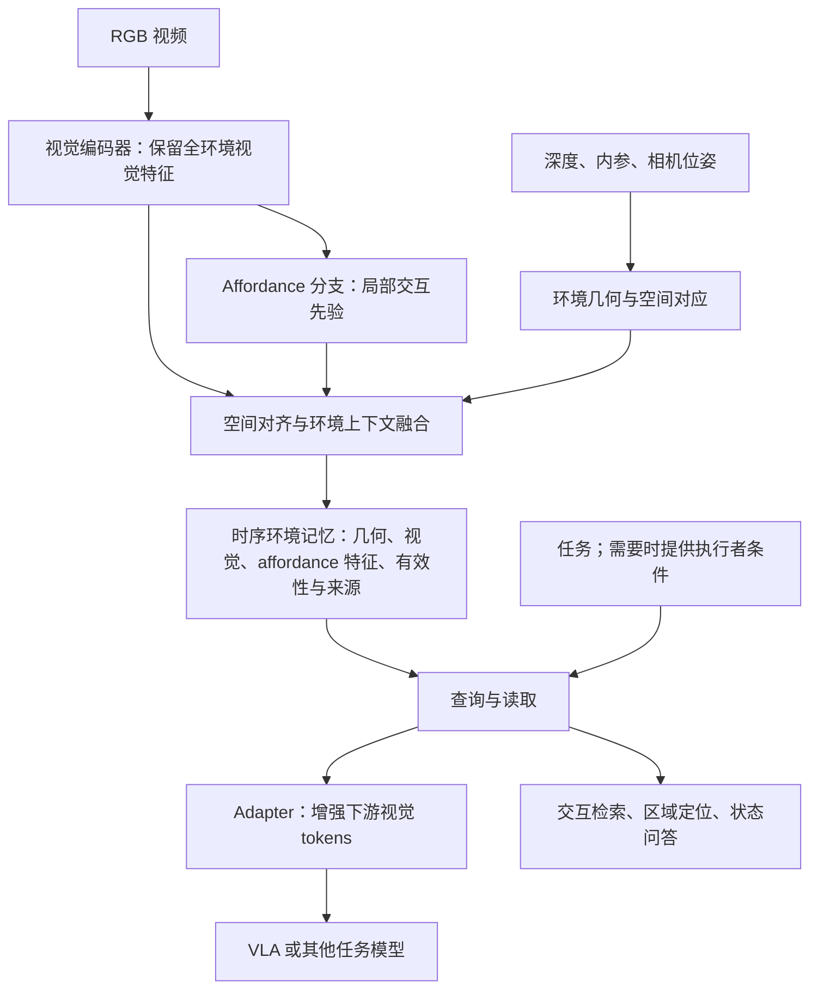

# 环境记忆中的 Affordance 特征层：可行性与实现建议

**日期：2026-11-05**  
**性质：基于 Pipeline v3 的补充架构研究建议，尚未实现或验证；不自动替换最新版 pipeline。**  
**阅读依据：**[Pipeline v3](任务驱动Affordance检索_Pipeline_v3.md)。本次用户澄清：环境是主体，affordance 是环境记忆中的一个可学习层；search 是其读取和使用机制之一。

## 1. 结论与术语

可行的候选路线是：二维局部 affordance 特征 → 空间对齐与多视角融合 → 环境上下文修正 → 时序环境记忆 → 经 adapter 交给视觉 tokens、检索或其他任务。

必须区分四项操作：几何投影只建立像素与三维位置对应；特征融合汇总观察；网络蒸馏通过损失学习表征；adapter/cross-attention 把记忆接入下游。将热图贴进场景或拼接到视觉特征，不会自动学到环境条件下的交互能力。

建议以学习得到的隐式向量表达交互内容，同时保留位置、观察时间、有效性和来源。点云／空间 patch 是显式的空间载体，不代表其特征是人工语义规则；这也不同于 LERF 式连续隐式神经场。若完全取消空间锚点，仍需验证跨视角对应与局部查询能力，不能仅因采用 tokens 就声称已经具备三维记忆。

## 2. 建议结构

首个原型继续采用 RGB-D 与已知相机位姿，验证空间对齐；普通 RGB 视频的尺度、深度与位姿估计另行研究，不将其可靠性作为已满足条件。

### 2.1 保留 map 之前的特征

设视觉编码器输出局部 tokens $H_t=E_v(I_t)$。用 affordance 分支提取 $F_t^A$，用小解码器在给定查询 $q$ 时预测热图 $\hat A_t=D_A(F_t^A,q)$。优先保存训练得到的 $F_t^A$，热图用于监督和可视化。

若现成教师只能输出热图，也可以将热图、原始局部视觉特征和查询共同编码，但不能假设单通道热图保留了所有动作信息。只有操作区域标签时，模型主要学到区域先验，不能据此宣称学到了运动过程、物理成功或未知动作。

建议记忆尽量保留可复用的特征基础，任务在读取时注入；若保存的是任务条件化的教师热图或隐藏特征，必须同时保存任务／交互条件键，避免混合不同任务下不兼容的响应。不能直接把教师最后一层无任务控制的特征称为通用 affordance 空间。

### 2.2 关联三维位置

对有效深度像素 $u=(u,v)$，在针孔模型下：

\[
x_w=R_{wc}\left(D_t(u)K^{-1}[u,v,1]^\top\right)+t_{wc}.
\]

将 $F_t^A(u)$ 与该三维表面位置关联。需要正确对齐图像裁剪、缩放、特征 patch 与深度坐标；小把手或按钮可能小于全图 token 的分辨率，需验证高分辨率局部分支，避免只使用全图向量。

对同一有效表面和兼容条件下的多帧特征，可先做置信加权融合，作为几何融合基线。只在有效深度、可见性及可靠对应处写入。动态对象须更新关联或保留分状态记录，不能把不同位置、开关状态或交互条件简单平均为一份静态记忆。

### 2.3 学习环境条件

每个空间 patch 保留几何与视觉特征、局部 affordance 先验及观察有效性。训练上下文模块：

\[
z_{i,t}=F_\theta\left(f^{geo}_{i,t},f^{vis}_{i,t},f^{A}_{i,t},\operatorname{Context}_{\mathcal N(i),t}\right).
\]

再按任务与执行者条件读取：

\[
\hat A_t(x\mid q,e)=D_\psi(M_t,x,q,e).
\]

$M_t$ 是截至当前的环境记忆，$q$ 是任务／交互查询，$e$ 是需要时提供的执行者条件。$\hat A$ 先称条件响应分数，不能未经校准称为成功概率。这些公式是候选架构，不是已有新颖性或能力保证。

例如同一杯子侧面的局部先验相近，但桌边、障碍物、支撑关系和目标方向不同，读取结果应可能不同。邻域需包含足够的空间，必要时结合较大范围上下文；固定小半径不能保证看到完整运动路径或机器人可达条件。

### 2.4 接入 vision tower

建议首版保持基础视觉编码器，训练一个输出端 memory adapter：

\[
\tilde H_t=H_t+W\operatorname{CrossAttn}(H_t,Z_t),
\]

其中 $Z_t$ 是读取出的、带空间／时间信息的记忆 tokens。它属于对视觉特征的可训练融合，和三维几何投影是不同步骤。先验证输出端融合，再考虑插入中间 transformer 层或 LoRA；模型接口、维度与训练成本均待检查。

更强的可选路线是教师—学生蒸馏：用空间融合后的 affordance 特征或条件化 map 监督学生视觉／场景编码器。但学生只能学习其输入可推断的信息；当前 RGB 无法区分的隐藏历史，仍需时序输入或外部记忆，不能蒸馏为无条件知晓。

## 3. 数据按监督目标分工

| 阶段 | 数据／方法参考 | 能学什么 | 仍缺什么 |
| --- | --- | --- | --- |
| 局部先验 | 物体级 affordance 数据；区域标签或物体动作数据 | 局部可交互区域及数据实际提供的交互特征 | 场景中障碍、支撑、可达等条件 |
| 场景对齐 | SceneFun3D 的场景几何、功能 mask、任务和运动参数 | 将局部先验对齐到完整环境，学习任务相关功能部位 | 机器人实际成功、碰撞及完整动力学 |
| 上下文修正 | 同一对象改变障碍／可用空间的配对仿真；参考 environment-aware affordance | 观察条件改变时，预测受阻、结果变化或特定动作成功 | 真实场景迁移与物理参数覆盖 |
| 时序记忆 | 有顺序、多视角和状态变化的场景序列 | 遮挡后读取、状态更新、跨视角一致性 | 不能用静态部件数据代替动态记忆验证 |

未标注区域不一律当负例；一段演示的接触位置不等于全部可行区域。仅更换物体背景或把物体贴进房间可以训练定位和视觉鲁棒性，但没有实际交互／有效几何验证时，不生成“物理可行”的标签。

没有大规模完整环境交互数据时，可先研究“场景功能区域记忆”，将能力范围限定在区域和状态证据；需要声称环境下动作可行性时，再加入对应动作与结果监督。项目不必一开始覆盖所有交互和整个房间。

## 4. 已核查的相关研究

本节为针对性范围核查，不是穷尽式系统综述。细节阅读范围与原始查询见同名[证据记录](环境记忆Affordance特征层_证据记录_2026-11-05.json)。没有复现、下载数据或验证硬件可运行性。

| 文献与状态 | 本次核查的机制 | 可借鉴之处及边界 |
| --- | --- | --- |
| [ConceptFusion，2023](https://arxiv.org/html/2302.07241) | §IV-A/B：像素特征对应三维点，多视角加权融合，基础模型不额外训练 | 空间特征写入基线；融合本身不是 affordance 学习 |
| [OpenScene，CVPR 2023](https://arxiv.org/html/2211.15654) | §3.1–3.3：二维密集特征融合，再蒸馏三维网络 | 可类比 affordance 教师—学生；原文训练的是三维网络，不是自动改造视觉 tower |
| [LERF，ICCV 2023](https://arxiv.org/html/2303.09553) | §3.1–3.4：场景特征场，经渲染与二维语言特征对齐 | 连续场的候选载体；不能据此假定通用动态环境记忆 |
| [TASA，2025 首发预印本](https://arxiv.org/html/2511.11702) | Method：任务条件二维引导、视角选择和三维几何细化 | 与二维 affordance 到场景的组合直接接近；输出区域不等同动作成功 |
| [SceneFun3D，CVPR 2024](https://scenefun3d.github.io/index.html) | 官方项目与标注文档：场景功能 mask、语言与运动参数 | 场景级监督已存在；无完整机器人执行结果标签 |
| [Environment-Aware Affordance，NeurIPS 2023](https://papers.neurips.cc/paper_files/paper/2023/file/bf78fc727cf882df66e6dbc826161e86-Paper-Conference.pdf) | §4.4、§5.1：场景／机器人条件下点级预测，以推拉成功且不碰障碍物为标签 | 局部先验结合环境约束的强参考；验证范围为关节物体及对应仿真设置 |
| [AFUN，2026 预印本](https://arxiv.org/html/2606.02551) | §3–4及附录：异构数据统一到 mask 与三维物体运动，冻结大骨干、训练接口与解码模块 | 可检查为教师和数据来源；不是现成的时序环境记忆，发布可用性和数据质量另需实测 |
| [IAAO，CVPR 2025](https://arxiv.org/abs/2504.06827) | 摘要及会议原文索引：三维 Gaussian 特征／标签场、跨状态部件关联和运动估计 | 说明语义三维表征与交互／状态关联已有近邻；本次未全文系统审阅，不据此作性能判断 |

不能把“affordance 特征投影三维／加入特征层”单独当作已确认创新。候选研究重点是上下文如何修正局部先验、状态改变后如何更新记忆，以及在相同预算下是否改善读取和检索；仍需进一步对照近邻方法。

## 5. 最小验证顺序

1. 先用少量静态 RGB-D 多视角序列验证二维 map 与三维位置对应，检查小部位、遮挡与误融合；这是数据／几何检查。
2. 在相同输入与预算下比较：语义环境特征；直接投影 affordance；加入环境上下文的特征。使用独立场景标签，避免用同一教师输出同时生成特征与评估真值。
3. 保持物体相同、改变邻近障碍／状态，检验模型是否利用环境，避免只记物体类别或纹理。物理结果结论仅来自实际执行或有效验证的标签。
4. 加入多视角遮挡与状态变化，比较当前帧、普通历史记忆和新特征层；测定位、过期状态、检索、内存和延迟。
5. 最后比较无 adapter、普通记忆 adapter 和 affordance 记忆 adapter，在相同下游模型上检验新特征是否被使用。先选一个独立检索／区域定位任务，VLA 可后接。

配对场景按对象、场景和完整 episode 划分训练测试，避免同一对象状态或相邻帧跨集合泄漏。本文件中的实现和训练安排均为建议，尚未开展。
