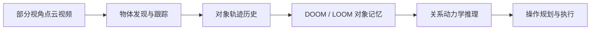
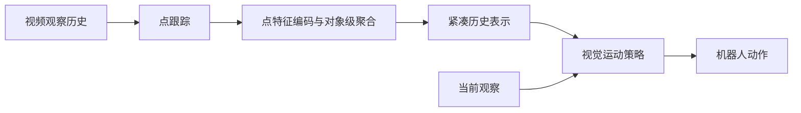
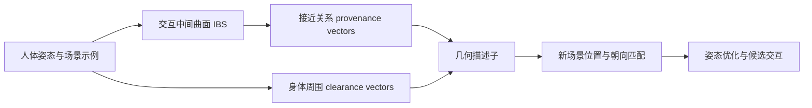
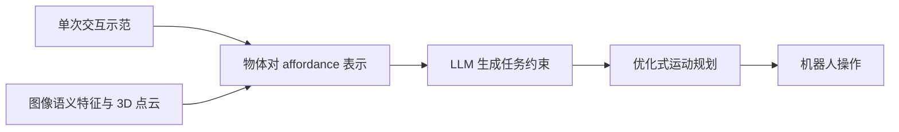
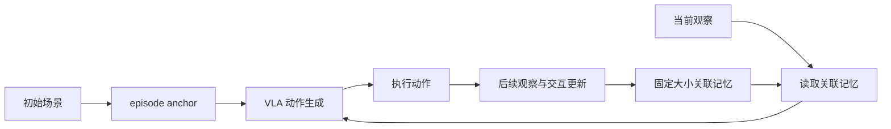
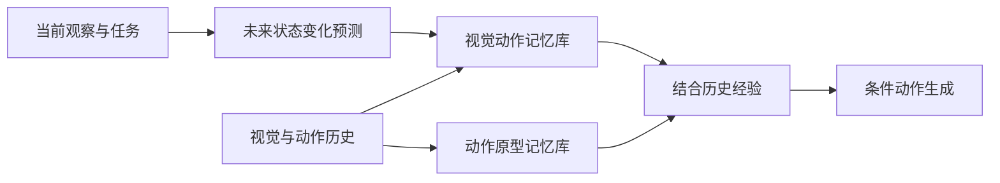
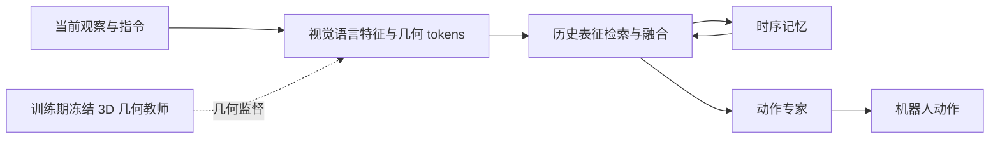
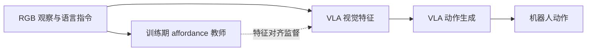
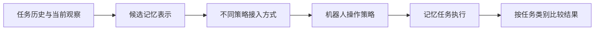

# 相关文献档案：视频、几何交互与机器人记忆

**首次整理：2026-10-29｜研究背景：Pipeline v2 与首个遮挡实验草案**

## 使用和维护方式

这是一份持续积累的文献档案，围绕当前及未来 pipeline 的研究问题保存相关工作。**追加规则：后续更新只在文末新增内容，不删除、覆盖、重写或移动已有条目。** 即使论文之后不再符合当前方向，也保留历史条目；如需纠错、补充版本、标注撤稿或调整理解，在文末追加注明日期、原条目编号和来源的更正记录。新增文献应注明关联的 pipeline 版本或研究点，避免重复收录；同一论文可以在新条目中交叉引用。

本文档独立于[项目总控](../项目总控.md)，不改变总控文档。当前条目是围绕 Pipeline v2 的**定向初筛**；阅读状态会明确标注，不能把摘要或项目页面初读等同于全文精读，也不表示已复现。论文效果和新颖性须在完整实验协议下判断。

每篇的“摘要内容”是基于原文摘要的**中文概述**，并非逐字转载或官方翻译；原始摘要见各论文链接。“Pipeline 图”是根据摘要或论文方法**重新绘制的概念示意图**，为便于理解省略细节，并非原论文图。贡献为对论文声称工作的整理；“相关性与区别”是对本项目的研究判断，不是作者结论。支持 Mermaid 的阅读器可渲染流程图。

## 研究点索引

| 研究点 | 与 Pipeline v2 的关系 | 条目 |
| --- | --- | --- |
| 视频历史与遮挡记忆 | 利用之前观察，处理当前不可见的信息；检验历史信息是否有用 | P01、P02 |
| 局部几何与交互 affordance | 表示物体—环境、物体—物体的接近、支撑和可交互关系 | P03、P04 |
| 动作、后果与时序事件 | 区分执行前决策与执行后写入，研究记忆、预测与动作 | P05、P06 |
| 几何或 affordance 接入 VLA | 用几何或功能监督塑造隐式特征，服务后续动作 | P07、P08 |
| 记忆相关 benchmark 与对照 | 在部分可观测、遮挡和不同记忆需求下评估策略 | P09、P10 |

---

## 一、视频历史与遮挡记忆

### P01｜Out of Sight, Still in Mind: Reasoning and Planning about Unobserved Objects with Video Tracking Enabled Memory Models

**作者与年份：** Yixuan Huang 等；ICRA 2024。  
**原文：** [arXiv 论文及摘要](https://arxiv.org/abs/2309.15278)  
**阅读状态：** 摘要与方法概况初读。

**摘要内容（中文概述）：** 机器人在真实环境中可能需要推理当前被遮挡、但之前见过的物体。作者将对象发现和跟踪与部分视角点云结合，利用物体轨迹历史和 Transformer 关系动力学构建 DOOM 与 LOOM 两种对象记忆模型，支持多物体操作中的遮挡、重新出现和新物体处理。论文通过仿真及真实机器人实验进行评估，并与隐式记忆基线比较。

**Pipeline 图（概念示意）：**

**Contribution：**

- 将对象轨迹和关系动力学结合，处理当前不可见的物体。
- 在多物体操作中研究遮挡、物体出现与重现。
- 通过仿真和真实实验评估历史记忆对于操作推理的作用。

**相关性与区别：** 适合对照“遮挡下记忆是否有效”。它以对象发现和跟踪为基础，不能直接视为 Pipeline v2 中无固定类别绑定的局部隐式关系记忆。

### P02｜History-Aware Visuomotor Policy Learning via Point Tracking

**作者与年份：** Jingjing Chen 等；ICRA 2026。  
**原文：** [arXiv 论文及摘要](https://arxiv.org/abs/2509.17141) · [作者项目页](https://tonyfang.net/history/)  
**阅读状态：** 摘要与项目概况初读。

**摘要内容（中文概述）：** 很多操作任务需要知道此前发生了什么，而只使用当前观察的策略难以处理重复状态和长时依赖。作者通过点跟踪压缩观察历史，将跟踪点编码并按对象聚合为紧凑历史表示，再将其接入视觉运动策略。评测覆盖任务阶段、空间记忆、动作计数等不同记忆需求。

**Pipeline 图（概念示意）：**

**Contribution：**

- 使用跟踪点构造可复用的结构化历史表示。
- 将历史表示与多种视觉运动策略结合。
- 在不同记忆需求下比较历史表示的任务表现。

**相关性与区别：** 可作为使用相同历史信息的跟踪式对照；其对象聚合与点跟踪假设和本项目的关系 tokens 不同，需要检验遮挡或错误跟踪时的表现。

---

## 二、局部几何与交互 affordance

### P03｜AROS: Affordance Recognition with One-Shot Human Stances

**作者与年份：** Abel Pacheco-Ortega、Walterio Mayol-Cuevas；*Frontiers in Robotics and AI*，2023。  
**原文：** [论文及摘要](https://doi.org/10.3389/frobt.2023.1076780) · [作者项目与代码](https://abelpaor.github.io/AROS/)  
**阅读状态：** 已阅读正文的方法与实验部分；未复现。

**摘要内容（中文概述）：** 作者提出单样本的人体—场景交互几何描述，从一个或少量姿态示例中刻画人体与环境之间的关系，并在未见过的三维场景中寻找能够支持相同交互的位置、生成相应人体姿态。论文在三类扫描场景中评估几何合理性及人工自然度偏好。

**Pipeline 图（概念示意）：**

**Contribution：**

- 在人体—环境关系中联合描述接近区域和身体周围的空余空间。
- 用一个或少量示例构建可在新场景中搜索的几何交互描述。
- 在扫描场景中研究碰撞、接触和人工感知自然度。

**相关性与区别：** Pipeline v2 可借鉴局部几何及空余空间的思想；AROS 针对静态人体姿态与场景，不是视频长期记忆，也不能直接证明机器人动作的可达性或稳定性。详见 [AROS 阅读笔记](../literature/aros-guide.md)。

### P04｜O³Afford: One-Shot 3D Object-to-Object Affordance Grounding for Generalizable Robotic Manipulation

**作者与年份：** Tongxuan Tian、Xuhui Kang、Yen-Ling Kuo；CoRL 2025。  
**原文：** [会议论文及摘要](https://proceedings.mlr.press/v305/tian25b.html)  
**阅读状态：** 摘要与论文概况初读。

**摘要内容（中文概述）：** 作者关注机器人操作中的物体—物体关系，使用单次示例，通过视觉基础模型的语义特征与点云几何建立三维 affordance 表示，将其推广到新物体与类别。该表示进一步结合大语言模型产生任务约束，并用于优化式运动规划。

**Pipeline 图（概念示意）：**

**Contribution：**

- 将 affordance 的研究对象从单个物体扩展至物体对之间的关系。
- 结合视觉语义与三维几何，研究单次示范的跨物体迁移。
- 将对象间 affordance 接入任务约束和运动规划。

**相关性与区别：** 与“一个物体能否放到某个支撑区域”的研究动机接近。它明确结合语义与几何，不是纯几何方法；它的 affordance 表示也不能直接当作本项目的时序事件记忆。

---

## 三、动作、后果与时序事件

### P05｜MemBodied: Recurrent Associative Memory for Vision-Language-Action Models

**作者与年份：** Tej Deep Pala 等；2026 年预印本。  
**原文：** [论文及摘要](https://arxiv.org/abs/2609.28256) · [项目页](https://declare-lab.github.io/MemBodied/)  
**阅读状态：** 摘要与方法概况初读；尚未复现。

**摘要内容（中文概述）：** 作者研究 VLA 在需要历史信息的操作任务中如何避免不断累积长上下文。MemBodied 使用固定大小的 episode 记忆，包括记录交互的关联状态和保存初始场景参考的 anchor；每次策略决策结合当前输入与记忆，并在执行后利用新观察更新记忆。论文在记忆相关操作任务和 LIBERO-Long 中与若干基线比较。

**Pipeline 图（概念示意）：**

**Contribution：**

- 使用固定容量的关联记忆和初始场景 anchor 表示 episode 信息。
- 以执行过的动作及其后续观察更新历史状态。
- 在历史依赖操作任务中评估记忆增强策略。

**相关性与区别：** 是 Pipeline v2 的直接近邻；“动作—结果写入记忆”本身已有先例。局部几何关系是否带来增益，必须与信息、容量和预算相匹配的事件记忆基线比较。

### P06｜UniMPA: A Unified Memory-Prediction-Action Model via Action-Grounded Transition Modeling

**作者与年份：** Wei Li 等；2026 年预印本。  
**原文：** [论文及摘要](https://arxiv.org/abs/2609.11875)  
**阅读状态：** 摘要与方法概况初读。

**摘要内容（中文概述）：** 面对当前观察有歧义、视觉预测与可执行动作不一致等问题，作者提出统一记忆、未来预测和动作生成的框架。方法预测与任务相关的未来状态变化，并从视觉—动作历史中检索经验，以帮助判断和生成与当前场景相关的动作。

**Pipeline 图（概念示意）：**

**Contribution：**

- 用动作关联的状态转移连接预测、历史经验和动作。
- 将历史视觉—动作经验用于检索和条件化未来决策。
- 研究对当前场景进行条件化的动作生成。

**相关性与区别：** 与“记忆＋后果预测＋动作”直接相关，该组合本身已有先例。检索到历史经验不自动证明新场景的物理可执行性；具体比较需核对全文、数据及评测。

---

## 四、几何或 affordance 接入 VLA

### P07｜GeoMem-VLA: Internalizing 3D Scene Understanding into Temporal Memory for Vision-Language-Action Models

**作者与年份：** Qinfan Zhang 等；2026 年预印本。  
**原文：** [论文及摘要](https://arxiv.org/abs/2610.29866)  
**阅读状态：** 摘要与方法概况初读；尚未复现。

**摘要内容（中文概述）：** 作者认为动作生成需要可持续更新的任务相关几何信息，不必每一步都构造完整可渲染场景。训练时使用冻结的几何基础模型监督可学习的几何 tokens，并结合观察历史形成时序记忆；推理时融合当前观察和历史表示来预测动作，无需运行几何教师或显式重建场景。论文报告了仿真和真实机器人任务结果。

**Pipeline 图（概念示意）：**

**Contribution：**

- 利用训练期几何监督塑造用于动作的潜在几何 tokens。
- 对观察历史进行检索与融合，形成时序记忆。
- 推理阶段不依赖额外运行几何教师或显式场景重建。

**相关性与区别：** 是 Pipeline v2 最近的研究之一；不能将“几何教师＋隐式记忆＋VLA”单独作为新贡献。该文推理时不运行 3D 教师，而本项目当前草案首版假设 RGB-D 输入，两者必须按实际输入和监督比较。

### P08｜AffordVLA: Injecting Affordance Representations into Vision-Language-Action Models via Implicit Feature Alignment

**作者与年份：** Weijie Kong 等；2026 年预印本。  
**原文：** [论文及摘要](https://arxiv.org/abs/2605.17517)  
**阅读状态：** 摘要与方法概况初读。

**摘要内容（中文概述）：** 作者指出 VLA 的视觉表征可能侧重外观而忽略与任务相关的交互区域，提出用任务条件化的 affordance 教师特征，对齐 VLA 的中间视觉表示，将操作相关知识隐式融入策略。论文报告仿真、真实机器人及消融实验。

**Pipeline 图（概念示意）：**

**Contribution：**

- 构建依赖任务指令和当前 RGB 的 affordance 教师表征。
- 通过隐式特征对齐将交互区域信息注入 VLA。
- 在作者实验中比较性能、训练效率和推理开销。

**相关性与区别：** 是“affordance 监督用于动作表示”的重要近邻；摘要没有建立其为跨时间动作—结果记忆。不能将一般性的 affordance 特征蒸馏单独视为本项目创新。

---

## 五、记忆相关 benchmark 与对照

### P09｜RoboMME: Benchmarking and Understanding Memory for Robotic Generalist Policies

**作者与年份：** Yinpei Dai 等；ICML 2026。  
**原文：** [作者项目页、摘要及论文入口](https://robomme.github.io/)  
**阅读状态：** 摘要、任务分类与项目概况初读。

**摘要内容（中文概述）：** 作者提出 RoboMME，用于统一评估机器人策略在需要历史信息的长期操作任务中的表现。该基准包含 16 项任务，覆盖时间、空间、对象和程序记忆；作者还在 π0.5 上构建并比较 14 种记忆增强变体，指出不同记忆方式的效果取决于任务。

**Pipeline 图（概念示意）：**

**Contribution：**

- 按时间、空间、对象和程序记忆组织机器人操作任务。
- 在统一策略骨干下比较多种记忆增强方式。
- 为遮挡、历史顺序及其他信息依赖任务提供评测案例。

**相关性与区别：** 可帮助选择“历史信息是否被真正使用”的对照任务；使用前须核对各任务允许的观察和模态，不能直接把不同输入条件的结果视为公平比较。

### P10｜Memory, Benchmark & Robots: A Benchmark for Solving Complex Tasks with Reinforcement Learning

**作者与年份：** Egor Cherepanov 等；ICLR 2026。  
**原文：** [论文及摘要](https://arxiv.org/abs/2502.10550) · [MIKASA-Robo-VLA 后续文档](https://mikasarobo.github.io/concepts.html)  
**阅读状态：** 原论文摘要与后续文档概况初读。

**摘要内容（中文概述）：** 作者提出 MIKASA，旨在系统评估强化学习中涉及时间和空间依赖的记忆能力。工作包括记忆任务分类、MIKASA-Base，以及含 32 个桌面机器人操作任务的 MIKASA-Robo。后续 MIKASA-Robo-VLA 文档描述了面向语言条件 VLA 的扩展；二者应按各自版本与协议区分。

**Pipeline 图（概念示意）：**

**Contribution：**

- 为记忆密集型强化学习任务提出分类和评测框架。
- 提供桌面操作中的部分可观测记忆任务。
- 后续 VLA 版本扩展任务和语言接口，适合调查不同记忆需求。

**相关性与区别：** 可为遮挡和长期依赖提供任务设计参考。原论文中的 32 个 RL 任务与后续 VLA 扩展并非同一版本；需单独核对相机模态、数据及官方评测协议。

---

## 初次检索与范围记录

- **项目依据：** [Pipeline v2](隐式交互记忆_Pipeline_v2.md)、[遮挡实验草案](首个对照实验_遮挡下交互预测_v1.md) 和 [已有文献初筛](隐式交互记忆_literature_review_v2.md)。
- **检索时间：** 2026-10-29；围绕上述研究点查阅原论文摘要、会议页面与作者项目页。
- **代表检索主题：** 几何 VLA 时序记忆、机器人遮挡对象记忆、动作—结果关联记忆、三维物体间 affordance、机器人记忆 benchmark。
- **筛选依据：** 与研究点和可能的实验对照直接相关、优先原始论文或作者项目、每个研究点两篇。该集合不是穷尽式系统综述；预印本应持续核对后续版本。
- **尚未完成：** 大多数论文的全文逐节精读、代码运行、数据协议核对和实验复现。未来的精读笔记或更正按维护规则在本文档末尾追加。
