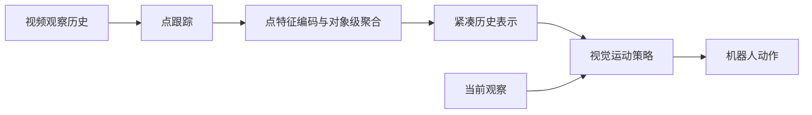
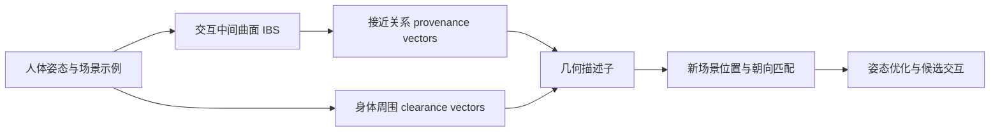
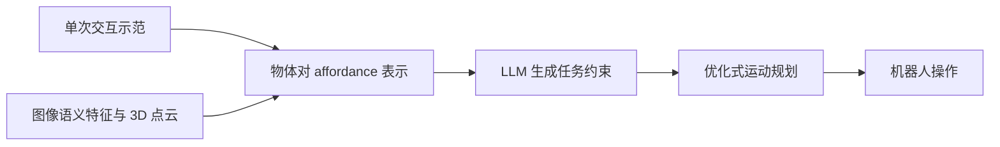
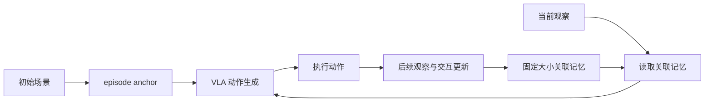
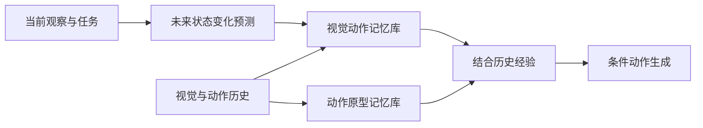
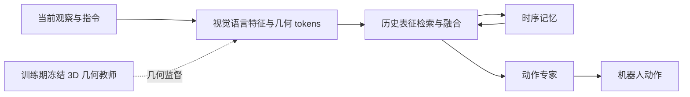
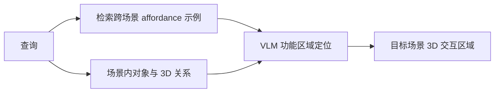
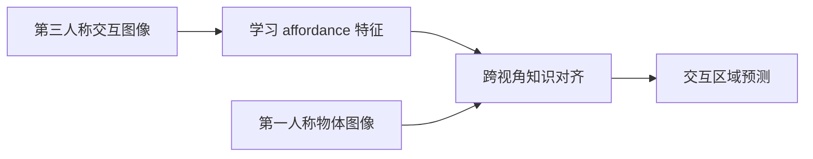
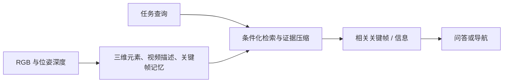

# 相关文献档案：视频、几何交互与机器人记忆

**首次整理：2026-10-29｜研究背景：Pipeline v2 与首个遮挡实验草案**

## 使用和维护方式

这是一份持续积累的文献档案，围绕当前及未来 pipeline 的研究问题保存相关工作。**追加规则：后续更新只在文末新增内容，不删除、覆盖、重写或移动已有条目。** 即使论文之后不再符合当前方向，也保留历史条目；如需纠错、补充版本、标注撤稿或调整理解，在文末追加注明日期、原条目编号和来源的更正记录。新增文献应注明关联的 pipeline 版本或研究点，避免重复收录；同一论文可以在新条目中交叉引用。

本文档独立于[项目总控](../项目总控.md)，不改变总控文档。当前条目是围绕 Pipeline v2 的**定向初筛**；阅读状态会明确标注，不能把摘要或项目页面初读等同于全文精读，也不表示已复现。论文效果和新颖性须在完整实验协议下判断。

每篇的“摘要内容”是基于原文摘要的**中文概述**，并非逐字转载或官方翻译；原始摘要见各论文链接。“Pipeline 图”是根据摘要或论文方法**重新绘制的概念示意图**，为便于理解省略细节，并非原论文图。贡献为对论文声称工作的整理；“相关性与区别”是对本项目的研究判断，不是作者结论。支持 Mermaid 的阅读器可渲染流程图。

## 研究点索引

| 研究点 | 与 Pipeline v2 的关系 | 条目 |
| --- | --- | --- |
| 视频历史与遮挡记忆 | 利用之前观察，处理当前不可见的信息；检验历史信息是否有用 | P01、P02 |
| 局部几何与交互 affordance | 表示物体—环境、物体—物体的接近、支撑和可交互关系 | P03、P04 |
| 动作、后果与时序事件 | 区分执行前决策与执行后写入，研究记忆、预测与动作 | P05、P06 |
| 几何或 affordance 接入 VLA | 用几何或功能监督塑造隐式特征，服务后续动作 | P07、P08 |
| 记忆相关 benchmark 与对照 | 在部分可观测、遮挡和不同记忆需求下评估策略 | P09、P10 |

---

## 一、视频历史与遮挡记忆

### P01｜Out of Sight, Still in Mind: Reasoning and Planning about Unobserved Objects with Video Tracking Enabled Memory Models

**作者与年份：** Yixuan Huang 等；ICRA 2024。  
**原文：** [arXiv 论文及摘要](https://arxiv.org/abs/2309.15278)  
**阅读状态：** 摘要与方法概况初读。

**摘要内容（中文概述）：** 机器人在真实环境中可能需要推理当前被遮挡、但之前见过的物体。作者将对象发现和跟踪与部分视角点云结合，利用物体轨迹历史和 Transformer 关系动力学构建 DOOM 与 LOOM 两种对象记忆模型，支持多物体操作中的遮挡、重新出现和新物体处理。论文通过仿真及真实机器人实验进行评估，并与隐式记忆基线比较。

**Pipeline 图（概念示意）：**


**Contribution：**

- 将对象轨迹和关系动力学结合，处理当前不可见的物体。
- 在多物体操作中研究遮挡、物体出现与重现。
- 通过仿真和真实实验评估历史记忆对于操作推理的作用。

**相关性与区别：** 适合对照“遮挡下记忆是否有效”。它以对象发现和跟踪为基础，不能直接视为 Pipeline v2 中无固定类别绑定的局部隐式关系记忆。

### P02｜History-Aware Visuomotor Policy Learning via Point Tracking

**作者与年份：** Jingjing Chen 等；ICRA 2026。  
**原文：** [arXiv 论文及摘要](https://arxiv.org/abs/2509.17141) · [作者项目页](https://tonyfang.net/history/)  
**阅读状态：** 摘要与项目概况初读。

**摘要内容（中文概述）：** 很多操作任务需要知道此前发生了什么，而只使用当前观察的策略难以处理重复状态和长时依赖。作者通过点跟踪压缩观察历史，将跟踪点编码并按对象聚合为紧凑历史表示，再将其接入视觉运动策略。评测覆盖任务阶段、空间记忆、动作计数等不同记忆需求。

**Pipeline 图（概念示意）：**



**Contribution：**

- 使用跟踪点构造可复用的结构化历史表示。
- 将历史表示与多种视觉运动策略结合。
- 在不同记忆需求下比较历史表示的任务表现。

**相关性与区别：** 可作为使用相同历史信息的跟踪式对照；其对象聚合与点跟踪假设和本项目的关系 tokens 不同，需要检验遮挡或错误跟踪时的表现。

---

## 二、局部几何与交互 affordance

### P03｜AROS: Affordance Recognition with One-Shot Human Stances

**作者与年份：** Abel Pacheco-Ortega、Walterio Mayol-Cuevas；*Frontiers in Robotics and AI*，2023。  
**原文：** [论文及摘要](https://doi.org/10.3389/frobt.2023.1076780) · [作者项目与代码](https://abelpaor.github.io/AROS/)  
**阅读状态：** 已阅读正文的方法与实验部分；未复现。

**摘要内容（中文概述）：** 作者提出单样本的人体—场景交互几何描述，从一个或少量姿态示例中刻画人体与环境之间的关系，并在未见过的三维场景中寻找能够支持相同交互的位置、生成相应人体姿态。论文在三类扫描场景中评估几何合理性及人工自然度偏好。

**Pipeline 图（概念示意）：**



**Contribution：**

- 在人体—环境关系中联合描述接近区域和身体周围的空余空间。
- 用一个或少量示例构建可在新场景中搜索的几何交互描述。
- 在扫描场景中研究碰撞、接触和人工感知自然度。

**相关性与区别：** Pipeline v2 可借鉴局部几何及空余空间的思想；AROS 针对静态人体姿态与场景，不是视频长期记忆，也不能直接证明机器人动作的可达性或稳定性。详见 [AROS 阅读笔记](../literature/aros-guide.md)。

### P04｜O³Afford: One-Shot 3D Object-to-Object Affordance Grounding for Generalizable Robotic Manipulation

**作者与年份：** Tongxuan Tian、Xuhui Kang、Yen-Ling Kuo；CoRL 2025。  
**原文：** [会议论文及摘要](https://proceedings.mlr.press/v305/tian25b.html)  
**阅读状态：** 摘要与论文概况初读。

**摘要内容（中文概述）：** 作者关注机器人操作中的物体—物体关系，使用单次示例，通过视觉基础模型的语义特征与点云几何建立三维 affordance 表示，将其推广到新物体与类别。该表示进一步结合大语言模型产生任务约束，并用于优化式运动规划。

**Pipeline 图（概念示意）：**



**Contribution：**

- 将 affordance 的研究对象从单个物体扩展至物体对之间的关系。
- 结合视觉语义与三维几何，研究单次示范的跨物体迁移。
- 将对象间 affordance 接入任务约束和运动规划。

**相关性与区别：** 与“一个物体能否放到某个支撑区域”的研究动机接近。它明确结合语义与几何，不是纯几何方法；它的 affordance 表示也不能直接当作本项目的时序事件记忆。

---

## 三、动作、后果与时序事件

### P05｜MemBodied: Recurrent Associative Memory for Vision-Language-Action Models

**作者与年份：** Tej Deep Pala 等；2026 年预印本。  
**原文：** [论文及摘要](https://arxiv.org/abs/2609.28256) · [项目页](https://declare-lab.github.io/MemBodied/)  
**阅读状态：** 摘要与方法概况初读；尚未复现。

**摘要内容（中文概述）：** 作者研究 VLA 在需要历史信息的操作任务中如何避免不断累积长上下文。MemBodied 使用固定大小的 episode 记忆，包括记录交互的关联状态和保存初始场景参考的 anchor；每次策略决策结合当前输入与记忆，并在执行后利用新观察更新记忆。论文在记忆相关操作任务和 LIBERO-Long 中与若干基线比较。

**Pipeline 图（概念示意）：**



**Contribution：**

- 使用固定容量的关联记忆和初始场景 anchor 表示 episode 信息。
- 以执行过的动作及其后续观察更新历史状态。
- 在历史依赖操作任务中评估记忆增强策略。

**相关性与区别：** 是 Pipeline v2 的直接近邻；“动作—结果写入记忆”本身已有先例。局部几何关系是否带来增益，必须与信息、容量和预算相匹配的事件记忆基线比较。

### P06｜UniMPA: A Unified Memory-Prediction-Action Model via Action-Grounded Transition Modeling

**作者与年份：** Wei Li 等；2026 年预印本。  
**原文：** [论文及摘要](https://arxiv.org/abs/2609.11875)  
**阅读状态：** 摘要与方法概况初读。

**摘要内容（中文概述）：** 面对当前观察有歧义、视觉预测与可执行动作不一致等问题，作者提出统一记忆、未来预测和动作生成的框架。方法预测与任务相关的未来状态变化，并从视觉—动作历史中检索经验，以帮助判断和生成与当前场景相关的动作。

**Pipeline 图（概念示意）：**



**Contribution：**

- 用动作关联的状态转移连接预测、历史经验和动作。
- 将历史视觉—动作经验用于检索和条件化未来决策。
- 研究对当前场景进行条件化的动作生成。

**相关性与区别：** 与“记忆＋后果预测＋动作”直接相关，该组合本身已有先例。检索到历史经验不自动证明新场景的物理可执行性；具体比较需核对全文、数据及评测。

---

## 四、几何或 affordance 接入 VLA

### P07｜GeoMem-VLA: Internalizing 3D Scene Understanding into Temporal Memory for Vision-Language-Action Models

**作者与年份：** Qinfan Zhang 等；2026 年预印本。  
**原文：** [论文及摘要](https://arxiv.org/abs/2610.29866)  
**阅读状态：** 摘要与方法概况初读；尚未复现。

**摘要内容（中文概述）：** 作者认为动作生成需要可持续更新的任务相关几何信息，不必每一步都构造完整可渲染场景。训练时使用冻结的几何基础模型监督可学习的几何 tokens，并结合观察历史形成时序记忆；推理时融合当前观察和历史表示来预测动作，无需运行几何教师或显式重建场景。论文报告了仿真和真实机器人任务结果。

**Pipeline 图（概念示意）：**



**Contribution：**

- 利用训练期几何监督塑造用于动作的潜在几何 tokens。
- 对观察历史进行检索与融合，形成时序记忆。
- 推理阶段不依赖额外运行几何教师或显式场景重建。

**相关性与区别：** 是 Pipeline v2 最近的研究之一；不能将“几何教师＋隐式记忆＋VLA”单独作为新贡献。该文推理时不运行 3D 教师，而本项目当前草案首版假设 RGB-D 输入，两者必须按实际输入和监督比较。

### P08｜AffordVLA: Injecting Affordance Representations into Vision-Language-Action Models via Implicit Feature Alignment

**作者与年份：** Weijie Kong 等；2026 年预印本。  
**原文：** [论文及摘要](https://arxiv.org/abs/2605.17517)  
**阅读状态：** 摘要与方法概况初读。

**摘要内容（中文概述）：** 作者指出 VLA 的视觉表征可能侧重外观而忽略与任务相关的交互区域，提出用任务条件化的 affordance 教师特征，对齐 VLA 的中间视觉表示，将操作相关知识隐式融入策略。论文报告仿真、真实机器人及消融实验。

**Pipeline 图（概念示意）：**


**Contribution：**

- 构建依赖任务指令和当前 RGB 的 affordance 教师表征。
- 通过隐式特征对齐将交互区域信息注入 VLA。
- 在作者实验中比较性能、训练效率和推理开销。

**相关性与区别：** 是“affordance 监督用于动作表示”的重要近邻；摘要没有建立其为跨时间动作—结果记忆。不能将一般性的 affordance 特征蒸馏单独视为本项目创新。

---

## 五、记忆相关 benchmark 与对照

### P09｜RoboMME: Benchmarking and Understanding Memory for Robotic Generalist Policies

**作者与年份：** Yinpei Dai 等；ICML 2026。  
**原文：** [作者项目页、摘要及论文入口](https://robomme.github.io/)  
**阅读状态：** 摘要、任务分类与项目概况初读。

**摘要内容（中文概述）：** 作者提出 RoboMME，用于统一评估机器人策略在需要历史信息的长期操作任务中的表现。该基准包含 16 项任务，覆盖时间、空间、对象和程序记忆；作者还在 π0.5 上构建并比较 14 种记忆增强变体，指出不同记忆方式的效果取决于任务。

**Pipeline 图（概念示意）：**


**Contribution：**

- 按时间、空间、对象和程序记忆组织机器人操作任务。
- 在统一策略骨干下比较多种记忆增强方式。
- 为遮挡、历史顺序及其他信息依赖任务提供评测案例。

**相关性与区别：** 可帮助选择“历史信息是否被真正使用”的对照任务；使用前须核对各任务允许的观察和模态，不能直接把不同输入条件的结果视为公平比较。

### P10｜Memory, Benchmark & Robots: A Benchmark for Solving Complex Tasks with Reinforcement Learning

**作者与年份：** Egor Cherepanov 等；ICLR 2026。  
**原文：** [论文及摘要](https://arxiv.org/abs/2502.10550) · [MIKASA-Robo-VLA 后续文档](https://mikasarobo.github.io/concepts.html)  
**阅读状态：** 原论文摘要与后续文档概况初读。

**摘要内容（中文概述）：** 作者提出 MIKASA，旨在系统评估强化学习中涉及时间和空间依赖的记忆能力。工作包括记忆任务分类、MIKASA-Base，以及含 32 个桌面机器人操作任务的 MIKASA-Robo。后续 MIKASA-Robo-VLA 文档描述了面向语言条件 VLA 的扩展；二者应按各自版本与协议区分。

**Pipeline 图（概念示意）：**


**Contribution：**

- 为记忆密集型强化学习任务提出分类和评测框架。
- 提供桌面操作中的部分可观测记忆任务。
- 后续 VLA 版本扩展任务和语言接口，适合调查不同记忆需求。

**相关性与区别：** 可为遮挡和长期依赖提供任务设计参考。原论文中的 32 个 RL 任务与后续 VLA 扩展并非同一版本；需单独核对相机模态、数据及官方评测协议。

---

## 初次检索与范围记录

- **项目依据：** [Pipeline v2](隐式交互记忆_Pipeline_v2.md)、[遮挡实验草案](首个对照实验_遮挡下交互预测_v1.md) 和 [已有文献初筛](隐式交互记忆_literature_review_v2.md)。
- **检索时间：** 2026-10-29；围绕上述研究点查阅原论文摘要、会议页面与作者项目页。
- **代表检索主题：** 几何 VLA 时序记忆、机器人遮挡对象记忆、动作—结果关联记忆、三维物体间 affordance、机器人记忆 benchmark。
- **筛选依据：** 与研究点和可能的实验对照直接相关、优先原始论文或作者项目、每个研究点两篇。该集合不是穷尽式系统综述；预印本应持续核对后续版本。
- **尚未完成：** 大多数论文的全文逐节精读、代码运行、数据协议核对和实验复现。未来的精读笔记或更正按维护规则在本文档末尾追加。

---

## 追加：跨视角 affordance 与环境检索（2026-11-02）

**关联研究问题：** 变化视角视频中的 affordance 条件物体与关键帧检索。本批是定向初筛，阅读范围为原论文摘要或作者项目页；没有复现。以下图是根据来源改绘的概念示意，不是论文原图；摘要为中文概述。

### P11｜Grounding by Remembering: Cross-Scene and In-Scene Memory for 3D Functional Affordances

**作者与年份：** Qirui Wang 等，2026 预印本。  
**来源：** [AFFORDMEM 论文与摘要](https://arxiv.org/abs/2605.11616)  
**阅读状态：** 摘要初读。

**摘要内容（中文概述）：** AFFORDMEM 使用两类记忆定位可交互的三维区域：跨场景记忆保存带 affordance 区域的示例图像，供查询时检索；场景内记忆组织候选物体和三维空间关系，以理解远处或当前不可见对象的指代。方法无需在目标场景微调，使用预先构建的来源场景记忆库。

**Pipeline 图（概念示意）：**



**Contribution：**

- 结合跨场景 affordance 示例记忆与场景内空间记忆。
- 利用检索到的示例协助定位小型交互区域。
- 评估功能区域定位与带空间修饰语的查询。

**相关性与区别：** 是本议题的重要近邻；其核心为功能区域 grounding，不应仅凭摘要声称与视频跨视角关键帧检索完全相同或完全不同。场景图和预构建示例库也是需对照的实际条件。

### P12｜Learning Affordance Grounding From Exocentric Images

**作者与年份：** Luo 等，CVPR 2022。  
**来源：** [CVPR 原论文](https://openaccess.thecvf.com/content/CVPR2022/papers/Luo_Learning_Affordance_Grounding_From_Exocentric_Images_CVPR_2022_paper.pdf)  
**阅读状态：** 摘要与方法概况初读。

**摘要内容（中文概述）：** 工作通过第三人称的人—物交互图像学习与 affordance 有关的特征，并将其转移到第一人称物体图像以定位交互区域。作者提出跨视角知识转移方法并构建 AGD20K 数据集。

**Pipeline 图（概念示意）：**



**Contribution：**

- 研究从第三人称交互到第一人称观察的 affordance 知识转移。
- 设计跨视角特征对齐及 affordance 相关性约束。
- 提供 AGD20K 作为 affordance grounding 研究数据集。

**相关性与区别：** 跨视角功能特征学习已有先例；其任务是交互区域定位，不应当直接等同于同场景视频的实例检索与关键帧选择。AGD20K 是图像数据，不能未经核对就当作多视角视频记忆 benchmark。

### P13｜STaR: Scalable Task-Conditioned Retrieval for Long-Horizon Multimodal Robot Memory

**作者与年份：** Mingfeng Yuan 等，IEEE Robotics and Automation Letters 2026。  
**来源：** [作者项目页与论文入口](https://trailab.github.io/STaR-website/)  
**阅读状态：** 项目页概况初读。

**摘要内容（中文概述）：** STaR 将三维场景元素、带时间的视频描述和关键帧组合为机器人记忆；根据任务查询选取紧凑、较少冗余的证据，用于空间和时间问题推理及机器人应用。作者报告仿真和真实机器人评估。

**Pipeline 图（概念示意）：**



**Contribution：**

- 将不同时间与空间信息组织为多模态机器人记忆。
- 根据任务从长期记忆中选择紧凑证据。
- 在机器人任务中评估检索与下游推理。

**相关性与区别：** 是关键帧记忆与任务条件检索的重要参照，原方案使用 RGB 和带位姿的深度；不能把其结果视为单目 RGB-only 的直接结果。是否有 affordance 专门约束需全文核对。


---

## 追加：跨视角功能证据检索的立项调研（2026-11-02）

本批关联“RGB 移动视角视频→环境记忆→功能条件物体与关键帧检索”的候选题目，不代表批准修改总控。原文摘要在下方以中文概述；图为阅读后重新绘制的简图，并非原图。A=方法及实验相关章节核查，B=摘要或作者项目概况；均未复现。

完整判断见[文献调研与立项评估](跨视角Affordance检索_文献调研与立项评估_2026-11-02.md)。

**对既有 P11/P13 追加核查：** AFFORDMEM §3 明确使用 RGB-D、内参与位姿，并做跨视图实例聚合；不应因摘要没写清而归为纯 RGB。STaR 使用 posed depth，已具有任务条件证据选择，原文有功能性示例。已有概述保留，本段补充其输入与范围。

### P14｜Affordance RAG: Hierarchical Multimodal Retrieval with Affordance-Aware Embodied Memory for Mobile Manipulation

**作者 / 年份：** Ryosuke Korekata 等；2025 预印本。  
**来源：** [原文 / 作者页面](https://arxiv.org/html/2512.18987)  
**阅读状态：** A：§III–VI 方法及实验核查；未复现。

**摘要内容（中文概述）：** 以环境预探索图像为记忆，为自然语言移动操作指令检索目标和容器视图。作者将区域语义、图像特征、实例描述与 pick/place 功能信息组合起来。

**Pipeline 图（改绘概念示意）：**


**Contribution：**

- 层次化 affordance 环境记忆。
- 联合目标物和容器图像检索。
- WholeHouse-MM 及真实机器人评测。

**相关性与区别：** 是最直接的重复风险。§V-B 离线评测排除了最终 ASR，真实任务包含用户选择；不能把其检索收益全归于 ASR，也不能把任务形式当新。

### P15｜Actron3D: Learning Actionable Neural Functions from Videos for Transferable Robotic Manipulation

**作者 / 年份：** Anran Zhang 等；2025 首发 / ICRA 2026。  
**来源：** [原文 / 作者页面](https://arxiv.org/html/2510.12971)  
**阅读状态：** A：§III-C/D、§IV；未复现。

**摘要内容（中文概述）：** 把人类示范视频中的几何、接触和动作信息蒸馏为连续物体空间函数，检索并优化迁移到目标。部署阶段使用 RGB-D 观测。

**Pipeline 图（改绘概念示意）：**


**Contribution：**

- 连续多模态 neural affordance function。
- 检索后进行几何、视觉与接触对齐。
- 仿真和真实操作评测。

**相关性与区别：** 接触区相关视角排序已有，但其目标是合成视角对齐和操作迁移；不同于历史环境证据检索。RGB-only 示范不代表部署 RGB-only；公开实现尚未确认为完整可用。

### P16｜Task-Aware 3D Affordance Segmentation via 2D Guidance and Geometric Refinement

**作者 / 年份：** Lian He 等；2025 首发预印本。  
**来源：** [原文 / 作者页面](https://arxiv.org/html/2511.11702)  
**阅读状态：** A：Method、Ablation；未复现。

**摘要内容（中文概述）：** 从指令提取功能概念，利用任务与功能线索选择相关图像，再借助二维预测和三维几何细化功能区域。作者在 SceneFun3D 上评估分割及效率。

**Pipeline 图（改绘概念示意）：**


**Contribution：**

- Affordance-Weighted Frame Selection。
- 可操作点验证。
- 三维区域精化和选帧消融。

**相关性与区别：** 直接削弱“affordance 引导关键帧”单独创新。当前 HTML Eq.(4) 分子分母同和，需核对实现/更正，不能照抄该式号称复现。

### P17｜Functionality Understanding and Segmentation in 3D Scenes

**作者 / 年份：** Jaime Corsetti 等；CVPR 2025；2024 首发。  
**来源：** [原文 / 作者页面](https://arxiv.org/abs/2411.16310)  
**阅读状态：** B：摘要/方法概况；未复现。

**摘要内容（中文概述）：** 用预训练语言和视觉模型，从任务推断需要操作的部件，再跨多视图定位并提升到三维场景。工作在 SceneFun3D 上研究功能理解与分割。

**Pipeline 图（改绘概念示意）：**


**Contribution：**

- 场景级任务功能理解。
- 多视角功能定位与几何聚合。
- 无需任务专门微调的管线。

**相关性与区别：** 重要 grounding 基线；可用几何条件与视频 RGB 设定须区分，分割分数不是历史证据检索分数。

### P18｜3D-Mem: 3D Scene Memory for Embodied Exploration and Reasoning

**作者 / 年份：** Yuncong Yang 等；2024 首发 / 2025 版本。  
**来源：** [原文 / 作者页面](https://arxiv.org/html/2411.17735) · [官方仓库](https://github.com/UMass-Embodied-AGI/3D-Mem)  
**阅读状态：** A：§3–4；未复现。

**摘要内容（中文概述）：** 以多视角 memory snapshots 保留场景视觉细节，结合 frontier snapshots 与增量检索，使具身系统在已探索和未探索区域之间决策。

**Pipeline 图（改绘概念示意）：**


**Contribution：**

- 多视图快照式场景记忆。
- 共可视组织与增量维护。
- 具身问答和导航评测。

**相关性与区别：** 视角保存和去冗余已有；原方法依赖 RGB-D＋位姿，RGB-only 比较需明确适配。

### P19｜SpatialMem: Metric-Aligned Long-Horizon Video Memory for Language Grounding and QA

**作者 / 年份：** Xinyi Zheng 等；2026，核查 v4。  
**来源：** [原文 / 作者页面](https://arxiv.org/html/2601.14895v4)  
**阅读状态：** A：§3–5；未复现。

**摘要内容（中文概述）：** 从 RGB 视频构建尺度对齐的层次三维记忆，将对象、结构锚点、描述与原观察证据关联，用于空间查询及问答。

**Pipeline 图（改绘概念示意）：**


**Contribution：**

- RGB 驱动的空间层次记忆。
- 持久对象和原始观察证据绑定。
- 公开数据上的检索/问答分析。

**相关性与区别：** 视频—记忆—实例—证据组合已有。当前评测是离线静态场景；同 8 帧 OpenEQA 不可说普遍优于均匀采样。

### P20｜Memory Over Maps: 3D Object Localization Without Reconstruction

**作者 / 年份：** Rui Zhou 等；2026；官方仓库标 IROS 2026。  
**来源：** [原文 / 作者页面](https://arxiv.org/html/2603.20530) · [官方仓库](https://github.com/RuiZhou-cn/memory-over-maps)  
**阅读状态：** A：§III–IV；未复现。

**摘要内容（中文概述）：** 仅存带位姿的 RGB-D 关键帧，通过检索和 VLM 重排选择相关视图，再按需进行深度反投影及多视图定位，减少全局建图负担。

**Pipeline 图（改绘概念示意）：**


**Contribution：**

- 无需全局重建的对象定位。
- 两阶段候选视图检索。
- 定位、图像检索和导航评测。

**相关性与区别：** 官方 demo 已有功能性查询。真实部位证据质量是否受控量化仍需核查，不能声称此前没有功能检索。

### P21｜ReMEmbR: Building and Reasoning Over Long-Horizon Spatio-Temporal Memory for Robot Navigation

**作者 / 年份：** Abrar Anwar 等；2024 首发。  
**来源：** [原文 / 作者页面](https://arxiv.org/html/2409.13682) · [官方仓库](https://github.com/NVIDIA-AI-IOT/remembr)  
**阅读状态：** A：§III–VIII；未复现。

**摘要内容（中文概述）：** 将长期机器人观察、时间与空间线索组织为可检索记忆，让系统通过多步查询回答过去何时何地发生了什么，并生成导航目标。

**Pipeline 图（改绘概念示意）：**

```mermaid
flowchart LR
  n0["历史视频与定位时间"] --> n1["视频描述与向量库"] --> n2["LLM 多步检索"] --> n3["空间 / 时间问答及导航目标"]
```

**Contribution：**

- 时空 RAG 记忆框架。
- NaVQA 任务。
- 机器人部署展示。

**相关性与区别：** caption memory 强对照；不应默认它建立精细物体表面或必然返回全部原始证据帧。

### P22｜R4DSG: Relative 4D Scene Graph Memory for Object-Centric Question Answering in Long Egocentric Video

**作者 / 年份：** Ke Ma 等；2026 预印本 / ACM MM 2026 信息见原文。  
**来源：** [原文 / 作者页面](https://arxiv.org/html/2608.11017)  
**阅读状态：** A：§3–5；未复现。

**摘要内容（中文概述）：** 将长视频中的对象身份和空间变化组织为相对四维图记忆，通过分段、关联和压缩支持对象及时间相关问答。

**Pipeline 图（改绘概念示意）：**

```mermaid
flowchart LR
  n0["第一人称 RGB 长视频"] --> n1["相对对象关系与保守关联"] --> n2["窗口级记忆压缩"] --> n3["检索与对象 / 时间 QA"]
```

**Contribution：**

- 相对空间与时间组织。
- 对象关联和可查询记忆。
- 记忆压缩粒度的实验。

**相关性与区别：** RGB 长视频对象记忆与压缩不是空白；功能部位的独立证据标签仍需专门评估。

### P23｜EAGLE: Episodic Appearance- and Geometry-aware Memory for Unified 2D-3D Visual Query Localization in Egocentric Vision

**作者 / 年份：** Yifei Cao 等；AAAI 2026；2025 首发。  
**来源：** [原文 / 作者页面](https://arxiv.org/abs/2511.08007)  
**阅读状态：** B：原始摘要；未复现。

**摘要内容（中文概述）：** 以外观和几何感知记忆共同支持第一人称视频视觉查询定位，并把二维结果与几何模型结合以定位三维目标。

**Pipeline 图（改绘概念示意）：**

```mermaid
flowchart LR
  n0["视觉 query 与历史视频"] --> n1["外观记忆分割＋几何记忆跟踪"] --> n2["2D 目标轨迹"] --> n3["3D 定位"]
```

**Contribution：**

- 外观与几何记忆协同。
- 目标分割与追踪。
- 统一 2D/3D 视觉查询评测。

**相关性与区别：** 适合身份回忆基线；视觉实例 query 不等于功能 query，也不应把所有 3D 输入假设视为 RGB-only。

### P24｜Adaptive Keyframe Sampling for Long Video Understanding

**作者 / 年份：** Xi Tang 等；CVPR 2025。  
**来源：** [原文 / 作者页面](https://arxiv.org/html/2502.21271) · [官方仓库](https://github.com/ncTimTang/AKS)  
**阅读状态：** A：§3–4；未复现。

**摘要内容（中文概述）：** 在视觉 token 预算固定时，将 query relevance 与视频覆盖结合，选择比均匀采样更有用的关键帧供视频理解模型使用。

**Pipeline 图（改绘概念示意）：**

```mermaid
flowchart LR
  n0["视频与已知问题"] --> n1["相关性与视频覆盖打分"] --> n2["固定 token 预算选帧"] --> n3["视频问答"]
```

**Contribution：**

- 选帧作为独立可插拔组件。
- 相关性与覆盖联合目标。
- 长视频问答消融。

**相关性与区别：** 必须比较的一般选帧思路；query 后选帧不同于 query 未知时有界写入，但二者都已有研究基础。

### P25｜Bridging VideoQA and Video-Guided Agentic Tasks via Generalized Keyframe Extraction

**作者 / 年份：** Sunqi Fan 等；ECCV 2026，依原文 Comments。  
**来源：** [原文 / 作者页面](https://arxiv.org/abs/2606.29445)  
**阅读状态：** B：摘要；未复现。

**摘要内容（中文概述）：** 研究关键帧对于视频问答及从教程学习下游任务的作用，通过任务和场景信息选择有用帧，并提出 GUI 教程评测。

**Pipeline 图（改绘概念示意）：**

```mermaid
flowchart LR
  n0["视频与任务"] --> n1["任务相关性＋场景动态"] --> n2["关键帧抽取"] --> n3["VideoQA / 视频教程 GUI 任务"]
```

**Contribution：**

- 任务与场景联合选帧。
- VideoQA 与 agentic 任务联系。
- 视频教程 GUI benchmark。

**相关性与区别：** 一般任务条件选帧基线；GUI 任务结果不是环境功能检索的直接证据。

### P26｜Affordance-Driven Next-Best-View Planning for Robotic Grasping

**作者 / 年份：** Xuechao Zhang 等；CoRL 2023。  
**来源：** [原文 / 作者页面](https://proceedings.mlr.press/v229/zhang23i.html)  
**阅读状态：** B：摘要/项目概况；未复现。

**摘要内容（中文概述）：** 在遮挡条件下通过预测不同新视角的抓取 affordance，选择更有利于找到可行抓取的下一观察位置。

**Pipeline 图（改绘概念示意）：**

```mermaid
flowchart LR
  n0["当前场景观察"] --> n1["预测未观察视角的抓取质量"] --> n2["选择下一视角"] --> n3["新增观察与抓取"]
```

**Contribution：**

- 功能质量引导视角决策。
- 利用新视角预测处理遮挡。
- 仿真和真实抓取评测。

**相关性与区别：** 证明 affordance 引导视角选择已有；它主动采新数据，不能与被动历史检索混报成本。

### P27｜Learning 2D Invariant Affordance Knowledge for 3D Affordance Grounding

**作者 / 年份：** Xianqiang Gao 等；AAAI 2025；2024 首发。  
**来源：** [原文 / 作者页面](https://arxiv.org/abs/2408.13024)  
**阅读状态：** B：摘要；未复现。

**摘要内容（中文概述）：** 从同类 affordance 的多张交互图像提取共同功能知识，形成字典并与点云融合，以减少单图几何差异造成的泛化困难。

**Pipeline 图（改绘概念示意）：**

```mermaid
flowchart LR
  n0["多个同功能人—物交互图"] --> n1["不变 affordance 字典"] --> n2["与点云自适应融合"] --> n3["3D 功能区域"]
```

**Contribution：**

- 多图不变功能知识。
- 字典与点云融合。
- MIPA benchmark。

**相关性与区别：** 功能不变特征已有，且与实例身份不相同；不能凭功能相似性直接合并环境对象。

### P28｜ConceptGraphs: Open-Vocabulary 3D Scene Graphs for Perception and Planning

**作者 / 年份：** Qiao Gu 等；ICRA 2024。  
**来源：** [原文 / 作者页面](https://concept-graphs.github.io/)  
**阅读状态：** B：作者项目页；未复现。

**摘要内容（中文概述）：** 通过二维基础模型及多视角三维融合建立紧凑开放词汇场景图，用语义和空间关系支持感知及语言指定的任务规划。

**Pipeline 图（改绘概念示意）：**

```mermaid
flowchart LR
  n0["多视角视觉观测"] --> n1["2D 基础模型与 3D 关联"] --> n2["开放词汇对象关系图"] --> n3["查询与规划"]
```

**Contribution：**

- 开放词汇对象级三维关系图。
- 融合视觉与空间关系。
- 语言任务规划应用。

**相关性与区别：** 对象级跨视角关联的重要基础；运行所需几何输入需依原实现条件比较。

### P29｜EGO-TOPO: Environment Affordances from Egocentric Video

**作者 / 年份：** Tushar Nagarajan 等；CVPR 2020。  
**来源：** [原文 / 作者页面](https://arxiv.org/abs/2001.04583)  
**阅读状态：** B：摘要；未复现。

**摘要内容（中文概述）：** 将第一人称活动与持久环境联系起来，组织空间交互区域及其支持的活动，并研究跨环境功能关联和动作预测。

**Pipeline 图（改绘概念示意）：**

```mermaid
flowchart LR
  n0["第一人称活动视频"] --> n1["空间交互区域 / 拓扑组织"] --> n2["区域功能表示"] --> n3["活动预测"]
```

**Contribution：**

- 区域级环境 affordance。
- 第一人称空间拓扑组织。
- 活动预测评测。

**相关性与区别：** 从视频建立功能性环境理解已有历史，不应把整个动机作为首次贡献。

### P30｜Affordances from Human Videos as a Versatile Representation for Robotics

**作者 / 年份：** Shikhar Bahl 等；CVPR 2023。  
**来源：** [原文 / 作者页面](https://arxiv.org/abs/2304.08488)  
**阅读状态：** B：摘要；未复现。

**摘要内容（中文概述）：** 利用人类视频训练场景中心的视觉 affordance 模型，预测交互位置与方式，并研究其在不同机器人学习范式中的作用。

**Pipeline 图（改绘概念示意）：**

```mermaid
flowchart LR
  n0["互联网人类交互视频"] --> n1["学习交互位置与方式"] --> n2["视觉 affordance"] --> n3["辅助不同机器人学习范式"]
```

**Contribution：**

- 人类视频中的行为 affordance。
- 多种机器人学习接口。
- 真实环境实验。

**相关性与区别：** 可作功能先验来源，学习一般知识不同于保存当前场景的历史证据；视频先验不保证机器人可执行。

### P31｜I3DM: Implicit 3D-aware Memory Retrieval and Injection for Consistent Video Scene Generation

**作者 / 年份：** Jia Li 等；2026 预印本。  
**来源：** [原文 / 作者页面](https://arxiv.org/abs/2603.23413)  
**阅读状态：** B：摘要；未复现。

**摘要内容（中文概述）：** 使用预训练新视角模型的三维相关特征检索并对齐历史观察，以改善生成视频再次访问同一环境时的一致性。

**Pipeline 图（改绘概念示意）：**

```mermaid
flowchart LR
  n0["历史视角与目标视角"] --> n1["隐式 3D 相关性检索"] --> n2["内容对齐与可靠区域注入"] --> n3["一致视频生成"]
```

**Contribution：**

- 隐式 3D 相关记忆检索。
- 历史内容对齐注入。
- 重访生成一致性评测。

**相关性与区别：** 仅作为视角相关特征参考。生成像素是推断内容，不能充当真实历史环境证据。

---

## 2026-11-02 补充核实｜P14 发表信息

P14 的“2025 预印本”指首次公开时间。另经[作者实验室](https://smilab.org/en/publications/)及[作者机构出版记录](https://keio.elsevierpure.com/en/publications/affordance-rag-hierarchical-multimodal-retrieval-with-affordance-/)核实：Affordance RAG 已发表于 **IEEE Robotics and Automation Letters, 11(3):2706–2713, 2026**，DOI：[10.1109/LRA.2026.3653281](https://doi.org/10.1109/LRA.2026.3653281)。本轮方法核查依据链接的 arXiv 全文，未逐字比对期刊最终版本。保留上方历史条目，以本补充更新发表状态。


---

## 追加：视频输入到机器人动作与 VLA 立项调研（2026-11-02）

本批关联独立的[视频到机器人动作立项报告](视频到机器人动作_VLA_文献调研与立项评估_2026-11-02.md)。保留此前全部内容；新篇 P32–P66 按本档案编号追加，既有 P02、P05–P08、P09、P15 等不重复编号。A/B 阅读等级见报告与[证据记录](视频到机器人动作_VLA_检索与证据记录_2026-11-02.md)。摘要是中文概述，流程图是改绘示意，不是原始 abstract 全文或原论文图；原文见链接。没有下载数据、运行模型或证明通用 SOTA。

### P32｜RT-1: Robotics Transformer for Real-World Control at Scale

**作者 / 年份：** Anthony Brohan 等；2022 首发。  
**来源：** [原文](https://arxiv.org/abs/2212.06817)  
**阅读状态：** B：原始摘要 / 作者概况；未复现。

**摘要内容（中文概述）：** 把图像历史和任务指令转成机器人控制 token，研究多任务机器人数据扩大后，策略在新物体和场景中的泛化。

**Pipeline 图（改绘概念示意）：**

```mermaid
flowchart LR
  n0["短 RGB 序列与语言"] --> n1["图像 token 压缩与 Transformer"] --> n2["离散控制动作"] --> n3["循环执行与再观察"]
```

**Contribution：**

- 短视频条件控制。
- 统一离散动作接口。
- 大规模真实机器人多任务评测。

**相关性与区别：** 短历史视频→动作在 VLA 早期已有先例；未因此解决长期空间记忆。

### P33｜RT-2: Vision-Language-Action Models Transfer Web Knowledge to Robotic Control

**作者 / 年份：** Anthony Brohan 等；2023 首发。  
**来源：** [原文](https://arxiv.org/abs/2307.15818)  
**阅读状态：** B：原始摘要 / 作者概况；未复现。

**摘要内容（中文概述）：** 将机器人动作编码为语言模型可预测的 token，与视觉语言任务共同训练，以把网络知识迁移到机器人控制。

**Pipeline 图（改绘概念示意）：**

```mermaid
flowchart LR
  n0["视觉语言预训练"] --> n1["机器人动作 token 联合微调"] --> n2["图像与指令"] --> n3["闭环机器人动作"]
```

**Contribution：**

- 动作作为 token。
- 网络视觉语言知识迁移。
- 真实控制和语义泛化测试。

**相关性与区别：** 语义理解接动作已有；网络知识不保证任意新技能或物理可行性。

**资源核查：** 本轮未验证可复现训练与完整权重。

### P34｜Diffusion Policy: Visuomotor Policy Learning via Action Diffusion

**作者 / 年份：** Cheng Chi 等；2023 首发 / 2024 修订。  
**来源：** [原文](https://arxiv.org/abs/2303.04137)  
**阅读状态：** B：原始摘要 / 作者概况；未复现。

**摘要内容（中文概述）：** 以条件去噪建模多模态机器人动作分布，结合视觉条件、时序建模和滚动时域控制，在仿真与真实操作中评价。

**Pipeline 图（改绘概念示意）：**

```mermaid
flowchart LR
  n0["视觉观察及状态"] --> n1["条件动作扩散"] --> n2["预测动作序列"] --> n3["滚动执行与再观察"]
```

**Contribution：**

- 动作分布扩散建模。
- 视觉与时序条件化。
- 滚动时域闭环控制。

**相关性与区别：** 是 action head 和非 VLA 控制基线；原始版本不自动具有语言理解或持久环境记忆。

**资源核查：** [作者代码 / 项目](https://github.com/real-stanford/diffusion_policy)。作者项目提供 sim/real 源码链接；未运行。

### P35｜OpenVLA: An Open-Source Vision-Language-Action Model

**作者 / 年份：** Moo Jin Kim 等；2024 首发；PMLR 2025。  
**来源：** [原文](https://arxiv.org/html/2406.09246)  
**阅读状态：** A：§3、§5；未复现。

**摘要内容（中文概述）：** 在视觉语言模型上用多机器人演示训练动作预测，提供开放模型、训练代码和下游适配方法。

**Pipeline 图（改绘概念示意）：**

```mermaid
flowchart LR
  n0["当前 RGB 与语言"] --> n1["DINOv2 / SigLIP 与 Llama 2"] --> n2["离散动作 token"] --> n3["机器人执行反馈"]
```

**Contribution：**

- 开放通用动作模型。
- 语义与视觉特征融合。
- 微调与量化适配研究。

**相关性与区别：** 经典可适配基线。原始单帧接口不代表不能修改，但多帧、状态和 action chunk 需明确实现。

**资源核查：** [作者代码 / 项目](https://github.com/openvla/openvla)。官方代码和 checkpoint 入口存在；未下载或运行。

### P36｜Fine-Tuning Vision-Language-Action Models: Optimizing Speed and Success

**作者 / 年份：** Moo Jin Kim、Chelsea Finn、Percy Liang；2025；本轮依据 arXiv 版。  
**来源：** [原文](https://arxiv.org/html/2502.19645)  
**阅读状态：** A：§IV–VI；未复现。

**摘要内容（中文概述）：** 比较 VLA 适配中的解码、动作表示和训练目标，提出并行生成、连续动作与 action chunking 的 OFT 配方。

**Pipeline 图（改绘概念示意）：**

```mermaid
flowchart LR
  n0["预训练 OpenVLA"] --> n1["并行解码与连续动作头"] --> n2["L1 动作块适配"] --> n3["执行后重规划"]
```

**Contribution：**

- 系统比较适配设计。
- 高效连续动作块。
- LIBERO 与真实双臂适配。

**相关性与区别：** 建议的主 backbone 候选。OFT 是适配配方，不是视频记忆模型；原论文 LIBERO 默认单图，ALOHA 增加多相机和状态。

**资源核查：** [作者代码 / 项目](https://github.com/moojink/openvla-oft)。作者项目提供训练、评测与 checkpoint；未运行。

### P37｜π0.5: a Vision-Language-Action Model with Open-World Generalization

**作者 / 年份：** Physical Intelligence / Kevin Black 等；2025；CoRL 2025。  
**来源：** [原文](https://arxiv.org/html/2504.16054)  
**阅读状态：** A：§IV–V；未复现。

**摘要内容（中文概述）：** 结合机器人演示、网络视觉语言数据和高层子任务监督，研究在新家庭环境中的移动操作泛化。

**Pipeline 图（改绘概念示意）：**

```mermaid
flowchart LR
  n0["多相机 RGB / 状态 / 语言"] --> n1["异构数据共同训练"] --> n2["子任务预测"] --> n3["flow action expert 动作块"]
```

**Contribution：**

- 异构任务共训练。
- 高层语义与连续动作。
- 未见家庭环境评测。

**相关性与区别：** 强动作与语义基线。当前多相机不等于长视频历史，公开 openpi 也不等于复现原始全部数据系统。

**资源核查：** [作者代码 / 项目](https://github.com/Physical-Intelligence/openpi)。官方 pi05 base 和 LIBERO/DROID 权重路径与适配示例可见；未下载。

### P38｜SmolVLA: A Vision-Language-Action Model for Affordable and Efficient Robotics

**作者 / 年份：** Mustafa Shukor 等；2025；本轮依据 arXiv 版。  
**来源：** [原文](https://arxiv.org/html/2506.01844)  
**阅读状态：** A：§3–4；未复现。

**摘要内容（中文概述）：** 提出较小的视觉语言动作模型及社区数据训练方案，并通过动作队列研究感知、推理与执行异步化。

**Pipeline 图（改绘概念示意）：**

```mermaid
flowchart LR
  n0["RGB / 机器人状态 / 语言"] --> n1["紧凑 VLM 与 action expert"] --> n2["flow matching"] --> n3["同步或异步执行"]
```

**Contribution：**

- 紧凑动作模型。
- 公开社区机器人数据。
- 异步推理与执行。

**相关性与区别：** 适合资源较少时的对接候选。作者的仿真逐步重观测与实机完整动作块执行不同；支持多相机不代表现成长期记忆。

**资源核查：** [作者代码 / 项目](https://github.com/huggingface/lerobot)。官方 LeRobot 文档和模型入口可见；未核验目标仿真完整兼容。

### P39｜π0.7: a Steerable Generalist Robotic Foundation Model with Emergent Capabilities

**作者 / 年份：** Physical Intelligence 等；2026-04 预印本。  
**来源：** [原文](https://arxiv.org/abs/2604.15483)  
**阅读状态：** B：原始摘要 / 作者概况；未复现。

**摘要内容（中文概述）：** 通过语言、元数据、控制模式和视觉子目标等提示研究可引导的通用机器人策略与技能组合。

**Pipeline 图（改绘概念示意）：**

```mermaid
flowchart LR
  n0["多模态提示与观察"] --> n1["可引导通用策略"] --> n2["视觉子目标及动作专家"] --> n3["跨任务机器人动作"]
```

**Contribution：**

- 多模态策略引导。
- 技能组合与泛化。
- 多本体机器人实验。

**相关性与区别：** 前沿能力参照，不作为本轮已验证的可训练起点。作者页出现 observation memory，但内部记忆机制和公平复现未核查。

**资源核查：** 本轮未确认完整 pi0.7 公开训练权重；已查看的 openpi 主列表仍为 pi0 / FAST / pi0.5。

### P40｜Vid2Robot: End-to-end Video-conditioned Policy Learning with Cross-Attention Transformers

**作者 / 年份：** Vidhi Jain 等；2024。  
**来源：** [原文](https://arxiv.org/html/2403.12943)  
**阅读状态：** A：方法与实验；未复现。

**摘要内容（中文概述）：** 使用示范视频表达任务，并与当前机器人观察结合预测动作，学习跨人和机器人示范的控制迁移。

**Pipeline 图（改绘概念示意）：**

```mermaid
flowchart LR
  n0["人或机器人任务示范视频"] --> n1["近期机器人观察序列"] --> n2["跨注意力对齐"] --> n3["动作块与闭环执行"]
```

**Contribution：**

- 推理时视频任务条件。
- 示范与机器人观察跨注意力。
- 真实机器人视频条件控制。

**相关性与区别：** 最直接的 video-input→action 先例之一。训练仍用大量带动作标签的机器人轨迹，示范短视频不等于任意长互联网视频。

**资源核查：** 论文有拟发布表述；本轮未确认完整可用官方实现/权重。

### P41｜UniVLA: Learning to Act Anywhere with Task-centric Latent Actions

**作者 / 年份：** Qingwen Bu 等；RSS 2025。  
**来源：** [原文](https://arxiv.org/html/2505.06111)  
**阅读状态：** A：方法与实验；未复现。

**摘要内容（中文概述）：** 从人和机器人视频提取任务中心潜在动作，并通过目标机器人数据训练解码器，把视频知识接入控制。

**Pipeline 图（改绘概念示意）：**

```mermaid
flowchart LR
  n0["跨本体视频"] --> n1["任务中心潜在动作学习"] --> n2["VLA 潜在动作预测"] --> n3["目标机器人动作解码"]
```

**Contribution：**

- 任务中心潜在动作。
- 跨本体视频预训练。
- 目标本体解码与控制。

**相关性与区别：** 视频主要作用于训练；实际策略不是无限长视频环境记忆。潜在动作必须有目标机器人 grounding。

**资源核查：** [作者代码 / 项目](https://github.com/OpenDriveLab/UniVLA)。官方代码和模型入口存在；未下载目标本体 checkpoint。

### P42｜Unified Vision-Language-Action Model

**作者 / 年份：** Yuqi Wang 等；2025 首发；作者仓库标 ICLR 2026。  
**来源：** [原文](https://arxiv.org/html/2506.19850)  
**阅读状态：** A：方法与实验；未复现。

**摘要内容（中文概述）：** 将视觉、语言与动作统一为序列建模，利用无动作视频及有动作机器人数据，研究视觉预测与控制的共同训练。

**Pipeline 图（改绘概念示意）：**

```mermaid
flowchart LR
  n0["无动作视频世界模型训练"] --> n1["视觉 / 语言 / 动作统一 token"] --> n2["机器人动作监督适配"] --> n3["历史与未来预测辅助控制"]
```

**Contribution：**

- 统一多模态 token。
- 视频与机器人数据分阶段学习。
- 历史与预测的控制消融。

**相关性与区别：** 与 Bu 等的 UniVLA 是不同论文。历史视频与未来预测已有，但仍需机器人动作监督。

**资源核查：** [作者代码 / 项目](https://github.com/baaivision/UniVLA)。官方仓库可见；完整训练与模型可用性未逐项验证。

### P43｜Spatial-Aware VLA Pretraining through Visual-Physical Alignment from Human Videos

**作者 / 年份：** Yicheng Feng 等；2025 首发；CVPR 2026 信息见作者来源。  
**来源：** [原文](https://arxiv.org/html/2512.13080)  
**阅读状态：** A：方法与实验；未复现。

**摘要内容（中文概述）：** 从人类视频生成空间和运动学习信号，结合视觉物理表示及机器人示范进行操作迁移。

**Pipeline 图（改绘概念示意）：**

```mermaid
flowchart LR
  n0["人类视频重建手部 / 场景"] --> n1["空间与运动监督"] --> n2["视觉物理对齐预训练"] --> n3["机器人演示适配动作"]
```

**Contribution：**

- 人视频空间物理监督。
- 空间与语义表征融合。
- 机器人低样本适配研究。

**相关性与区别：** 主要是训练视频，不是持久视频记忆。重建与手部模型有额外假设，实机评测仅指定任务，不能概括全面优于。

**资源核查：** [作者代码 / 项目](https://github.com/BeingBeyond/VIPA-VLA)。本轮作者仓库显示 code coming soon；完整代码/权重未验证。

### P44｜Being-H0: Vision-Language-Action Pretraining from Large-Scale Human Videos

**作者 / 年份：** Hao Luo 等；2025 首发；ICML 2026。  
**来源：** [原文](https://arxiv.org/html/2507.15597) / [发表记录](https://proceedings.mlr.press/v306/luo26e.html)  
**阅读状态：** A：方法与实验；未复现。

**摘要内容（中文概述）：** 利用大规模人类视频中的运动和物理空间表示预训练，再用机器人数据对齐目标机器人的动作。

**Pipeline 图（改绘概念示意）：**

```mermaid
flowchart LR
  n0["人类视频及手部运动"] --> n1["物理空间动作 token"] --> n2["大规模预训练"] --> n3["机器人 physical instruction tuning"]
```

**Contribution：**

- 人视频动作表征。
- 物理空间对齐。
- 模型规模与机器人迁移分析。

**相关性与区别：** 官方示例有单张图输入，不能因为训练用视频就认定运行时有视频长期记忆。MANO 等附加资产协议需核查。

**资源核查：** [作者代码 / 项目](https://github.com/BeingBeyond/Being-H0)。若干预训练 checkpoint 和 motion tokenizer 链接可见；README TODO 与训练/真机完整性仍需核实。

### P45｜Cosmos Policy: Fine-Tuning Video Models for Visuomotor Control and Planning

**作者 / 年份：** Moo Jin Kim 等；ICLR 2026。  
**来源：** [原文](https://arxiv.org/abs/2601.16163)  
**阅读状态：** A：原文方法与实验；未复现。

**摘要内容（中文概述）：** 把预训练视频生成模型后训练为机器人策略，将动作、未来状态和价值编码为 latent frames，既可直接控制也可支持规划。

**Pipeline 图（改绘概念示意）：**

```mermaid
flowchart LR
  n0["预训练视频扩散"] --> n1["机器人演示后训练"] --> n2["动作 / 未来图像 / value latent"] --> n3["动作执行或候选规划"]
```

**Contribution：**

- 视频模型直接动作化。
- 未来状态与价值预测。
- 闭环仿真和真实双臂评测。

**相关性与区别：** 未来图像是预测，不是历史真值。仍用目标平台机器人演示；官方训练示例计算量大，不是低成本起点。

**资源核查：** [作者代码 / 项目](https://github.com/NVlabs/cosmos-policy)。官方代码、checkpoint 和训练数据入口存在；未运行。

### P46｜Video Prediction Policy 2: Predict Better, Act Better

**作者 / 年份：** Yanjiang Guo 等；2026-10 预印本；核查 v4。  
**来源：** [原文](https://arxiv.org/html/2610.10270)  
**阅读状态：** A：方法与实验；未复现。

**摘要内容（中文概述）：** 以混合视频训练和高质量未来预测支持机器人动作生成，研究视频模型与动作专家结合的通用操作能力。

**Pipeline 图（改绘概念示意）：**

```mermaid
flowchart LR
  n0["大视频骨干继续训练"] --> n1["未来视频预测及蒸馏"] --> n2["机器人 action expert"] --> n3["动作块与反馈"]
```

**Contribution：**

- 视频预测与动作联合。
- 预测蒸馏和动作专家。
- 多任务机器人与历史变体评测。

**相关性与区别：** RoboDojo 历史帧变体与 ALOHA 默认结果须分开。未见任务不等于未见机器人本体，14B backbone 不适合首轮从头训练。

**资源核查：** [作者代码 / 项目](https://github.com/roboterax/video-prediction-policy-2)。视频和部分仿真 action weights 链接可见；完整真实 ALOHA 部署权重未验证。

### P47｜MemoryVLA: Perceptual-Cognitive Memory in Vision-Language-Action Models for Robotic Manipulation

**作者 / 年份：** Hao Shi 等；2025 首发；ICLR 2026。  
**来源：** [原文](https://arxiv.org/html/2508.19236)  
**阅读状态：** A：§3–4；未复现。

**摘要内容（中文概述）：** 构建感知与认知两类历史记忆，供视觉语言动作策略检索并融合，研究长期与部分可观测操作。

**Pipeline 图（改绘概念示意）：**

```mermaid
flowchart LR
  n0["当前 RGB / 语言"] --> n1["感知与认知历史银行"] --> n2["检索压缩融合"] --> n3["diffusion 动作专家"]
```

**Contribution：**

- 双类型历史记忆。
- 压缩检索和策略融合。
- 记忆任务与真实操作评测。

**相关性与区别：** 直接记忆增强 VLA 近邻。官方 release 所列观察仅第三人称 RGB 和语言，不应默认它拥有腕相机或本体输入；不是所有任务均最好。

**资源核查：** [作者代码 / 项目](https://github.com/Penation/MemoryVLA)。作者代码和模型 zoo 链接可见；未下载或运行。

### P48｜Spatial Memory for Out-of-Vision Manipulation in Vision-Language-Action

**作者 / 年份：** Pengteng Li 等；ICML 2026。  
**来源：** [原文](https://arxiv.org/html/2605.22283) / [发表记录](https://proceedings.mlr.press/v306/li26ay.html)  
**阅读状态：** A：§3–4；未复现。

**摘要内容（中文概述）：** 用可移动相机的多视角探索建立空间语义记忆，动态维护并按任务读取，以支持目标不在当前视野中的机器人操作。

**Pipeline 图（改绘概念示意）：**

```mermaid
flowchart LR
  n0["移动头相机 RGB 扫描"] --> n1["估计几何与对象空间记忆"] --> n2["动态细化和指令检索"] --> n3["VLA 动作块"]
```

**Contribution：**

- 扫描构建空间记忆。
- 动态一致性维护。
- 视野外闭环操作。

**相关性与区别：** 已直接覆盖 RGB扫描→空间记忆→查询→动作。真实实验需要机器人状态/当前多相机及训练演示；不能仅连接同类模块就称新。

**资源核查：** 论文/出版摘要写 code will be released；本轮未确认完整官方代码/权重。

### P49｜NativeMEM: Native Memory Compression for Long-Horizon Robotic Manipulation

**作者 / 年份：** Ziye Wang 等；2026；作者标 CoRL 2026。  
**来源：** [原文](https://arxiv.org/html/2607.06678)  
**阅读状态：** A：§3–4、附录 C；未复现。

**摘要内容（中文概述）：** 复用 VLA 视觉编码器压缩历史，先用冻结策略的动作损失训练记忆 tokenizer，再微调策略以进行长期控制。

**Pipeline 图（改绘概念示意）：**

```mermaid
flowchart LR
  n0["多相机历史与状态 / 语言"] --> n1["原生视觉编码器每视图压为 token"] --> n2["动作监督对齐与微调"] --> n3["连续动作块"]
```

**Contribution：**

- 原生历史 token 压缩。
- 动作监督的两阶段对齐。
- 记忆效率及闭环操作。

**相关性与区别：** 固定预算历史 token→动作已有。高效不等于保存了全部功能细节，是否丢失小部位需独立比较，不能预设其失败。

**资源核查：** [作者代码 / 项目](https://github.com/OpenDriveLab/NativeMEM)。README 给 tokenizer 与任务 checkpoint 路径；未验证二进制下载和运行。

### P50｜EvoMem-VLA: State-Evolution Memory for Long-Horizon Robot Manipulation

**作者 / 年份：** Yuheng Na 等；2026-10 预印本。  
**来源：** [原文](https://arxiv.org/html/2610.05418)  
**阅读状态：** A：§3.2–3.4、§4；未复现。

**摘要内容（中文概述）：** 通过有序帧对编码交互前后的变化，保留状态演化证据，再由共享视觉语言骨干与动作头生成控制。

**Pipeline 图（改绘概念示意）：**

```mermaid
flowchart LR
  n0["历史帧及有向帧对"] --> n1["条件 delta token"] --> n2["状态演化记忆与可选子任务"] --> n3["动作块"]
```

**Contribution：**

- 有方向的变化 token。
- 历史状态证据保留。
- 记忆基准和真实机器人。

**相关性与区别：** 记住发生了什么变化已有直接先例。部分子任务路由不是最终只输出文本；仍需同观察历史置换等更强因果测试。

**资源核查：** 本轮未确认完整官方代码/权重；不据此断言未公开。

### P51｜MEM: Multi-Scale Embodied Memory for Vision Language Action Models

**作者 / 年份：** Marcel Torne 等；2026-03 预印本。  
**来源：** [原文](https://arxiv.org/html/2603.03596)  
**阅读状态：** A：§III–IV；未复现。

**摘要内容（中文概述）：** 结合视频短期记忆和文本长期摘要，让机器人策略在多阶段操作中利用不同时间尺度的事件与观察。

**Pipeline 图（改绘概念示意）：**

```mermaid
flowchart LR
  n0["短历史视频 / 状态 / 指令"] --> n1["视频编码的短期记忆"] --> n2["语言事件摘要与子任务"] --> n3["连续动作块"]
```

**Contribution：**

- 混合模态多尺度记忆。
- 长任务语义进度。
- 机器人长期操作与上下文适应。

**相关性与区别：** 长任务视频+文本 memory 已有。任务级语言摘要与可回溯的精细功能证据不同，但是否影响成功必须测试。

**资源核查：** 完整代码与权重本轮未验证。

### P52｜SpatialVLA: Exploring Spatial Representations for Visual-Language-Action Model

**作者 / 年份：** Delin Qu 等；2025；作者标 RSS 2025。  
**来源：** [原文](https://arxiv.org/html/2501.15830)  
**阅读状态：** A：方法、实验及附录 D；未复现。

**摘要内容（中文概述）：** 通过估计几何、三维位置编码和动作空间离散化增强视觉语言动作表示，并研究新机器人和任务适配。

**Pipeline 图（改绘概念示意）：**

```mermaid
flowchart LR
  n0["RGB / 语言"] --> n1["估计深度与 Ego3D 位置编码"] --> n2["空间特征和自适应动作网格"] --> n3["机器人动作块"]
```

**Contribution：**

- 空间感知表示。
- 自适应动作网格。
- 仿真和真实控制迁移。

**相关性与区别：** RGB 驱动的几何动作对齐已有；估计深度与实测深度设置分开，不是长期环境 memory。

**资源核查：** [作者代码 / 项目](https://github.com/SpatialVLA)。官方组织有代码/model zoo；未逐个下载 checkpoint。

### P53｜3D-VLA: A 3D Vision-Language-Action Generative World Model

**作者 / 年份：** Haoyu Zhen 等；ICML 2024。  
**来源：** [原文](https://arxiv.org/html/2403.09631)  
**阅读状态：** A：§3–5；未复现。

**摘要内容（中文概述）：** 把三维理解、目标生成和动作预测结合，构建具身指令数据以训练三维视觉语言动作模型。

**Pipeline 图（改绘概念示意）：**

```mermaid
flowchart LR
  n0["图像 / 点云 / 语言"] --> n1["3D 交互 token"] --> n2["目标图像与点云生成"] --> n3["动作预测"]
```

**Contribution：**

- 三维具身指令数据。
- 交互 token 与几何理解。
- 目标视觉与点云生成。

**相关性与区别：** 原文 §5.3 RLBench 动作实验为 open-loop，不应把它当作已经验证的真实闭环控制。

**资源核查：** [作者代码 / 项目](https://github.com/UMass-Embodied-AGI/3D-VLA)。预训练与部分生成权重可见；完整动作 checkpoint 和闭环复现未验证。

### P54｜GeomVLA: Unifying Scene, Motion, and Action in 3D

**作者 / 年份：** Ziyin Xiong 等；CoRL 2026 接收；2026-09 首发。  
**来源：** [原文](https://arxiv.org/html/2609.13812)  
**阅读状态：** A：§3.4、§4及附录；未复现。

**摘要内容（中文概述）：** 将场景、运动和动作置于统一几何空间，使用点轨迹监督及几何条件动作去噪进行机器人控制。

**Pipeline 图（改绘概念示意）：**

```mermaid
flowchart LR
  n0["多视图 RGB / 深度 / 标定"] --> n1["机器人坐标 3D 特征"] --> n2["场景运动 token"] --> n3["flow 动作预测"]
```

**Contribution：**

- 统一三维场景与动作。
- 视觉轨迹中间监督。
- 连续动作与真实双臂实验。

**相关性与区别：** 不是纯 RGB 推理；依赖深度和标定。两阶段训练不意味着无需机器人动作标签。

**资源核查：** [作者代码 / 项目](https://github.com/ziyin-xiong/GeomVLA)。本轮项目指向的代码页面返回404；不得写成已验证开源可跑。

### P55｜AffordanceVLA: A Vision-Language-Action Model Empowering Action Generation through Affordance-Aware Understanding

**作者 / 年份：** Qize Yu 等；2026-06 预印本；核查 v2。  
**来源：** [原文](https://arxiv.org/html/2606.06155)  
**阅读状态：** A：§3–4、附录 G–I；未复现。

**摘要内容（中文概述）：** 以对象选择、二维交互位置及三维形状布局等分层表示连接视觉语言理解和机器人动作，利用多阶段数据训练。

**Pipeline 图（改绘概念示意）：**

```mermaid
flowchart LR
  n0["RGB / 语言"] --> n1["Which2Act / Where2Act / How2Act"] --> n2["多层功能表示"] --> n3["动作专家与闭环控制"]
```

**Contribution：**

- 多层 affordance 条件。
- 自动化中间标注。
- 多阶段动作适配。

**相关性与区别：** 与 Kong 等 AffordVLA 是不同论文。功能表征接 action 已做；大规模 grounding 与机器人数据是额外监督。

**资源核查：** [作者代码 / 项目](https://github.com/Skywalker-yqz/AffordanceVLA)。官方代码入口存在；完整可用权重未验证。

### P56｜AffordanceWAM: Affordance-Aware Joint World-Action Modeling for Robot Manipulation

**作者 / 年份：** Jiadi You 等；2026-09 预印本；核查 v3 摘要。  
**来源：** [原文](https://arxiv.org/abs/2609.22332)  
**阅读状态：** B：原始摘要 / 作者概况；未复现。

**摘要内容（中文概述）：** 将未来视觉、时空功能表征及连续动作共同建模，用人类视频提供世界与功能监督，用机器人轨迹提供动作监督。

**Pipeline 图（改绘概念示意）：**

```mermaid
flowchart LR
  n0["人和机器人视频"] --> n1["未来 RGB / affordance 标量与热图"] --> n2["联合 world-action expert"] --> n3["连续机器人动作"]
```

**Contribution：**

- 功能感知 world-action 模型。
- 人视频与机器人监督分工。
- 仿真及真实操作评测。

**相关性与区别：** 直接削弱‘未来视频＋affordance＋action’的组合创新；摘要级核查不足以断言它没有记忆或某种能力。

**资源核查：** 摘要提供项目/代码链接；本轮未验证完整实现与权重。

### P57｜MIKASA-Robo-VLA: Benchmarking Memory in VLA Models for Long-Horizon Manipulation

**作者 / 年份：** Egor Cherepanov 等；2026-09 首发；arXiv 2610 号。  
**来源：** [原文](https://arxiv.org/abs/2610.00604)  
**阅读状态：** B：原始摘要 / 作者概况；未复现。

**摘要内容（中文概述）：** 构建带语言的记忆操作任务与对照，发布机器人专家轨迹，研究关键线索消失后策略能否依据历史行动。

**Pipeline 图（改绘概念示意）：**

```mermaid
flowchart LR
  n0["语言条件机器人任务"] --> n1["隐藏关键信息和 reactive 控制"] --> n2["oracle 动作轨迹"] --> n3["记忆相关闭环评估"]
```

**Contribution：**

- 90 个任务及 reactive 控制。
- 可测的信息间隔。
- 22,500 条机器人轨迹。

**相关性与区别：** 优先 pilot 候选；MIKASA-Robo-VLA 90任务版与旧 MIKASA-Robo 32任务版不可混称。并非每个已发 baseline 覆盖全部90任务。

**资源核查：** [作者代码 / 项目](https://mikasarobo.github.io/)。官方说明有 RLDS / LeRobot v3；未下载或运行。

### P58｜Open X-Embodiment: Robotic Learning Datasets and RT-X Models

**作者 / 年份：** Open X-Embodiment Collaboration；2023 首发；ICRA 2024。  
**来源：** [原文](https://arxiv.org/abs/2310.08864)  
**阅读状态：** B：原始摘要 / 作者概况；未复现。

**摘要内容（中文概述）：** 汇集多机器人操作数据并研究跨本体学习，提供统一数据格式和示例通用策略。

**Pipeline 图（改绘概念示意）：**

```mermaid
flowchart LR
  n0["多机构机器人轨迹"] --> n1["RLDS episode / step 整理"] --> n2["跨机器人混合训练"] --> n3["RT-X 与迁移评估"]
```

**Contribution：**

- 多本体数据协作。
- 统一存储与加载格式。
- 跨机器人迁移证据。

**相关性与区别：** 格式统一不意味着动作坐标、单位、频率和相机全部统一；需选具体子集，不建议首轮全量重训。

**资源核查：** [作者代码 / 项目](https://github.com/google-deepmind/open_x_embodiment)。官方数据格式和入口已查；子集许可与下载未逐项验证。

### P59｜DROID: A Large-Scale In-The-Wild Robot Manipulation Dataset

**作者 / 年份：** Alexander Khazatsky 等；2024 首发；本轮亦查官方 schema。  
**来源：** [原文](https://arxiv.org/abs/2403.12945)  
**阅读状态：** B：原始摘要 / 作者概况；未复现。

**摘要内容（中文概述）：** 采集真实环境中的多样机器人操作轨迹，用于研究策略在场景、任务和物体变化中的泛化。

**Pipeline 图（改绘概念示意）：**

```mermaid
flowchart LR
  n0["真实机器人多场景示范"] --> n1["多相机 / 状态 / 动作"] --> n2["数据整理与语言"] --> n3["策略训练和泛化"]
```

**Contribution：**

- 真实环境数据多样性。
- 视觉与机器人动作同步。
- 开放策略学习资源。

**相关性与区别：** 可用于后续真实域适配，非现成功能记忆标签。官方动作维数描述存在需 inspect 样本确认的细节，不能直接按文字猜接口。

**资源核查：** [作者代码 / 项目](https://droid-dataset.github.io/droid/the-droid-dataset)。官方 schema 已查；未下载 TB 级数据或核对样本。

### P60｜BridgeData V2: A Dataset for Robot Learning at Scale

**作者 / 年份：** Homer Walke 等；2023 首发 / 2024 修订。  
**来源：** [原文](https://arxiv.org/abs/2308.12952)  
**阅读状态：** B：原始摘要 / 作者概况；未复现。

**摘要内容（中文概述）：** 提供多环境机器人操作轨迹，支持语言或目标图像条件的学习，并研究数据与技能多样性对泛化的作用。

**Pipeline 图（改绘概念示意）：**

```mermaid
flowchart LR
  n0["低成本机器人多环境示范"] --> n1["图像 / 状态 / 动作 / 任务"] --> n2["多任务策略学习"] --> n3["跨场景迁移"]
```

**Contribution：**

- 多环境动作演示。
- 多种任务条件接口。
- 数据规模与泛化分析。

**相关性与区别：** 是机器人 video-action 数据而非纯人类视频；WidowX 动作接口需与目标策略和仿真一致。

**资源核查：** [作者代码 / 项目](https://rail-berkeley.github.io/bridgedata/)。原始项目链接；具体数据版本、许可与下载未验证。

### P61｜LIBERO: Benchmarking Knowledge Transfer for Lifelong Robot Learning

**作者 / 年份：** Bo Liu 等；2023。  
**来源：** [原文](https://arxiv.org/abs/2306.03310)  
**阅读状态：** B：原始摘要 / 作者概况；未复现。

**摘要内容（中文概述）：** 组织语言条件机器人操作任务，评价空间、对象、目标及长任务上的知识迁移。

**Pipeline 图（改绘概念示意）：**

```mermaid
flowchart LR
  n0["语言条件仿真任务"] --> n1["专家图像状态动作演示"] --> n2["策略适配"] --> n3["多任务闭环评价"]
```

**Contribution：**

- 多维任务集合。
- 专家示范与策略评测。
- 终身学习与迁移研究。

**相关性与区别：** 适合打通 VLA 闭环，但 Long 不自动是记忆依赖。改变遮挡协议通常需重新采集对应历史演示。

**资源核查：** [作者代码 / 项目](https://github.com/Lifelong-Robot-Learning/LIBERO)。官方环境与演示入口可见；未安装。

### P62｜CALVIN: A Benchmark for Language-Conditioned Policy Learning for Long-Horizon Robot Manipulation Tasks

**作者 / 年份：** Oier Mees 等；2021 首发；2022 发表信息见官方库。  
**来源：** [原文](https://arxiv.org/abs/2112.03227)  
**阅读状态：** B：原始摘要 / 作者概况；未复现。

**摘要内容（中文概述）：** 提供长时程语言条件操作平台，研究从视觉和语言学习可组合技能及新环境泛化。

**Pipeline 图（改绘概念示意）：**

```mermaid
flowchart LR
  n0["机器人 play 视频与状态动作"] --> n1["语言标注"] --> n2["连续子任务策略"] --> n3["未见环境长序列评价"]
```

**Contribution：**

- 连续 play 与语言学习。
- 长序列技能组合。
- 跨环境测试。

**相关性与区别：** 适合后续长序列验证；并非每项标准任务必须依赖历史。完整 ABC→D 数据和多模型实验存储开销较大。

**资源核查：** [作者代码 / 项目](https://github.com/mees/calvin)。官方库及数据说明可见；未下载或运行。

### P63｜LIBERO-Plus: A Progressive Robustness Benchmark for Visual-Language-Action Models

**作者 / 年份：** Senyu Fei 等；CVPR 2026。  
**来源：** [原文](https://openaccess.thecvf.com/content/CVPR2026/html/Fei_LIBERO-Plus_A_Progressive_Robustness_Benchmark_for_Visual-Language-Action_Models_CVPR_2026_paper.html)  
**阅读状态：** B：原始摘要 / 作者概况；未复现。

**摘要内容（中文概述）：** 在多个受控扰动维度评价视觉语言动作模型，检验原始基准高分在环境变化下是否保持。

**Pipeline 图（改绘概念示意）：**

```mermaid
flowchart LR
  n0["既有 VLA 与 LIBERO"] --> n1["视角 / 布局 / 语言等扰动"] --> n2["闭环测试"] --> n3["细粒度鲁棒性分析"]
```

**Contribution：**

- 自动化多维扰动。
- 细粒度失效分析。
- 高分与稳健性的区分。

**相关性与区别：** 可加到 LIBERO 路线作鲁棒性外测，不直接证明记忆作用；不能把脆弱性当成已证实训练泄漏。

**资源核查：** [作者代码 / 项目](https://github.com/sylvestf/LIBERO-plus)。官方库存在；未核查版本与安装。

### P64｜Turning Video Models into Generalist Robot Policies

**作者 / 年份：** Sizhe Lester Li 等；2026-05 预印本。  
**来源：** [原文](https://arxiv.org/abs/2605.27817)  
**阅读状态：** B：原始摘要 / 作者概况；未复现。

**摘要内容（中文概述）：** 研究保持视频规划器与动作解码分离，通过面向机器人本体的逆动力学模型，把视觉计划转为闭环动作。

**Pipeline 图（改绘概念示意）：**

```mermaid
flowchart LR
  n0["视频世界模型给视觉计划"] --> n1["本体专用 Jacobian IDM"] --> n2["计划转动作块"] --> n3["执行再观察和重规划"]
```

**Contribution：**

- 模块化视频计划与动作映射。
- Jacobian 结构的 IDM。
- 多本体仿真和真实实验。

**相关性与区别：** 重要替代路线。视频规划部分不读动作标签不等于整个系统无需动作数据；IDM 仍用该机器人自交互 video-action 数据。

**资源核查：** [作者代码 / 项目](https://vera.csail.mit.edu/)。已读摘要与方法概况；完整实现/权重未验证。

### P65｜Adapting Video Models for Robot Control via Motion-guided Asymmetric Prediction

**作者 / 年份：** Taeyoung Kim 等；2026-10-27 预印本。  
**来源：** [原文](https://arxiv.org/abs/2610.36624)  
**阅读状态：** B：原始摘要 / 作者概况；未复现。

**摘要内容（中文概述）：** 在视频动作模型训练中给动态区域更多预测监督，研究视觉训练目标如何更好服务动作控制。

**Pipeline 图（改绘概念示意）：**

```mermaid
flowchart LR
  n0["带动作机器人训练视频"] --> n1["视频中提取运动线索"] --> n2["训练专用非对称视觉预测"] --> n3["共享 world-action 策略"]
```

**Contribution：**

- 运动聚焦辅助预测。
- 不新增外部教师模态。
- 跨 WAM 骨干实验。

**相关性与区别：** 最新训练目标参考，未全文核查；局部/交互相关视觉监督本身并非空白，原文作者的提升不自动迁移到记忆课题。

**资源核查：** 项目入口在原文；本轮未验证完整代码/权重。

### P66｜3DS-VLA: A 3D Spatial-Aware Vision Language Action Model for Robust Multi-Task Manipulation

**作者 / 年份：** Xiaoqi Li 等；CoRL 2025。  
**来源：** [原文](https://proceedings.mlr.press/v305/li25g.html)  
**阅读状态：** B：原始摘要 / 作者概况；未复现。

**摘要内容（中文概述）：** 通过二维三维位置对齐和功能相关关键点的顺序空间约束，把空间理解连接到机器人末端动作，并报告多任务及跨本体操作实验。

**Pipeline 图（改绘概念示意）：**

```mermaid
flowchart LR
  n0["视觉语言输入"] --> n1["2D 到 3D 空间对齐"] --> n2["功能相关 3D 关键点序列约束"] --> n3["机器人末端姿态动作"]
```

**Contribution：**

- 二维三维空间对齐。
- 功能关键点顺序空间约束。
- 多任务及机器人操作评价。

**相关性与区别：** 比一般三维理解更直接涉及功能几何到动作；本轮只核查官方摘要，不据此推断长期 memory、RGB-only 或遮挡历史能力。

**资源核查：** 推理具体模态、完整代码/权重及可运行性未验证。

---

## 2026-11-02 补充精读｜P02、P05–P08 的动作与记忆机制

本节只追加阅读升级和机制澄清，不覆盖早期初筛。详细对照及候选实验见视频到动作报告。

- **P02 HistRISE：** 本轮读到方法与实机实验，升级为 A。双 RGB-D 相机、对象历史点轨迹接 ACT/DP/RISE，Guess 类任务需记住此前的人类放置及箱子变化。不是因为它处理历史就必须称作 VLA；部署纯 RGB 与其原始输入不同。[原文](https://arxiv.org/html/2509.17141)
- **P05 MemBodied：** 本轮 §3.2、3.5–3.6 与 §4–6 升级 A。先用当前观察和既有记忆生成执行动作，得到真实后续视觉后再写入 gated associative memory，训练也按对应时间关系展开。它已做当前 rollout 内的动作—观察后果因果写入；每 rollout 重置，不代表跨回合永久空间地图。原文实验不证明任意物理因果状态都被正确表示。[原文](https://arxiv.org/html/2609.28256)
- **P06 UniMPA：** 本轮 §III–IV、附录G升级 A。核心是离线对齐的视觉—动作与动作—视觉经验库；推理禁用未来真图解码/检索路径，动作专家使用预测latent和允许的经验分支。完成 rollout 后可以追加经验；当前 rollout 同步在线写入是作者未来工作，不能与 MemBodied 的执行后即时更新混为一类。[原文](https://arxiv.org/html/2609.11875)
- **P07 GeoMem-VLA：** 本轮 §3–4 升级 A。几何点图教师和未来末端轨迹用于训练监督；推理不运行该教师或显式重建，因果 episode memory 参与连续动作生成。官方代码和HF链接存在，但简化 quick-start 不保证复现完整论文 checkpoint 或实机部署。[原文](https://arxiv.org/html/2610.29866) / [作者代码](https://github.com/GeoMem-VLA/GeoMem-VLA)
- **P08 AffordVLA：** 本轮 §III–IV 升级 A。零样本任务功能 teacher 对齐学生隐式特征，同时用机器人动作监督；推理去掉 teacher。teacher 不需任务专门微调不等于学生无需机器人动作标签；与新增 P55 AffordanceVLA 是不同论文。[原文](https://arxiv.org/html/2605.17517)

**本轮资源说明补充：** [OpenVLA-OFT 官方FAQ](https://openvla-oft.github.io/)中的25.6GB是特定单图、chunk=8、batch=1、bf16的训练配置显存，15.9GB为同单图推理示例；不得把训练值写成推理要求，也不能直接外推到新增历史模块或本机GPU。90任务 MIKASA-Robo-VLA（P57）与旧 MIKASA-Robo/MemoryVLA使用的任务子集区分记录。


---

## 追加：组会简稿与人类示范 affordance 学习（2026-11-02）

对应[组会讨论稿](组会讨论稿_视频环境记忆与机器人学习_2026-11-02.md)及[人类示范数据与方法备查](人类示范到机器人Affordance_数据与方法简表_2026-11-02.md)。本批只追加P67–P73，保留此前所有条目；P12、P15、P30不重复收录。中文摘要与图是概述/改绘，不是原文转载；阅读深度和数据可用性按下述记录，未运行训练或下载素材。

### P67｜RAM: Retrieval-Based Affordance Transfer for Generalizable Zero-Shot Robotic Manipulation

**作者 / 年份：** Yuxuan Kuang 等；2024首发；CoRL 2024 / PMLR 2025。  
**来源：** [原文 / 作者页面](https://proceedings.mlr.press/v270/kuang25a.html)  
**阅读状态：** A：本轮方法与实验相关章节；未复现。

**摘要内容（中文概述）：** 从人、机器人等示范中提取接触点和运动路径，建立可检索功能库，通过视觉对应及目标几何迁移到机器人。

**Pipeline 图（改绘概念示意）：**

```mermaid
flowchart LR
  n0["人 / 机器人示范"] --> n1["接触与运动示范库"] --> n2["语言视觉检索与对应"] --> n3["目标RGB-D提升及规划执行"]
```

**Contribution：**

- 统一多来源示范的交互表示。
- 层次检索和跨物体功能迁移。
- 连接三维动作与机器人规划。

**相关性与区别：** 是人示范→功能记忆→机器人执行的直接近邻。它的示范技能库与当前环境的完整历史记忆不同，限定任务的迁移不保证任意长流程。

**资源核查：** [作者代码](https://github.com/yxKryptonite/RAM_code)有执行/检索文件及retrieval data链接，也保留TODO；未下载或运行。

### P68｜Demo2Vec: Reasoning Object Affordances From Online Videos

**作者 / 年份：** Kuan Fang、Te-Lin Wu 等；CVPR 2018。  
**来源：** [原文 / 作者页面](https://openaccess.thecvf.com/content_cvpr_2018/papers/Fang_Demo2Vec_Reasoning_Object_CVPR_2018_paper.pdf)  
**阅读状态：** B：本轮原文数据标注说明与作者仓库；未完整精读全部方法/实验；未复现。

**摘要内容（中文概述）：** 通过在线产品操作示范学习物体交互，提出OPRA数据，将示范视频与目标物图像中的交互动作和区域关联。

**Pipeline 图（改绘概念示意）：**

```mermaid
flowchart LR
  n0["产品操作短视频与目标图像"] --> n1["示范交互表征"] --> n2["目标图像动作及区域预测"] --> n3["OPRA评价"]
```

**Contribution：**

- 视频示范到目标图像的功能推理。
- OPRA人类交互数据。
- 动作类别和交互点热图评价。

**相关性与区别：** 视频是真实连续片段，但目标区域由另一张图上的点标注生成热图；不是逐帧稠密部位mask、3D轨迹或机器人命令。

**资源核查：** [OPRA官方仓库](https://github.com/kuanfang/opra)列标注包及YouTube获取脚本；部分原视频可能失效，实际下载及素材许可未核验。

### P69｜HOI4D: A 4D Egocentric Dataset for Category-Level Human-Object Interaction

**作者 / 年份：** Yunze Liu、Yun Liu、Che Jiang 等；CVPR 2022。  
**来源：** [原文 / 作者页面](https://hoi4d.github.io/)  
**阅读状态：** B：原始摘要、官方标注与下载说明；未复现。

**摘要内容（中文概述）：** 提供第一人称RGB-D交互视频和分割、手及物体位姿、动作分段等标注，用于时空手—物理解与跟踪。

**Pipeline 图（改绘概念示意）：**

```mermaid
flowchart LR
  n0["第一人称RGB-D交互"] --> n1["手 / 物体 / 相机与动作标注"] --> n2["时空表示学习"] --> n3["分割、跟踪及动作评价"]
```

**Contribution：**

- 连续三维交互观察。
- 多类型逐帧标注。
- 时空理解与动作基准。

**相关性与区别：** 适合当前几何和时序记忆起步；有位姿/动作不等于有物理接触力、全部部件affordance或完整状态变化真值。

**资源核查：** 官网有RGB、深度、模型、标注、相机参数等分项下载，标CC BY-NC 4.0；未下载。

### P70｜EPIC-KITCHENS VISOR Benchmark: VIdeo Segmentations and Object Relations

**作者 / 年份：** Ahmad Darkhalil、Dandan Shan、Bin Zhu 等；NeurIPS 2022。  
**来源：** [原文 / 作者页面](https://epic-kitchens.github.io/VISOR/site)  
**阅读状态：** B：原始项目、标注/任务及下载说明；未复现。

**摘要内容（中文概述）：** 为真实厨房视频标注手和被交互物体，提供视频分割、手—物关系及来源回忆评价。

**Pipeline 图（改绘概念示意）：**

```mermaid
flowchart LR
  n0["EPIC-KITCHENS人类任务视频"] --> n1["人工稀疏mask与自动插值"] --> n2["手—物关联及跟踪"] --> n3["分割、关系与来源回忆"]
```

**Contribution：**

- 自然交互的手和对象标注。
- 跨遮挡的视频对象评价。
- Where Did This Come From来源定位任务。

**相关性与区别：** 很贴合历史过程和物体来源记忆；对象mask和in-hand关系不是部件功能mask，来源回忆本身已有先例。

**资源核查：** [官方标注下载](https://doi.org/10.5523/bris.2v6cgv1x04ol22qp9rm9x2j6a7)已列出；官网标CC BY-NC 4.0；未下载。

### P71｜EgoDex: Learning Dexterous Manipulation from Large-Scale Egocentric Video

**作者 / 年份：** Ryan Hoque、Peide Huang、David J. Yoon 等；2025首发；ICLR 2026信息见原始会议版。  
**来源：** [原文 / 作者页面](https://arxiv.org/abs/2505.11709)  
**阅读状态：** B：原始摘要、会议版信息及作者数据说明；未复现。

**摘要内容（中文概述）：** 采集大规模第一人称桌面操作视频，与采集时的三维手部和身体跟踪及语言配对，支持灵巧运动学习。

**Pipeline 图（改绘概念示意）：**

```mermaid
flowchart LR
  n0["人类第一人称操作"] --> n1["视频、语言与3D身体 / 手位姿"] --> n2["人类运动策略学习"] --> n3["轨迹预测与泛化评价"]
```

**Contribution：**

- 大规模人类操作数据。
- 原生三维手/手指跟踪。
- 手部轨迹学习与评价。

**相关性与区别：** 适合运动预训练；并无现成的目标机器人动作、完整对象位姿或稠密功能标签。人体轨迹需映射到具体机器人。

**资源核查：** [作者数据与下载](https://github.com/apple-aiml-research/ml-egodex)列训练/测试分包，数据标CC-by-NC-ND；未下载，测试包不作训练。

### P72｜HOT3D: Hand and Object Tracking in 3D from Egocentric Multi-View Videos

**作者 / 年份：** Prithviraj Banerjee、Sindi Shkodrani 等；CVPR 2025。  
**来源：** [原文 / 作者页面](https://facebookresearch.github.io/hot3d/)  
**阅读状态：** B：原始论文信息、官方数据与工具说明；未复现。

**摘要内容（中文概述）：** 提供头戴多视角连续观察和手、物体、相机的三维位姿及模型，用于精细手—物跟踪。

**Pipeline 图（改绘概念示意）：**

```mermaid
flowchart LR
  n0["同步头戴多视角"] --> n1["动捕手 / 物体 / 相机位姿与模型"] --> n2["三维手—物跟踪"] --> n3["跨视角几何评价"]
```

**Contribution：**

- 同步多视角交互数据。
- 高质量三维位姿与模型。
- 手—物跟踪工具与评价。

**相关性与区别：** 适合精细几何、位姿和接触候选研究；部分相机流为灰度，不默认全部RGB；不提供真实接触力或机器人命令。

**资源核查：** 官网有完整数据/HOT3D-Clips工具和下载说明；数据受专门协议，手模型有另行条件；未下载。

### P73｜EgoMimic: Scaling Imitation Learning via Egocentric Video

**作者 / 年份：** Simar Kareer、Dhruv Patel、Ryan Punamiya 等；2024首发；本轮依据arXiv正文与作者来源。  
**来源：** [原文 / 作者页面](https://arxiv.org/html/2410.24221)  
**阅读状态：** A：本轮方法与实验相关章节；未复现。

**摘要内容（中文概述）：** 将带手部跟踪的人类第一人称示范与机器人遥操作数据对齐，用共享策略共同学习物理操作。

**Pipeline 图（改绘概念示意）：**

```mermaid
flowchart LR
  n0["人类手部示范与机器人遥操"] --> n1["跨域坐标、时间与外观对齐"] --> n2["共享策略与不同输出头"] --> n3["机器人闭环操作"]
```

**Contribution：**

- 人和机器人数据跨域对齐。
- 共享策略及动作分支训练。
- 真实单/双臂任务评价。

**相关性与区别：** 不是显式affordance memory，也不要求逐帧同步人—机器人配对；机器人关节/夹爪分支仍用机器人标签，不是仅凭人的视频直接控制。

**资源核查：** [作者代码](https://github.com/SimarKareer/EgoMimic)和[数据文件列表](https://huggingface.co/datasets/gatech/EgoMimic/tree/main)可见；未下载运行，文件中的human/robot不是同步成对轨迹。

---

## 2026-11-02 补充核查｜P12、P15、P30及人类视频监督

- **P12 / AGD20K：** 是静态交互图像数据，不是连续视频。训练以图像级功能监督为主，评测用交互点等生成热图；不能假定训练集全部提供稠密部位mask。作者[代码页](https://github.com/lhc1224/Cross-View-AG)可读，但本轮未确认具体数据下载入口，不能仅凭有代码称数据已经成功取得。
- **P30 / VRB：** 本轮核查原文方法及实验，升级为A。其接触点与接触后手腕路径可从人视频提取作为学习信号；主要是局部where/how，并不单独表示完整任务步骤及语义状态。运行时主要输入场景图像，视频主要提供训练先验。[原文](https://arxiv.org/html/2304.08488)
- **P30资源进一步核实：** arXiv指向[正式项目页](https://robo-affordances.github.io/)，其[作者代码](https://github.com/shikharbahl/vrb)已提供推理/demo及预训练权重入口；独立Dataset仍标Coming Soon。代码、完整训练素材和下游机器人控制不是同一发布状态，不能将三者混为“全部未发布”或“全部可复现”。
- **P15 / Actron3D：** 人类RGB示范用于建立技能表征；目标真实部署需要RGB-D、几何对齐及具体机器人控制。它可在限定任务不依赖目标任务机器人动作标签，但仍需本体映射，不能概括为纯RGB任意机器人端到端控制。[原文](https://arxiv.org/html/2510.12971)
- **跨数据集标注边界：** 实际接触点是一次示范的正例，不等于完整的潜在可交互区域。对象mask、人类关节、动作类别和物体状态标签含义不同；构建完整交互过程记忆可能仍需补充变化/事件标注和独立核验。


---

## 2026-11-02 追加｜观察视频中的动态环境记忆维护

本组支撑[视频环境记忆维护：机器人方向Proposal讨论稿](视频环境记忆维护_机器人方向Proposal_讨论稿_2026-11-02.md)。关注对象身份、旧信息撤销与机器人搜索，无需人类动作模仿。以下摘要为中文概述，pipeline为依据原文改绘的概念图，并非原图。阅读等级A表示核查相关方法与实验；B表示摘要及作者资源核查，均未复现。

### P74｜DynaMem: Online Dynamic Spatio-Semantic Memory for Open World Mobile Manipulation

**作者 / 年份：** Peiqi Liu、Zhanqiu Guo、Mohit Warke、Soumith Chintala、Chris Paxton、Nur Muhammad Mahi Shafiullah、Lerrel Pinto；2024首发，本轮依据arXiv正文。  
**来源：** [原文](https://arxiv.org/html/2411.04999)｜[作者项目](https://dynamem.github.io/)  
**阅读状态：** A：核查§3.2–3.4与§4的方法、更新和机器人实验；未复现。

**摘要内容（中文概述）：** 为移动操作机器人构建在线更新的空间语义记忆。系统将RGB-D观察及相机位姿融合进带视觉特征的稀疏空间表示，随新观察加入信息，并通过深度和几何证据清除过时内容。结合开放词汇目标定位、探索、导航和操作，使机器人能利用历史观察在变化环境中完成任务。

**Pipeline 图（改绘概念示意）：**

```mermaid
flowchart LR
  D74["RGB-D与相机位姿"] --> M74["稀疏空间特征与观测来源"]
  M74 --> U74["新观测融合与射线反证清除"]
  U74 --> Q74["语言目标定位与探索"]
  Q74 --> A74["导航与抓放"]
  A74 --> D74
```

**Contribution：**

- 将在线动态空间语义记忆连接到开放词汇移动操作。
- 在空间记录中维护视觉特征、观测时间和来源，并依据新深度证据清除过时记录。
- 通过真实机器人及离线场景实验检验搜索、导航和操作用途。

**相关性与区别：** 是“动态环境记忆＋机器人使用”的直接先例，不能将此组合视为新贡献。其原始系统使用深度和定位；转换到RGB估计几何后的可靠性需重新测量。射线清除不等于“离开画面就删除”，也不能据此推定它已解决所有移动物体的长期实例身份关联。

**资源核查：** 作者项目提供论文、演示及代码入口；本轮未安装、下载权重或测试机器人接口，入口可见不代表已复现。

### P75｜Dynamic Open-Vocabulary 3D Scene Graphs for Long-term Language-Guided Mobile Manipulation

**简称：** DovSG。  
**作者 / 年份：** Zhijie Yan、Shufei Li、Zuoxu Wang、Lixiu Wu、Han Wang、Jun Zhu、Lijiang Chen、Jihong Liu；2024首发，2025修订。  
**来源：** [原文](https://arxiv.org/html/2410.11989)｜[作者项目与代码入口](https://bjhyzj.github.io/dovsg-web/)  
**阅读状态：** A：核查§III-B、D–G及§IV–V的方法与机器人实验；未复现。

**摘要内容（中文概述）：** 面向会发生物体变化的室内场景，构建可局部更新的开放词汇三维场景图。通过RGB-D、相机重定位与实例融合表示物体及空间关系，在重新观察时发现过时几何并更新受影响对象和关系，再将场景图用于语言驱动的移动操作规划。

**Pipeline 图（改绘概念示意）：**

```mermaid
flowchart LR
  D75["RGB-D与重定位"] --> I75["分割、实例关联与融合"]
  I75 --> G75["对象及空间关系图"]
  G75 --> U75["新视角差异检测与局部更新"]
  U75 --> P75["语言任务规划"]
  P75 --> A75["导航、抓取与放置"]
```

**Contribution：**

- 以开放词汇实例和空间关系支持语言驱动的机器人任务。
- 依据新观察局部更新对象及受影响关系，减少全场景重建。
- 结合重定位与真实环境变化实验验证长期移动操作流程。

**相关性与区别：** “对象记忆＋关系维护＋语言任务”已有直接先例。更新涉及将旧几何投影到新视角并比较深度/颜色等证据；不能仅凭有变化检测就声称它已可靠处理所有遮挡、误定位和相似实例。RGB-only适配必须与原始RGB-D系统区分。

**资源核查：** 作者页面列论文、演示及代码入口；未下载数据或实际运行，运行依赖和平台兼容性尚未验证。

### P76｜Khronos: A Unified Approach for Spatio-Temporal Metric-Semantic SLAM in Dynamic Environments

**作者 / 年份：** Lukas Schmid、Marcus Abate、Yun Chang、Luca Carlone；RSS 2024。  
**来源：** [原文](https://arxiv.org/html/2402.13817)｜[作者代码](https://github.com/MIT-SPARK/Khronos)  
**阅读状态：** A：核查§III–VII相关建图、存在性判断、实验与限制；未复现。

**摘要内容（中文概述）：** 将动态环境中的短期度量语义建图与长期时空推理结合，追踪场景组成及其时间变化。系统利用几何关联和后端优化连接观察片段，并借助射线证据推断对象何时出现或不再存在，构建能描述变化历史的环境表示。

**Pipeline 图（改绘概念示意）：**

```mermaid
flowchart LR
  D76["RGB-D、估计位姿与分割线索"] --> S76["短期几何及对象片段"]
  S76 --> B76["长期关联与优化"]
  B76 --> R76["射线支持遮挡、存在或空缺"]
  R76 --> T76["时空场景图与对象历史"]
```

**Contribution：**

- 将短期动态场景建图与长期时空场景表示统一起来。
- 使用射线及时间窗口证据区分遮挡、表面支持和自由空间反证。
- 在仿真和真实序列中评估动态建图及时间变化推理。

**相关性与区别：** “未看见不等于不存在”和利用空缺证据撤销旧信息均有直接先例。原文限制指出，几何关联不能连接已经移动的对象片段；引入描述子有望补充更完整的移动历史。因此身份关联与位置有效性应分别评价，而不是把撤销旧位置解释为删除全部对象历史。该文研究SLAM及表示，并非VLA策略训练。

**资源核查：** MIT-SPARK仓库可见；未安装或运行。原始几何/位姿输入与纯RGB估计条件需要分组，不能直接混为同一输入预算。

### P77｜RIO: 3D Object Instance Re-Localization in Changing Indoor Environments

**数据集：** 3RScan。  
**作者 / 年份：** Johanna Wald、Armen Avetisyan、Nassir Navab、Federico Tombari、Matthias Nießner；ICCV 2019。  
**来源：** [原文摘要](https://arxiv.org/abs/1908.06109)｜[会议论文](https://openaccess.thecvf.com/content_ICCV_2019/papers/Wald_RIO_3D_Object_Instance_Re-Localization_in_Changing_Indoor_Environments_ICCV_2019_paper.pdf)｜[作者数据与格式](https://github.com/WaldJohannaU/3RScan)  
**阅读状态：** B：核查原始摘要及作者数据格式与下载说明；本轮未完整精读方法实验，未复现。

**摘要内容（中文概述）：** 研究室内环境发生变化后如何重新找到同一物体实例，提出多尺度三维对应学习方法，并提供包含重复扫描及跨扫描实例对应的3RScan数据，用来评价变化场景中的物体再定位。

**Pipeline 图（改绘概念示意）：**

```mermaid
flowchart LR
  D77["同一环境不同时刻的扫描"] --> C77["跨扫描实例对应与变化标注"]
  C77 --> F77["多尺度三维特征及对应学习"]
  F77 --> R77["变化后的物体实例再定位"]
```

**Contribution：**

- 将变化室内环境中的三维实例再定位作为明确任务。
- 提供重复扫描、实例对应及变动物体相关标注。
- 提出利用多尺度三维特征学习对应的再定位方法。

**相关性与区别：** 可用于检验重访后的实例身份和位置更新。作者sequence资产含校准颜色/深度帧、相机参数及位姿；它是多次扫描，不是物体全程移动的连续真值，不能评价未被拍到的每一步变化。纯RGB组必须屏蔽深度和真值位姿；同一房间的各次扫描按环境整体分割，避免跨训练/测试泄漏。

**资源核查：** 官方仓库列数据格式、序列资产及工具；未下载。实际访问条件、许可适用范围及原始序列完整性须在选定子集后核验。

### 本轮补充｜候选创新与数据权限

- P74–P76已覆盖动态维护、旧证据清理及遮挡/空缺判断。新proposal只能将“有误差的RGB观察下怎样可靠更新，以及是否改善机器人搜索”作为待验证研究问题，不能仅凭增加时间戳、置信字段或估计深度宣称新颖。
- [AI2-THOR官方文档](https://ai2thor.allenai.org/ithor/documentation/)可作为控制相机/物体变化的仿真平台入口，不是已经采集好的本项目benchmark。其metadata中的[visible定义](https://ai2thor.allenai.org/ithor/documentation/concepts/)包含距离及射线条件，不等于完整逐像素可见性标签；旧位置的可观察性需要另行验证。
- 原始RGB-D/定位方法可作额外信息参考；RGB适配方法应共用估计模块、观察前缀与存储预算。机器人导航若读取定位/地图，单列下游额外输入；隐藏状态仅用于生成任务和评价，不输入记忆。


---

## 2026-11-03 追加｜Affordance驱动交互示范检索与VLA

对应[本轮文献综述](交互示范检索_VLA_文献综述_2026-11-03.md)。新增P78–P92；保留全部既有记录。以下摘要为中文概述，pipeline为依据方法改绘的概念示意，并非论文原图。A表示方法及相关实验核查（含分工阅读），B表示原始摘要/作者概况；均未复现。

### P78｜R+X: Retrieval and Execution from Everyday Human Videos

**作者 / 年份：** Georgios Papagiannis; Norman Di Palo; Pietro Vitiello; Edward Johns；2024首发 / ICRA 2025。  
**原始来源：** [论文](https://arxiv.org/html/2407.12957)  
**阅读状态：** A；相关方法与实验，未复现。

**摘要内容（中文概述）：** 从长第一视角人类视频中检索语言相关动作片段，再把关键点和手部运动变为上下文，驱动机器人执行相应技能。

**Pipeline 图（改绘概念示意）：**

```mermaid
flowchart LR
  n78_0["长人视频＋命令"] --> n78_1["VLM动作片段检索"] --> n78_2["关键点／手运动上下文"] --> n78_3["KAT与机器人执行"]
```

**Contribution：**

- 长视频到任务片段检索。
- 以示范上下文连接即时执行。
- 在真实日常操作中检验迁移。

**监督与评价：** 无需目标任务动作微调；预训练模型与机器人重定向规则；真实日常任务。

**相关性与边界：** 不是VLA或显式affordance；实验视频不等于任意网络视频。

**资源状态：** 论文/作者入口核查；未安装、下载或复现。

### P79｜RICL: Adding In-Context Adaptability to Pre-Trained Vision-Language-Action Models

**作者 / 年份：** Kaustubh Sridhar; Souradeep Dutta; Dinesh Jayaraman; Insup Lee；CoRL 2025。  
**原始来源：** [论文](https://arxiv.org/html/2508.02062)  
**阅读状态：** A；相关方法与实验，未复现。

**摘要内容（中文概述）：** 先对预训练VLA进行上下文学习适配，再在新任务中检索少量机器人示范的相关部分，使策略无需逐任务更新权重即可利用新证据。

**Pipeline 图（改绘概念示意）：**

```mermaid
flowchart LR
  n79_0["预训练VLA＋机器人示范"] --> n79_1["训练上下文适应"] --> n79_2["新任务检索相关片段"] --> n79_3["VLA生成动作"]
```

**Contribution：**

- 给已有VLA补训示范读取能力。
- 检索示范部分作为动作上下文。
- 比较真实新任务及可选微调。

**监督与评价：** 机器人动作示范；π0-FAST适配；真实新物体/动作/任务。

**相关性与边界：** 不更新新任务权重不等于策略从未训练；不是纯人视频接口。

**资源状态：** 论文/作者入口核查；未安装、下载或复现。

### P80｜RA-VLA: Retrieval-Augmented VLA for Test-Time Adaptation

**作者 / 年份：** Sanghwan Jang et al.；ICML 2026；arXiv v2 2026-10。  
**原始来源：** [论文](https://arxiv.org/html/2608.25585)  
**阅读状态：** A；相关方法与实验，未复现。

**摘要内容（中文概述）：** 联合学习行为相关的专家片段检索与上下文约束的动作生成，减少只按视觉相似找示范，以及策略忽略示范的问题。

**Pipeline 图（改绘概念示意）：**

```mermaid
flowchart LR
  n80_0["视觉／任务／状态"] --> n80_1["行为相关片段检索"] --> n80_2["上下文约束动作生成"] --> n80_3["LIBERO与UR5e评价"]
```

**Contribution：**

- 用行为对齐训练检索。
- 让动作生成遵循专家上下文。
- 验证新任务推理适配。

**监督与评价：** 动作轨迹匹配监督与真实机器人示范；LIBERO及UR5e。

**相关性与边界：** action-aware retrieval已有；不是已验证跨人/跨工具。

**资源状态：** https://proceedings.mlr.press/v306/jang26c.html；代码/权重未确认。

### P81｜Retrieve, Don’t Retrain: Extending Vision-Language-Action Models to New Tasks at Test Time

**作者 / 年份：** Jeongeun Park et al.；2026-06预印本。  
**原始来源：** [论文](https://arxiv.org/html/2606.15631)  
**阅读状态：** A；相关方法与实验，未复现。

**摘要内容（中文概述）：** 跨本体配对训练后冻结策略，新任务只扩充来源示范池；每步检索来源状态—动作块，通过目标本体修正产生动作。

**Pipeline 图（改绘概念示意）：**

```mermaid
flowchart LR
  n81_0["跨本体配对经验训练"] --> n81_1["冻结策略与扩充源池"] --> n81_2["每步检索状态动作块"] --> n81_3["目标动作与未来状态"]
```

**Contribution：**

- 以扩库支持新任务适配。
- 检索引导跨本体动作修正。
- 研究世界—动作骨干的作用。

**监督与评价：** 配对跨本体训练和目标动作；人手池有VR腕位姿；PushT、RoboTwin及人手到真机。

**相关性与边界：** 直接覆盖跨本体检索增强VLA；不是任意无标签RGB池。

**资源状态：** https://recap-robot.github.io/ 列代码/数据/权重；未下载。

### P82｜Robota-Embed: Unified VLA Embeddings for Robot In-Context Learning and Evolution

**作者 / 年份：** Yunze Liu; Jing Wang; Shenrui Wu et al.；2026-10预印本。  
**原始来源：** [论文](https://arxiv.org/html/2610.19495)  
**阅读状态：** A；相关方法与实验，未复现。

**摘要内容（中文概述）：** 把交互图像、语言和各来源原生动作联合编码，对齐当前状态与未来经验，研究检索结果如何转成机器人策略上下文。

**Pipeline 图（改绘概念示意）：**

```mermaid
flowchart LR
  n82_0["交互图／语言／原生动作"] --> n82_1["来源专用投影与统一嵌入"] --> n82_2["检索未来经验"] --> n82_3["策略上下文"]
```

**Contribution：**

- 动作参与的预测式检索空间。
- 异构数据及检索评价。
- 连接策略上下文与经验使用。

**监督与评价：** 多源原生动作与专用projector；策略接口适配；四源检索、仿真及实机。

**相关性与边界：** 跨本体仅定性示例；四源平均非跨本体指标，task progress非成功率。

**资源状态：** https://robota-ai.github.io/robota-embed/ 代码/模型/benchmark coming soon。

### P83｜RoboTok: A Scalable Data Engine for Internet Demonstration Video Retrieval and Dexterous Manipulation Learning

**作者 / 年份：** Howard Qian et al.；2026-09预印本。  
**原始来源：** [论文](https://arxiv.org/html/2609.03199)  
**阅读状态：** A；相关方法与实验，未复现。

**摘要内容（中文概述）：** 从人类示范视频估计actor坐标系中的三维手运动，学习紧凑检索空间，从互联网库选择相似片段用于灵巧操作学习。

**Pipeline 图（改绘概念示意）：**

```mermaid
flowchart LR
  n83_0["互联网人视频"] --> n83_1["actor坐标手轨迹"] --> n83_2["运动嵌入检索"] --> n83_3["重定向与策略训练"]
```

**Contribution：**

- 以规范化手运动索引视频。
- 蒸馏运动对齐相似性。
- 评价检索及下游灵巧策略。

**监督与评价：** 估计人手轨迹、DTW相似监督及仿真奖励；检索及灵巧手仿真/真实任务。

**相关性与边界：** 主要按手运动而非对象功能；不是在线检索增强VLA。

**资源状态：** https://rice-robotpi-lab.github.io/RoboTok/ 有代码/模型入口；未运行。

### P84｜VLAff: Vision-Language-Affordance Model for Unified Actionable Affordances

**作者 / 年份：** Jihoon Oh; Kento Kawaharazuka; Kei Okada；IROS 2026。  
**原始来源：** [论文](https://arxiv.org/html/2608.05215)  
**阅读状态：** A；相关方法与实验，未复现。

**摘要内容（中文概述）：** 从第一视角人视频估计接触、手形与三维轨迹，训练模型根据图像和指令生成视觉、抓取及运动affordance，再结合场景转换为动作。

**Pipeline 图（改绘概念示意）：**

```mermaid
flowchart LR
  n84_0["人视频与三维重建"] --> n84_1["功能／抓取／轨迹监督"] --> n84_2["VLAff预测"] --> n84_3["场景转换与机器人操作"]
```

**Contribution：**

- 构造EgoAffordance监督。
- 统一where／grasp／move表示。
- 验证操作及机器人学习用途。

**监督与评价：** 人手/相机重建伪标签；不同下游另接机器人系统；功能预测、真实零样本操作与机器人学习。

**相关性与边界：** 相对接触点坐标不自动等于物体规范坐标；非片段检索。

**资源状态：** https://ojh6404.github.io/vlaff/ 显示代码/数据/模型soon。

### P85｜Robo-ABC: Affordance Generalization Beyond Categories via Semantic Correspondence for Robot Manipulation

**作者 / 年份：** Yuanchen Ju et al.；2024 arXiv版。  
**原始来源：** [论文](https://arxiv.org/html/2401.07487)  
**阅读状态：** A；相关方法与实验，未复现。

**摘要内容（中文概述）：** 从人视频建立接触点记忆，检索与新物体相近的来源示例，再通过语义和视觉对应迁移接触点，研究跨类别抓取。

**Pipeline 图（改绘概念示意）：**

```mermaid
flowchart LR
  n85_0["人视频接触示例"] --> n85_1["来源对象检索"] --> n85_2["跨类别视觉对应"] --> n85_3["目标接触与抓取"]
```

**Contribution：**

- 来源接触记忆。
- 跨类别对应与迁移。
- 真实机器人抓取验证。

**监督与评价：** 人视频接触提取；下游抓取接口；跨类别功能定位与真机抓取。

**相关性与边界：** 接触对应不代表方向、完整技能或可靠因果效果。

**资源状态：** 论文/作者入口核查；未安装、下载或复现。

### P86｜FlowBot3D: Learning 3D Articulation Flow to Manipulate Articulated Objects

**作者 / 年份：** Ben Eisner; Harry Zhang; David Held；RSS 2022。  
**原始来源：** [论文](https://arxiv.org/html/2205.04382)  
**阅读状态：** A；相关方法与实验，未复现。

**摘要内容（中文概述）：** 根据目标物体点云预测逐点三维关节运动方向，用方向场选择操作点并进行闭环操控，检验对未见铰接物体的泛化。

**Pipeline 图（改绘概念示意）：**

```mermaid
flowchart LR
  n86_0["点云及部件条件"] --> n86_1["三维关节方向场"] --> n86_2["选择接触与运动方向"] --> n86_3["闭环操控"]
```

**Contribution：**

- 逐点三维articulation flow。
- 几何关节合成监督。
- 方向引导的闭环操作。

**监督与评价：** 已知关节与几何合成流标签；PartNet-Mobility及Sawyer。

**相关性与边界：** 主要铰接物体；方向场不是任意时序技能检索。

**资源状态：** 论文/作者入口核查；未安装、下载或复现。

### P87｜Track2Act: Predicting Point Tracks from Internet Videos Enables Generalizable Robot Manipulation

**作者 / 年份：** Homanga Bharadhwaj et al.；ECCV 2024。  
**原始来源：** [论文](https://arxiv.org/html/2405.01527)  
**阅读状态：** A；相关方法与实验，未复现。

**摘要内容（中文概述）：** 从大量视频的点跟踪伪标签学习目标条件轨迹预测，将预测的视觉运动转为机器人计划，并用少量在域数据训练残差控制。

**Pipeline 图（改绘概念示意）：**

```mermaid
flowchart LR
  n87_0["视频跟踪伪监督"] --> n87_1["当前图＋目标图预测轨迹"] --> n87_2["几何转机器人计划"] --> n87_3["残差闭环控制"]
```

**Contribution：**

- 视频点轨迹作为中间表示。
- 目标条件运动预测。
- 计划与在域残差控制结合。

**监督与评价：** 跟踪伪标签；约400条Spot机器人轨迹用于残差；真实多任务/未见对象。

**相关性与边界：** 目标图、深度和控制适配不可省；不研究视频片段检索。

**资源状态：** 论文/作者入口核查；未安装、下载或复现。

### P88｜3DFlowAction: Learning Cross-Embodiment Manipulation from 3D Flow World Model

**作者 / 年份：** Hongyan Zhi et al.；2025预印本。  
**原始来源：** [论文](https://arxiv.org/html/2506.06199)  
**阅读状态：** A；相关方法与实验，未复现。

**摘要内容（中文概述）：** 从人和机器人视频构建伪三维对象流数据，训练语言条件世界模型预测目标物运动，利用状态核验与优化将物体流转为动作。

**Pipeline 图（改绘概念示意）：**

```mermaid
flowchart LR
  n88_0["人／机器人视频"] --> n88_1["伪三维对象流监督"] --> n88_2["语言条件未来流"] --> n88_3["核验与动作优化"]
```

**Contribution：**

- 异构视频的对象流表示。
- 目标物三维流预测。
- 跨本体动作规划验证。

**监督与评价：** 人/机器人视频估计的伪3D流；机器人动作优化接口；四类实机任务、两个机器人平台。

**相关性与边界：** 物体运动可共享不等于动作空间共享；非检索方法。

**资源状态：** 论文/作者入口核查；未安装、下载或复现。

### P89｜VidBot: Learning Generalizable 3D Actions from In-the-Wild 2D Human Videos for Zero-Shot Robotic Manipulation

**作者 / 年份：** Hanzhi Chen et al.；CVPR 2025。  
**原始来源：** [论文](https://openaccess.thecvf.com/content/CVPR2025/papers/Chen_VidBot_Learning_Generalizable_3D_Actions_from_In-the-Wild_2D_Human_Videos_CVPR_2025_paper.pdf)  
**阅读状态：** A；相关方法与实验，未复现。

**摘要内容（中文概述）：** 把人视频恢复的三维运动转为粗接触/目标及细轨迹学习信号，在目标RGB-D场景中结合碰撞和抓具几何生成操作。

**Pipeline 图（改绘概念示意）：**

```mermaid
flowchart LR
  n89_0["人视频估计三维运动"] --> n89_1["接触目标及细轨迹模型"] --> n89_2["目标RGB-D几何约束"] --> n89_3["机器人执行"]
```

**Contribution：**

- 人视频三维动作学习。
- 粗细层次轨迹预测。
- 场景与抓具约束执行。

**监督与评价：** SfM/深度轨迹伪标签；TSDF与抓具约束；13项模拟任务及实机。

**相关性与边界：** 不是仅RGB部署，也未证明任意工具迁移。

**资源状态：** 论文/作者入口核查；未安装、下载或复现。

### P90｜MimicPlay: Long-Horizon Imitation Learning by Watching Human Play

**作者 / 年份：** Chen Wang et al.；CoRL 2023。  
**原始来源：** [论文](https://arxiv.org/abs/2302.12422)  
**阅读状态：** B；摘要及作者方法概况，未复现。

**摘要内容（中文概述）：** 利用人类自由交互视频学习高层潜在计划，再用少量机器人遥操作训练低层控制，研究长时任务及干扰下的模仿执行。

**Pipeline 图（改绘概念示意）：**

```mermaid
flowchart LR
  n90_0["人类play视频"] --> n90_1["高层latent计划"] --> n90_2["少量机器人低层训练"] --> n90_3["视频提示闭环执行"]
```

**Contribution：**

- 从人play学习latent plan。
- 高低层学习分工。
- 真实长任务与泛化评价。

**监督与评价：** 少量机器人遥操动作仍需；14类真实长时任务。

**相关性与边界：** 非显式3D affordance或跨工具检索。

**资源状态：** https://mimic-play.github.io/；本轮摘要与作者方法概况，非全文精读。

### P91｜MemER: Scaling Up Memory for Robot Control via Experience Retrieval

**作者 / 年份：** Ajay Sridhar; Jennifer Pan; Satvik Sharma; Chelsea Finn；2025首发 / ICLR 2026。  
**原始来源：** [论文](https://arxiv.org/html/2510.20328)  
**阅读状态：** A；相关方法与实验，未复现。

**摘要内容（中文概述）：** 在机器人当前任务历史中选择并追踪相关关键帧，高层结合历史生成文字子任务，再由低层视觉语言动作策略执行。

**Pipeline 图（改绘概念示意）：**

```mermaid
flowchart LR
  n91_0["本episode视觉历史"] --> n91_1["选择与追踪关键帧"] --> n91_2["高层生成子任务"] --> n91_3["低层VLA动作"]
```

**Contribution：**

- 学习历史关键帧选择。
- 关键帧到高层语言决策。
- 长时真实机器人记忆任务。

**监督与评价：** 机器人动作示范及子任务/关键帧监督；三类真实长时任务。

**相关性与边界：** 历史关键帧不直接作为action-expert外部token；非跨任务人示范库。

**资源状态：** 论文/作者入口核查；未安装、下载或复现。

### P92｜When Does Retrieval Help? A Study of In-Context Adaptation in Vision-Language-Action Models

**作者 / 年份：** Zixuan Liu; Joris Köster; Zizhan Zheng; Siavash Khajavi；2026-10预印本/工作坊稿。  
**原始来源：** [论文](https://arxiv.org/html/2610.05492)  
**阅读状态：** A；相关方法与实验，未复现。

**摘要内容（中文概述）：** 在RICL框架下比较图像、状态、VLA特征和随机检索，发现离线检索诊断与控制表现并不总一致，相关任务经验也可能有用。

**Pipeline 图（改绘概念示意）：**

```mermaid
flowchart LR
  n92_0["固定RICL框架"] --> n92_1["多种检索／随机对照"] --> n92_2["检索与控制分别评价"] --> n92_3["分析不一致及迁移"]
```

**Contribution：**

- 比较不同检索依据。
- 分析检索质量与控制关系。
- 强调随机及跨任务对照。

**监督与评价：** 沿用RICL训练与示范；LIBERO相关适配实验。

**相关性与边界：** 随机也有收益；离线检索好不保证控制好，仅限所测框架。

**资源状态：** 论文/作者入口核查；未安装、下载或复现。

### 本轮阅读补充｜既有条目与最新检索边界

- **P04 / O³Afford：** 本轮依据[方法与实验](https://arxiv.org/html/2509.06233)升级为A；输入涉及RGB-D/对象点云及示范功能标注。对象双方点级区域评分与完整时序动作不同，不能把它称为视频动作检索或纯RGB记忆。
- **P56 / AffordanceWAM：** 本轮依据[正文§3–4](https://arxiv.org/html/2609.22332)升级为A。人视频监督世界/功能，机器人数据监督动作；action expert读取RGB及标量功能latent，不能概括为直接读取热图流。尚未据此确认跨主体clip检索。
- **P15 / Actron3D、P67 / RAM：** 对本轮任务是直接检索迁移前例，不能因不是VLA就忽略其重复风险。来源视频、目标几何和控制器的权限应分别核算。
- **记忆用途：** P18/P19/P13主要提供环境及来源证据；P47及P91主要读取本episode历史；跨任务交互示范库是另一个逻辑用途。它们可以共享存储，但不能仅凭“memory”一词视为同一接口。
- **新颖性与公平性：** P80/P81/P82表明行为相关检索、跨本体检索增强策略和动作参与的经验embedding已有先例；新贡献需检验affordance及对象动态的具体增量。P92的结论限于其RICL实验，不代表所有检索无效。


---

## 2026-11-03 追加｜独立视频交互记忆（非机器人动作路线）

对应[独立综述与必读10篇](独立视频交互记忆_文献综述与必读10篇_2026-11-03.md)。新增P93–P113，不删除或重写机器人相关旧记录。摘要为中文概述，流程图为概念改绘，不是原论文图。A=相关方法及实验核查，B=原始摘要；均未复现。

### P93｜MA-LMM: Memory-Augmented Large Multimodal Model for Long-Term Video Understanding

**作者 / 年份：** Bo He et al.；CVPR 2024。  
**原文：** [论文](https://arxiv.org/html/2404.05726)  
**阅读：** A；未复现。

**摘要内容（中文概述）：** 视觉bank＋逐层query-feature bank，相邻相似条目合并，Q-Former读取。

**Pipeline 图（改绘概念示意）：**

```mermaid
flowchart LR
  n93_0["逐帧视觉特征"] --> n93_1["双bank与相邻合并"] --> n93_2["Q-Former读取"] --> n93_3["文本输出"]
```

**Contribution：**

- 视觉与query-feature双bank。
- 相邻相似合并维持容量。
- 多类长视频理解评价。

**输入/监督与评价：** 顺序帧特征与训练后的查询Transformer；learned query非用户问题；LVU/Breakfast/COIN、视频QA及caption。

**与本项目的关系及限制：** 固定bank不等于跨会话持久库，也未保留明确交互区域。

**资源核查：** https://boheumd.github.io/MA-LMM/ 有代码入口；未运行。

### P94｜KeyRec: Bounded Visual Memory for Streaming and Long-Video Understanding

**作者 / 年份：** Zihan Chen et al.；2026-09预印本。  
**原文：** [论文](https://arxiv.org/html/2609.32182)  
**阅读：** A；未复现。

**摘要内容（中文概述）：** 近历史cache＋事件token包，query未知时add/merge/evict；到问题后固定预算读取。

**Pipeline 图（改绘概念示意）：**

```mermaid
flowchart LR
  n94_0["视频流"] --> n94_1["近期cache与事件包"] --> n94_2["有界写入维护"] --> n94_3["问题条件读出"]
```

**Contribution：**

- 未知query时维护视觉记忆。
- 事件add／merge／evict。
- 分开固定写入与读出预算。

**输入/监督与评价：** training-free，已预训练视觉/语言模型；写入不读未来问题；流式/长视频QA、存储与读出预算曲线。

**与本项目的关系及限制：** 事件token未明确编码接触/几何；时间索引不自动包含可回看的原视频。

**资源核查：** 原文已读；代码与模型完整性未核实。

### P95｜Learning Fine-grained View-Invariant Representations from Unpaired Ego-Exo Videos via Temporal Alignment

**作者 / 年份：** Zihui Xue; Kristen Grauman；NeurIPS 2023。  
**原文：** [论文](https://arxiv.org/html/2306.05526)  
**阅读：** A；未复现。

**摘要内容（中文概述）：** 手/active-object中心编码，soft-DTW及时间反转约束学帧特征。

**Pipeline 图（改绘概念示意）：**

```mermaid
flowchart LR
  n95_0["同粗动作ego/exo视频"] --> n95_1["手与活跃对象编码"] --> n95_2["时序对齐训练"] --> n95_3["帧检索与阶段对应"]
```

**Contribution：**

- 对象中心ego/exo编码。
- 时间对齐与倒序对比约束。
- 细粒度跨视角验证。

**输入/监督与评价：** 同粗动作分组＋外部手物检测；无逐帧phase/同步配对训练真值；四类ego/exo数据的阶段、检索及进度。

**与本项目的关系及限制：** 并非任意无筛选长视频；未保证3D对应或跨工具功能等价。

**资源核查：** https://vision.cs.utexas.edu/projects/AlignEgoExo/ 有代码/数据入口。

### P96｜Temporal Cycle-Consistency Learning

**作者 / 年份：** Debidatta Dwibedi et al.；CVPR 2019。  
**原文：** [论文](https://debidatta.github.io/tcc_interactive_paper/index.html)  
**阅读：** A；未复现。

**摘要内容（中文概述）：** A→B→A软近邻cycle-back约束，学逐帧阶段表示。

**Pipeline 图（改绘概念示意）：**

```mermaid
flowchart LR
  n96_0["相关活动视频对"] --> n96_1["帧特征软对应"] --> n96_2["循环回原视频约束"] --> n96_3["阶段与时间对齐"]
```

**Contribution：**

- 可微时间循环一致性。
- 逐帧嵌入与近邻对齐。
- 阶段及进度评价。

**输入/监督与评价：** 相关活动视频集合；无需同步/逐帧阶段训练标签；Pouring/Penn Action阶段、检索、进度与Kendall tau。

**与本项目的关系及限制：** 重复、缺失和不匹配阶段不能强制一一对应；非几何memory。

**资源核查：** 原始论文/作者入口核查；未安装或复现。

### P97｜SPOC: Spatially-Progressing Object State Change Segmentation in Video

**作者 / 年份：** Priyanka Mandikal et al.；2025首发；依据arXiv v2。  
**原文：** [论文](https://arxiv.org/html/2503.11953)  
**阅读：** A；未复现。

**摘要内容（中文概述）：** mask提案及伪标签约束，分割随时间变化的actionable/transformed区域。

**Pipeline 图（改绘概念示意）：**

```mermaid
flowchart LR
  n97_0["操作视频与区域提案"] --> n97_1["伪标签与时间约束"] --> n97_2["区域状态预测"] --> n97_3["变化分割与进度"]
```

**Contribution：**

- 局部状态变化分割任务。
- 伪监督与变化动态约束。
- WhereToChange基准。

**输入/监督与评价：** 状态文本/视觉伪监督、跟踪和时序约束；每动词训练；WhereToChange及VOST迁移。

**与本项目的关系及限制：** actionable是特定状态变化定义，不等于完整物理affordance或真实接触。

**资源核查：** 原始论文/作者入口核查；未安装或复现。

### P98｜Object-Centric Framework for Video Moment Retrieval

**作者 / 年份：** Zongyao Li et al.；2025 arXiv版；本轮未核实最终venue。  
**原文：** [论文](https://arxiv.org/html/2512.18448)  
**阅读：** A；未复现。

**摘要内容（中文概述）：** 文本/场景图引导对象tracklet，经关系Transformer定位时段。

**Pipeline 图（改绘概念示意）：**

```mermaid
flowchart LR
  n98_0["文本与视频对象关系"] --> n98_1["对象tracklets"] --> n98_2["关系时序Transformer"] --> n98_3["相关视频区间"]
```

**Contribution：**

- 查询相关对象特征。
- 关系tracklet时序建模。
- 对象中心时段定位。

**输入/监督与评价：** 对象/关系检测先验及有区间标注的检索任务；Charades-STA、QVHighlights、TACoS。

**与本项目的关系及限制：** 主要query-conditioned离线特征，不是未知query写入的有界长期memory。

**资源核查：** 原始论文/作者入口核查；未安装或复现。

### P99｜Adapting MLLMs for Nuanced Video Retrieval

**作者 / 年份：** Piyush Bagad; Andrew Zisserman；2025首发 / ECCV 2026；依据v4。  
**原文：** [论文](https://arxiv.org/html/2512.13511)  
**阅读：** A；未复现。

**摘要内容（中文概述）：** 以文本对比三元组和时间反义/否定hard negatives适配跨模态embedding。

**Pipeline 图（改绘概念示意）：**

```mermaid
flowchart LR
  n99_0["文本三元组监督"] --> n99_1["对比适配MLLM"] --> n99_2["视频／文本编码"] --> n99_3["细微过程检索"]
```

**Contribution：**

- MLLM检索embedding适配。
- 时间反义与否定负例。
- 细微语义视频检索评价。

**输入/监督与评价：** 文本监督训练已有MLLM；不是用20k视频训练；CiA/RTime、NegBench及组合检索。

**与本项目的关系及限制：** 只排名既有clips；不直接写memory或给事件边界/接触真值。

**资源核查：** https://www.robots.ox.ac.uk/~vgg/research/tara/ 有代码/数据/模型入口。

### P100｜Hierarchical Event Memory for Accurate and Low-latency Online Video Temporal Grounding

**作者 / 年份：** Minghang Zheng et al.；ICCV 2025。  
**原文：** [论文](https://arxiv.org/html/2508.04546)  
**阅读：** A；未复现。

**摘要内容（中文概述）：** 事件提案＋多尺度事件记忆，在线预测文本相关事件起止。

**Pipeline 图（改绘概念示意）：**

```mermaid
flowchart LR
  n100_0["视频流与预给query"] --> n100_1["事件提案"] --> n100_2["层次事件记忆"] --> n100_3["在线起止预测"]
```

**Contribution：**

- 事件级在线时间定位。
- 多尺度历史事件记忆。
- 准确性与延迟评价。

**输入/监督与评价：** query已知；只读过去帧，训练区间监督与未来预测分支；TACoS、ActivityNet Captions、MAD的tIoU及延迟。

**与本项目的关系及限制：** query已知协议不等于事后未知查询；预测未来非使用未来真值。

**资源核查：** https://github.com/minghangz/OnVTG 有代码；未运行。

### P101｜MovieChat: From Dense Token to Sparse Memory for Long Video Understanding

**作者 / 年份：** Enxin Song et al.；2023首发 / CVPR 2024。  
**原文：** [论文](https://arxiv.org/html/2307.16449)  
**阅读：** A；未复现。

**摘要内容（中文概述）：** FIFO短记忆相邻token合并后追加长记忆，按global/breakpoint读取。

**Pipeline 图（改绘概念示意）：**

```mermaid
flowchart LR
  n101_0["视频视觉token"] --> n101_1["FIFO短期缓存"] --> n101_2["合并后追加长期记忆"] --> n101_3["视频问答"]
```

**Contribution：**

- 短期到稀疏长期记忆。
- 相邻视觉token合并。
- 全局及breakpoint读取。

**输入/监督与评价：** 预训练视觉/语言模型及视频理解接口；MovieChat-1K及视频QA。

**与本项目的关系及限制：** 长期条目仍可增长；不是全系统恒定空间或已验证跨会话持久。

**资源核查：** 原始论文/作者入口核查；未安装或复现。

### P102｜Time-Contrastive Networks: Self-Supervised Learning from Video

**作者 / 年份：** Pierre Sermanet et al.；2017首发；本轮依据arXiv摘要。  
**原文：** [论文](https://arxiv.org/abs/1704.06888)  
**阅读：** B；未复现。

**摘要内容（中文概述）：** 同步多视角同一时刻为近邻，时间上其他帧作区分。

**Pipeline 图（改绘概念示意）：**

```mermaid
flowchart LR
  n102_0["同步多视角事件"] --> n102_1["同刻近邻与时间对比"] --> n102_2["视频特征学习"] --> n102_3["表示使用"]
```

**Contribution：**

- 同步多视角时间对应。
- 度量学习视频表示。
- 视角不变特征学习。

**输入/监督与评价：** 同步多摄同一事件是主要条件；表征及相关学习应用；本轮仅摘要范围。

**与本项目的关系及限制：** 只借表示思想；不同录制与功能等价不能自动推出。

**资源核查：** 原始论文/作者入口核查；未安装或复现。

### P103｜Frame-Wise Action Representations for Long Videos via Sequence Contrastive Learning

**作者 / 年份：** Minghao Chen et al.；CVPR 2022。  
**原文：** [论文](https://openaccess.thecvf.com/content/CVPR2022/papers/Chen_Frame-Wise_Action_Representations_for_Long_Videos_via_Sequence_Contrastive_Learning_CVPR_2022_paper.pdf)  
**阅读：** A；未复现。

**摘要内容（中文概述）：** 同视频两种增强，时间距离加权sequence contrastive学帧特征。

**Pipeline 图（改绘概念示意）：**

```mermaid
flowchart LR
  n103_0["同视频时空增强"] --> n103_1["时间对应权重"] --> n103_2["序列对比学习"] --> n103_3["逐帧特征"]
```

**Contribution：**

- 逐帧时序表示。
- 时间距离加权对比。
- 阶段与检索验证。

**输入/监督与评价：** 无逐帧动作训练标签；时间增强对应；Pouring/Penn Action/FineGym的阶段/进度/检索。

**与本项目的关系及限制：** 增强视角不是实拍多机视角；不保证同一对象几何关联。

**资源核查：** 原始论文/作者入口核查；未安装或复现。

### P104｜Learning to Align Sequential Actions in the Wild

**作者 / 年份：** Weizhe Liu et al.；CVPR 2022。  
**原文：** [论文](https://openaccess.thecvf.com/content/CVPR2022/papers/Liu_Learning_To_Align_Sequential_Actions_in_the_Wild_CVPR_2022_paper.pdf)  
**阅读：** A；未复现。

**摘要内容（中文概述）：** 带时间先验的optimal transport学习部分/变化序列对应。

**Pipeline 图（改绘概念示意）：**

```mermaid
flowchart LR
  n104_0["相关活动视频"] --> n104_1["时间先验与OT"] --> n104_2["部分软对应"] --> n104_3["过程对齐"]
```

**Contribution：**

- 序列变化下的软对齐。
- 时间先验最优传输。
- 阶段和进度验证。

**输入/监督与评价：** 相关动作视频，无同步逐帧对齐训练标签；阶段、进度与跨视频对齐。

**与本项目的关系及限制：** 对背景、缺失有启发；不直接证明局部物体功能或因果效果。

**资源核查：** 原始论文/作者入口核查；未安装或复现。

### P105｜Joint Self-Supervised Video Alignment and Action Segmentation

**作者 / 年份：** Ali Shah Ali et al.；ICCV 2025。  
**原文：** [论文](https://openaccess.thecvf.com/content/ICCV2025/papers/Ali_Joint_Self-Supervised_Video_Alignment_and_Action_Segmentation_ICCV_2025_paper.pdf)  
**阅读：** A；未复现。

**摘要内容（中文概述）：** 结构与时间先验的fused GW对应，联合分段并处理冗余背景。

**Pipeline 图（改绘概念示意）：**

```mermaid
flowchart LR
  n105_0["活动视频集合"] --> n105_1["结构与时间OT"] --> n105_2["帧表示及分段"] --> n105_3["对齐／分段评价"]
```

**Contribution：**

- 结构／时间约束伪对应。
- 对齐与分段联合学习。
- 处理背景冗余的验证。

**输入/监督与评价：** 部分按活动分组训练；伪对应；Pouring/PennAction/IKEA ASM及无监督分段。

**与本项目的关系及限制：** 部分分段协议同批train/test视频，不等于未见场景泛化。

**资源核查：** 原始论文/作者入口核查；未安装或复现。

### P106｜Egocentric Video-Language Pretraining

**作者 / 年份：** Kevin Qinghong Lin et al.；NeurIPS 2022。  
**原文：** [论文](https://arxiv.org/html/2206.01670)  
**阅读：** A；未复现。

**摘要内容（中文概述）：** EgoClip双编码；EgoNCE利用动名词正例和邻近难负例。

**Pipeline 图（改绘概念示意）：**

```mermaid
flowchart LR
  n106_0["第一人称clip与旁白"] --> n106_1["EgoNCE对比学习"] --> n106_2["视频／文本embedding"] --> n106_3["检索与下游任务"]
```

**Contribution：**

- EgoClip视频文本数据。
- EgoNCE正负例学习。
- 第一人称多任务迁移。

**输入/监督与评价：** 人类旁白与预训练特征；非无监督所有信号；EgoMCQ、EPIC检索及Ego4D任务。

**与本项目的关系及限制：** 预切clip排名不等于事件边界或动态记忆；邻近负例可能歧义。

**资源核查：** https://github.com/showlab/EgoVLP 有代码/权重入口。

### P107｜QVHighlights: Detecting Moments and Highlights in Videos via Natural Language Queries

**作者 / 年份：** Jie Lei; Tamara L. Berg; Mohit Bansal；NeurIPS 2021。  
**原文：** [论文](https://arxiv.org/html/2107.09609)  
**阅读：** A；未复现。

**摘要内容（中文概述）：** Transformer集合预测多个起止区间和显著度。

**Pipeline 图（改绘概念示意）：**

```mermaid
flowchart LR
  n107_0["视频特征与文本query"] --> n107_1["Transformer集合预测"] --> n107_2["区间与显著度"] --> n107_3["时间／highlight评价"]
```

**Contribution：**

- 多区间与显著度标注。
- Moment-DETR集合预测。
- 检索和highlight联合评价。

**输入/监督与评价：** 人工query/时段/显著度，另有ASR预训练；tIoU mAP、R@1、highlight mAP/HIT@1。

**与本项目的关系及限制：** 通用显著度不是接触/状态变化关键时刻；非长期memory。

**资源核查：** https://github.com/jayleicn/moment_detr 有代码与数据入口。

### P108｜Ego4D: Around the World in 3,000 Hours of Egocentric Video

**作者 / 年份：** Kristen Grauman et al.；CVPR 2022。  
**原文：** [论文](https://arxiv.org/abs/2110.07058)  
**阅读：** A；未复现。

**摘要内容（中文概述）：** NLQ证据区间、VQ实例轨迹；独立手物任务有pre/PNR/post。

**Pipeline 图（改绘概念示意）：**

```mermaid
flowchart LR
  n108_0["第一人称视频"] --> n108_1["多任务人工标注"] --> n108_2["NLQ／VQ与手物基准"] --> n108_3["证据／状态评价"]
```

**Contribution：**

- 多样第一人称视频。
- 回忆查询与证据标注。
- 独立手物状态变化任务。

**输入/监督与评价：** 人工多任务标注，覆盖随任务子集变化；NLQ tIoU Recall、视觉查询及状态变化任务。

**与本项目的关系及限制：** benchmark不等于memory机制；不同标注子任务不能混当同一数据。

**资源核查：** https://ego4d-data.org/docs/benchmarks/episodic-memory/。

### P109｜Ego-Exo4D: Understanding Skilled Human Activity from First- and Third-Person Perspectives

**作者 / 年份：** Kristen Grauman et al.；CVPR 2024。  
**原文：** [论文](https://openaccess.thecvf.com/content/CVPR2024/papers/Grauman_Ego-Exo4D_Understanding_Skilled_Human_Activity_from_First-_and_Third-Person_Perspectives_CVPR_2024_paper.pdf)  
**阅读：** A；未复现。

**摘要内容（中文概述）：** 同步ego/exo观察及跨视角对象mask/轨迹对应任务。

**Pipeline 图（改绘概念示意）：**

```mermaid
flowchart LR
  n109_0["同步头戴与外置视频"] --> n109_1["子集任务标注"] --> n109_2["对象／活动对应"] --> n109_3["跨视角评价"]
```

**Contribution：**

- 同步ego/exo观察。
- 技能及对象对应基准。
- 多视角任务标注。

**输入/监督与评价：** 同步摄像及子集专门标注；多视角活动/对象对应等基准。

**与本项目的关系及限制：** 并非每段都含3D/接触标注；同事件对应不等于不同事件功能等价。

**资源核查：** 原始论文/作者入口核查；未安装或复现。

### P110｜EventMemAgent: Hierarchical Event-Centric Memory for Online Video Understanding with Adaptive Tool Use

**作者 / 年份：** Siwei Wen et al.；ECCV 2026；依据arXiv v2。  
**原文：** [论文](https://arxiv.org/html/2602.15329)  
**阅读：** A；未复现。

**摘要内容（中文概述）：** 事件边界＋短帧reservoir，长期事件归档与工具检索。

**Pipeline 图（改绘概念示意）：**

```mermaid
flowchart LR
  n110_0["视频流"] --> n110_1["事件边界与短期采样"] --> n110_2["长期归档及工具检索"] --> n110_3["在线视频回答"]
```

**Contribution：**

- 事件中心短期采样。
- 长期事件归档与读取。
- 学习按需工具使用。

**输入/监督与评价：** agentic RL与外部OCR/检测等工具；OVO-Bench、StreamingBench。

**与本项目的关系及限制：** 短缓存有界不等于长期档案恒定；工具/外存成本需计入。

**资源核查：** https://github.com/lingcco/EventMemAgent 与模型入口可见；未运行。

### P111｜StreamMem: Query-Agnostic KV Cache Memory for Streaming Video Understanding

**作者 / 年份：** Yanlai Yang et al.；2025 arXiv版。  
**原文：** [论文](https://arxiv.org/html/2508.15717)  
**阅读：** A；未复现。

**摘要内容（中文概述）：** 通用proxy query注意力压缩逐层视觉KV，固定缓存。

**Pipeline 图（改绘概念示意）：**

```mermaid
flowchart LR
  n111_0["逐段视频"] --> n111_1["通用proxy注意力"] --> n111_2["KV压缩"] --> n111_3["未来问题读取"]
```

**Contribution：**

- 未来query未知时写入。
- 固定视觉KV缓存。
- 流式及长视频QA验证。

**输入/监督与评价：** training-free；写入不知未来用户问题；长视频与streaming QA。

**与本项目的关系及限制：** KV不自动有对象事件语义或源帧定位，非完整持久资料库。

**资源核查：** 原始论文/作者入口核查；未安装或复现。

### P112｜MARC: Memory-Augmented RL Token Compression for Efficient Video Understanding

**作者 / 年份：** Peiran Wu et al.；ICLR 2026；2025首发。  
**原文：** [论文](https://arxiv.org/html/2510.07915)  
**阅读：** A；未复现。

**摘要内容（中文概述）：** 先事件索引检索，再以RL蒸馏压缩选中token。

**Pipeline 图（改绘概念示意）：**

```mermaid
flowchart LR
  n112_0["预索引事件库与query"] --> n112_1["相关事件检索"] --> n112_2["RL训练压缩"] --> n112_3["视频理解"]
```

**Contribution：**

- 事件级视觉记忆检索。
- RL蒸馏token压缩。
- 质量与成本联合评价。

**输入/监督与评价：** query条件检索＋教师/学生训练；多套视频理解及效率。

**与本项目的关系及限制：** 预索引语料不等于未知query的在线固定写入。

**资源核查：** https://github.com/Memories-ai-labs/MARC 有部分代码；VMR/训练数据未全发布。

### P113｜EgoMemReason: A Memory-Driven Reasoning Benchmark for Long-Horizon Egocentric Video Understanding

**作者 / 年份：** Ziyang Wang et al.；2026预印本v2。  
**原文：** [论文](https://arxiv.org/html/2605.09874)  
**阅读：** A；未复现。

**摘要内容（中文概述）：** 跨日entity/event/behavior问题及多段证据。

**Pipeline 图（改绘概念示意）：**

```mermaid
flowchart LR
  n113_0["长时第一人称经历"] --> n113_1["问题及证据构建"] --> n113_2["人审记忆问题"] --> n113_3["QA与证据分析"]
```

**Contribution：**

- 跨日对象／事件／行为题。
- 多段证据与时间约束。
- 记忆推理能力诊断。

**输入/监督与评价：** 人审问题/证据时间区间；500题QA及oracle-evidence分析。

**与本项目的关系及限制：** QA准确率非精确定位/区域能力；无记忆写入算法。

**资源核查：** https://egomemreason.github.io/；未下载。

### 既有条目补充｜独立视频交互记忆

- **P29 / Ego-Topo：** 本轮核查原文方法实验，阅读升级为A。地点节点保留重访片段，功能来自观察的活动/对象分布；不是逐点物理affordance真值。
- **P70 / VISOR：** 本轮核查§3–5，升级为A。来源回溯、手物关系与视频分割适合证据评价；不等于完整功能区域或因果状态标签。
- **P22 / R4DSG：** 本轮按[arXiv正文](https://arxiv.org/html/2608.11017)核查。作者标注MM'26（11月10–14日），截至本记录日会议尚未举行；不能将未来会议写成已举行。对象状态与时间证据记忆是重要前例；JSON容量不含原视频/模型/视觉前端。
- **P18/P19空间记忆：** 沿用先前方法核查，本轮仅参考空间对象与来源证据组织，不以导航或机器人动作作为必要任务。
- **优先10篇：** P93、P94、P22、P95、P96、P97、P98、P99、P100、P29。MovieChat与TCN分别保留为长短记忆、同步多视角基础；完整选读理由见独立综述。


## 2026-11-04｜向记忆加入学习特征：空间与视频构建范例

本轮围绕“将 affordance 特征写入记忆”补充三篇构建参照，并核查既有 P11。候选方案与非控制评价见[独立方法比较](Affordance特征写入记忆_构建范例与非机器人评估_2026-11-04.md)及[检索证据](Affordance特征写入记忆_检索与证据记录_2026-11-04.md)。以下摘要是中文概述，流程图是改绘概念示意，均未复现。

### P114｜AMEGO: Active Memory from long EGOcentric videos

**作者 / 年份：** Gabriele Goletto、Tushar Nagarajan、Giuseppe Averta、Dima Damen；ECCV 2024。  
**原文：** [论文](https://arxiv.org/html/2409.10917)；[作者项目页](https://gabrielegoletto.github.io/AMEGO/)。  
**阅读：** A；核查方法、实验及补充，未复现。

**摘要内容（中文概述）：** 从长第一人称视频增量建立对象交互和活动地点的记忆。手物交互跟踪获得片段与对象特征，实例聚类及地点时间线保留过去经历，以视觉查询找回对象、先后顺序与共现信息。

**Pipeline 图（改绘概念示意）：**

```mermaid
flowchart LR
  n114_0["第一人称视频"] --> n114_1["交互跟踪与对象特征"]
  n114_0 --> n114_2["地点分段与场景特征"]
  n114_1 --> n114_3["实例／地点聚类与时间关联"]
  n114_2 --> n114_3
  n114_3 --> n114_4["视觉查询与历史读取"]
```

**Contribution：**

- 用对象交互片段与地点组织长期经历，而非只保留整帧平均向量。
- 将学习特征与实例身份、区域位置和时间关联。
- 提出 Active Memories Benchmark，评价顺序、共现及时间相关查询。

**输入/监督与评价：** RGB视频；预训练检测／跟踪和编码器，对象用DINOv2，地点用SWAG。AMB五选一准确率；两段视频的独立片段评价使用双向平均最佳时间IoU与ΔN，补充有身份切换。模型RGB输入不等于基准真值也只由RGB自动产生。

**与本项目的关系及限制：** 可参考经历与来源索引结构；未学习物理affordance，视觉实例相似不能替代功能相似。在线写入不等于总存储有界或全流程实时。部分基准对象设置较简化，不能证明困难同类实例／遮挡下的全面泛化。

**资源核查：** 作者方法、项目及ECCV补充入口可访问；未下载模型或数据。

### P115｜ConceptFusion: Open-set Multimodal 3D Mapping

**作者 / 年份：** Krishna Murthy Jatavallabhula et al.；RSS 2023。  
**原文：** [论文](https://arxiv.org/html/2302.07241)；[作者项目页](https://concept-fusion.github.io/)。  
**阅读：** A；核查§IV–V，未复现。

**摘要内容（中文概述）：** 将预训练多模态模型的局部与全局信息转成像素对齐特征，融合入三维地图，使地图可通过文字、图像等概念查询。学习特征成为传统空间载体上的附加信息。

**Pipeline 图（改绘概念示意）：**

```mermaid
flowchart LR
  n115_0["RGB-D与位姿"] --> n115_1["像素对齐概念特征"] --> n115_2["三维关联与加权融合"] --> n115_3["空间表面＋特征记忆"]
  n115_4["多模态查询"] --> n115_5["相似度与空间定位"]
  n115_3 --> n115_5
```

**Contribution：**

- 将开放概念特征加入可查询三维地图。
- 结合区域／全局特征与多视角空间融合。
- 以多模态定位和分割检验地图中的概念保留。

**输入/监督与评价：** 深度、RGB与位姿；基础模型预训练，无需为融合方法额外微调。UnCoCo三维定位mIoU／IoU阈值命中；语义分割mAcc、频率加权mIoU，及特征设计消融。

**与本项目的关系及限制：** 是“在记忆中新增学习特征”的直观范例，但载体仍是显式地图，不是完整隐式场；不自带动态对象状态版本或交互过程历史。新affordance监督和时序维护仍需另行研究。

**资源核查：** 原文与作者方法／资源入口可访问；未运行。

### P116｜CLIP-Fields: Weakly Supervised Semantic Fields for Robotic Memory

**作者 / 年份：** Nur Muhammad Mahi Shafiullah、Chris Paxton、Lerrel Pinto、Soumith Chintala、Arthur Szlam；RSS 2023，2022首发。  
**原文：** [论文](https://arxiv.org/html/2210.05663)；[RSS原文](https://www.roboticsproceedings.org/rss19/p074.pdf)；[作者代码](https://github.com/notmahi/clip-fields)。  
**阅读：** A；核查§IV–V，未复现。

**摘要内容（中文概述）：** 将空间位置映射到学习语义与视觉向量。使用RGB-D和位姿建立像素—三维对应，从预训练视觉语言／检测／文本模型获得监督，训练可查询的神经特征场，用于分割、空间搜索和视图定位。

**Pipeline 图（改绘概念示意）：**

```mermaid
flowchart LR
  n116_0["RGB-D与位姿"] --> n116_1["坐标及教师特征对"] --> n116_2["坐标编码器与预测头训练"] --> n116_3["隐式空间特征场"] --> n116_4["语义查询与分割"]
```

**Contribution：**

- 用可学习坐标函数表达空间语义记忆。
- 从预训练模型取得弱监督，而非为所有空间位置手写类别规则。
- 用离线感知及机器人导航展示同一空间记忆的用途。

**输入/监督与评价：** RGB-D、内参与近似位姿；CLIP／Detic／Sentence-BERT教师。HM3D少样本实例／语义、零样本语义、标签噪声评价；少样本实例用IoU0.5–0.95的mAP。少样本设置有1–5张标注视图；测试查询场仍需深度／位姿。

**与本项目的关系及限制：** 可参考坐标到功能特征的隐式表示，但原方法不是affordance场；没有自动提供时间事件索引、动态记忆维护、原视频证据回溯或固定存储保证。不能把所有实验统称完全无人工监督。

**资源核查：** RSS／arXiv原文与作者代码入口可访问；未安装或运行。

### 既有条目补充｜P11 AFFORDMEM 构建及非控制评价核查（2026-11-04）

- 按[原文§3–4及限制](https://arxiv.org/html/2605.11616)核查，阅读标为A；2026预印本，未复现。
- 来源场景有功能区域标注；投影到RGB形成带区域叠加的示例，按类别存入跨场景记忆。查询用**类别字符串匹配**，不是训练隐式功能向量后近邻检索。目标场景使用RGB-D／位姿、冻结VLM与SAM3、多视角候选融合及空间关系图；无需目标场景功能标注不等于无需来源监督。
- SceneFun3D评价AP25/AP50、AR25/AR50、mIoU；无需机器人执行。场景图、提示及示例数有消融；代表性消融子集与全测试结果须分开解释，直接SAM3与完整方法之间也不只改变一个特征。
- 对本项目：已有“affordance＋memory”直接先例；候选差别应落实到学习功能表示、视频时序／状态维护及受控评价，不能只用模块组合声称创新。
