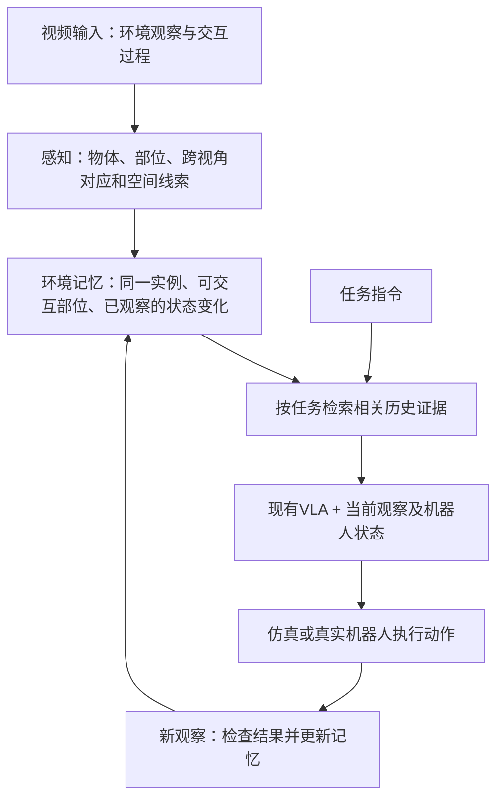

# 组会讨论稿：让机器人记住视频中的交互证据

**讨论用候选方案｜2026-11-02｜建议主讲5–8分钟。尚未验证，不修改项目总控。**

## 1. 我们想解决什么问题？

机器人不仅需要看懂当前画面，还需要记住之前看到的环境：同一个物体有哪些可操作部位、人或机器人曾怎样操作它、操作后发生了什么变化。

我们的目标是：**从视频建立环境记忆（Environment Memory），之后按任务找回有用证据，帮助机器人行动。** 这与博士项目中“用视频构建三维环境记忆”的主线一致。

这里的**可交互性（Affordance）**指某个部位在一定条件下支持什么操作，例如把手支持抓取和拉动。它比“这是一个抽屉”的类别信息更接近行动，但看到把手不代表已经证明抽屉未锁或机器人一定能拉开。

## 2. 用一个例子理解

人先打开抽屉A，把杯子拿到台面上。之后摄像机转向，抽屉把手离开视野。现在要求机器人：“把杯子放回原处。”

系统需要记住三件事：

- 杯子原来在哪个抽屉，而不是随便找到同类抽屉。
- 那个抽屉的可抓部位在哪里，以及此前观察到的拉动方向。
- 抽屉和杯子发生过哪些变化，哪些信息可能已经过时。

只识别“杯子、抽屉”不够；只保留一张交互热图，也不能表达整个过程。

## 3. 新的候选 pipeline

1. **感知（Perception）：** 在不同视角中对应同一个物体，识别局部部位；需要时估计三维空间关系。
2. **记忆（Memory）：** 保留对象身份、重要部位、观察时间和来源；有交互时再记录前后变化。未拍到的内容保持未知。
3. **检索（Retrieval）：** 根据当前任务找回相关对象与证据，例如“抽屉A的把手”，而不是只找外观最像的整帧。
4. **行动（Action）：** 现有视觉—语言—动作模型（Vision-Language-Action, VLA）利用证据、当前图像及允许的机器人状态，输出一小段连续动作（Action Chunk）。
5. **闭环反馈（Closed-loop Feedback）：** 执行后重新观察，更新记忆；预测的结果不能直接当作已经发生的事实。

感知先记录“物体、部位和空间发生了什么”，推理／决策（Reasoning / Decision）再结合任务选择证据与动作；这是准备比较的分工，不预设一定使用两个完全独立模型。

本稿以VLA动作作为下游检验，首轮可在仿真中完成；真实机器人不是当前实验的前提，上图是拟验证流程。

**已有完整路线的近邻：[SOMA](https://arxiv.org/html/2605.22283)（ICML 2026）。** 它从相机扫描构建空间记忆，按指令读取后驱动机器人。**主要贡献：把当前视野外的空间信息接入动作策略。** 因此，我们不能把“视频→空间记忆→动作”本身当成新意。

## 4. 我们具体研究什么？

### 研究点一：压缩视频时，能否保留小而关键的部位？

两帧整体外观相似，但其中一帧可能是唯一看清把手的视角。我们希望减少重复信息，同时保留这种证据，并保持正确的物体身份。

**相关文献：[NativeMEM](https://arxiv.org/html/2607.06678)（2026）。** 它把图像压成很小的数字特征（Memory Token），再让VLA读取这些历史特征。**主要贡献：复用模型已有的图像处理模块，高效保存历史。** 我们要测试功能部位证据能否在相同记忆预算下进一步改善动作，不能预先认定普通压缩一定丢失细节。

### 研究点二：记住“可交互部位”能否帮助选对动作？

比较只认物体类别与保留任务相关部位的策略，尤其关注部位被遮挡、相似物体容易混淆的情况。

**相关文献：[AffordVLA](https://arxiv.org/html/2605.17517)（2026预印本）。** 它用功能预测模型指导VLA内部特征学习，部署时移除该指导模型。**主要贡献：把affordance知识转入动作表征。** 我们关注这些线索如何随视频被保留和找回，而不只是给当前帧增加功能监督。

### 研究点三：怎样区分旧信息、已发生变化与未知？

例如，人把障碍移走后，记忆应更新；如果没有看到新的变化，就不能凭空认定路径已经畅通。

**相关文献：[MemBodied](https://arxiv.org/html/2609.28256)（2026预印本）。** 它执行动作、取得真实后续观察后，再把动作与观察写入记忆。**主要贡献：让策略利用执行后的历史反馈。** 因此，“记录动作后果”也已有先例；我们还需证明局部交互证据及其可靠度带来额外价值。

## 5. 新增讨论分支：让人先执行任务，可以吗？

可以。可以先由人产生交互视频，让系统学习“接触哪里、怎样移动、什么发生了变化”，机器人之后再利用。这属于**从人类示范学习（Learning from Human Demonstrations）**。

**相关文献：[RAM](https://proceedings.mlr.press/v270/kuang25a.html)（2024首发，PMLR 2025）。** 它从人或机器人示范中建立接触点与运动路径库，检索相似示范，再迁移到目标物体。**主要贡献：把示范检索与affordance迁移连接到机器人执行。** 它依赖目标场景深度、抓取和规划模块，并非端到端VLA。

建议把这一分支先作为**记忆的信息来源**：人负责产生交互，系统负责记录与理解。若要求机器人完整复现流程，还需解决步骤划分、目标机器人动作映射和执行验证。相关数据及方法见[人类示范备查文档](人类示范到机器人Affordance_数据与方法简表_2026-11-02.md)。

若接现有VLA，需要用机器人动作数据或经验证的控制映射对齐接口；人的手部轨迹不能直接当作机器人的控制命令。

## 6. 第一个实验怎样判断是否值得继续？

选少量“关键部位先可见、后离开视野”的操作任务，使用同一个VLA和同一份机器人训练数据比较：

| 对照 | 给模型什么 |
| --- | --- |
| A：当前帧 | 当前观察 |
| B：普通历史记忆 | 经过常规选择或压缩的历史 |
| C：候选方法 | 保留功能部位和变化证据的历史记忆 |

B与C使用相同记忆预算。主要看**闭环任务成功率（Task Success Rate）**，同时记录选错物体、选错部位和额外搜索。检索准确率用于诊断原因。

**有意义的结果：C稳定优于B，且优势来自保留了正确交互证据。** 只比A好，还不足以说明新记忆设计有效。首轮可以在仿真中验证，无需从头训练大型VLA。

还应清空或交换关键记忆，检查动作是否按任务所需的历史证据改变；额外的几何或功能监督也要给对照组同等条件。

## 7. 希望组会上讨论的三个决定

1. **先解决什么：** 部位证据保留、状态变化更新，还是完整任务步骤？建议先选前两者之一。
2. **先用什么视频：** 机器人观察、人类交互，还是两者结合？人类视频可先用于学习与构建记忆。
3. **怎样检验价值：** 先固定一个机器人和少量任务，用动作成功率判断记忆贡献，再扩大范围。

完整文献与资源细节保留在[原立项报告](视频到机器人动作_VLA_文献调研与立项评估_2026-11-02.md)，本稿只保留讨论主线。

