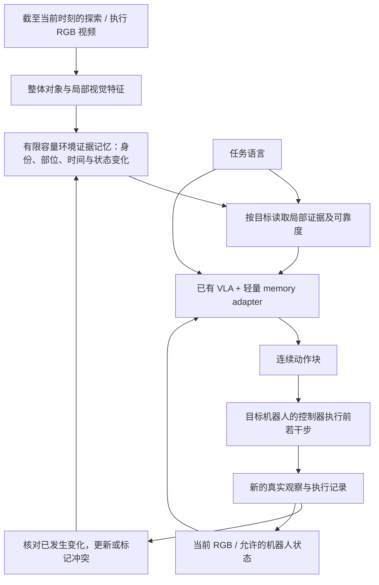

# 视频输入到机器人动作：VLA 文献调研与立项评估

**日期：2026-11-02｜性质：立项决策用定向范围综述｜状态：候选研究路线，未运行实验**

## 1. 直接判断与推荐定位

**建议有条件立项，但将贡献放在“视频中的环境交互证据如何改善闭环动作”，不以“做一个 video-to-action VLA”作为创新主张。**

视频条件动作、视频预训练、空间表征、历史记忆、动作后果写入及 affordance 条件化都已有直接先例。SOMA 已实现扫描 RGB → 空间记忆 → 指令检索 → 动作；GeoMem-VLA 已用几何监督训练时序记忆；MemBodied 已在执行后把动作与真实后续观察写入记忆。因此，简单连接视频编码器、affordance map、memory 和现有 VLA，工程上可行，论文新颖性较弱。

更适合当前 PhD 主线的候选问题是：**有限容量的视频环境记忆，如何保留同一物体的局部交互证据及已观察到的状态变化，让机器人在目标部位离开视野后仍能选择正确对象和动作？** 是否能超越普通历史窗口、压缩 token 及空间记忆，需要实验；这不是已证明的空白。

本报告比较 **34 篇方法论文**，其中 26 篇核查了方法和实验相关章节（Actron3D 沿用前轮核查），8 篇仅原始摘要/作者项目概况；另整理 8 篇数据/基准工作及官方文档。不代表全文逐字精读全部论文或穷尽式检索，不给跨协议的统一 SOTA 排名。来源、等级及检索边界见[检索与证据记录](视频到机器人动作_VLA_检索与证据记录_2026-11-02.md)和[证据表](视频到机器人动作_VLA_文献证据表_2026-11-02.json)。

本报告新增一条动作方向的候选评估，不替代[跨视角检索报告](跨视角Affordance检索_文献调研与立项评估_2026-11-02.md)，**不修改项目总控，不表示已批准改变主线。**

## 2. 先把 video input 和 action output 定义清楚

### 2.1 四种不同的“视频用于机器人”

| 路线 | 视频出现在哪里 | 模型实际做什么 | 对当前项目的意义 |
| --- | --- | --- | --- |
| 人视频预训练 | 训练数据 | 学视觉、运动、潜在动作或空间先验；部署可能只吃当前图 | 可提供先验，但不自动提供环境历史记忆 |
| 机器人历史视频 | 执行时的因果历史 | 根据当前帧、过去观察/动作和指令输出动作 | **最符合你的环境记忆主线** |
| 视频示范条件控制 | 执行前输入的一段示范 | 模仿视频中的任务，结合当前机器人观察控制 | 若你希望“给一段示范，机器人去做”，这是另一个任务 |
| 视频世界模型 / WAM | 预测未来视频或 latent 的训练目标及规划 | 预测动作和视觉后果，或把视觉计划译成控制 | 研究价值高，完整训练计算与数据成本通常更高 |

例如 Being-H0 主要属于第一类，Vid2Robot 直接涉及第三类，MemoryVLA/SOMA 属第二类，Cosmos Policy、VPP2 属第四类，并可与其他类结合。**多相机的同一时刻图像不是时间视频；预测的未来不是已经发生的历史。**

### 2.2 建议的首版输入与输出

- 输入：同一机器人执行/探索产生的 RGB 历史、当前 RGB、任务语言；允许使用机器人本体状态与已执行动作，但所有基线一致。若最终要纯 RGB，应作为单独约束和消融，不默认所有 VLA 都不需要状态。
- 记忆：观察过的物体身份、局部几何/功能线索、时刻与来源、动作及随后真实观察的变化；保存不确定性，不把未观察的内部或背面当事实。
- 输出：一个固定机器人接口下的连续动作块，例如末端位移、旋转和夹爪指令，由平台控制器执行。机器人不同，动作维度、绝对/相对坐标、单位、频率和夹爪约定可能不同。
- 闭环：执行若干动作后取得新观察，再生成下一动作。预测块长和实际执行块长分别记录；输出一整段视频或“去抓杯子”的文字，不能等同于输出可执行低层控制。

普通人类 RGB 视频不直接包含目标机器人的关节命令；相同视觉结果也可能对应不同控制。通常需要目标机器人动作轨迹，或经验证的重定向/逆动力学/控制映射。VERA 展示了规划与本体 IDM 分离的替代路线，但 IDM 仍通过机器人自交互 video-action 数据学习。不能把“视频规划器不读动作标签”写成“整个系统完全不需要动作数据”。

## 3. 文献版图：已经做到了哪里

A=方法与实验相关章节级核查；B=原始摘要/作者项目概况。表内性能描述均限于作者自己的设置；没有统一重跑，不作横向分数排名。P 编号对应持续文献档案。

### 3.1 动作模型与可实施基线（8 篇）

| 文献 | 机制与实际输入输出 | 对立项的意义与边界 |
| --- | --- | --- |
| P32 [RT-1](https://arxiv.org/abs/2212.06817)，2022，B | 短 RGB 序列＋任务语言 → Transformer → 离散机器人动作 | 视频短窗口到控制已有早期先例；不是持久三维记忆 |
| P33 [RT-2](https://arxiv.org/abs/2307.15818)，2023，B | 网络视觉语言知识与机器人动作 token 共训练，闭环控制 | 语义推理转动作已有；知识迁移不等于任意新技能 |
| P34 [Diffusion Policy](https://arxiv.org/abs/2303.04137)，2023，B | 观察条件动作扩散、动作序列及滚动执行 | 重要的非 VLA 动作基线；原始版本不自动具有语言与长期记忆 |
| P35 [OpenVLA](https://arxiv.org/html/2406.09246)，2024 首发 / PMLR 2025，A | 当前 RGB＋语言 → DINOv2/SigLIP＋LLM → 动作 token | 开放的 VLA 起点。原版接口主要单帧，不能直接声称支持持久视频记忆 |
| P36 [OpenVLA-OFT](https://arxiv.org/html/2502.19645)，2025，A | 并行解码、连续动作及 L1 action chunk；可适配状态、多相机和不同动作空间 | **主 backbone 候选**。多相机/状态灵活性不等于原生长期历史；ALOHA 实验是块间反馈 |
| P37 [π0.5](https://arxiv.org/html/2504.16054)，CoRL 2025，A | 多相机/本体＋语言，高层子任务与 flow action expert；多来源共训练 | 强动作与语义对照；原始论文全部训练数据/系统并未由 openpi 完整复现 |
| P38 [SmolVLA](https://arxiv.org/html/2506.01844)，2025，A | 紧凑 VLM＋flow 动作专家；社区轨迹与异步执行 | 资源较少时的候选。仿真逐步重观测和实机完整块执行的结果不能混称相同控制协议 |
| P39 [π0.7](https://arxiv.org/abs/2604.15483)，2026-04 预印本，B | 多模态提示、视觉子目标和可引导动作专家 | 前沿能力参照；本轮未核查其完整内部 memory，也未确认可复现训练权重 |

**最新不等于适合起步。** 2026-11-02 查看的 [Isaac-GR00T 官方 main](https://github.com/NVIDIA/Isaac-GR00T)已标 N1.7，并列模型、仿真示例及本体接口。它是本轮的实现资源参照，不把不同版本能力混为同一篇论文，也不把未来版本预告当可下载模型。已查 [openpi](https://github.com/Physical-Intelligence/openpi)主列表为 π0/FAST/π0.5，不能因为 π0.7 论文存在就假定该仓库有完整对应实现。

### 3.2 视频知识、示范与世界—动作模型（10 篇）

| 文献 | 视频的作用、动作 grounding | 关键判断 |
| --- | --- | --- |
| P40 [Vid2Robot](https://arxiv.org/html/2403.12943)，2024，A | 推理输入示范视频及近期机器人观察，跨注意力生成动作块；训练有动作机器人轨迹 | **直接覆盖“给视频输出机器人动作”**。示范短视频与任意长视频环境理解不同 |
| P41 [UniVLA—Task-centric Latent Actions](https://arxiv.org/html/2505.06111)，RSS 2025，A | 跨人/机器人视频学潜在动作，再用机器人数据训练本体动作解码 | 潜在动作不是电机命令；主要视频预训练不代表运行时长期历史 |
| P42 [Unified Vision-Language-Action Model](https://arxiv.org/html/2506.19850)，2025 首发，A | 视觉、语言、动作统一 token；视频世界学习＋机器人动作监督，涉及历史与预测 | 与 P41 同名 UniVLA 但不同团队/论文；不可合并成一项证据 |
| P43 [VIPA-VLA](https://arxiv.org/html/2512.13080)，2025 首发 / CVPR 2026 信息见作者来源，A | 从人视频重建手部与空间监督，机器人示范后训练 | 人类空间/运动先验已有；重建假设与手部资产不免费，实际任务泛化有限 |
| P44 [Being-H0](https://arxiv.org/html/2507.15597)，[ICML 2026](https://proceedings.mlr.press/v306/luo26e.html)，A | 大规模人视频手部动作与物理空间预训练，机器人 physical instruction tuning | 官网示例有单张图输入；“video pretraining”不是“video-history policy” |
| P45 [Cosmos Policy](https://arxiv.org/abs/2601.16163)，ICLR 2026，A | 机器人演示后训练视频扩散；动作、未来图像和 value 用 latent frames 表达 | 闭环与规划先例强，完整后训练成本高；未来图像不能充当已观察证据 |
| P46 [VPP2](https://arxiv.org/html/2610.10270)，2026-10 预印本，A | 大视频骨干、预测蒸馏和 action expert；机器人动作监督 | RoboDojo 加历史的变体与 ALOHA 默认结果分开；未见任务不等于未见本体 |
| P56 [AffordanceWAM](https://arxiv.org/abs/2609.22332)，2026-09 预印本，B | 未来 RGB、时空 affordance 标量/热图与连续动作共同学习；人视频不提供机器人动作标签 | **未来视频＋功能表征＋action 组合已有直接近邻**；未全文核查其具体历史机制 |
| P64 [VERA](https://arxiv.org/abs/2605.27817)，2026-05 预印本，B | 视频模型给计划，本体专用 Jacobian IDM 译成动作，再反馈重规划 | 模块化替代路线；IDM 仍需本体 video-action 自交互数据，非无需 grounding |
| P65 [MoGAP](https://arxiv.org/abs/2610.36624)，2026-10-27 预印本，B | 训练时强调动态区域的视频预测，辅助 WAM 控制 | 最新局部视觉监督参考；单纯把视觉 loss 聚焦交互区域也不能直接称新颖 |

对你的资源和目标，视频世界模型适合作为后续路线与相关工作。先训练 14B 视频骨干，再接动作专家，会把问题扩大为数据配比、生成质量、动作对齐和运行延迟，较难独立回答“环境记忆有什么贡献”。

### 3.3 历史与空间记忆直接驱动动作（9 篇）

| 文献 | 记忆、输入与闭环证据 | 与当前候选的重合 / 尚需比较 |
| --- | --- | --- |
| P02 [HistRISE](https://arxiv.org/html/2509.17141)，ICRA 2026，A | RGB-D 历史点跟踪与对象 token 接 ACT/DP/RISE；真实 Guess 遮挡/箱子洗牌任务 | 历史对象轨迹→动作已做；用双 RGB-D，严格说不必是 VLA，也非纯 RGB |
| P47 [MemoryVLA](https://arxiv.org/html/2508.19236)，ICLR 2026，A | 感知/认知状态银行，历史压缩与检索，diffusion 动作专家；记忆任务和真实操作 | 重要直接动作基线。其公开配置主要第三人称 RGB＋语言，不应凭常规 VLA 经验添加本体输入 |
| P05 [MemBodied](https://arxiv.org/html/2609.28256)，2026-09 预印本，A | 先生成执行动作，取得真实后续观察，再将动作及观察写入 gated associative memory | **执行后果的因果写入已存在**。每 rollout 重置，非跨 episode 永久地图 |
| P06 [UniMPA](https://arxiv.org/html/2609.11875)，2026-09 预印本，A | 离线视觉—动作/动作—视觉经验库，未来 latent 监督与动作 expert；多平台闭环 | 完成 rollout 后可追加经验，当前 rollout 同步写入仍为未来工作；推理不读取未来真图 |
| P07 [GeoMem-VLA](https://arxiv.org/html/2610.29866)，2026-10 预印本，A | 训练用几何教师和末端轨迹；推理因果几何/观察 token memory＋flow 动作 | **几何监督→隐式时序记忆→动作直接重合**；不能以“训练显式、推理隐式”作为首次 |
| P48 [SOMA](https://arxiv.org/html/2605.22283)，[ICML 2026](https://proceedings.mlr.press/v306/li26ay.html)，A | 头相机 RGB 扫描→估计几何/对象记忆→动态维护和指令检索→动作；有实机视野外任务 | **最接近你的完整空间 memory-to-action pipeline**。需要正面对比或同预算适配，非只比无记忆 |
| P49 [NativeMEM](https://arxiv.org/html/2607.06678)，作者标 CoRL 2026，A | 原生视觉编码器把每帧每视图压为 token，经动作监督对齐后接 π0.5 | 高效历史压缩接动作已有；小部位是否丢失是待测问题，不能预先断言其失败 |
| P50 [EvoMem-VLA](https://arxiv.org/html/2610.05418)，2026-10 预印本，A | 有向帧对 delta token 和历史状态证据；动作头，部分任务另预测子任务 | “保留交互导致的变化”亦有直接先例；文本子任务不是它唯一最终输出 |
| P51 [MEM](https://arxiv.org/html/2603.03596)，2026-03 预印本，A | 视频短期记忆＋语言长期事件摘要，分层连续动作；真实长任务 | 短期/长期混合记忆已有；语言摘要与局部功能证据的差异需要量化 |

**不要把 memory 当作一个同质模块。** SOMA 是空间环境记忆；MemBodied 是回合内关联状态；UniMPA 是离线经验检索；MEM 是视频＋文本任务记忆；NativeMEM 是历史 token 压缩。跨目标/跨回合持久化可以成为实验维度，但“持久记忆”这个词本身不保证原创。

最强的现有记忆证据来自关键线索已经消失的任务，而非单纯长时间运行。HistRISE Guess、MemoryVLA 的部分 MIKASA 任务、NativeMEM 记位/计数任务都有此类设计；但本轮没有核查到这些工作都进行了严格的“相同当前观察、交换历史”的配对因果干预。不能据此断言其方法没有用历史，也不能把一个新增消融当成完整算法贡献。

### 3.4 几何与 affordance 如何落到 action（7 篇）

| 文献 | 几何/功能到动作的连接 | 对本项目的边界 |
| --- | --- | --- |
| P52 [SpatialVLA](https://arxiv.org/html/2501.15830)，2025，A | RGB 估计深度、Ego3D 位置编码与空间动作 token；仿真和实机 | 几何增强 VLA 已有；不等于环境历史 memory |
| P53 [3D-VLA](https://arxiv.org/html/2403.09631)，ICML 2024，A | 三维交互 token、目标图像/点云生成及动作预测 | §5.3 RLBench 动作测试是 open-loop，不能当作已验证实机闭环控制 |
| P54 [GeomVLA](https://arxiv.org/html/2609.13812)，CoRL 2026 接收，A | RGB＋metric depth＋标定 → 机器人坐标 3D tokens → motion/action denoising | 需要深度/标定，不能等同纯 RGB；场景—运动—动作共同对齐已有 |
| P08 [AffordVLA](https://arxiv.org/html/2605.17517)，2026-05 预印本，A | 功能 teacher 对齐学生 VLA 特征，同时用动作监督；推理去掉 teacher | **功能监督蒸馏成隐式动作表征已有**，没有时序 memory 也可能提高任务表现 |
| P55 [AffordanceVLA](https://arxiv.org/html/2606.06155)，2026-06 预印本，A | Which2Act/Where2Act/How2Act 多级功能表征与动作 expert，分阶段训练 | 与 AffordVLA 是不同论文；大量 grounding、合成及真实机器人数据需计入比较 |
| P15 [Actron3D](https://arxiv.org/html/2510.12971)，ICRA 2026 信息见作者来源，A | 人视频几何/接触/动作 neural function，经 RGB-D 检索对齐迁移操作 | 视频功能表示＋动作迁移已有；示范 RGB-only 不代表部署 RGB-only |
| P66 [3DS-VLA](https://proceedings.mlr.press/v305/li25g.html)，CoRL 2025，B | 2D→3D 对齐与功能相关 3D 关键点顺序约束，预测末端姿态；作者报告仿真和实机 | 功能几何及顺序空间约束接动作已有；摘要不足以确认其长期记忆、推理具体模态或遮挡历史能力 |

AROS 和 O³Afford 可继续作为局部关系与几何表示的动机，但不是首版动作系统的必需模块。AROS 的人体姿态—场景几何相容不等于某机械臂能到达、抓稳、承重或无碰撞执行；功能热图、可见部位、预测可操作性和实测成功必须分开。

## 4. 创新性审查

以下是立项判断，不是领域统一分数或录用概率。

| 候选主张 | 判断 | 直接依据 / 需要补的证据 |
| --- | --- | --- |
| 视频输入生成机器人动作 | 不足以作创新 | RT-1、Vid2Robot 及大量后续方法 |
| 人类视频预训练 VLA | 已有成熟竞争路线 | UniVLA、Being-H0、VIPA-VLA；须证明新的对齐/数据效率 |
| 预测未来视频再生成动作 | 广泛已有 | Cosmos Policy、VPP2、VERA 等 |
| 3D/affordance 特征接 VLA | 原始组合创新低 | SpatialVLA、GeomVLA、AffordVLA、AffordanceVLA |
| 空间/隐式记忆接 VLA | 原始组合创新低 | SOMA、GeoMem-VLA、MemoryVLA |
| 实际动作＋后续观察写入记忆 | 不能称首次 | MemBodied 已有清楚时间因果；EvoMem 保留状态变化 |
| 有限容量下保留局部交互证据并改善闭环动作 | **有研究潜力，原创性未确认** | 要赢同历史预算的 NativeMEM/普通记忆、空间记忆及功能监督基线，不能只赢当前帧 |
| 对同一环境换目标，复用证据并处理新变化 | 可作为强化维度 | 需与任务级摘要/空间记忆公平比较；跨回合 reset 与知识权限清楚 |
| 从“证据检索正确”连接到“动作正确” | 值得检验，非自动成立 | 同 backbone 下测选错实例、接触区域、任务成功与错误检索的影响 |

**推荐定位：功能证据保持的环境记忆增强 VLA。** 主贡献应是经过验证的记忆写入/保留/更新机制，以及它为何帮助动作；如果只是多接一个分割器和 cross-attention，更像增量系统整合。若只提出更可靠评测而无方法增益，需按 benchmark/诊断贡献单独定位。

## 5. 三条立项路线与建议优先级

| 路线 | 具体目标 | 可实施性 | 创新与风险 | 建议 |
| --- | --- | --- | --- | --- |
| A：现有 VLA＋视频历史 | 单帧、固定历史、普通压缩 memory 的动作对照 | 相对较高，但仍需平台适配和动作数据 | 原型价值高；仅接历史创新低 | 作为必做 baseline 阶段 |
| B：功能证据环境记忆＋VLA | 保留同实例的小部位/关系及真实状态变化，帮助遮挡后操作 | 中等；主要困难是任务和监督，而非模型名称 | 有潜力但近邻很强；需等预算闭环增益 | **优先验证的研究路线** |
| C：视频 world model＋action expert / IDM | 预测视觉未来并生成或解码动作 | 完整训练通常成本高，且本体对齐不可省略 | 前沿竞争密集，贡献容易与 backbone/数据规模混淆 | 后续扩展；不作为首轮必需 |

如果研究只想证明“历史有用”，A 的结果可能已经足够回答工程问题；如果要论文贡献，B 必须说明**普通历史为什么丢失了对动作重要的内容，以及新的保留/更新机制如何解决**。C 的大模型成绩不自动证明 B 的价值。

### 5.1 建议的候选 pipeline

这里的 memory 不必是一张完整网格，也不必先设计全新大模型。首轮可以保留局部 learned descriptors、少量证据图像/索引和置信信息；再比较显式对象库、普通隐式 token 和候选功能证据 memory。选择混合表示不是自动的创新，也不要把带来源索引的系统叫作“完全隐式”。

若三维几何只作训练教师，必须明确来源及训练成本；若推理需相机位姿、深度或机器人标定，写入输入约束并给基线相同信息。单目几何估计并不自动得到准确机器人基坐标，动作接口仍需相应对齐。

### 5.2 需要检验的三个研究假设

1. **证据保留：** 同容量下，普通去重/压缩丢失了稀有小部位；功能证据机制保留得更多，且不把同功能的不同物体误合并。
2. **动作相关性：** 保留这些证据能降低错对象/错部位动作，提高闭环成功；不只是让检索可视化更漂亮。
3. **更新可靠性：** 真实观察到障碍、位置或交互状态变化后，旧证据能被更新或降权；没有观察变化时不会凭空改写环境。

这三项均可能被否证。局部功能表示、变化 token、因果写入各自都有先例，必须以具体新机制及受控结果论证，而非叠加名词。

### 5.3 一个适合起步的受控任务

探索阶段，机器人从不同视角看过两个相似容器或抽屉；其中的可抓取部位或接近路径不同。执行阶段改变相机视角，或由机器人自身遮挡部位，要求按指令选对实例与接触位置，完成打开/取放。另一组在历史中观察到障碍被放入或移走，随后该局部区域离开视野。

只评价视觉或交互反馈确实提供过的线索；不能要求单目视频判断从未可见的锁、承重或摩擦。几何相容与最后成功之间仍有控制误差。首轮尽量固定一个机器人、少数刚体操作和两三种功能关系，不同时引入自由移动、人形全身和柔性物体。

## 6. 数据、平台和动作标签是否够用

### 6.1 数据/benchmark 证据（8 篇）

| 资料 | 已有内容 | 本项目能做什么 / 缺什么 |
| --- | --- | --- |
| P57 [MIKASA-Robo-VLA](https://arxiv.org/abs/2610.00604)，2026 预印本 | 90 个语言任务，含 10 个 reactive 控制；22,500 条 oracle 机器人轨迹，官方说明 RLDS/LeRobot v3 | **记忆 pilot 优先候选**。先验任务构造有隐藏线索；完整90任务与论文只训练的部分 baseline 覆盖不同，不能直接称全部可复现 |
| P09 [RoboMME](https://arxiv.org/abs/2603.04639) / [项目](https://robomme.github.io/)，2026 | 16 个操作任务与多种记忆需求，部分任务涉及视频前置信息、遮挡和状态跟踪 | 适合后续另一基准验证；需适配观察/控制协议，不保证跨本体零样本。额外深度与 RGB 组分开 |
| P61 [LIBERO](https://github.com/Lifelong-Robot-Learning/LIBERO)，2023 | 语言、图像、状态、动作演示及标准闭环环境，许多 VLA 已有接口 | **打通动作链的低门槛候选**；Long 任务不自动需要记忆。新增遮挡/历史歧义通常需 wrapper 与对应新演示 |
| P62 [CALVIN](https://github.com/mees/calvin)，2021 首发 / 2022 | play 数据和语言，五段技能链、ABC→D 未见环境协议 | 可后续研究组合与长任务；长序列不等于信息必须来自过去。完整数据存储较大 |
| P63 [LIBERO-Plus](https://openaccess.thecvf.com/content/CVPR2026/html/Fei_LIBERO-Plus_A_Progressive_Robustness_Benchmark_for_Visual-Language-Action_Models_CVPR_2026_paper.html)，CVPR 2026 | 布局、相机、初态、语言、光照等受控扰动 | 用作 LIBERO 路线的稳健性扩展；不直接证明 memory 必要，也不证明某模型训练泄漏 |
| P58 [Open X-Embodiment](https://arxiv.org/abs/2310.08864) / [官方格式](https://github.com/google-deepmind/open_x_embodiment)，2023/2024 | 多机器人 episode/step、视觉、状态、动作和不同覆盖的语言 | 用现有预训练或具体兼容子集。统一 RLDS 不等于动作坐标、频率、语义都统一 |
| P59 [DROID](https://arxiv.org/abs/2403.12945) / [schema](https://droid-dataset.github.io/droid/the-droid-dataset)，2024 | 真实多场景多相机、状态、动作及语言 | 后续真实域适配候选，非现成功能记忆标签；动作维数/模式须 inspect 实际样本与代码，原始数据规模大 |
| P60 [BridgeData V2](https://arxiv.org/abs/2308.12952)，2023 | 低成本机器人多场景示范与任务条件 | 视频与动作同步，可研究迁移；不直接提供所有历史功能区域标签，需对齐 WidowX 等本体接口 |

MIKASA 的旧套件、MemoryVLA 使用的任务子集与新的 MIKASA-Robo-VLA 90任务版不是同一个评测截面；数据、版本和任务 ID 必须记录。DROID 的官方文字在动作维数上有待样本核对的细节，不能据此直接编写转换器。

**建议只开两个起步入口：** MIKASA-Robo-VLA 用来验证历史是否必要；LIBERO 用来打通已有 VLA 闭环适配，之后再决定是否值得新增功能任务。外测优先 RoboMME，但须确认控制和训练权限；若先要验证稳健性，可在 LIBERO 内用 Plus 扰动替代另开本体。首轮不要同时下载全部数据集。

### 6.2 哪些视频不能直接训练 action head

- SceneFun3D 有功能区域、RGB/几何和语言，**没有配套的目标机器人动作轨迹**；可作功能教师或独立感知检查，不能单独训练并证明闭环策略。
- Ego4D/Ego-Exo4D 等人视频可学视觉历史/交互先验；机器人动作需额外对齐、标注或可靠控制映射。
- 修改环境遮挡、相机扫描或任务逻辑后，原来任务的演示可能没有所需历史，不能继续把旧专家标签当新任务专家。
- 仿真 privileged state 可用于专家、离线标签和评价，但不能悄悄送入 RGB policy、memory、检索排序或 teacher-free 测试路径。

[CALVIN](https://github.com/mees/calvin)、[SimplerEnv](https://github.com/simpler-env/SimplerEnv)、[RoboTwin 2.0](https://robotwin-platform.github.io/)可作为后续平台背景；后两者不是本报告首轮必选项，也不假定默认任务有记忆必要性。RoboTwin 的更高版本本轮未核实，不按版本名推定能力。

## 7. 一个可回答研究问题的最小实验

### 7.1 先做信息必要性诊断

构造两段不同历史，在决策时给出相同或尽可能匹配的当前 RGB、语言和允许的本体状态，但正确对象/动作不同。核查所有当前相机、时间步、语言、初始位置和机器人姿态没有泄露答案。

这不是声称现有论文都没做过遮挡，而是避免你在信息充分的任务上“证明”记忆有效。先检查 oracle 历史/部位上界是否优于强当前帧和普通历史基线；无 headroom 时停止开发复杂 memory。

上界诊断之前，先确认 oracle 信息已通过正确接口被同一动作 backbone 消费：做接口可用的正对照，匹配动作头、执行块长和允许的输入。未经训练的新 token 接进去却无效，可能只是对齐或接线问题，不能据此判定记忆没有价值。oracle 的特权观察与其训练/接入成本单列，不称公平方法成绩。

区分两种协议：诊断任务可限制关键信息再次可见；自由操作任务则给所有方法相同的主动重观察权限，报告成功、搜索动作和时间。不能只禁止无记忆基线重新看，又允许候选系统额外探索。

首个 pilot 可用约 3–5 个 memory-dependent 任务＋2 个 reactive 控制任务，覆盖相似实例、部位离开视野及观察到的状态变化。少量 rollout 先定位问题；正式样本量由 pilot 方差和预设最低有用增益决定，不把一组小样本平均值当论文结论。

### 7.2 最低公平对照

| 组别 | 需要固定的条件 / 回答的问题 |
| --- | --- |
| B0 当前帧 VLA | 相同预训练、机器人示范、状态和动作头；记忆总体是否有用 |
| B1 固定窗口历史 | 相同观察权限与可比预算；收益是否只是多看了帧 |
| B2 普通压缩历史 | NativeMEM 风格或普通 token/crop/多样性 memory；新写入机制是否比通用压缩好 |
| B3 空间/几何 memory | SOMA/GeoMem 风格可运行适配；功能证据相对空间记忆有何增量 |
| B4 功能监督、无长期 memory | AffordVLA 风格或相同教师的当前帧辅助训练；收益是否只是多了训练标签 |
| M 候选方法 | 同 backbone、动作头与数据，改变证据写入/读取/更新 |
| 特权参考 | oracle 部位/实例/几何/历史，仅作诊断，不能和 RGB-only 方法并列称公平 SOTA |

无需承诺全部原始大系统都完整复现；首轮至少跑 B0/B1/B2 和 M。正式方法主张涉及空间或功能教师时，再加入对应 B3/B4；若无法复现，明确称“适配/近似基线”并公开差异，不能拿原论文异任务数字替代实验。

匹配训练轨迹数、预训练来源、相机、图像分辨率、动作空间、预测块长、实际执行块长、总参数/训练预算和测试权限。新增 teacher、几何预处理、标签或合成数据单列，必要时给基线同等监督。记忆记录全部保留图像/token/索引字节；允许外部视频回取则所有方法权限一致并计 I/O，不能免费重扫整段历史。

### 7.3 消融和干预

- 记忆置空、交换两段匹配历史、打乱时间、加入相似错误实例；应按任务所需的信息改变动作，而非只测性能下降。
- 同实例保整体、保部位及二者联合；只用语义类别、只用外观、去几何/可靠度/更新，各自明确改变什么。
- 给同一对象换功能目标，检验是否根据任务读取相应部位，而非固定抓最大/最显眼区域。
- 观察到障碍变化后检验旧证据；没有新观察时返回不确定，不把预测后果写成事实。
- 控制检索质量后检查动作是否仍受益；用正确/错误证据干预分离检索失败与控制失败。

### 7.4 主指标与因果时序

主指标是**闭环任务成功率**，同时报告阶段完成、错实例、错接触区域、碰撞/无效动作、搜索次数、动作总步数和墙钟时间。功能证据检索、区域 IoU 和动作 L1/MSE 是诊断指标，不能替代控制成功。未获取足够证据而重新观察/停止应按任务定义计时与计分，不把拒绝执行直接算成功。

按任务、场景/物体实例、训练随机种子分别报告结果和不确定区间；训练/测试以完整 episode 和场景分开，不能把相邻帧随机分到两边。避免每次在测试集挑最佳 checkpoint；用独立验证集选模型。

时间规则：

1. 读取截至 t 的观察与记忆，生成预测动作块。
2. 只把平台实际执行的前若干步与对应记录视为已发生；未执行的预测后缀不是事实。
3. 取得执行后的真实观察，再更新 memory。只有控制命令而没有执行验证时，应标明是 commanded action。
4. 未来图像、完整轨迹、扫描真值和接触标签仅在允许的训练/评价环节使用；部署不能读取未来真值。
5. 每回合正确 reset。若测试跨回合持久记忆，单独定义环境是否保持、哪些旧信息可复用，禁止跨测试样本或场景泄漏。

## 8. 如何训练与选择 backbone

### 8.1 从已有模型适配，先避免基础模型重训

1. 先让一个现有 checkpoint 在一个既有仿真任务闭环运行，确认动作坐标、归一化、夹爪约定、相机顺序、采样频率和执行时序。
2. 用同一份同步机器人轨迹建立当前帧及普通历史基线。训练数据必须含你想保留的探索/历史事件。
3. 加小型 memory encoder / adapter，以动作监督对齐其接口；必要时对 VLA 部分层作 LoRA 或小范围微调。冻结 VLA 并不保证它理解任意新 token，需要实验。
4. 再研究是否值得加入功能/几何教师、对比学习或变化监督；所有额外数据和标签计入资源。
5. 最后才考虑大视频模型继续训练、跨本体动作对齐或真实机器人泛化。

损失可以包含动作回归/flow matching、实例一致性、部位证据或状态变化辅助项，但“多加几种 loss”不是贡献的替代。若目标机器人与预训练本体不同，要重新对齐动作接口，不只改输出维度。

### 8.2 基于官方当前资料的资源判断

| 候选 | 本轮核实的来源与状态 | 起步建议 |
| --- | --- | --- |
| OpenVLA-OFT | [项目](https://openvla-oft.github.io/)提供代码/checkpoint；特定 LIBERO 单图、chunk=8、batch=1、bf16 **训练配置**最低显存示例约 25.6GB，同单图配置推理示例15.9GB；均非所有配置统一下界 | 数据/显存允许时首选研究基线之一；增加历史后的资源另测 |
| openpi / π0.5 | [README](https://github.com/Physical-Intelligence/openpi)列单 GPU 推理 >8GB、LoRA >22.5GB、全参 >70GB，且有平台/实现条件 | 学校 GPU 上可优先核查；不是对任意动作空间或新增 memory 的保证 |
| SmolVLA / LeRobot | [官方文档](https://huggingface.co/docs/lerobot/main/smolvla)和模型入口存在；模型较小 | 低资源原型候选，但目标任务和历史接口仍要适配；本轮未运行 |
| Isaac-GR00T N1.7 | [官方 main](https://github.com/NVIDIA/Isaac-GR00T)有模型与示例；README 推荐推理16GB+、微调40GB+，部分基础资产需访问许可 | 有相应数据/具身需求才优先；不因版本更新就替换可运行基线 |
| Cosmos Policy / VPP2 | 公开部分代码和权重。Cosmos 官方完整后训练示例涉及多张 H100，VPP2 有 14B 视频骨干 | 先作为对照/后续研究；完整重训不适合默认首轮 |

这些是作者特定配置的文档或报告值，不是本机测试。模型权重许可证、数据许可、依赖、完整训练可复现性尚未逐项核验。GeomVLA 的项目代码链接本轮返回404；VIPA-VLA 仓库显示 coming soon；SOMA 摘要仍写拟发布，不能因为论文有项目按钮就称可立即运行。

学校 GPU 型号、显存、数量和排队额度还未知；5060 的具体显存及平台兼容也未核实，不能保证它能跑某个 VLA。SSH 可以用于无图形界面的训练/仿真，GUI 不必成为训练前提；是否能 headless 渲染和远程传输需按平台验证。若跨设备推理，要报告网络、编码、检索和执行延迟，不能只报模型 forward 时间。

## 9. 继续、缩减与停止条件

**继续研究 B 路线，需要同时满足：**

- 数据有可用的同步历史—动作监督和独立功能/状态标签，观察中确实含有动作所需线索。
- 受控任务有非平凡记忆 headroom，且不是语言、当前本体姿态或场景布局泄漏答案。
- 候选机制能超越相同数据/历史预算的强 B1/B2；相对空间 memory 或额外功能监督仍有可解释增量。
- 增益出现在闭环动作，跨场景/实例保持，且没有以显著恶化碰撞、延迟或 reactive 控制为代价。

**缩减或停止：** 只赢单帧；普通历史已经解决；只在完美 GT mask/track 下有效；收益完全来自 teacher 或额外机器人数据；动作分数与实际成功脱节；只有端到端大规模重训才出现不稳定增益。此时可以保留为环境证据检索研究，或转为有清楚定位的负结果/评测工作，不必强行把所有部分做成新 VLA。

先用 pilot 约定最低有用增益、资源上限和正式评测规模，不给尚无数据基础的成功概率、论文档次或固定完成周期。

## 10. 与上一份检索报告的关系

| 项目 | 跨视角证据检索路线 | 本次动作路线 |
| --- | --- | --- |
| 最终输出 | 对象、部位、历史帧及证据不足 | 机器人动作及闭环任务结果 |
| 数据需求 | 视频、实例/部位/可见性标签 | 另需动作、本体、时序同步和可执行环境 |
| 可独立贡献 | 有界记忆保留与可靠检索 | 记忆机制对控制的增量与必要性 |
| 主要风险 | 普通多样性/质量排序已足够 | 历史基线已足够，或控制误差淹没记忆收益 |
| 连接方式 | 先验证记忆能保留正确证据 | 在同一 backbone 下验证证据如何改变动作 |

两条路线可以共享表示和部分标注，但**检索提高不推导出操作提高**。若资源有限，先把一个有记忆必要性的仿真动作闭环跑通，再判断用上一条检索机制是否比普通 memory 更好；无须同时从头训练视频模型、设计新 benchmark 和部署真实机器人。

## 11. 优先阅读顺序与候选题目

最快理解“视频如何变成机器人动作”：先看 OpenVLA-OFT §IV–VI 和 π0.5 §IV，明确动作头、数据和执行；再看 Vid2Robot，区分示范视频与环境历史。

决定你的创新是否成立：优先读 SOMA §3–4、GeoMem-VLA §3–4、MemBodied §3.2/3.5–3.6 及实验；再读 NativeMEM、MemoryVLA、EvoMem，避免把压缩历史与动作后果记忆重复提出。功能接口对照读 AffordVLA 与 AffordanceVLA，未来视频路线再看 Cosmos Policy、VPP2、AffordanceWAM。

工作题目可暂写为：**面向部分可观测操作的功能证据环境记忆与视觉语言动作策略**，英文 *Functional Evidence Memory for Vision-Language-Action Policies under Partial Observability*。标题是讨论用候选，不宣称已经获得一种新模型。

**立项意见：** 原始“video→VLA→action”方向适合学习和搭建基线；围绕同实例功能证据的保留、更新与闭环利用，有条件作为 PhD 的一项研究子课题。值得先投入一个能推翻假设的小实验，再决定是否扩大到完整 VLA/世界模型研究。

