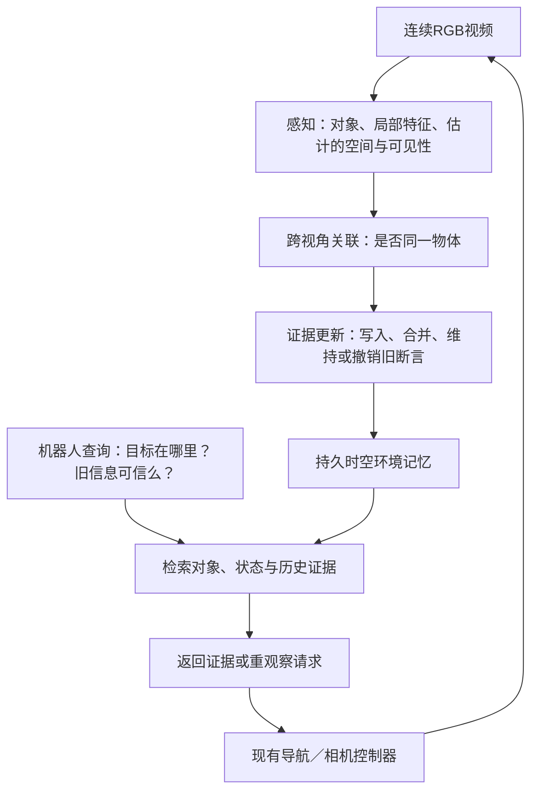

# Proposal讨论稿：面向机器人目标搜索的视频环境记忆维护

**2026-11-02｜候选方向，尚未实现或验证。保留此前版本，项目总控不变。**

*Video-based Environment Memory Maintenance for Robotic Object Search*

## 1. 一句话目标

**让系统从持续视频中维护“环境里有什么、最后在哪里看到、哪些信息仍可信”，供机器人查询目标和决定是否重新观察。**

研究对象是环境记忆（Environment Memory）的写入、关联、修正与检索。视频可以来自移动摄像机或机器人；不要求有人示范，也不要求识别人类动作。机器人提供应用场景和评价任务，控制器可以直接使用现有方法。

## 2. 一个能讲清问题的例子

摄像机先看到杯子A在桌面左侧，转向后杯子离开视野；之后回看，旧位置已经空了。

| 新观察 | 记忆应怎样维护 |
| --- | --- |
| 只是转头、被挡住 | 保留“最后见于左侧”；当前位置待验证，不凭空删除 |
| 旧位置清晰可见并确认空缺 | 撤销“仍在左侧”的位置断言；不能推断杯子已离开整个房间 |
| 在右侧看到疑似同一杯子 | 身份匹配可靠时更新；有歧义则保留候选 |
| 后来机器人要找杯子 | 返回最近可靠证据及来源，必要时建议重观察 |

**核心区别是“以前见过”和“现在确认”。** 遮挡期间发生但从未观察到的移动，系统不可能凭记忆知道。

## 3. 候选 pipeline

- **感知（Perception）：** 从图像获取对象和局部特征；必要时估计几何，不默认知道精确三维位置。
- **关联（Data Association）：** 连接不同视角里的同一实例，避免两个相似杯子被合并。
- **维护（Memory Maintenance）：** 根据新证据更新断言，分别处理当前支持、仅有历史和已被反证的记录。
- **检索（Retrieval）：** 返回实例、最近观察、证据帧和可靠程度。
- **重观察（Active Re-observation）：** 信息不足时，请已有机器人系统再看一眼；新观察重新进入维护流程。

主体不必输出关节动作，也不必训练新VLA。后续VLA可以作为记忆的一个使用者。

## 4. 记忆具体保存什么？

| 内容 | 作用 |
| --- | --- |
| 实例身份与视觉特征（Instance Identity） | 认出同一物体，区分相似实例 |
| 空间或历史视角线索（Spatial / View Evidence） | 找到相关区域或之前的观察视角 |
| 观测时间与来源（Timestamp / Provenance） | 知道判断来自哪帧、多久以前 |
| 断言状态与冲突（Validity / Conflict） | 分开“有新支持”“待验证”“旧位置已被反证” |

建议将**实例身份**与**位置断言的有效性**分开：撤销旧位置，不等于删除这个物体的全部历史。有限预算下只保留必要历史和摘要，不承诺保存所有像素。

初版可用学习得到的视觉特征＋少量结构记录和来源索引。是否改成完全隐式记忆（Implicit Memory），由实验决定；表示形式本身不是贡献。

## 5. 主要研究问题与候选方法

**主问题：普通RGB视频中，怎样避免把遮挡误判为移走，同时及时撤销已经过时的位置？**

候选机制是“证据门控更新”（Evidence-gated Update）：结合视角/可见性估计、多帧一致性、实例匹配和反证强度，决定保留、修正或暂缓更新；冲突时优先保留不确定性，并选择有用视角核验。

同时检验两个问题：

1. 在有限存储下，能否保留日后查询需要的实例及局部证据？
2. 更可靠的维护，能否减少机器人去错旧位置和重复搜索？

这是一组待验证假设。首轮重点放在**更新可靠性**，使用现有感知与检索模块；不把身份识别、三维重建、记忆、导航全部设为新算法。

Affordance可以后续作为物体属性加入，例如保存把手或支撑区域。第一版先证明一般环境记忆维护有效，无须强制学习交互动作。

## 6. 已有工作做到了什么？

| 论文 | 主要内容及贡献 | 对本proposal的约束 |
| --- | --- | --- |
| [DynaMem](https://arxiv.org/html/2411.04999)，2024首发 | RGB-D与位姿构建动态语义记忆；依据新观察增删旧点，服务机器人搜索和抓放 | **动态更新＋机器人使用已有**；原始输入含深度/定位 |
| [DovSG](https://arxiv.org/html/2410.11989)，2024/2025 | 局部更新三维对象及空间关系，避免每次重建全图，再连接任务规划 | 更新对象与关系也已有；不能只比静态地图 |
| [Khronos](https://arxiv.org/html/2402.13817)，2024 | 用时空建图和射线证据区分遮挡、存在与空缺 | **遮挡不等于消失并非新概念**；需正面对照其更新思路 |
| [SpatialMem](https://arxiv.org/html/2601.14895v4)，2026 | 从RGB视频估计空间结构，组织对象并链接历史图像 | RGB视频＋空间记忆也已有；不能只以RGB-only为创新 |

**可能有价值的定位：** 在几何、位姿与实例关联都不可靠的RGB条件下，研究怎样维护可追溯的断言，并证明它比同预算的普通更新更可靠。只增加时间戳、置信字段，或把深度替换成估计值，不足以自动构成创新。

## 7. 输入边界：纯视频能承诺到哪里？

记忆主模块优先只读RGB，输出对象、历史帧、最后观察和待验证状态。单目几何存在尺度与漂移问题；若使用已知内参，也须明示，不能默认有精确机器人坐标。

机器人真要导航到某处，还需定位和坐标对齐。可以将机器人定位作为**下游接口的额外条件**，让所有对照共同使用并计入开销；此时整套系统不能再称严格纯视频。

无需人类动作或机器人动作模仿标签，但维护模块仍需自监督/训练标注及独立评价真值。视频输入不等于无需监督。

## 8. 最小实验：先离线维护，再接固定机器人系统

**阶段一：所有方法看同一段视频。** 用相机转向、遮挡、物体移动和再次访问构造测试；在每个时刻查询，只允许读取此前观察。比较：

- B0：只看当前帧，诊断历史是否必要。
- B1：静态对象/关键帧记忆，加入后不撤销。
- B2：至少包含一组Khronos/DynaMem思路的动态更新对照：由同一RGB视频估计深度与位姿，以有遮挡意识的射线反证清除过时记录。与M共用估计模块；这是方法适配，不宣称完整复现原论文。
- M：候选证据门控维护。

B1/B2/M匹配存储和检索权限；所有保留图像、特征、索引及额外模型成本都计入。RGB与RGB-D/真值位姿组分开，原始DynaMem/Khronos可作额外信息参考，RGB适配版必须说明差异。

**阶段二：更换记忆，固定控制器。** 机器人按记忆搜索物体，遇到不确定记录可重观察；最终以实际重新看见并核验目标为成功，不以到达旧坐标为成功。允许所有方法相同的重观察权限。

主要指标：实例/证据检索、误撤销和旧位置残留、存储/更新时间；机器人侧看搜索成功率、错误旧目标次数、额外观察和总时间。隐藏真值只用于评价，不进入记忆或检索；不能要求模型知道从未观察的变化。

## 9. 数据和第一步

| 来源 | 用途与限制 |
| --- | --- |
| [AI2-THOR](https://ai2thor.allenai.org/ithor/documentation/) | 控制相机和物体变化，采集RGB及独立标签；需要自建重访/遮挡任务与验证器，不是现成的新benchmark |
| [3RScan / RIO](https://github.com/WaldJohannaU/3RScan) | 真实房间重复扫描、RGB-D序列及跨次实例对应；适合重访测试，不能当作完整连续移动过程真值 |

建议先在一个仿真平台做少量场景，确认“误删”与“旧信息残留”确实影响搜索，再加入真实重访数据。首轮用冻结视觉模型与轻量更新规则；若没有超过强B2的空间，就调整或停止复杂化。学校GPU、5060渲染、数据访问均尚未实测。

**这版proposal的预期成果：一个可独立评价、可持久化、能向机器人说明证据是否仍可信的视频环境记忆模块。**

来源与维护说明（备查）

这是一份范围收窄的讨论稿，不替换此前VLA/人类示范路线文档，不修改项目总控，不宣称已完成实验或穷尽检索。

本轮核查DynaMem §3.2–3.4/§4，DovSG §III-B/D–G及§IV–V，Khronos §III–VII相关方法实验。三者均已有动态更新机制，不能声称缺少遮挡/变化处理；Khronos明确用射线支持存在/空缺判断，并在限制中讨论移动片段关联问题。SpatialMem沿用前轮核查。3RScan核查原论文摘要及作者资产说明；AI2-THOR核查官方观察、物体与导航文档，未运行。

AI2-THOR的metadata visible标志含距离/射线等定义，并非图像中的逐像素可见性真值；实验需单独核验“旧区域确实可见”，不直接把该布尔量当全部监督。仿真实例ID、位姿和地图不能泄漏到纯RGB维护组；若固定导航器使用地图/定位，单列权限和成本。

主查询：3RScan dataset RGB D sequences object instance correspondence rescans official RIO；AI2 THOR object manipulation navigation environment interactive objects documentation；DynaMem Online Dynamic Spatio Semantic Memory RGB D robot memory；Khronos DovSG dynamic scene memory occlusion free space robotics。

分支查询：DynaMem dynamic 3D scene memory robot long horizon object changes navigation manipulation paper；DovSG dynamic open vocabulary 3D scene graph moving objects robot memory；Khronos spatial temporal scene graph dynamic real world robot memory mapping；dynamic 3D scene memory robot object moved occlusion update revoke persistent scene graph RGB D。

新论文追加到[持续文献档案](相关文献档案_持续追加.md) P74–P77。未下载数据、安装模型、训练策略或发布网站。

