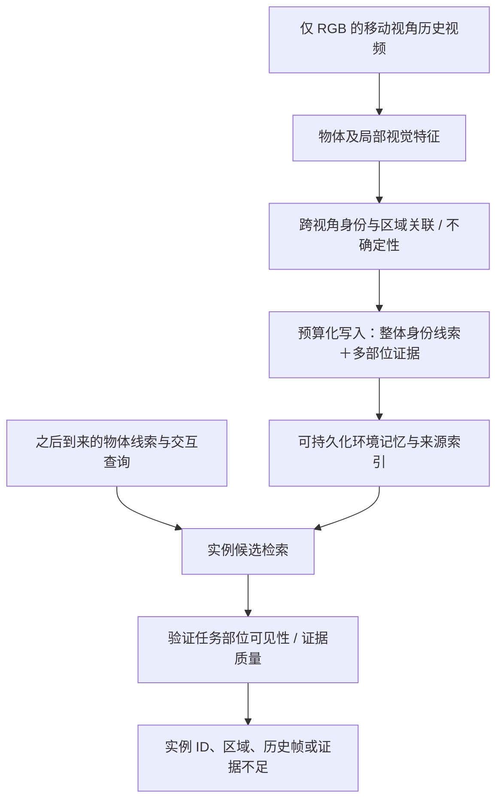

# 跨视角 affordance 环境记忆检索：文献调研与立项评估

**日期：2026-11-02｜性质：立项用定向范围综述与独立判断｜状态：候选方向，未运行实验**

## 1. 结论先行

**建议：有条件开展 pilot，不建议按当前宽泛题目直接投入大规模方法开发。** “RGB 环境观察 → 记忆 → affordance 条件物体及图像检索”已有直接近邻；“功能线索引导多视角帧选择”亦已有明确先例。单纯串联 affordance 分割器、CLIP 和关键帧排序，作为系统原型有用，但论文创新依据不足。

更值得验证的候选问题是：**在查询未知的历史写入阶段，如何在有限记忆预算内保留交互部位的多视角证据；查询到来后，能否同时找到正确实例与确实看清其目标部位的历史帧，并在证据缺失时返回未知？** 这是对文献的综合判断和研究建议，不是已经确认的空白或方法有效性结论。

本报告覆盖 23 篇方法/基础论文；其中 13 篇已核查方法及实验相关章节，10 篇为摘要或作者项目概况级核查。另查数据官方文档。不是穷尽式系统综述；不保证没有遗漏论文，不据此宣称首次。完整检索范围和逐篇阅读等级见[检索与证据记录](跨视角Affordance检索_检索与证据记录_2026-11-02.md)。没有下载数据、复现代码或证实任何方法可在现有 GPU 上运行。

**本报告不修改项目总控，不把候选方向替换成已批准路线。** 持续文献档案采用追加记录；已有条目和历史解释保留。

## 2. 锁定研究对象，避免问题漂移

当前理解：在同一室内环境中移动摄像机，得到普通 RGB 视频；系统构建持久记忆。之后给定物体线索与交互要求，返回相关物体实例、历史时间/帧、可见部位及证据不足状态。首轮可以假定环境内物体静止，只有摄像机移动；无需出现实际人类交互。若没有实际执行，就评价功能区域/视觉证据，不宣称真实机器人可执行性。

需要分别评估三种任务：

| 任务 | 查询示例 | 正确结果 |
| --- | --- | --- |
| 实例定位 | “刚才那个柜子” | 同一物理实例，不能拿另一个相同柜子代替 |
| 功能候选检索 | “哪里有可以拉开的抽屉” | 符合标注功能及任务约束的一个或多个候选；不凭图像保证未锁住 |
| 证据视角检索 | “那个柜子的把手在哪一帧看得最清楚” | 正确实例，且所需功能部位可见、足够清晰的历史视角 |

建议首个主任务为第三种，并用实例定位作必要子任务。不能把三种任务混成一个 Recall@K。也不能把“包含柜子的帧”与“能看清柜子把手的帧”共用相同标签。

“完整环境”在首版中应表述为**对已经观察到的环境内容的覆盖和保留**。未见背面、隐藏内部和遮挡期间未知变化都不能凭 memory 自动恢复成事实。360° 相机转向覆盖不等于全部表面、全部功能或全部物理性质已知。

## 3. 竞争格局与论文谱系

以下归纳以原始来源为依据；方法之间没有统一实验，不能横向比较其原论文分数。A=读到方法/实验相关章节，B=摘要或作者项目页；对应文献档案编号便于追溯。

### 3.1 最直接近邻：affordance、记忆与视图检索

| 工作 / 来源 | 已经做了什么 | 对候选题目的影响 | 等级 |
| --- | --- | --- | --- |
| P14 [Affordance RAG](https://arxiv.org/html/2512.18987), RA-L 2026，2025 首发 | 预探索 RGB 图像建立区域—视图—实例—pick/place affordance 记忆；层次检索及排序，输出目标物与容器的图像列表 | **直接覆盖 affordance-aware object/view retrieval 组合**；WholeHouse-MM 将同一目标的不同视角标正例。不能称首次；其粗粒度动作分数与精细部位证据质量不是同一指标 | A，§III–VI |
| P11 [AFFORDMEM](https://arxiv.org/html/2605.11616), 2026 预印本 | 有标定位姿和深度的多视图；跨场景功能示例库＋场景内 3D 候选与关系图，定位具体功能部件 | 跨视角实例选择、记忆和功能 grounding 已存在；目标主要是 3D segmentation，不能仅改成返回帧就认定新颖 | A，§3–4 |
| P16 [TASA](https://arxiv.org/html/2511.11702), 2025 首发预印本 | 用任务抽取的 affordance concepts 与 CLIP 对多视图帧加权选择，再生成/精化 3D affordance mask | **明确已有 Affordance-Weighted Frame Selection**；“给关键帧检索加入功能线索”不足以单独立项为创新 | A，Method、Ablation |
| P15 [Actron3D](https://arxiv.org/html/2510.12971), ICRA 2026，2025 首发 | RGB 人类示范蒸馏连续 neural affordance function，检索并优化迁移；部署以 RGB-D 对齐；筛除接触区遮挡的合成视角 | 隐式函数、affordance memory、接触感知视角排序均有先例；它选的是用于动作迁移的合成视角，非直接等同历史证据帧任务 | A，§III-C/D、§IV |
| P17 [Fun3DU](https://arxiv.org/abs/2411.16310), CVPR 2025 | 任务语言解析→多视角功能部件分割→几何提升与聚合 | 功能性语言到小部位的跨视角 grounding 已成熟到需要强基线；并非仅认物体类别 | B，摘要 |

**决定性的细节：** Affordance RAG §V-B 的 WholeHouse-MM 检索评测**移除了最终 Affordance Score Reranking（ASR）**，真实机器人部分才包含它；不能把其所有离线检索收益都归因于 ASR。§III/VI 包含用户从候选图像中选择目标，真实 85% 任务结果不能描述为全自动物理可行性判别。它仍然是非常强的任务形式近邻。

发表信息另经[作者机构记录](https://keio.elsevierpure.com/en/publications/affordance-rag-hierarchical-multimodal-retrieval-with-affordance-/)核实：IEEE RA-L 11(3):2706–2713，2026，[DOI](https://doi.org/10.1109/LRA.2026.3653281)。方法细节仍以本轮阅读的 arXiv 版本为依据；未逐字核对期刊版与预印本差异。

AFFORDMEM 的源示例选择含中心性/距离条件，同场景 3D 聚合还处理当前视角外的实例；不能声称它“没有多视角/遮挡”。TASA 的帧选择明示功能词与主物体语义互补。**代码核对问题：** 所检查 TASA HTML 的 Eq.(4) 将同一求和写成分子和归一化分母，按印刷式 S 恒为 1；因此不能直接用这一公式号称精确复现。需核对 PDF、实现或后续更正；这不构成对整篇实验结果的否定。

### 3.2 视频/空间记忆与实例证据检索

| 工作 / 来源 | 输入与机制 | 评价/资源及比较边界 | 等级 |
| --- | --- | --- | --- |
| P18 [3D-Mem](https://arxiv.org/html/2411.17735), 2024 首发 / 2025 版本 | RGB-D＋位姿；对象关联、共可视 snapshot、增量记忆与 frontier | EQA/GOAT；[代码](https://github.com/UMass-Embodied-AGI/3D-Mem)。已做紧凑视图记忆与检索，不能把“保存多个视角”本身当新意 | A，§3–4 |
| P19 [SpatialMem v4](https://arxiv.org/html/2601.14895v4), 2026 | RGB 视频估计几何与位姿，结构锚点—对象层次记忆，链接证据图像 | 问答与物体检索；同 8 帧 OpenEQA 预算与均匀采样相当，不能泛称全面优于。其评估是离线静态场景，不是增量动态记忆证明 | A，§3–5 |
| P20 [Memory Over Maps](https://arxiv.org/html/2603.20530), 2026 | posed RGB-D 关键帧；粗检索＋VLM 重排；需要时反投影多视角定位 | 图像检索/3D定位/导航；[代码](https://github.com/RuiZhou-cn/memory-over-maps)。官方 demo 含功能性查询，但 demo 不等于受控功能部位评测 | A，§III–IV |
| P13 [STaR](https://arxiv.org/html/2602.09255), RA-L 2026 | RGB＋posed depth；caption/3D primitive/关键帧；任务条件信息瓶颈挑证据 | NaVQA/仓库问答和机器人应用；[仓库](https://github.com/TRAILab/STaR)。紧凑、任务条件证据检索已有先例 | A，§IV–VI |
| P21 [ReMEmbR](https://arxiv.org/html/2409.13682), 2024 首发 | 视频描述 embedding＋时间＋机器人位置，LLM 多步检索 | NaVQA/导航；[代码](https://github.com/NVIDIA-AI-IOT/remembr)。可作 caption RAG 基线，不是精细功能部位表示 | A，§III–VIII |
| P22 [R4DSG](https://arxiv.org/html/2608.11017), 2026 | RGB 长视频、相对对象图及保守关联；窗口记忆压缩与检索 | 对象/时序 QA，压缩消融；说明 RGB-only 对象记忆与压缩也已有。不能把其任务等同物理功能检索 | A，§3–5 |
| P23 [EAGLE](https://arxiv.org/abs/2511.08007), AAAI 2026 | 外观与几何记忆协同 segmentation/tracking；视觉查询定位 | Ego4D-VQ；跨视角实例回忆的相关基线。功能相同不代表同一实例 | B，摘要 |
| P28 [ConceptGraphs](https://concept-graphs.github.io/), ICRA 2024 | 视觉基础模型输出经多视角关联融合成开放词汇 3D 对象图 | 语义/空间查询与规划；对象级多视角记忆基础 | B，项目页 |

### 3.3 选帧、视角与功能表示的基础

| 工作 / 来源 | 相关点 | 本课题应避免的重复主张 | 等级 |
| --- | --- | --- | --- |
| P24 [AKS](https://arxiv.org/html/2502.21271), CVPR 2025 | 固定 token 预算，query relevance＋coverage 选帧 | “相关性＋多样性/覆盖”单独不新；其 query 已知选帧与 query 未知时写入是不同协议 | A，§3–4 |
| P25 [TASKER](https://arxiv.org/abs/2606.29445), ECCV 2026 | 任务与场景变化驱动关键帧抽取，VideoQA/GUI教程任务 | 任务条件关键帧不是空白；GUI 结果不等于机器人环境效果 | B，摘要 |
| P26 [ACE-NBV](https://proceedings.mlr.press/v229/zhang23i.html), CoRL 2023 | 预测新视角抓取 affordance，主动选择下一观察 | 功能引导视角选择已有；主动新增观察和被动检索旧帧必须分开 | B，摘要 |
| P12 [Learning Affordance Grounding From Exocentric Images](https://openaccess.thecvf.com/content/CVPR2022/papers/Luo_Learning_Affordance_Grounding_From_Exocentric_Images_CVPR_2022_paper.pdf), CVPR 2022 | 第三到第一人称跨图像功能区域知识迁移 | 视角不变功能特征非首次；AGD20K 非连续视频记忆数据 | B，摘要/方法概况 |
| P27 [MIFAG](https://arxiv.org/abs/2408.13024), AAAI 2025 | 多张交互图像提炼不变 affordance 字典，融合点云 | 多图共同功能表示已有，不等同同实例历史 | B，摘要 |
| P29 [Ego-Topo](https://arxiv.org/abs/2001.04583), CVPR 2020 | 第一人称活动与环境功能区域/拓扑联系 | 视频中学习环境功能已有较长谱系 | B，摘要 |
| P30 [VRB](https://arxiv.org/abs/2304.08488), CVPR 2023 | 人类视频学习接触位置与交互方式，辅助机器人学习 | 从人类视频提取 affordance 已有；不同于一个场景的证据回忆 | B，摘要 |
| P03 [AROS](https://doi.org/10.3389/frobt.2023.1076780), 2023 | 单示例人体—场景几何、接近与 clearance | 有用的几何动机，但不是必须组件，亦非物体身份表示 | A，既有方法/实验阅读 |
| P04 [O³Afford](https://proceedings.mlr.press/v305/tian25b.html), CoRL 2025 | DINOv2＋点云＋物体对 cross-attention→功能区域与规划 | tokens 是表示，不自动是时序 memory；其语义/点云输入须明确 | A，既有 §3–5 阅读 |
| P31 [I3DM](https://arxiv.org/abs/2603.23413), 2026 预印本 | 隐式 3D 相关特征检索/对齐历史视角，服务生成一致性 | 属方法参考，**不作为本课题已验证的检索 benchmark**；生成补全不是真实环境证据 | B，摘要 |

## 4. 创新性逐项审查

以下是立项判断，不是领域统一评分，也不对应录用概率。

| 候选主张 | 判断 | 原因 / 要达到什么证据 |
| --- | --- | --- |
| 首次将 affordance 加入环境记忆检索 | 不成立 | Affordance RAG、AFFORDMEM 已有直接证据 |
| 首次根据功能选择关键帧/视角 | 不成立 | TASA、ACE-NBV、Actron3D 已涉及 |
| 视频→对象记忆→证据帧 | 创新弱 | 多项场景记忆工作覆盖 |
| CLIP 分数＋affordance mask 分数重排 | 适合作基线，单独不足 | 易归因于已有模块/提示；须超越质量、多样性和强 VLM 排序 |
| RGB-only 或使用隐式 tokens | 是限制/实现选择，本身不保证新颖 | SpatialMem、R4DSG、I3DM 等已有相关路线；需证明效果、成本和功能证据保留 |
| 身份保持与任务部位可见性联合建模 | 有研究价值，原创性未确定 | 同类不同实例 hard negatives、不同部位任务切换、同物不同视角；须比双分支简单基线更好 |
| query 未知时保留未来功能证据的预算化记忆 | 更值得优先验证 | 在固定字节、查询后不能重扫视频条件下，证明比多样性/对象覆盖记忆保留更多稀有部位证据 |
| 不存在/从未可见时可靠返回未知 | 有用的评测与方法目标 | 需要独立标签与风险—覆盖曲线；一般拒答机制本身亦非新 |
| 一个新 benchmark | 可能有贡献，但不能仅改查询说法 | 必须新增可靠的实例＋功能部位＋视角证据标注，足够困难且有强基线、跨场景 split |

**总体定位：** 当前原始组合新颖度低；缩窄后的记忆保留和证据充分性问题有中等潜力，但证据尚不足以立刻声称算法创新。适合作为博士项目的一项可控子课题；不应仅凭这份 review 将其视为整个 PhD 的充足贡献。

## 5. 现有想法最重要的技术风险

1. **身份与功能存在冲突。** 两个杯子都能抓，其把手特征可能相似；用功能相似度做 re-ID 会误合并。反过来，同一杯子转身把手不可见，不能据此判为另一物体。
2. **可见性不等于功能存在或实际可执行。** 隐藏把手不是没有把手；清楚看到把手不是已经证明抽屉未锁、机器人能拉开。把任务目标严格限定为视觉证据与功能区域。
3. **预测图可循环自证。** 用同一 affordance 模型产生地图、给帧排序、再作为 ground truth，就会得到偏置的好结果；必须有独立人工或离线几何核查标签。
4. **多视角补全与重复压缩的矛盾。** 全局相似的两帧可能分别暴露不同小部位；简单去重可能删除唯一关键证据。这是可以具体测试的机会。
5. **查询前后协议混乱。** query 后从完整视频选 k 帧只证明读取有效，不能证明 query 未知时已经构建了有用的有界记忆。两种任务分别报告。
6. **功能标签退化成语义类别。** “能喝水”全部答案是杯子，会被类别模型轻易解决；需要同类别不同可见性/状态、跨类别相同功能、相似纹理不同功能的对照。
7. **持久化和因果性。** 保存特征及来源可重启复用才是外部持久记忆；如果 query 后允许全量重扫原视频，计算与保留预算不能称固定。在线只允许 t 前观察，离线全视频则明确标记。

## 6. 建议验证的 pipeline（候选，不是批准后的版本）

关键设计不是先把所有信息塞入单个不可追溯向量。首版可用 **learned visual descriptors＋少量来源索引**，分别保存整体身份证据和局部功能线索，再研究何时合并/保留。它是混合结构，不能为了名称而宣称“全隐式地图”。是否需要 end-to-end slot memory 应由基线结果决定。

写入必须先于未知查询；当前可预设有限功能集合（拉、转、按等），在训练未见的查询措辞及组合上检验；不宣称任意未知动作都可覆盖。功能预测可以使用外部预训练知识，但须记录来源和训练监督。下游不需要机器人或 VLA；先将检索输出作为接口。

## 7. 数据可行性：没有直接可套用的完整标注组合

| 数据 / 官方来源 | 有什么 | 缺什么 / 用法边界 |
| --- | --- | --- |
| [SceneFun3D annotations](https://scenefun3d.github.io/documentation/dataset/annotations/)＋[assets](https://scenefun3d.github.io/documentation/toolkit/data-downloader/) | 基于 ARKitScenes 的静态室内 RGB/深度/位姿、扫描级功能部件实例 mask、语言任务及部分 motion 标签 | 最适合低成本 pilot。3D 投影不自动是可见性 GT；需遮挡/深度一致性/分辨率/人工验证。完整对象 parent ID 和最佳证据帧不保证现成；承重表面不在主要标签内 |
| [Ego4D VQ2D/VQ3D](https://ego4d-data.org/docs/data/annotation-guidelines/) | 自然第一人称历史，同实例 query crop 与较早 response track；相关 3D 任务 | 不是功能部位标注；不是全视频所有出现。query crop 可来自更晚片段，在线必须隔离这种特权输入。适合作身份检索对照，新增功能标注 |
| [Ego-Exo4D](https://docs.ego-exo4d-data.org/overview/) | 同步第一/第三人称、标定及稀疏几何、部分对象 masks、任务与动作步骤 | 更适合交互过程外测；同步 ego/exo 非单摄像机移动协议，mask/深度覆盖不可假设完整 |
| [AGD20K 原论文](https://openaccess.thecvf.com/content/CVPR2022/papers/Luo_Learning_Affordance_Grounding_From_Exocentric_Images_CVPR_2022_paper.pdf) | ego/exo 功能图像与部位监督 | 可作预训练/外测，非时序记忆。36 是其 affordance 类别数量，不是名为 AGD36 的第二数据集 |
| [EPIC-KITCHENS](https://epic-kitchens.github.io/site) / [VISOR](https://epic-kitchens.github.io/VISOR/) | 第一人称厨房动作视频；相关子集有手和 active-object 分割 | active-object mask 不等于功能部位；视角/完整实例/深度并非基础数据全覆盖，需核对各子集 |
| [WholeHouse-MM](https://arxiv.org/html/2512.18987) | 论文有 MP3D 环境图像、自然指令、多个视角正例 | 直接检索近邻；公开下载与衍生许可尚未确认，不能假设可立即复用；物体可见正例非部位可见正例 |
| [OpenEQA / SpatialMem 使用协议](https://arxiv.org/html/2601.14895v4) | 环境问答与历史视频，可外测保留的一般环境信息 | 不自带本课题所需所有功能部位与证据视角标签，不直接充当主检索指标 |

**推荐路线：** 先挑 SceneFun3D 的少量独立场景，选择拉/按/转中的两三类已标注部件，离线利用官方几何构造候选帧，再人工核验 visibility、实例和证据集。推理仅给 RGB；深度/位姿/扫描 mask 只作离线标签或明确训练监督。随后再用 Ego4D 子集检查自然视频身份关联；有余力才做动态交互域。不开始大规模跨数据集拼接。

按场景/房间/源扫描划分，防止同一扫描的另一视频落到测试集。数据许可、存储规模、下载权限和资产是否对齐仍需下载前逐项核验；本次未下载，不作已成功运行声明。

## 8. 最小可信实验

### 8.1 先做上界诊断，决定要不要继续

用少量标注验证三件事：全对象 embedding 在同类不同实例中是否犯错；普通选帧是否遗漏可见部位；使用独立真值部位/轨迹的 oracle 是否真的有改善空间。oracle 只用于诊断，不能作为方法结果。若普通质量＋多样性选帧已接近 oracle，不值得投入复杂模块。

首轮规模可从约 10–20 个场景、100–200 个经核验查询开始；这是探索性预算建议，不是统计功效承诺，也不够自动支持论文结论。先检查场景和功能类别的有效覆盖，再依误差分布扩展。正式测试应有独立场景及足够查询，按场景聚类计算区间，避免把相邻帧当独立样本。

### 8.2 必要的基线与消融

| 类别 | 最低配置 |
| --- | --- |
| 视觉/语义检索 | 相同 backbone 的全帧/物体 crop embedding；视觉 query 用视觉编码，文字 query 用共同文本编码；不能给 DINO 单独不公平的文本接口 |
| 视角与质量 | 均匀采样、对象可见面积/清晰度、相似度＋MMR/多样性、AKS 类 relevance/coverage |
| 功能检索 | 仅 affordance mask；全对象＋mask 双分支；TASA 类功能词重排；Affordance RAG 适配版 |
| 环境记忆 | 同输入条件的普通多视角对象库；选一个可运行的 3D-Mem/MoM/RGB graph 风格基线，若用 GT 几何则标为特权参考 |
| 候选方法 | 新的写入/压缩/证据验证机制；分别去功能特征、去跨视角关联、去可见性、交换功能查询 |
| 理想上界与鲁棒性 | oracle 部位/track 只做分析；逐步加入检测、mask、关联误差；报告误差级联 |

同候选历史、同帧分辨率、同训练/微调数据、相同 k 和存储字节；额外模型/API 调用单独报告。原始视频是否归档与查询时是否允许回取，必须统一：有索引但 query 后全量重扫，不是同样的有界检索。

固定预算主协议：query 前允许完整读取历史以构建记忆；query 后只能访问保留下来的记忆。所有必要特征、保留图像及来源索引均计费。“全帧”指图像内容粒度，不意味着可以免费保留全部视频帧。保留所有帧的 embedding/图像若超预算，单列为高存储参考，不纳入等预算排名。若另设可随机回取原视频的外存协议，所有方法具有相同权限，并单列外存字节、读取次数和延迟。

### 8.3 主指标

- 实例 Recall@K / mAP：目标必须是同一实例；功能候选多正例单列。
- **联合证据 Recall@K**：检索帧中的实例正确，且任务部位按独立标注可见、有效；这是建议主指标。
- 各功能/实例的证据保留率与曲线面积：固定字节预算下，query 未知写入是否保留稀有细节。
- 可见性/区域指标：部位可见性分类、区域 IoU；预测分数未经校准不称成功概率。
- 证据不足：报告无有效历史视图时的错误肯定率及风险—覆盖曲线；离线扫描/人工确定的物理存在状态另作分析分组。单目不完整历史可能无法区分不存在与因遮挡未见，此时只要求返回“未知/证据不足”。只有具备可靠观察证据时才评价物理正负判断；显式概率输出且校准后才使用概率指标。
- 角度变化、遮挡比例、时间距离、相似实例数量分组；相机角度/几何 GT 只用于评测分桶，不作为 RGB 推理输入。
- 存储字节（包括 retained 图像/索引/token）及构建成本、单查询延迟、额外模型调用；QA 仅作固定下游模型的次指标。

数据标注不是唯一“最佳帧”主观投票：定义足够清晰的有效证据集合；多个正确视角均为正例。如果下游要求多视角组合，另设 set-level 覆盖与冗余指标，不强制单帧代表全部信息。

### 8.4 必须包含的困难样本

- 同一类别、多个几乎相同实例，功能部位相似；
- 相机绕同一静止实例改变相对视角，目标部位一会可见一会不可见；
- 整体物体最大最清晰的一帧不一定最适合观察小部位；
- query 对同一物体的不同部位切换；
- 历史确实没有拍到该部位；
- 相同功能跨类别、同类别不同几何或可见状态；
- 先看到侧面、之后看到正面，再返回侧面，测试历史关联；
- 低质帧上的高 affordance 分数，检验幻觉与不确定性。

“杯子/椅子出现即为功能正例”的简易类别匹配不能验证研究假设。视频里没有执行过动作时，不评价真实承重、开锁、机器人可达或成功操作。

## 9. 继续/停止条件

**继续开发的条件：** 数据可产生可靠独立标签；oracle 证明存在非平凡 headroom；在冻结相同编码器及预算下，局部交互信息或新的记忆写入机制能稳定提高联合证据指标，且身份错误没有明显恶化。预先在验证阶段约定有实际意义的最低增益，例如联合证据 Recall@5 提升约 5 个百分点或显著降低达到同表现所需存储；这是项目决策阈值示例，不是已有成果或统计保证。

**停止或缩减的条件：** 只能赢随机帧/均匀帧，不能赢 crop＋质量/多样性强基线；控制标注和 backbone 后优势消失；只对语义类别词有效；需要完美 mask/track 才有效；查询时靠全量重扫；小部位证据与任务结果毫无关联。负结果可以作为研究诊断，但不应包装成新记忆算法成功。

**资源次序：** 先做冻结特征与轻量排序/写入模块，学校 GPU 用于离线特征和小规模适配，图形设备用于核验可视化。无需为证明本问题从头训练 VLA，也不把 5060 的具体能力当已知。标注和数据对齐可能比训练更早成为瓶颈；不承诺固定完成周数。

## 10. 建议题目与最少阅读路径

更准确的候选题目：**面向未知功能查询的跨视角环境记忆与证据保留**。英文可暂用 *Preserving Functional Evidence in Budgeted Cross-View Environmental Memory*。这是讨论用工作题目。

先读 Affordance RAG §III–VI、TASA Method/Ablation、AFFORDMEM §3–4，确定已做功能检索和选帧的范围；再读 Memory Over Maps §III–IV 与 AKS §3–4，设计强基线；最后按实际输入对照 SpatialMem、3D-Mem、STaR。AROS/O³Afford 保留为功能/几何表示来源，不能代替最接近的记忆检索论文。

**最终立项建议：** 作为围绕环境记忆的子课题值得做可证伪 pilot；泛化为“affordance map object/keyframe retrieval”的现有 pipeline 不足以直接主张高创新。优先验证“预算化记忆保留正确实例的小部位证据”是否有数据基础和真实增益，再决定是否训练新模型、构建 benchmark 或增加 VLA/机器人应用。
