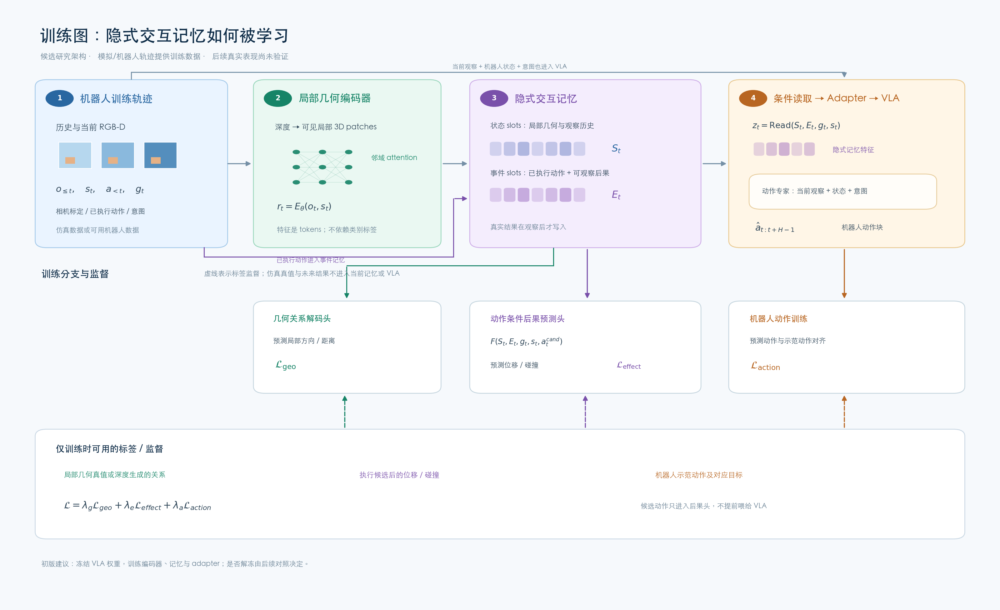
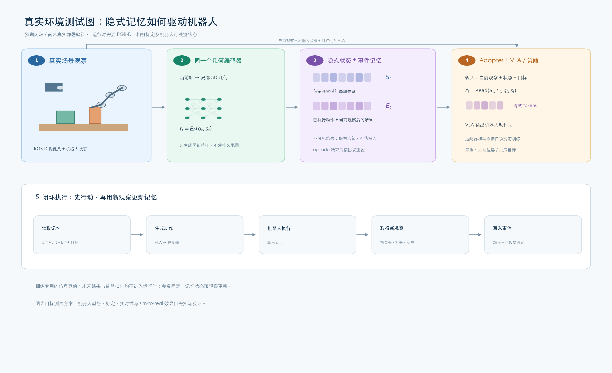

# 隐式交互记忆 v2：训练与真实环境测试图解

**状态：候选研究架构，尚未实现、训练或完成真实机器人验证。** 两张图使用相同的编码器、隐式记忆及 VLA 接口，展示不同阶段的信息流。

## 图一：训练

[高清 PNG](figures/隐式交互记忆_v2_训练网络图.png) · [矢量 SVG](figures/隐式交互记忆_v2_训练网络图.svg)

1. **数据：** 机器人仿真或可用的机器人轨迹提供过去与当前 RGB-D、相机标定、机器人状态、已执行动作和任务目标。候选模型不一定需要语义类别标签或人工 bounding box。
2. **局部几何编码：** 由有效深度构建当前帧的局部 3D patches，聚合邻域几何形成可学习的关系 tokens；它不需要输出一个持久化的显式场景图。
3. **隐式记忆：** 状态 slots 保留局部几何及观察历史；事件 slots 编码上一步实际动作和**之后可观察到的结果**。两组 slots 的信息通过条件读取形成 \(z_t\)。未观察到结果时不能写入假设的结果。
4. **机器人动作：** adapter 把 \(z_t\) 送入经过接口适配的 VLA/action expert；VLA 同时接收当前观察、机器人状态和目标。初版候选是冻结 VLA 权重、训练记忆与 adapter，但是否可用取决于所选架构，仍需实验。
5. **三类训练监督：** 几何关系解码头预测局部方向/距离，交互后果头接收候选动作并预测位移/碰撞，动作训练分支将 VLA 输出与对应的机器人示范动作对齐。后果头的候选动作不是 VLA 生成动作前的必需输入。

\[
\mathcal L=\lambda_g\mathcal L_{geo}+\lambda_e\mathcal L_{effect}+\lambda_a\mathcal L_{action}.
\]

仿真状态、完整几何、未来结果、碰撞等真值是可能的训练标签，不可混入当前时刻记忆或正常测试输入。动作损失应采用所选 VLA 原生的训练目标；失败轨迹不能无区分地作为成功行为克隆示范。

## 图二：真实环境测试（目标方案）

[高清 PNG](figures/隐式交互记忆_v2_真实环境测试图.png) · [矢量 SVG](figures/隐式交互记忆_v2_真实环境测试图.svg)

机器人接收当前 RGB-D、相机内参和已知或可靠估计的相机位姿、机器人状态及目标。与训练一致的编码器生成局部几何特征；记忆从已发生的观察与动作更新，随后由目标条件读取并送入 adapter / VLA，输出符合控制器约定的动作块。

闭环顺序：**读取记忆 → 生成动作 → 机器人执行 → 获取新观察 → 写入实际可观察到的事件**。推理时不需要几何真值解码器和训练损失；模型参数固定，但 episode 内记忆状态随观察变化。episode 结束后何时重置需依据实验协议。

例如，机器人先观察一个物体及附近障碍，物体暂时被遮挡后仍可读取此前局部关系；若机器人执行一次推动，只有获取到后续观察时才把这次动作及可观察结果编码入事件记忆。隐藏位置的未观察变化无法凭空确定。

图中真实机器人仅为未来目标环境；RGB-D 设备、标定、坐标系、控制频率、机器人硬件、adapter、实时性和仿真到真实的效果均未验证。第一版推理仍依赖 RGB-D 与相机位姿，不能称为纯 RGB 系统。

[完整 Pipeline v2 与公式](隐式交互记忆_Pipeline_v2.md) · [Literature review](隐式交互记忆_literature_review_v2.md)
