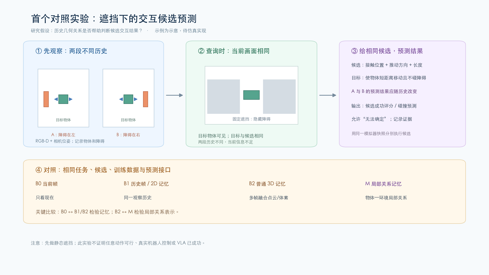

# 首个对照实验 v1：遮挡下的交互候选预测

**状态：讨论草案；尚未实现、采集数据或运行实验**  
**日期：2026-10-28**

[高清 PNG](figures/首个对照实验_示意_v1.png) · [可缩放 SVG](figures/首个对照实验_示意_v1.svg)

## 1. 这个实验要回答什么？

在相同的任务和候选交互条件下：

1. **记忆是否有用？** 当障碍物离开当前视野，但之前被观察到，利用历史能否更准确地判断交互结果？
2. **局部关系表示是否有额外价值？** 在已经有相同三维观察历史的条件下，显式或学习到的物体—环境局部关系，是否比普通三维融合记忆更好？

实验只考察一种受控的短时相互作用，不需要训练 VLA 或实现真实机器人控制。它回答的是记忆和几何表征是否有用，不能证明这种表征已经具备通用 affordance、理解所有意图或支持任意机器人动作。

## 2. 任务与场景

### 2.1 桌面受控场景

建议使用 [ManiSkill](https://github.com/mani-skill/ManiSkill) 搭建自定义桌面场景：桌面、一个刚体目标物、一个或多个可调位置的障碍物，以及用于采集视频的 RGB-D 相机。官方支持 RGB-D 等观察，但场景、障碍和记忆实验本身都需自行实现；它不是 ManiSkill 现成 benchmark。参考[观察文档](https://maniskill.readthedocs.io/en/latest/user_guide/concepts/observation.html)和[自定义任务教程](https://maniskill.readthedocs.io/en/latest/user_guide/tutorials/custom_tasks/intro.html)。

先固定材质、摩擦、质量范围、重力和短时动作控制方式，以免未知动力学主导第一个实验。目标物形状、大小、障碍形状和间隙在指定范围内变化。相机位姿、内参以及时间同步以实际导出结果为准；坐标约定和深度单位必须先核验。

### 2.2 一次 episode 的过程

1. **观察历史：** 摄像机采集多帧 RGB-D 和相机位姿，观察目标物及其周围的障碍和空间。
2. **构造查询时的部分观察：** 目标物仍可见，关键障碍区域被固定的遮挡条件遮住或移出视野。首版可以对渲染的 RGB-D 应用固定空间图像遮挡，将遮挡部分深度标为无效；该遮挡只改变输入，不是额外的物理障碍。也可采用物理遮挡，但必须验证其不干扰交互和标签。
3. **提供目标和候选：** 所有方法获得同一个目标以及同一组事先生成的候选短程推动。首版目标是“使目标物沿桌面移动超过指定距离，且不碰障碍或跌落”；它不是特定语义类别。
4. **预测：** 对每个候选输出成功/碰撞评分，可选择输出预期物体位移，以及“不确定”。
5. **检查真实结果：** 在相同物理参数下从同一个模拟器初始快照出发，对每个候选分别重置并执行，记录目标物位移、障碍碰撞及跌落，得出独立标签。模型推理不得读取用于生成标签的仿真器隐藏状态。

使用简化的虚拟推动器和预定义短程动作产生交互数据即可；这不是完整机械臂控制。最终也可以在相同交互接口上替换机器人和控制器，但应独立报告可达性及接触误差。

### 2.3 候选和成功标签

一个候选记为 \(a_k=(c_k,\theta_k,L_k,v_k)\)：推动器的候选接触位置、平面方向、推动长度和速度；它是具体的短时尝试，不是物体类别或语义动作标签。候选由当前可观察目标区域生成或使用相同的预定义采样协议，必须独立于隐藏障碍位置和成功标签，不能通过真值形状偷渡答案。实验图上的左/右箭头只是例子，正式候选包含多个方向和接触点。

预先固定阈值与检测方法，例如：目标物的平面位移达到任务阈值、保持在桌面上且未发生目标物—障碍或推动器—障碍的不允许碰撞。推动器与目标物的预期接触不算失败；是否允许目标物旋转也必须预先定义。若只发生微小非接触位移或控制器没有接触到目标，应作为失败/无效执行单独记录，不可算成功。

每次 rollout 至少保存：候选参数、前后物体状态（仅用作监督/评估）、目标结果、碰撞、执行有效性、视频及模拟随机种子。成功标签来自仿真自动测量；**没有人工逐例标注不等于没有监督**。

## 3. 核心实验设计：配对反事实

构造一对仅在被遮挡区域内不同的场景：

- **A：** 历史帧看到障碍在目标物左侧；
- **B：** 历史帧看到障碍在目标物右侧。

查询时，A 和 B 的目标物、当前可观察图像、目标、候选集合和推动器初始设置相同；历史不同。要求在实际渲染及固定遮挡后核查 RGB-D 数值一致或处于预设传感器噪声容差内，检查阴影、反射、屏幕边缘、深度残影及背景是否泄漏障碍位置。若当前观察能辨别 A/B，该配对不能用于证明历史不可或缺。

**必须检查标签：** 不能预设“左障碍必然意味着向右成功”。先执行配对候选，验证至少有某些候选的结果在 A 与 B 中真实不同；若没有不同，重新采样或放弃该对。

另随机安排：仅左边安全、仅右边安全、两边都安全、两边都不安全等不同条件，并在数据集中报告比例；让动作顺序、障碍侧别、成功比例及目标保持平衡。单看目标或候选参数的预测器、单看当前帧的预测器也应接受相同的泄漏检查。不能让模型仅凭数据构造习惯猜到答案。

首轮 **障碍在观察后保持静止**。这是为了明确测试“能否记住曾经看到的几何关系”，不是证明动态记忆已经解决。

## 4. 对照组与可回答的问题

除 B0 有意只看当前帧外，B1、B2 和 M 获得同样的 RGB-D 历史、相机位姿、目标、候选、训练数据和预算；通过统一的输入输出接口训练或适配预测头。

| 方法 | 可用信息 / 表示 | 比较目的 |
| --- | --- | --- |
| **B0 当前帧** | 当前 RGB-D、目标、候选 | 测试历史不可用时的表现；刻意不给历史 |
| **B1 历史帧记忆** | 与其他历史方法相同的 RGB-D 帧、位姿及时间，可用 keyframe 或 2D/时序模型读取 | 判断收益是否仅来自额外观察，而非三维关系结构 |
| **B2 普通 3D 记忆** | 融合相同多帧得到点云或体素；不额外设计局部关系模块 | 判断普通几何记忆的作用 |
| **B3 对象/区域记忆** | 与 B2 同源观察，增加类别无关的对象或区域关联 | 控制对象级组织本身可能带来的收益；初版可作为扩展基线 |
| **M 局部关系记忆** | 与 B2 相同的观察，加入目标区域—周围区域的相对几何信息及观测证据 | 检验局部几何关系是否带来额外收益 |
| **Oracle 诊断** | 明确标记仿真真值几何/位姿或直接执行所有候选后选最优 | 分离观测与预测误差；是有额外信息的参考，不是可部署方法 |

**关键比较：**

- B0 对 B1/B2：检验这组被遮挡任务中历史是否有用；不是严格同信息量对比，而是有意的记忆必要性对照。
- B1 对 B2：研究使用三维融合是否比保留历史帧更有效；不能因架构、可见信息或计算量差异直接归因。
- B2/B3 对 M：在相同历史下检验关系表示的边际贡献。尽可能匹配预测头、训练样本量、参数量、计算预算和存储预算，并实际报告；无法同时完全匹配时分别做预算曲线，不声称绝对公平。

**交互经验是否有额外作用？** 在表示选定后可比较相同结构的几何预训练与几何 + 交互后果预训练。两者最终使用同样的候选预测监督及微调数据，再加冻结编码器 probe；额外预训练数据和计算单独报告。若 M 使用更多交互训练而基线没有，不可将提升归因于几何关系表示。

目标点/区域可由统一的可观察方式指定。若先用仿真实例 mask、对象 pose 做实验，应为所有相关组共享，清楚标记为 privileged 诊断，随后替换为只依赖观察的目标选择与追踪，单独报告。类别标签、仿真碰撞和完整几何不能悄悄混入模型输入。

## 5. 数据与划分

每条记录包含：多帧 RGB-D、相机内外参和时间戳；查询时当前观测与遮挡 mask；任务目标；K 个候选的动作参数；每个候选从同一物理快照恢复执行的结果；资产 ID、物理参数、种子及场景组 ID。仿真 pose、接触和碰撞等标签与模型输入分开存放。

候选设置及数量先作为 pilot 选择，例如每个独立场景 8–16 个候选、100–300 个基础场景及其配对变化，仅用来检查生成速度、遮挡是否成功、候选正负是否平衡和算法流程是否跑通；这些数字不是统计功效保证。正式样本量、成功率差异的最小关注幅度和随机种子数，应基于 pilot 的方差与资源情况在最终测试前确定。

划分原则：

- 按物体 mesh / 几何族、障碍资产家族和场景布局分训练、验证、测试；配对反事实及其所有帧、候选始终同属一个划分，避免近重复泄漏。
- 单独报告未见对象实例、未见几何形状、未见对象—障碍组合。未见类别不自动代表未见几何。
- 为了先分离几何效应，第一轮固定或控制摩擦和质量；后续才单独改变它们并说明 RGB-D 不足以辨识的限制。
- 模型和阈值只在验证集选择；测试集不参与设计。记录多次训练随机种子和数据生成版本。

## 6. 指标和判读

**主指标（提前选定）：**

1. **候选结果预测：** 候选成功与碰撞的分类表现（类别比例不平衡时优先报告 PR-AUC，并配混淆矩阵）；仅当方法输出经验证的概率时报告 Brier score/可靠性图。
2. **选择效果：** 每集选择评分最高的候选并查看它的真实 rollout 结果，报告 Top-1 成功率。对完全无成功候选的场景，单独统计不应行动的拒绝率和错误行动率，不把强制选择混进成功率。
3. **配对反事实表现：** 对 A/B 历史不同、当前输入和候选相同且真实结果不同的候选对，统计两边都预测正确的比例；一对场景为统计单位。
4. **记忆开销：** 存储量、建图/更新和查询时间；说明硬件、观测长度及候选数。

补充指标：物体最终位移误差（在统一坐标系和有效执行子集上），可见与遮挡条件分别的预测质量，不确定/拒绝对应的风险—覆盖率曲线。按场景或反事实配对做 bootstrap 置信区间，而不是把同一场景的 K 个候选当作独立场景；报告多训练随机种子及其差异。

**四种可能结果：**

- B1/B2 比 B0 好：支持“观察历史对这个任务有用”；不自动证明局部关系表征有效。
- M 优于 B2/B3：在数据和资源条件可比的前提下，支持局部关系设计有额外价值；仍需消融与外部验证。
- B2/B3 与 M 相当：普通三维记忆可能已经足够；应考虑修改研究问题或简化系统，不强求复杂表示。
- 所有方法都接近机会水平：先检查配对标签、可见性、重建误差、动作定义与训练数据，不能立即归咎于记忆设计。

## 7. 二期可选扩展：变化与意图

静态主实验成立后，分别添加：

- **变化被观察到：** 在障碍可见时移动，再遮挡并查询；测试记忆是否更新而非使用旧位置。
- **变化完全未观察到：** 遮挡后发生移动，后续没有可区分观测；当前状态不可辨识，测试“不确定/拒答”和错误风险，不要求模型猜中隐藏真相。
- **多意图：** 在同一历史和候选上改变目标位移或碰撞条件；测试输出是否随目标变化。首先要确保目标没有泄漏隐藏状态。
- **迁移到下游控制：** 保持感知记忆及数据预算，使用同一个策略或规划器比较候选；再考虑 VLA。不能用离线预测结果直接声称机器人闭环任务成功。

## 8. 与研究路径及现有 benchmark 的关系

本实验先用一个可复现的局部设置分解历史、三维几何与关系表示的作用；局部关系可以来自距离场、关系网络、点云特征等，不限定必须采用 AROS / IBS。有关功能区域的外部测试可在后续考虑 [SceneFun3D](https://scenefun3d.github.io/)；将记忆接机器人策略后可以考虑 [RoboMME](https://robomme.github.io/)，其中 Permanence 任务涉及遮挡和环境变化，但不是本实验的直接替代。公开 benchmark 的输入、坐标系和允许的评测信息必须逐项核验。

实验成功也只说明在限定推动任务中获得了证据。更广泛的 affordance 记忆、跨任务泛化或方法创新需要与 [AFFORDMEM](https://arxiv.org/abs/2605.11616)、[MessyMem](https://messymem.github.io/) 等相关研究具体比较。

## 9. 当前建议与待你修改的地方

建议先保留：可见目标 + 曾观察到的障碍 + 固定候选短程推动 + 配对反事实；把动态环境、更多动作族和 VLA 留到后续。

请重点审阅：推动作为首个研究交互是否符合你的兴趣；你更关心最终位移、碰撞风险、还是多种意图下的可交互区域；关系应当显式存储还是由神经模型学习。以上都是本草案可调整的研究选择。
