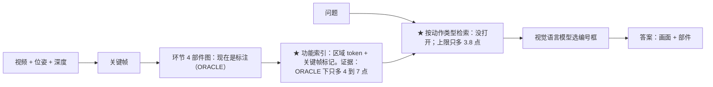
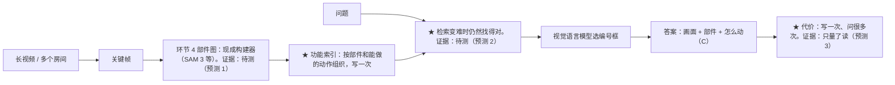

# 评估 2026-11-13：视频功能记忆（affordance3D）对 NeurIPS 2027

> **状态：提案。** 这份评估里的东西，在项目负责人回答第 14 节的问题之前都不生效；第 14 节问题 1 如果采纳，章程的当前主线和半径要改，我会另写提案 P-4 请你批。
>
> **沿着你的方向：** 章程里的方向是功能记忆（环境记忆按"能对什么做什么、做过什么"来组织和写入），贡献必须"主要做memory system而不是robotics"，类型是应用。发现方向本身的弱点时，写成发现，并给出在方向之内的补法。
>
> **依据：** 讨论稿 §20 到 §25 的全部记录；一次按目标会议的独立审稿（只读文件）；一次撞车检查（三个候选主张逐个查最近的工作）。审稿的问题记在 `helm/REVIEW.md`（V-64 到 V-73），两个代理的发现记在 `helm/evidence/field_2026-11-13_assessment_views.md`。
>
> **哪些数字是上限：** 用标注部件图的组（P4、c2、c4、阶段 1 的检索）是上限（ORACLE）；c1、c1'、c3（不用标注）和 B-1（不用标注）不是。
>
> **和第 5 轮评估（§20）的关系：** 沿用 §20 的主张"功能记忆"、预测 A 和 C、关口 G2；重新打开的有：B（事件，预测 B）、标题里的"4D"（关口 G3 的事）、按动作类型检索、以及 G2 的具体内容（第 11 节）。

## 1. 结论

**按 NeurIPS 2027 应用类论文的标准，现在还不够格。** 原因，最重要的在前：

1. **测到的优势都属于标注的部件图。** P4（标注部件图 + 记忆挑画面）选对部件 53 到 54%，直接读原视频 28%；但给同样的标注框、只按整张画面的语义挑 3 张画面（不用记忆，c4），也有 48%。记忆挑画面多出的只有 4 到 7 个百分点，而且这是 ORACLE 下的上限（4B：+4.4，−0.9 到 +9.6；8B：+6.7，+1.8 到 +11.5），按事先的规则都算"接近"。
2. **还没有一个不用标注的部件图的结果。** 现成工具建图的检查（第 9 轮问题 2）已批准，暂停着。
3. **"在动作类问题上格外强"目前没有证据。** 动作类型之间看不出差别（p = 0.16）；按动作类型检索，上限（真值）也只多 3.8 个百分点。
4. **"做过什么"（B）没有不用标注的写入方法。** 只靠手腕跟踪找事件，召回 27.6%、精度 15.5%（门槛 60%、50%）。
5. **代价的说法还没算全。** 只算了读的时间，没算写入。

**一个假设（看到 c4 之后才形成的，还没检验）：** 单个房间、每个场景 40 张关键帧、问题点明了部件，是"语义检索已经够用"的容易情形，记忆本来就不该有多少用武之地。功能记忆该起作用的，是检索变难的时候：录得长、房间多、相似部件多（一排抽屉、好几个开关）。撞车检查（读到摘要和表格，不是穷尽的检索）在部件一级没有找到这样的工作。这是第 4 节主张的来源。

## 2. 已经站得住的

- **做法规矩：** 每个检查的读法都在跑之前写定；ORACLE 处处标明；归因用的对照真的跑了，读出来是负的也照记。
- **一个清楚的机制结果：** 同一个视觉语言模型，给出部件的编号框，选对部件从 27 到 31% 升到 48 到 54%（4B、8B 一致；有框的几组用的是标注）。这和 2026 年"Part Grounding, Not Action Knowledge"（核对过摘要）一致：瓶颈在找到部件。
- **读得快：** 每个问题的模型调用（中位数）：P4 1.2 秒（4B）、0.7 秒（8B），3 张图；读原视频 5.7 秒（4B）、3.5 秒（8B），41 张图。8B 反而更快，原因没查，这些时间只能粗看。
- **数据和工具都搭好了：** 30 个 SceneFun3D 场景的特征和全部对照；HD-EPIC 的标注、手腕数据和轨迹对齐（误差中位数 1.9 厘米）；SceneFun3D 的动作记录（C-0 通过）；SAM 3 和 Qwen3-VL-8B 已下载、按哈希核对；现成工具建图的代码已写好、测过。

## 3. 审稿人会问的

| 审稿人的问题 | 现在的状态 | 要补什么 |
| --- | --- | --- |
| 不用标注时还剩多少？ | 没有结果 | 恢复现成工具建图的检查（第 14 节问题 2） |
| 记忆比"检测器加编号框"多给了什么？ | 单个房间里在 ORACLE 下最多 4 到 7 个百分点 | 在检索变难的情形下测（预测 2） |
| 和这个领域已有的系统比呢？ | 只比了自己设的对手 | 在同样的任务上跑 UniFunc3D（便宜版本）和"用问题文字直接提示 SAM 3"；投到官方指标要另问你用扫描打分的事（DF-5） |
| 写入要多少代价，问多少次才划算？ | 只算了读 | 记录每个场景的写入时间，画划算点（预测 3） |
| 任务是不是挑过的？ | 390 个任务按我们关键帧里看得到部件来选 | 报告全部任务，看不到的算错 |
| 能直接拿去做的回答（C）里，记忆的功劳是什么？ | C-1 的"记忆"组用了标注的接触点和类别 | 已加一组 M4（同样的标注、不用记忆挑画面），在 C-1 全部运行之前加上（账本 D-10）；判定规则要不要改，交你定（问题 7） |

## 4. 中心主张和预测（提议）

**主张（一句话）：** 一次走动视频写成的功能记忆（部件级的 affordance map，按"能对什么做什么"来索引），在检索变难的时候（录得长、相似的部件多），比按语义检索的画面加同样的部件框更可靠地找到要操作的部件，而且越难优势越大；在单个房间这种容易的情形，起作用的是部件图本身。用例是你在第 7 轮选的：家里的使用指导、无障碍与远程协助（走一遍之后，随时问"这个怎么操作"）。

| 预测 | 对应 | 基准和指标 | 和什么朴素做法比（同样输入、同样预算） | 什么结果会推翻它 |
| --- | --- | --- | --- | --- |
| **预测 1（部件图从视频里能建出来）：** 现成工具建的部件图交给同一个视觉语言模型，比它直接读原视频、比"用问题文字直接提示 SAM 3"都更准 | 预测 A（§20.5）；关口 G2 | SceneFun3D 30 个验证场景、390 个任务，8B，统一的二维标准；工具图的部件召回 | 读原视频（c3）；用问题文字直接提示 SAM 3 | 工具图那组减任一对手，区间下沿不大于 0 |
| **预测 2（检索变难时功能索引才起作用）：** 功能索引挑画面减语义挑画面（两边给同样的部件图和编号框，即 c4 式的对照），这个差随同类部件个数和录像长度变大 | 预测 A 的延伸；讨论稿 §5 的 H1 到 H4 里没有对应的一条（H4 讲的是"我做过什么"按动作检索），是新的假设，要你认可 | 先把 30 个场景的关键帧混在一起检索（只用 CPU，已有特征，按同类部件个数分组）；再找现成基准（第 6 节） | 同样部件图下按语义挑画面 | 差随同类部件个数的斜率，区间包含 0 |
| **预测 3（写一次比每次重读省）：** 写入算进去，同一个场景问到一定次数之后，写一次的记忆比每次重读视频更省 | 预测 C（§20.5） | 每个场景的写入秒数加每个问题的秒数 | 读原视频（8B）；UniFunc3D | 划算点多于 15 个问题（SceneFun3D 每个场景约 15 个任务，作为"一次走动会问多少次"的暂定值，测之前由你改定） |

## 5. 最接近的工作

读到的层级写在括号里；都没有通读全文。

| 工作 | 已经做到的 | 本项目必须说明的差别 |
| --- | --- | --- |
| Set-of-Mark（2023，方法）、AffordBot（NeurIPS 2025，方法）、ThinkAfford（2026-08，方法） | 在画面上给候选画编号框，让模型选编号；AffordBot 要点云和渲染的视角 | 不能声称"编号框让模型找到部件"；"有部件框从 28% 到 53%"只当作基线结果报告 |
| Functional-SLAM（2026-09，表格）、HHOpenFunGraph（2026-07，表格）、FunGraph（表格）、OpenFunGraph（表格） | 从视频建部件级的功能图；Functional-SLAM 在线建、跨画面合并 | 不声称新的构建方法；它们当构建器或对手。HHOpenFunGraph 报告的部件召回 70.1% 的指标定义我没核实，不和我们的召回并排 |
| UniFunc3D（NeurIPS 2026，表格）、T-FunS3D（表格）、AffordMem（方法） | 每个问题重读，或用点云；AffordMem 里直接提示 SAM 3 有 AP25 30.45（审稿代理读到，我没核实） | 同样的任务和标准下并排；代价曲线 |
| 3D-Mem（CVPR 2025，表格）、VL-KnG（表格）、Video-EMem（摘要） | 物体级的写一次记忆；VL-KnG 报告约 10 个问题后回本 | 部件级、写入算全时的代价 |
| CapMem、MERIT（2026，表格） | 通用视频问答里，记忆的优势随视频变长而变大 | 部件级、相似部件变多时的版本没有找到 |
| OpenGround / OpenTarget（2025-12，表格） | 同一类部件很多时，给了真值候选的定位模型也会崩 | 可借它的设定或数据测预测 2 |
| SpatialMem（arXiv 2601.14895，表格） | 物体级的第一人称记忆，在相同画面预算下检索证据画面；不到部件 | 相关工作，可当语义检索的参照 |

## 6. 基准

- **SceneFun3D**（CVPR 2024）：split 0 有 30 个场景，split 1 有 200 个；每个场景约 15 个任务（撞车检查读到，2026-11-13）。现在用的是 split 0 的 30 个场景、445 个任务里的 390 个。
- **OpenTarget**（arXiv 2512.23020，2025-12）：7,724 个问题、70 类部件、平均每个场景 8.35 个同类部件；建在 ScanNet++ 和 Articulate3D 上，单个房间（撞车检查读到，我没核实）。要下载 ScanNet++，超过 1 GB，到时要你批。最适合测预测 2 里"相似部件多"的那一半。
- **HD-EPIC**（CVPR 2025）：9 个厨房、41.3 小时、26,550 个问题（`helm/evidence/field_2026-11-13_feasibility_B_C.md`）；问题是设施一级。最适合测"录得长"的那一半；下载视频（P02 约 10 GB）到时要你批。
- **自己把多个场景混在一起：** 最便宜，但证据最弱，只当第一步检查。

## 7. 最大的风险

**现成工具建出的部件图太差；或者即使检索变难，功能索引也赢不了"语义挑画面 + 同样的部件图"。** 最早、最便宜的两个检查：
1. 现成工具建图的 SAM 3 那一步（约 0.1 到 0.3 GPU 小时）：部件召回、每个任务的覆盖（标注时 83.6%）。
2. 把 30 个场景的关键帧混在一起检索（只用 CPU、用已有特征）：功能索引的优势是否随同类部件个数上升。

## 8. 现在的流程和走到头的样子

★ 是论文要声称的贡献；方框后面写着它的证据现在到哪一步。

**现在（第 9 轮的方案乙）：**

**走到头（按第 4 节的主张）：**

论文能列的贡献（最多三条）：(1) 检索变难时的部件级功能记忆（预测 2）；(2) 写一次、问很多次的代价，写入算全（预测 3）；(3) 如果现成基准不够用，一个"相似部件多、录得长"的测试设定。

## 9. 论文的骨架

**主表（格子先空着）：**

| 方法 | 选对部件（SceneFun3D，二维标准） | 选对部件（相似部件多 / 录得长） | 动作类问题（按动作类型拆开） | 每个问题秒数 | 写入秒数 | 划算点（问题数） |
| --- | --- | --- | --- | --- | --- | --- |
| 视觉语言模型直接读原视频（8B） | | | | | 0 | — |
| 用问题文字直接提示 SAM 3 + 视觉语言模型 | | | | | 0 | — |
| UniFunc3D（便宜的二维版本） | | | | | 0 | — |
| 语义挑画面 + 现成部件图 + 编号框（不用功能索引） | | | | | | |
| **功能记忆（现成部件图）** | | | | | | |
| 功能记忆（标注的部件图，上限） | | | | | | |

**主图：** 横轴是同一类部件的个数（或录像长度），纵轴是选对部件的比例；两条线：语义挑画面、功能索引挑画面，两边用同样的部件图。预测 2 成立时，两条线随横轴分开。

## 10. 方向检查：退路是否还"立得住"

章程要求"想法本身要立得住、不是插件"。如果预测 2 不成立，剩下的是"部件图当记忆 + 代价"：用现成的 SAM 3 加编号框，这正是审稿人说的"检测器加编号框"，**很可能过不了这一条**。所以那时不是换个说法继续，而是到关口 G2 由你决定：做新的构建方法（边缘，要训练）、换会议（WACV 的 Applications track 是候选）、或停下来重新想。

## 11. 阶段和关口

| 阶段 | 做什么 | 围栏 | 结束时的关口 | 关口没过怎么办 |
| --- | --- | --- | --- | --- |
| 2a（已批准，暂停中） | 现成工具建图：先 SAM 3，再 Qwen3-VL-8B；读图用 8B。全部跑之前先给你看两个工具在 3 个场景、6 张关键帧上的框（§24.9 的流程关口） | 围栏内 | 预测 1：工具图那组减读原视频、减直接提示 SAM 3，区间下沿都大于 0 | 现成工具这条路走不通：到 G2 定是否做新的构建方法（边缘，要训练，DF-4）或停下来 |
| 2b（新，要你批） | 把多个场景的关键帧混在一起检索，按同类部件个数分组；先用标注部件图（上限），再换工具图 | 围栏内（DF-3 的一部分，加一个新假设） | 预测 2 的第一步：功能索引挑画面减语义挑画面（同样部件图）的差，随同类部件个数上升（斜率区间下沿大于 0） | 第 10 节：到 G2 由你定 |
| 3 | 在现成基准上测预测 2（OpenTarget 或 HD-EPIC，下载要你批）；补 UniFunc3D 和代价曲线 | 围栏内 | G2：主张是否成立、是否训练、投哪个会议 | 按 G2 的决定 |
| C（已批准） | C-1，加 M4 一组之后照计划跑 | 围栏内 | 照 §25.5 的读法（判定规则见问题 7） | C 并进预测 1 的一个指标 |
| B 的用画面检测器（要你批） | 只在问题 6 选"继续"时做 | 边缘 | B-1 的门槛 | B 停下 |

## 12. 日程

NeurIPS 2027 的日程和审稿指南还没有公布（审稿代理 2026-11-13 查过）。2026 年"由应用驱动"类的指南要求：用例真实而有意义、任务和指标贴合用例、和常用的非机器学习做法及基线比、分析为什么有效（neurips.cc/Conferences/2026/ReviewerGuidelines，2026-11-13 读到）。不估计录用概率。

## 13. 下一步、停止清单和还没做的

- **这一周（你批了之后）：**
  1. C-1：M4 一组已经在加（只用 CPU，账本 D-10），然后照计划跑。
  2. 问题 2 的检查：先跑 6 张关键帧给你看，你认可后跑 SAM 3、再跑 Qwen3-VL-8B。
  3. 阶段 2b：先把计划写进讨论稿再跑。
- **建议停止的（都要你定，见第 14 节）：** 按动作类型检索当作主张（问题 5）；B 和标题里的"4D"（问题 6，"4D"按章程仍到关口 G3 定）。另外，为了归因再在标注部件图上加对照，我建议不再做（阶段 2b 的上限检查除外）。
- **推迟的决定放到哪里：** DF-3（阶段 2）→ 阶段 2a、2b；DF-4（构建方法算不算贡献）→ 阶段 2a 之后；DF-5（和 UniFunc3D 并排）→ 阶段 3 的主表，用扫描打分时另问。
- **还没做的：** 没有任何不用标注的部件图；没有写入时间；没有和已有系统在同一协议下比；预测 2 一点都没测；OpenTarget 和 HD-EPIC 的视频没有下载。

## 14. 要你定的

1. **中心主张：** 采纳、修改，还是换掉第 4 节的主张和三个预测？我建议采纳。采纳的话，章程的当前主线和半径要改，我写提案 P-4 再请你批。
2. **恢复问题 2 的检查：** 先给你看工具在 6 张关键帧上的框，你认可后跑 SAM 3、再跑 Qwen3-VL-8B（都在已批的 7 小时内）。我建议恢复。
3. **问题 2 检查里"要不要停"的规则：** 原规则是"工具版 P4 减工具版 c4 接近就停"。c4 已经说明单个房间里这一条多半会触发，按第 4 节的主张这是预料之中的。选项：(a) 照原规则，触发就停下来讨论；(b) 原规则照样算、照样报告，但不因它停，只按预测 1 的两条决定。改事先写定的规则要你定。我建议 (b)。
4. **阶段 2b：** 批不批"把多个场景的关键帧混在一起检索"的 CPU 检查？我建议批。
5. **动作方向：** 你最初希望"一些关于action的方向上又格外高的performance"。现在：动作类型之间看不出差别，按动作类型检索上限只多 3.8 点。选项：(a) 不再把"动作类问题上格外强"当作主张，动作方向由 C（能直接拿去做的回答）来体现；(b) 在阶段 2b 里加一组"按动作类型检索在相似部件多时有没有用"，再定。我建议 (b)：代价很小，都只用 CPU。
6. **B 和"4D"：** 你在第 8 轮说"指AC，但是为了能够具有平行比较的能力，希望能够同时做B"。现在只靠手腕跟踪找不出事件。选项：(a) B 先停，"4D"按章程仍到关口 G3 定；(b) 批一个用画面的事件检测器（要 GPU，代价我先查清再报）。我建议 (a)。
7. **C-1 的判定规则：** 原规则按"M 减 V"判定（包含标注的功劳）；新加的 M4 能算出"M 减 M4"（记忆自己的功劳）。选项：(a) 照原规则判定，M 减 M4 只报告；(b) 改成按 M 减 M4 判定。C-1 还没跑，现在改不算看了结果再改。我建议 (b)。
