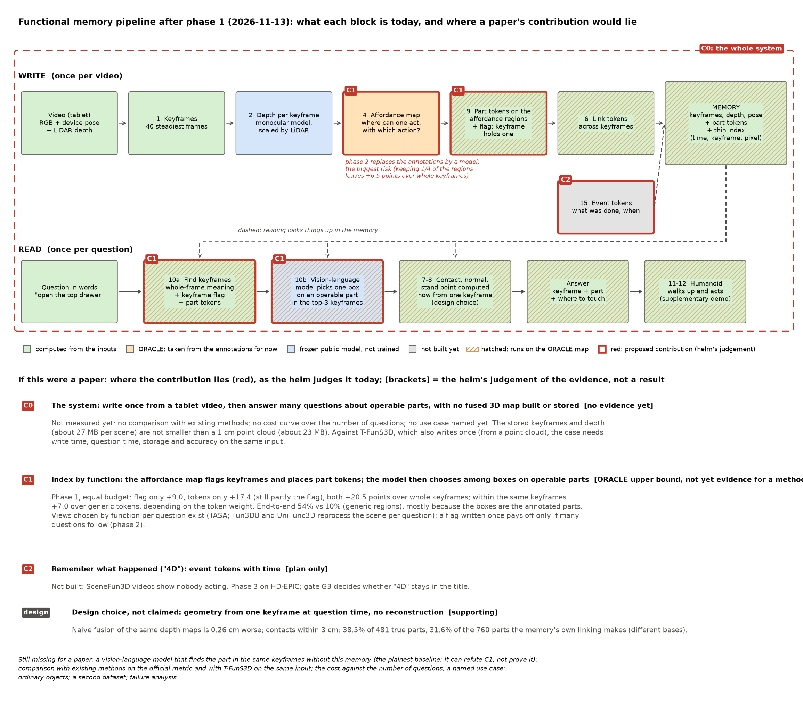
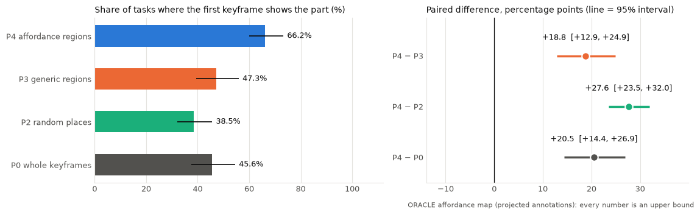
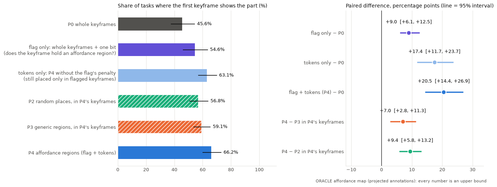
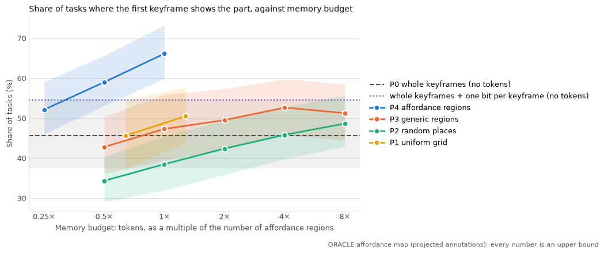

# 第 7 轮：阶段 1 的结果，和需要你决定的 7 件事

> **2026-11-13。** 这一轮需要你看、需要你定的内容都在这一份文档里。正文是白话；附录是三个下一步选项的完整卡片，正文已经概括了它们，不看附录也能做决定。
>
> **所有数字都是用 ORACLE（标注投影得到的）affordance map 算的，是上限。** 换成模型预测的 affordance map，结果只会更低。
>
> **审稿：** 结果记录经过三轮独立审稿。这份文档的流程图和"贡献在哪里"一节另外审了三轮（章程允许的上限）：第 1 轮"不够格"；按意见改写后，第 2、3 轮都是"边缘"。第 3 轮的意见已经照改，但没有再审。每条意见和处理都在 `helm/REVIEW.md`。

## 0. 一分钟版本

- **做了什么：** 在 SceneFun3D 的 30 个验证场景上，比较了 5 种"记忆的 token 写在哪里"的做法，看哪种最能帮检索找到正确的画面。
- **结果：** 预算相同时，按 affordance 写的记忆（P4）最好：把正确的关键帧排在第 1 位的比例是 66.2%；只看整张画面、随机位置、通用区域这三种在 38.5% 到 47.3% 之间。按跑实验之前定好的规则，关口 G1 的两个条件都满足，P4 也明显好于随机位置。
- **要收窄的地方：** 只用"哪些关键帧里有可操作部件"这个标记，就比只看整张画面高 9.0 个百分点；只用 token，高 17.4（这里面仍带着一部分标记的作用）；两样都用，高 20.5。在同一批关键帧里比较，token 写在可操作部件上比写在通用区域上只高约 7 个百分点，而且这个数会随打分方式变化。
- **论文的贡献：** 按独立审稿的意见改过之后，我认为现在能说的是两条：一是"写入一次、之后回答很多问题、不建也不存三维地图"这个系统；二是"按功能给记忆建索引"这个设计。但证据都只在 ORACLE 下；系统那一条还没有任何证据；还缺最朴素的对照（不用我们的记忆，把同样的画面直接交给视觉语言模型），也还没有说清楚谁会对同一个场景问很多问题。审稿人对最后一版的评价仍是"边缘"。
- **最大的风险：** 换成模型预测的 affordance map 之后，优势可能大幅缩水。随机只留四分之一的 affordance 区域时，相对"只看整张画面"的优势就从 20.5 个百分点降到 6.5。
- **要你定的：** 7 件事，见第 5 节。最主要的是第 1 件（关口 G1 是否通过）、第 4 件（是否补做包括那个最朴素对照在内的几项检查）和第 7 件（论文用什么真实场景来讲这个系统）。

## 1. 现在的流程

**怎么看这张图**

- **上下两行：** 上面一行是"写入"，每段视频做一次，结果就是记忆。下面一行是"读取"，每来一个问题做一次。中间的虚线表示读取时要去记忆里查东西。
- **颜色是方框现在的状态：** 绿色是只用输入算出来的；橙色是暂时用标注代替（ORACLE）；蓝色是直接拿来用的公开模型，没有训练；灰色是还没做。
- **斜线：** 这个方框用到了橙色方框（ORACLE 的 affordance map）的输出，所以现在的数字都是上限。可以看到，橙色方框之后几乎都带斜线。
- **红色：** 如果写成论文，贡献在这些地方。这是我的判断，第 2 节解释。外面的红色虚线框（C0）表示整个系统本身。

**每个方框在做什么**

| 方框             | 做什么                                                                                               | 现在怎么做                                                | 状态                         |
| ---------------- | ---------------------------------------------------------------------------------------------------- | --------------------------------------------------------- | ---------------------------- |
| 1 关键帧         | 从一段视频里挑出 40 张画面，记忆只从这 40 张来                                                       | 把视频按时间分成 40 段，每段挑相机转得最慢的一张          | 只用输入                     |
| 2 深度           | 估计画面里每个像素离相机多远                                                                         | 公开的单目深度模型，再用平板（iPad）自带的 LiDAR 校正尺度 | 公开模型                     |
| 4 affordance map | 在画面上标出"哪里可以操作、用什么动作"（按、拉、转……）                                             | 暂时把数据集的标注投影到画面上                            | ORACLE                       |
| 9 部件 token     | 在每个可操作的区域周围取一小块画面，存成一个向量；同时给每张关键帧记一个标记：里面有没有可操作的区域 | 用现成的图文模型（SigLIP 2）把小块画面变成向量            | 用到 ORACLE 的输出           |
| 6 跨帧关联       | 把不同画面里的同一个部件连起来                                                                       | 按外观是否相似、位置是否相近；效果偏碎                    | 用到 ORACLE 的输出           |
| 15 事件 token    | 记下"什么时候、对哪个部件、做了什么"                                                                 | SceneFun3D 的视频里没有人操作，做不了                     | 没做（阶段 3）               |
| 10a 找关键帧     | 用问题的文字去比对每张画面、每个 token，排出最可能的几张画面                                         | 整张画面的相似度，加上关键帧的标记和 token 的相似度       | 用到 ORACLE 的输出           |
| 10b 选部件       | 把排在前 3 的画面连同编号框交给视觉语言模型，让它选一个框                                            | Qwen3-VL-4B，没有训练；框画在可操作的区域上               | 公开模型，用到 ORACLE 的输出 |
| 7–8 几何        | 算出要碰的位置、表面朝向、人该站在哪里                                                               | 只用选中的那一张画面和它的深度，在查询时现算，不存下来    | 用到 ORACLE 的输出           |
| 11–12 人形      | 让人形走过去做动作                                                                                   | 补充材料里的演示                                          | 只用输入                     |

## 2. 如果写成论文，贡献在哪里

**前提：** 章程里写的贡献类型是"应用"，核心并不完全在算法创新；"训练一个写入器"会不会成为贡献，到关口 G2 再定。审稿人会看三件事：这个系统让人能做到什么；和已有方法比怎么样；在任务上效果如何。

**这一节改过两次。** 第一版把贡献分成"按功能写入""按功能读取""不重建也能动手"三条。第一位审稿人认为不够格：它像算法论文的零件清单，缺了"系统让人能做到什么"；"读取"那一条的证据大半是在重复"写入"那一条；"不重建"只是设计选择。改写后，第二位审稿人认为升到了"边缘"，又指出三点：拿"不需要点云"当区别站不住；最朴素的对照只能推翻、不能证明；没有说清使用场景。下面是第二次改过的版本。

| 编号                      | 贡献是什么                                                                                                                                                                       | 现在的证据                                                                                                                                                                                                                                                                                                                                                       | 证据有多强（我的判断）              | 还缺什么                                                                       |
| ------------------------- | -------------------------------------------------------------------------------------------------------------------------------------------------------------------------------- | ---------------------------------------------------------------------------------------------------------------------------------------------------------------------------------------------------------------------------------------------------------------------------------------------------------------------------------------------------------------- | ----------------------------------- | ------------------------------------------------------------------------------ |
| C0 系统                   | 用平板拍一段带位姿的视频，写入一次记忆；之后可以回答很多"怎么操作某个东西"的问题，给出证据画面、要操作的部件和接触的位置。记忆只是关键帧加部件 token，不建、也不存融合的三维地图 | 还没有：没有和已有方法比过；没有量过"问多少个问题之后，写入一次才划算"；还没有说清谁会对同一个场景问很多问题（问题 7）。另外，记忆存的关键帧图像和深度每个场景约 27 MB，并不比 1 厘米的点云（约 23 MB）小                                                                                                                                                        | 没有证据                            | 阶段 2；问题 7                                                                 |
| C1 按功能建索引           | 写入时由 affordance map 决定两件事：哪些关键帧标为"里面有可操作的部件"，以及 token 写在画面的哪里。读取时，视觉语言模型在可操作部件上的框里挑一个                                | 预算相同时，正确的关键帧排第 1 的比例 66% 对通用区域的 47%。模型选对部件 54% 对 10%，但这个差距主要因为 P4 的框就是标注出来的部件（框里有正确部件：84% 对 20%），而且通用区域那一组只用了 1 个随机种子、提示词对它不公平。拆开看：只用标记 +9.0，只用 token +17.4（仍带着一部分标记的作用），两样都用 +20.5；同一批关键帧里，比通用 token 高 7.0，随打分方式变化 | ORACLE 下的上限，还不能算方法的证据 | 换成预测的 affordance map 后还剩多少（阶段 2）；下面"缺的对照"里的第 1 到 3 条 |
| C2 记住发生过什么（"4D"） | 事件 token：什么时候、对哪个部件、做了什么                                                                                                                                       | 没有                                                                                                                                                                                                                                                                                                                                                             | 只是计划                            | 阶段 3 在 HD-EPIC 上做；关口 G3 决定标题里能不能留"4D"                         |
| 设计选择，不算贡献        | 要碰的位置等几何量，在查询时从一张画面现算，不做三维重建                                                                                                                         | 把同样的深度图简单拼成点云再读，并不更准（反而差 0.26 厘米）；但接触点落在 3 厘米以内的只有 38.5%（按 481 个真实部件算）；按记忆自己的跨帧关联是 31.6%（按记忆分出的 760 个部件算，分母不同，不能直接比）                                                                                                                                                        | 只起辅助作用                        | 精度                                                                           |

**和已有工作撞车的风险**

- **"写入一次、回答很多问题"本身不新。** T-FunS3D（2026 年 6 月，我读了摘要）也是先把场景处理一次，用点云建一张物体图，之后每个问题再用视觉语言模型找功能部件；在 SceneFun3D 上报告了和最好方法相当的精度、更快的速度、更少的内存。
- **"不需要点云"也不是站得住的区别。** 我们的输入是带位姿的画面加 LiDAR 校正过的深度，拼成点云只要 2 秒左右。所以区别只能落在"记忆的样子和代价"：我们不建、不存融合的三维地图，记忆是关键帧加部件 token。但这还没有好处可言：存的东西并不比点云小（约 27 MB 对 23 MB）。要和同样只写入一次的 T-FunS3D 分出高下，需要在同样的输入上比四样东西：写入花的时间、每个问题花的时间、存储大小、精度（阶段 2）。"代价随问题数量变化"的曲线只能把我们和"每个问题都重新处理场景"的方法分开。
- **"按功能挑画面"也不新。** TASA（2025 年 11 月；11 月 2 日的调研读到了方法和消融，文献档案 P16）对每个问题，用从任务句子里抽出的功能概念加 CLIP 给画面加权、挑出相关的画面，再在点云上细化；Fun3DU、UniFunc3D 也是每个问题重新挑画面、重新处理场景。我们的关键帧标记是写入时一次标好、和问题无关的。这只有在"同一个场景会被问很多次"时才是优势，所以也要等代价曲线；"按问题挑画面"要作为对照。
- **另外两篇最接近的**（已经在 `docs/research/` 的调研里）：AFFORDMEM（在 SceneFun3D 上找功能部件，需要点云）和 Affordance RAG（物体级的 affordance 记忆与检索）。

**缺的对照，按重要性排**

1. **最朴素的对照：** 不用我们的记忆，把同样的关键帧直接交给视觉语言模型，让它自己框出部件。要注意它的作用：如果它和 P4 差不多，C1 就站不住；如果 P4 赢了，在 ORACLE 下这是意料之中的，只能说明阶段 2 有多少余地，不能当成 C1 的证据。（便宜，见问题 4）
2. **读取那一步的公平对照：** 让模型在全部通用区域里得分最高的那些框里挑，而不是只在和 P4 一样多的小区域里挑。（便宜，见问题 4）
3. **"按问题挑画面"（TASA 的做法）作为对照。**（阶段 2）
4. **和已有方法在官方指标上比：** Fun3DU、UniFunc3D，以及同样只处理一次场景的 T-FunS3D、AFFORDMEM；还要在同样的输入上跑一个用点云的方法。Fun3DU、UniFunc3D 论文里报告的是每个问题 53 到 332 秒（硬件各不相同）；我们写入一次之后，每个问题约 1.3 秒。但现在还不能直接比：我们的时间没有算预测 affordance map 的部分，输出也不是官方要求的三维掩码。（阶段 2）
5. **代价随问题数量的变化：** 一个场景要问多少个问题，"写入一次"才比"每次重新处理"划算。（阶段 2）
6. **问普通物体的问题**（比如"杯子在哪里"）、**第二个数据集**、**失败案例的分析。**（阶段 2 以后）

**今天能写的一句话**（按第 3 轮审稿意见改过）：在标注给出的 affordance map 下、30 个 SceneFun3D 场景上，写入时按功能给关键帧打一个和问题无关的标记，就让检索把正确的关键帧排在第一位的比例提高 9.0 个百分点；在同一批关键帧里，把部件 token 写在可操作的区域上，比写在通用区域上再高约 7 个百分点（依赖打分方式）。端到端的差距更大，但主要来自交给模型的候选框就是标注出来的部件，不能当成方法的证据。

## 3. 阶段 1 发现了什么

### 3.1 实验怎么做的

- **数据：** 30 个场景，445 个任务句子，例如 "Open the top drawer of the cabinet"。其中 390 个任务所指的部件在 40 张关键帧里看得到，统计只在这 390 个上做。
- **5 种写法，只有"写在哪里"不同：**
  - **P0 只有整帧：** 不写 token，只用整张画面。
  - **P1 均匀网格：** 把每张画面切成固定的格子，每格一个 token。格子数只有固定的几档，只能和 P4 的个数大致对齐。
  - **P2 随机位置：** 位置随机，大小和个数与 P4 相同。
  - **P3 通用区域：** 用一个不知道"什么可以操作"的分割模型（SAM）切出的区域，大小和个数与 P4 匹配。
  - **P4 affordance 区域：** affordance map 上的区域。P4 的 token 个数叫"1 倍预算"。
- **主要指标"第一个关键帧对"：** 排在第 1 位的画面里，有没有任务所指的部件。作为参照，随便挑一张画面，对的概率只有 9.2%。

### 3.2 主要结果

**怎么看图：** 左边是每种写法"第一个关键帧对"的比例；黑线是 95% 置信区间，可以理解为"换一批同类的场景，结果大概率落在这个范围里"。右边是 P4 减去其他写法的差；横线不碰到 0，说明这个差别不太可能只是运气。

| 写法               | 第一个关键帧对 | 前 3 个关键帧里有 | 视觉语言模型选对部件 |
| ------------------ | -------------- | ----------------- | -------------------- |
| P4 affordance 区域 | 66.2%          | 84.4%             | 53.6%                |
| P3 通用区域        | 47.3%          | 69.2%             | 10.3%                |
| P0 只有整帧        | 45.6%          | 70.5%             | 没有做               |
| P2 随机位置        | 38.5%          | 64.0%             | 没有做               |

P4 比 P3 高 18.8 个百分点（区间 12.9 到 24.9）。

### 3.3 优势从哪里来（审稿之后加的检查）

打个比方：要在一本 40 页的相册里找"能开灯的开关"。

- **只有整帧（P0）：** 一页一页看，整张照片像不像。
- **加一个标记：** 事先告诉你"哪几页上有可以操作的东西"，但不说在页上哪里。
- **P4：** 告诉你哪几页有，并且在页上把可操作的东西框出来。

**怎么看图：** 左边六组"第一个关键帧对"的比例，带斜线的两组拿到了和 P4 相同的关键帧。右边是成对比较的差。

- **只加"哪几页有"：** 54.6%，比只有整帧高 9.0 个百分点。
- **只用框（去掉"哪几页有"带来的扣分）：** 63.1%，高 17.4 个百分点。但这一项仍带着"哪几页有"的作用：框只出现在有标记的那几页上。同样去掉扣分，把通用区域放进同样的几页，也比只有整帧高 11.9。
- **两样都用（P4）：** 66.2%，高 20.5 个百分点。这三个数不能简单相加。
- **框的是同几页上的其他东西：** 把通用区域放进同样的关键帧、个数也一样，是 59.1%。P4 比它高 7.0 个百分点（区间 2.8 到 11.3）：这是"框在可操作部件上、而不是框在同一页的别处"的价值。
- **这 7.0 不太稳：** 打分时 token 的分数占的比重小一些（权重 0.5 或 0.25），这个差就缩到 1.3 到 4.9 个百分点，多数情况下看不出差别。

**为什么这很重要：** 如果论文里写"把 token 写在可操作部件上，让检索提高了 18.8 个百分点"，审稿人会指出，其中相当一部分是"知道哪几页有"的功劳。准确的说法是：按功能标记关键帧本身就有用（+9.0）；在同一批关键帧里，token 写在可操作部件上比写在通用区域上再高约 7 个百分点，而且依赖打分方式。

### 3.4 交给模型那一步

- **候选框里有没有正确的部件：** 给模型看的框里有一个在正确部件上的任务，P4 是 84%，P3 只有 20%。这主要是在重复检索那一步的结果：在 ORACLE 下，P4 的框就是标注出来的部件。
- **有正确候选的时候，模型挑没挑对：** P4 约 64%，P3 约 51%。这个比较有两个不公平的地方：P3 只用了 1 个随机种子；提示词把每个框都说成"可以操作的部件"，而 P3 的框多数不是。
- **所以：** 端到端 54% 对 10% 的差距，主要来自"给模型的候选是什么"，不是模型读图读得更好。

### 3.5 多给 token 能不能追上

**怎么看图：** 横轴是 token 的数量，用 P4 的个数做 1 倍。纵轴是"第一个关键帧对"的比例。

- **在试过的预算里都没有追上：** 通用区域给到 8 倍的 token 是 51.3%，仍比 P4 低 14.9 个百分点。打分方式换成对通用区域最有利的一种，P4 也还高 15 个百分点以上。两种写法用同一种打分方式时，差从 3.3 到 19.0 个百分点不等，10 个不同的结果里有 1 个的区间含 0。
- **但要注意图里的点线：** 不写任何 token、只标记"哪几页有"，就有 54.6%，不低于通用区域的最好成绩（52.7%）。所以这张图主要说明"按功能标记关键帧"很值钱，不能读成"P4 的 token 更省"。
- **没试过的：** 把全部通用区域都写进记忆。这是问题 4 的一部分。

### 3.6 没有成立的，和风险

- **漏掉部件时，优势很快变小。** 随机只留四分之一的 affordance 区域，P4 比只有整帧只高 6.5 个百分点（区间 0.4 到 13.6）；留一半是 13.4。模型预测的 affordance map 一定会漏，这是阶段 2 最大的风险。
- **挑相机转得慢的帧，没有多看到部件。** 561 个部件里，挑稳帧时看得到 481 个，均匀取帧是 501 个。挑稳帧本来是为了让标注和画面对得更齐，这一点没有单独量。
- **碰的位置还不够准。** 从一张画面现算，误差中位数 4.1 厘米，38.5% 在 3 厘米以内（按真实部件编号算的）；按记忆自己的跨帧关联，中位数是 5.5 厘米。
- **跨帧关联偏碎。** 465 个真实部件，被记忆分成了 760 个。
- **"不重建"站得住，但证据很弱。** 简单拼成点云并不更准，差别只有 0.26 厘米，而且只和最简单的拼法比过。

## 4. 我自己定了、你可以推翻的 5 件事

这些都在已批准的阶段 1 范围内，可以撤销，账本里有记录（D-1 到 D-5）。

1. **LiDAR 没有可用像素的关键帧：** 6 个场景里有 7 张关键帧，数据集给的 LiDAR 置信度整张为 0，没法用 LiDAR 校正深度的尺度。这几张改用同一场景其他关键帧的尺度中位数。只用输入，没碰真值。
2. **区域填满了算表面朝向的窗口：** 1 个场景里有一个 affordance 区域太大，周围没有像素可以用来算表面朝向。这时改用区域自己的表面来算。
3. **全部重跑一遍：** 改了上面两处之后，30 个场景全部在新代码上重跑。原先成功的 23 个场景，结果逐条相同。
4. **规格之外加了几项检查：** 包括第 3.3 节的拆分、更大预算下的比较等，只用 CPU，不参与 G1 的判定。
5. **汇总只读场景的结果文件：** 否则会把模型答案的缓存误当成场景结果读进来。

## 5. 需要你决定的 7 件事

### 问题 1：关口 G1 是否通过？

- **G1 是什么：** 阶段 1 结束时的检查点。规则在跑实验之前就写定了（讨论稿 §21.6），有两个条件：预算相同时，P4 要明显好于 P3（差值的区间不含 0）；视觉语言模型选对的比例，P4 不低于 P3。
- **结果：** 两条都满足。P4 比 P3 高 18.8 个百分点（区间 12.9 到 24.9）；选对部件 53.6% 对 10.3%。P4 也明显好于随机位置（高 27.6，区间 23.5 到 32.0）。按规则，这属于"通过"一档。
- **需要你判断的：** 规则只检查 P4 有没有赢，不检查赢在哪里，也不检查"不用记忆、直接让模型找"能不能做得一样好。

| 你的选择             | 意味着什么                                                                                | 接下来                                  |
| -------------------- | ----------------------------------------------------------------------------------------- | --------------------------------------- |
| 通过，按收窄后的含义 | 接受"按功能建索引在 ORACLE 下有效"，同时承认"写在哪里"本身只有约 7 个百分点、依赖打分方式 | 问题 3、5、6 生效                       |
| 先不定               | 想先看问题 4 的结果，尤其是"不用记忆、直接让模型找"                                       | 需要你对问题 4 说"做"；结果出来后再问你 |
| 不通过               | 认为 ORACLE 下的优势不够，或者不够稳                                                      | 停下来，重新讨论主张                    |

**这一项没有默认，等你决定。** 我的看法：可以通过，但写清楚收窄后的含义。理由是，规则是事先定的，条件都满足；加预算、换成对通用区域最有利的打分方式，P4 都还领先；不过两种写法用同一种打分方式时，差从 3.3 到 19.0 个百分点不等，10 个结果里有 1 个的区间含 0。如果你想先看那个最朴素的对照再定，"先不定"也很合理：只跑 c 只要半小时以内的 GPU。

回答：通过，按收窄后的含义

### 问题 2：论文的贡献按第 2 节的新划分来写，是否同意？

- **新划分：** C0 是整个系统（写入一次、回答很多问题、不建也不存三维地图）；C1 是"按功能建索引"（写入和读取合在一起）；事件和时间（C2）只是计划；"不重建"是设计选择，不算贡献。
- **措辞：** "写在哪里"用收窄后的说法：按功能标记关键帧单独 +9.0；同一批关键帧里，写在可操作部件上比写在通用区域上高约 7，依赖打分方式。"今天能写的一句话"用第 2 节末尾那句，带着它的限定。
- **和原来的差别：** 原来的说法是"三条贡献"，加上"写在可操作部件上让检索提高 18.8 个百分点"。新的说法经得起审稿人追问，但"写在哪里"的分量变小，重心移到"系统"和"按功能建索引"上，而这两条现在都还缺关键的证据。

**这是主张的结构和措辞，由你定，没有默认。** 我建议同意。

回答：同意。但是现在的应用场景和对比场景有点单薄，最好还是使用传统的vlm模型直接读取原video来完成整体系统的对比，看这里提出的‘功能性索引’是否真的比‘传统vlm’更好

### 问题 3：如果 G1 通过，是否批准阶段 2（附录 R7-A）？

- **阶段 2 做什么：** 用现成的模型预测 affordance map，替换掉现在的标注；量出每一步损失了多少；把结果做成官方要求的三维掩码，在官方指标上和 Fun3DU、UniFunc3D、T-FunS3D 等比较；在同样的输入上跑一个用点云的方法；报告每个问题花的时间，以及代价怎么随问题数量变化。
- **代价：** 整个阶段约 3 周（时长估计）；GPU 用量还没有估。它超出了章程现在写的范围，要改章程里的三行。我会提议这样改（改章程要你批准）：阶段一行改成"阶段 2：去掉 ORACLE，与已有方法比较，到关口 G2"；探索半径从 narrow 改成 medium（允许给环节 4 换做法）；每轮预算改成"GPU 走队列，限于阶段 1、2，每次开始前先报用量"。
- **风险：** 现成模型漏得太多，优势就没了。那样就要考虑训练自己的写入器，这是关口 G2 要决定的事。

| 你的选择               | 接下来                                                        |
| ---------------------- | ------------------------------------------------------------- |
| 批准                   | 我先把章程三行的改法和 GPU 用量的估计给你看，你同意之后再开始 |
| 等问题 4、5 的结果再定 | 问题 4、5 里你说"做"的那些先做，结果出来再问你                |
| 不批准                 | 阶段 2 不开始                                                 |

**没有默认。** 我建议等问题 4、5 的结果再定：先知道"不用记忆的模型能做到多少"和"现成模型至少要多准"，才能判断阶段 2 值不值得、怎么做。

回答：等问题 4、5 的结果再定

### 问题 4：是否补做阶段 1 的几项对照（附录 R7-C）？

| 项 | 是什么                                                                                                                                                                                                                                                             | 为什么                                                               | 代价（估计）                                         |
| -- | ------------------------------------------------------------------------------------------------------------------------------------------------------------------------------------------------------------------------------------------------------------------ | -------------------------------------------------------------------- | ---------------------------------------------------- |
| a  | 把每个场景的全部通用区域（中位数约 2265 个）和全部网格档位都写进记忆，只做检索                                                                                                                                                                                     | 审稿人会问"全部写进去行不行"，现在只试到 8 倍                        | 只用 CPU，约 2 到 5 小时                             |
| b  | 模型那一步的 P3 补到 5 个随机种子（现在只有 1 个）；所有组改用中性的提示词（不说框里是"可以操作的部件"），P4 也用新提示词重跑一遍                                                                                                                                  | 现在的比较不够公平                                                   | GPU，约 2,340 次模型调用，约 50 分钟                 |
| c  | **不用记忆：** 把关键帧直接交给视觉语言模型，让它自己框出部件。分两种：用"只看整张画面"排出的前 3 张；用 P4 排出的前 3 张但不给编号框                                                                                                                        | 最朴素、也最关键的对照。两种一比，能分开"挑画面"和"给候选框"各值多少 | GPU，约 780 次模型调用，约 20 分钟                   |
| c+ | **更强的"不用记忆"：** 把全部 40 张关键帧（缩小）一起交给模型，让它先挑一张画面，再把这张画面按原分辨率给它、让它框出部件（部件在缩略图里只有十几个像素宽，只看缩略图不公平）；再用一个更大的模型（Qwen3-VL-8B），在现在就定下的 100 个任务上重做 c 和这一项 | 现在的模型只有 4B 参数，只给 3 张画面也可能低估了"不用记忆"的做法    | GPU，约 2 到 3 小时，另要从镜像站下载约 17 GB 的模型 |
| d  | 让模型在全部通用区域中得分最高的 40 个框里挑                                                                                                                                                                                                                       | 读取那一步的公平对照                                                 | GPU，约 390 次模型调用，约 10 分钟                   |

- **事先定好的规则（跑之前写进记录，不因结果修改）：**
  - **同一个"对"的标准：** 所有组都用同一个标准，即模型选出（或自己框出）的框，中心落在目标部件上（部件区域向外放宽 8 个像素）。原来的标准（框盖住部件的中心）同时报告。
  - **什么叫"差不多"：** P4 减去某一组的差，95% 区间的下沿低于 5 个百分点，就算这一组接近 P4。但如果差本身大于 10 个百分点、只是因为区间太宽才"接近"，记为"说不清"。
  - **每一组接近时怎么读（各自分开）：** c 的第一种（只看整张画面挑出的前 3 张）或 c+ 的"全部 40 张"接近 P4：不用记忆也能做到，C1 站不住，先停下来和你讨论。c 的第二种（P4 挑出的前 3 张、但不给编号框）接近 P4：只说明"编号框"那一半没有用，"按功能挑画面"那一半还在。c 的第二种减第一种：就是"挑画面"值多少。
  - **c+ 的 100 个任务现在就定：** 按整个场景抽（随机种子固定为 0），抽到满 100 个任务为止；P4、c、c+ 都在这 100 个任务上成对比较。
  - **P4 赢了怎么读：** 在 ORACLE 下这几乎是一定的（正确部件在前 3 张里的比例 84.4% 对 70.5%，P4 的框又是标注出来的部件），只报告为"阶段 2 有多少余地"，不当成 C1 的证据。
- **代价合计：** 不含 c+ 时，GPU 上模型调用本身约 1.3 小时，加上加载模型等余量约 2 小时；含 c+ 约 4 到 5 小时。这些都超出了实验规格（规格写定的预算上限是 8 倍，也没有 c、c+、d），所以要问你。
- **它补的是阶段 1，不依赖问题 1。没有默认；** 我建议 a、b、c、d 都做，c 最重要；c+ 我也建议做，但你可以先只批 c，看了结果再定。
- 回答：都做，但是先做c在做其他

### 问题 5：是否先做"漏检和误检"的模拟（附录 R7-B）？

- **是什么：** 还是在 ORACLE 上，按不同比例丢掉 affordance 区域（模拟漏检），再混入一些通用区域（模拟误检），画出 P4 的优势怎么随之下降。
- **为什么：** 给阶段 2 定一个门槛：现成模型的召回至少要多高、误检最多能有多少，按功能写的记忆才仍然比不按功能写的好。
- **代价：** 只用 CPU，一到两天（估计）。它超出了规格，所以要问你。
- **只在问题 1 选"通过"时才有意义。没有默认；** 我建议做。
- 回答：做

### 问题 6：GPU 作业排在队列的什么位置？

- **背景：** 阶段 1 你说"插到前面"，所以排在你自己的作业前面。
- **要定的两件：** 问题 4 的那几项（2 到 5 小时）是否也插到前面；如果批准阶段 2，它（时间长得多）排在哪里：继续插到前面、排在你的作业后面，或者和你的作业交替。
- **没有默认；** 我建议问题 4 的插到前面，阶段 2 排在你的作业后面（这个方向不赶时间）。
- 回答：问题 4 的插到前面，阶段 2 排在你的作业后面

### 问题 7：论文用什么真实场景来讲这个系统？

- **为什么要定：** 审稿人会问"谁会对同一个场景问很多个'怎么操作'的问题，为什么"。只有这样的场景存在，"写入一次、之后回答很多问题"才有意义，C0 才站得住。这是在定论文讲什么故事，由你决定。
- **几个候选：**

| 场景                 | 例子                                                                                                   | 好处                                                   | 要注意的                                                                       |
| -------------------- | ------------------------------------------------------------------------------------------------------ | ------------------------------------------------------ | ------------------------------------------------------------------------------ |
| 家里的使用指导       | 用平板或眼镜在家里扫一遍；之后家里人反复问"烤箱的灯怎么开""空调遥控器哪个键调温度"，系统指出部件和位置 | 最贴近"做记忆系统、不做机器人"；同一个家会被问很多次   | 需要说明为什么不每次现场拍一张照片问就行（答案：东西不在眼前、或者要远程指导） |
| 家用机器人的环境记忆 | 机器人进新家先转一圈；之后接到很多任务指令，每个任务都要先找到要操作的部件                             | 和 T-FunS3D 等工作的设定一致，好比较；人形演示可以接上 | 容易被看成机器人论文，与"不做机器人"的定位要说清                               |
| 无障碍与远程协助     | 帮视障者或老人记住家里开关、把手的位置；远程有人指导操作                                               | 社会意义明确                                           | 数据集里没有这类用户，评测只能借用同样的任务                                   |

- **没有默认；** 我建议用第一种（家里的使用指导）作为主线，第二种作为讨论里的延伸。
- 回答：我希望优先一和三，二作为补充说明

## 6. 你决定之前，我做什么、不做什么

- **会做：** 整理记录。
- **不会做：** 阶段 2、R7-B、R7-C 都不开始，不占 GPU。

## 7. 这一轮收到的你的话

- **排队位置（2026-11-12）：** "continue，插到前面……不用特别着急"（省略的部分与另一个项目有关）。我的理解是：阶段 1 的作业排到你自己的排队作业前面，不赶时间，而且只对阶段 1 有效。已照此执行。
- **汇报方式（2026-11-13）：** "之后每次阶段性汇报的时候，都给我一个流程图，用来展示目前的流程大概是什么样的，然后这个流程图如果作为paper的话核心的contribution在哪里。另外，每次需要我审视和决定的内容汇报的时候，尽量放在一个文档里，并且尽量详细但是简单直白的解释，这样我最能够直观地看到其中的内容"。这份文档就是照这个要求做的，以后每次阶段汇报都这样做；账本里已经记下。下次整理 research-helm 的习惯时，我会建议把它加进 playbook，到时再请你确认。

## 8. 术语表

| 词               | 意思                                                                                                                |
| ---------------- | ------------------------------------------------------------------------------------------------------------------- |
| 关键帧           | 从视频里挑出来、存进记忆的画面。每段视频 40 张                                                                      |
| affordance map   | 画面上"哪里可以操作、用什么动作"的标注图                                                                            |
| ORACLE           | 暂时用标注代替模型预测。用它得到的数字是上限                                                                        |
| token            | 记忆里的一条内容：一小块画面变成的向量，加上它在哪张画面、哪个位置                                                  |
| 关键帧的标记     | 每张关键帧一个"是/否"：里面有没有可操作的区域                                                                       |
| 预算、1 倍       | 记忆里 token 的数量。1 倍 = P4 在这个场景里的 token 数                                                              |
| 第一个关键帧对   | 检索排在第 1 位的画面里，有任务所指的部件                                                                           |
| 候选框           | 交给视觉语言模型、让它从中挑一个的编号框                                                                            |
| 95% 置信区间     | 换一批同类场景再做，结果大概率落在的范围                                                                            |
| 百分点           | 两个百分比直接相减。66.2% 减 47.3% 是 18.8 个百分点                                                                 |
| 成对比较         | 两种写法在同一批任务上逐条比较，比分别统计更可靠                                                                    |
| 随机种子         | 决定"随机"怎么随机的一个数。换几个种子重做，可以看结果是不是碰巧                                                    |
| 召回、漏检       | 真实存在的可操作部件里，被找出来的比例；没找出来的就是漏检                                                          |
| 误检             | 把不能操作的地方当成了可操作的部件                                                                                  |
| 表面朝向（法线） | 部件所在表面朝哪个方向，用来决定人从哪边去碰                                                                        |
| 点云、三维地图   | 把很多张画面的深度拼在一起得到的三维点的集合                                                                        |
| 关口 G1、G2、G3  | 路线上的检查点。G1：阶段 1 之后，按功能写有没有用；G2：阶段 2 之后，换成预测还剩多少；G3：阶段 3 之后，事件有没有用 |
| 阶段 1 到 4      | 1：ORACLE 下的对照（已完成）；2：去掉 ORACLE，和已有方法比；3：事件和时间；4：定型、全量实验和写作                  |

## 9. 详细记录在哪里

- **带图的结果：** [notebooks/mem/phase1_results.ipynb](../../notebooks/mem/phase1_results.ipynb)。第 11 节是第 3.3 节的拆分，第 12 节是结论。
- **结果记录：** [讨论稿](../../docs/mem/mem分支_问题定义与讨论稿_2026-11-10.md)第 22 节；补充检查是第 23 节。
- **审稿：** [helm/REVIEW.md](../REVIEW.md)，每条意见和处理都在里面。
- **账本：** [helm/LEDGER.md](../LEDGER.md)，第 7 轮。
- **流程图的代码：** `report/pipeline_flowchart.py`。以后每次汇报更新里面的描述，再重新画。
- **在任何设备上打开的单文件版本：** `python scripts/render_brief.py helm/rounds/R7.md <输出的 html>`。

---

## 附录：三个下一步选项的完整卡片

### R7-A 阶段 2：去掉 ORACLE

- **是什么：** 按讨论稿 §20.7 的路线，用不训练的写入器（现成的功能部件检测或分割模型）代替标注投影，量出每一步掉了多少。再把记忆读出的结果投到三维，用官方指标和已有方法比，并报告每个问题的时间和代价随问题数量的变化。
- **它支持的说法：** "功能记忆写入一次之后，按问题读取，不建也不存三维地图；在官方指标上接近每个问题都重新处理场景的方法，而在同一个场景被问很多次时代价低得多。"
- **最接近的工作和差别：** Fun3DU、UniFunc3D：每个问题重新处理场景，需要点云；§20.5 里的数字已对照原文核对。T-FunS3D：用点云建一张物体图、只处理一次场景（读了摘要）。AFFORDMEM（文献档案 P11，需要点云）和 Affordance RAG（P14，物体级的 affordance 记忆与检索）：读到方法部分。差别在于记忆的样子和代价：不建、不存融合的三维地图，记忆在部件一级按功能建索引；要和 T-FunS3D 在同样的输入上比写入时间、每个问题的时间、存储大小和精度来证明。
- **代价：** 整个阶段约 3 周（时长估计，来自 §20.7）；GPU 用量还没有估，开始前先估好给你看。
- **风险和最早的失败迹象：** 现成检测器的召回太低。最早的迹象来自 R7-B 的曲线：如果召回 25% 时优势已经接近 0，而现成模型只有这个水平，就需要训练写入器。
- **第一步检查：** 在 3 个场景上量现成模型给出的 affordance map 的召回和误检。达不到 R7-B 定出的门槛就停下来，先讨论是否训练写入器（关口 G2）。
- **围栏：** 围栏内。它在关口 G1 之后，并且超出章程现在的范围：阶段一行写的是阶段 1，半径是 narrow，GPU 预算只限阶段 1。所以开始它需要你批准（问题 3）。激光扫描只用于打分，不作为输入。
- **对其他部分的影响：** 环节 4（affordance map）从 ORACLE 变成真实；环节 10 的读取一步要重做（放大图、提示词）。阶段 1 的 P4 保留为上限。

### R7-B 先量"漏检和误检"能承受多少

- **是什么：** 仍在 ORACLE 上，按不同的比例丢掉 affordance 区域，混入通用区域充当误检，画出"优势对召回率、误检率"的曲线。它给出阶段 2 的写入器需要达到的门槛。
- **它支持的说法：** "affordance map 的召回不低于某个水平、误检不高于某个水平时，功能记忆仍然有效。"
- **最接近的工作和差别：** 没有找到在记忆检索上画这类容错曲线的工作（只查到摘要一级）。
- **代价：** 只用 CPU，不占 GPU；一到两天（估计）。依据：第 3.3 节的检查用了约 1 小时 CPU（量过的），这里要多编码几倍的小块画面。它超出 §21 的规格，所以要问。
- **风险和最早的失败迹象：** 随机丢区域不代表真实检测器的漏检方式，真实的漏检偏向小部件。最早的迹象是：按部件大小丢和随机丢，两条曲线差别很大。
- **第一步检查：** 召回 50%、误检数与 P4 的 token 数相当时，P4 是否仍高于"只标记关键帧"。高于就继续画完整曲线；不高于就直接报告，并把重点转到训练写入器。
- **围栏：** 围栏内。
- **对其他部分的影响：** 不改流程，给 G2 的判定提供门槛。

### R7-C 补齐阶段 1 的几项对照

- **是什么：** 见问题 4 的表：a 全部通用区域和全部网格（只做检索）；b 端到端的 P3 补到 5 个随机种子；c 不用记忆，让视觉语言模型自己在关键帧里框出部件（两种）；c+ 更强的"不用记忆"（全部 40 张关键帧，以及更大的模型）；d 让模型在全部通用区域中得分最高的 40 个框里挑。
- **它能说明什么：** c、c+ 只能推翻 C1（如果它们接近 P4），不能证明 C1；P4 赢了只报告为阶段 2 的余地。a 回答"全部写进去行不行"；b、d 让读取那一步的比较变公平。
- **事先定好的规则：** 见问题 4：所有组用同一个"对"的标准（框的中心落在放宽 8 个像素的目标部件上），原标准同时报告；所有组用同一个中性的提示词；"接近"按区间下沿低于 5 个百分点算，差本身大于 10 个百分点时记为"说不清"；c 的两种、c+ 各自有事先定好的读法；c+ 的 100 个任务现在就定。
- **最接近的工作和差别：** c 相当于"直接让视觉语言模型找功能部件"这一类做法的最简单版本。
- **代价（估计）：** a 只用 CPU，约 2 到 5 小时（依据：第 3.3 节的编码速度，以及第 2 轮审稿人的估计）。b、c、d 用 GPU 队列，约 2,340、780、390 次模型调用，按每次约 1.3 秒算，调用本身约 1.3 小时，加上加载模型等余量约 2 小时。c+ 约 2 到 3 小时 GPU，另要下载约 17 GB 的模型。它超出 §21 写定的 8 倍预算上限，也超出规格里的对照组，所以要问。
- **风险和最早的失败迹象：** c 的结果接近 P4。那样 C1 的主张站不住，要先停下来讨论。
- **第一步检查：** 先跑 c，再跑其他几项。
- **围栏：** 围栏内。
- **对其他部分的影响：** 影响第 2 节 C1 的证据和讨论稿 §22.4 第 4 条的写法；c、c+ 的结果可能改变主张。
