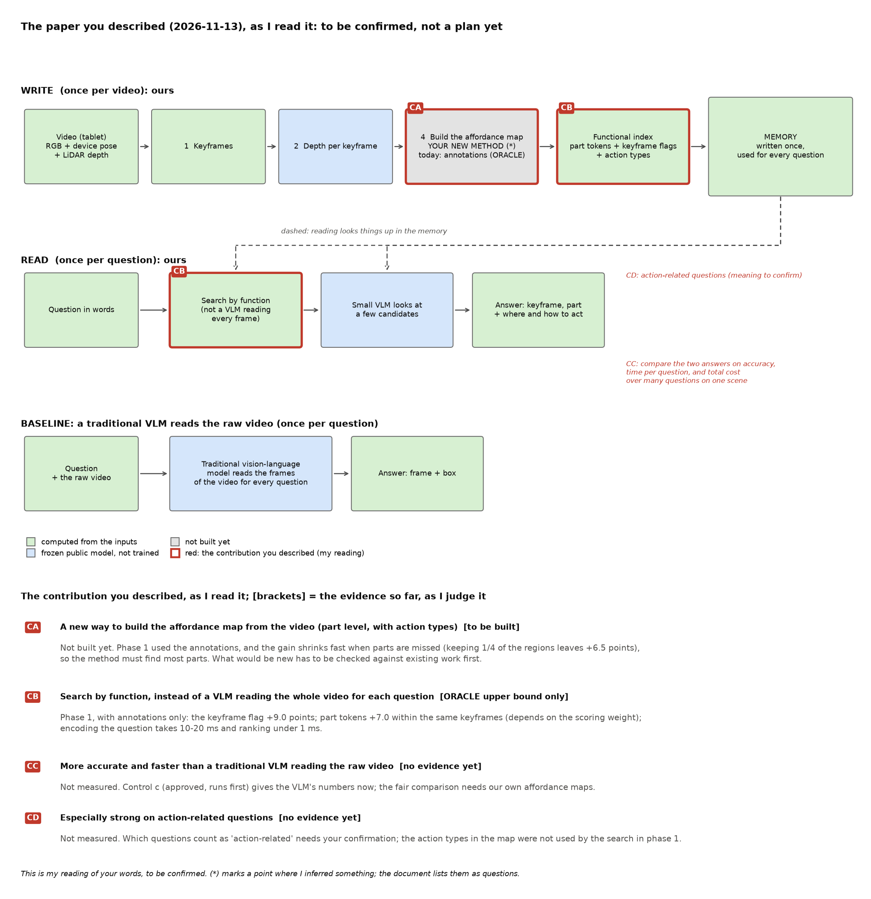

# 第 8 轮：你想要的贡献——我的理解，请你确认

> **2026-11-13。** 你在第 7 轮的回答之外，写出了希望论文最后能说的贡献。这会改变项目的重心，所以按我们的规则，我先把理解写出来请你确认，确认之前不调研、不出新方案。需要你看、需要你回的内容都在这一份文档里。
>
> 带 ★ 的地方是我推断出来的，不是你的原话，请你逐条看对不对。

## 0. 一分钟版本

- **你想要的论文（我的理解）：** 我们自己做一种新的 affordance map 构建方法；用它建出的"功能索引"去搜索，这种搜索和"传统视觉语言模型每次把整段视频读一遍"不一样；它比传统视觉语言模型更快、更准；在和动作有关的问题上，优势格外大。
- **和现在的计划比，最大的三处变化：**
  1. affordance map 从"暂时用标注代替"，变成论文的一项核心贡献（一个新的构建方法）。★
  2. 主要的对手从"几种写法互相比"，变成"传统视觉语言模型直接读原视频"，比的是整个系统。
  3. 阶段 1 的结果（用标注）变成论文里的上限和消融实验，不再是主要证据。★
- **要你确认的：** 5 件事，见第 6 节，回一行就行。
- **确认之前我做什么：** 只做你已经批准的事。先做 c，并按你在问题 2 里的要求，加了"传统视觉语言模型直接读原视频"这一组；然后做 a、b、d、c+ 和"漏检和误检"的模拟。

## 1. 你说的话（原话）

- **第 7 轮问题 2 的回答：** "同意。但是现在的应用场景和对比场景有点单薄，最好还是使用传统的vlm模型直接读取原video来完成整体系统的对比，看这里提出的‘功能性索引’是否真的比‘传统vlm’更好"
- **聊天里（2026-11-13）：** "目前试验的测试结果有些过于集中在只有affordance map的部分，并且我自己的算法中并没有affordance map的构建结果，因此无法直接和传统vlm模型进行比较。我最终比较希望我的模型能够完成‘使用较为新颖的affordance map的方法，通过一个与传统vlm模型不同的搜索方式，这种搜索方式能够有效的提高搜索效率和准确度，并且一些关于action的方向上又格外高的performance’类似这种的contribution内容"

## 2. 我的理解：你想要的论文是什么样

**怎么看这张图**

- **上面两行是我们的系统。** 写入时，用新的方法从视频建出 affordance map（CA），再按功能建索引；读取时，按功能搜索（CB），只把少数几个候选交给一个小的视觉语言模型。
- **最下面一行是对手。** 传统的视觉语言模型，每来一个问题，就把视频的画面读一遍，直接给出画面和框。
- **红色是你描述的贡献：** CA、CB 在图上的方框里；CC（比对手更快、更准）和 CD（动作类问题格外强）是两行之间的比较，写在右边。
- **灰色的方框（新的构建方法）还没有做。** 现在那个位置用的是标注。

**论文的主表大概会是这个样子**（数字都还没有，只是说明要比什么）：

| 方法 | 每个问题要读的画面 | 每个问题的时间 | 找对画面 | 找对部件 | 动作类问题 |
| --- | --- | --- | --- | --- | --- |
| 传统视觉语言模型，直接读原视频 | 全部（例如 40 帧） | 待测（c 会先测） | 待测 | 待测 | 待测 |
| 传统视觉语言模型，先用普通检索挑 3 张 | 3 张 | 待测 | 待测 | 待测 | 待测 |
| **我们：新的 affordance map + 功能索引** | 3 张，外加一次检索（把问题变成向量约 10 到 20 毫秒，排序不到 1 毫秒） | 待测 | 待测 | 待测 | 待测 |
| 我们，但 affordance map 用标注（上限） | 3 张 | 约 1.3 秒 | 66.2%（阶段 1） | 53.6%（阶段 1） | 没有分开算 |

最后一行是阶段 1 已有的数字，只能当上限看。其中 1.3 秒只算了视觉语言模型那一次调用；53.6% 用的是阶段 1 的打分标准和提示词，按新的统一标准和中性提示词会重新算（c 里的 P4 那一组）。

## 3. 和现在的计划比，变了什么

| 方面 | 现在 | 按你的新要求（我的理解） |
| --- | --- | --- |
| 贡献类型 | 章程写的是"应用"：构建一条新的流程，核心并不完全在算法创新 | 加上一项方法上的贡献：新的 affordance map 构建方法 ★ |
| affordance map 从哪来 | 暂时用标注（ORACLE） | 我们自己的新方法从视频建出来 ★ |
| 主要对手 | 几种写法互相比（P0 到 P4）；以后在官方指标上和 Fun3DU、UniFunc3D 比 | 传统视觉语言模型直接读原视频，比整个系统；官方指标上的比较退为次要 ★ |
| 比什么 | "第一个关键帧对"的比例 | 准确度和效率；再按问题类型分开，看动作类问题 ★ |
| 阶段 1 的结果 | 主要证据 | 论文里的上限和消融 ★ |
| 下一步的主要工作 | 阶段 2：用现成模型代替标注，看还剩多少 | 设计并做出新的 affordance map 方法，可能需要训练 ★ |

## 4. 我推断的地方（★）

### ★1 "affordance map 的方法"指的是"从视频里把 affordance map 建出来的方法"

依据是你说的"我自己的算法中并没有affordance map的构建结果"。所以我理解的重点是"建"，而不只是"怎么用 affordance map 去搜索"。用它去搜索，是 CB 那一项。

### ★2 这个构建方法本身要算论文的一项贡献，而且要有新意

- **这会改章程：** "贡献类型"一行（现在是"应用，核心并不完全在算法创新"）；"边缘"一行里的"训练写入器（到关口 G2 再定）"；以及"探索半径"一行（现在是 narrow，只允许在现有环节里变化；设计一个新的构建方法需要改成 medium）。改章程需要你批准，我会在你确认之后写一份修改提案；提案批准之前，我不给新方法的方案。
- **新意从哪来，还不知道。** 可能来自训练一个模型，也可能来自不训练的设计。例如把视频里多张画面的信息合在一起、用视频里人手碰过的地方当提示、或者让大模型先标一遍再整理。哪条路可行，要先调研。
- **要不要训练，到时候再请你定。** "训练写入器"在章程的"边缘"一行，按章程到关口 G2 由你决定。

### ★3 "传统视觉语言模型"指的是在我们的服务器上跑的开源模型，每个问题把原视频读一遍

- 例如 Qwen3-VL（4B、8B，必要时更大的），把视频按时间均匀取的画面作为视频输入。
- 不用商业模型的接口：数据要上传到外部，也有费用。如果你希望也比商业模型，请告诉我。

### ★4 "搜索效率"和"准确度"怎么量

- **效率：** 每个问题要读多少张画面、花多少时间和 GPU 算力；以及同一个场景被问很多个问题时的总代价。我们写入时花的时间（估深度、建 affordance map）也要算进去，摊到每个问题上。这正好对上你选的使用场景：家里的使用指导、无障碍与远程协助，同一个家会被问很多次。
- **准确度：** 找对画面；找对部件（框在部件上）。

### ★5 "action 的方向"指哪一种（这一处最需要你说清楚）

| 选项 | 什么样的问题 | 现在有没有数据 | 传统视觉语言模型的弱点 |
| --- | --- | --- | --- |
| A | 问题里点明了动作："按下电源键""转动旋钮""拉开抽屉"，按动作类型分开看效果 | SceneFun3D 就有，已经下载好 | 它不知道哪些地方能按、能转；我们的 affordance map 带动作类型（阶段 1 的搜索还没有用上这一点） |
| B | 问"做过什么"："我刚才打开的是哪个抽屉""上次按的是哪个开关" | 要用 HD-EPIC（有人在操作的视频），也就是原来的"4D"（阶段 3） | 要在很长的视频里记住先后发生的事 |
| C | 回答要能直接拿去做：要碰哪里、站在哪边、往哪个方向用力 | SceneFun3D 标注了部件的范围和运动的类型、方向（没有直接标接触点，可以用部件的范围来打分） | 它通常只给一个框，给不出接触点和动作方向 |
| D | 问题不说物体，只说想达到的效果："屋里太暗了""想把水烧开" | 要查 SceneFun3D 的任务句子里有没有这类；没有就要另外准备 | 要先从效果推到物体，再推到部件 |

可以多选。我的建议是 A 和 C 先做（数据现成，也最能体现 affordance map 的长处），B 作为"4D"那一部分放在后面，D 先查数据。

### ★7 阶段 1 的结果在论文里的位置

阶段 1 用的是标注，所以在你描述的论文里，它不再是主要证据，而是"上限"（affordance map 完美时能做到多好）和"消融"（去掉功能索引的某一部分，效果掉多少）。

### ★6 先在哪个数据上比

先在 SceneFun3D（30 个验证场景已经在服务器上）比准确度和效率。如果 ★5 选了 B，再加 HD-EPIC。和 Fun3DU、UniFunc3D 在官方指标上的比较，保留为次要的一项：用 SceneFun3D 的论文，审稿人还是会期待看到它。

## 5. 我对这个方向的看法（坦白说）

**好的一面：** 你的要求补上了论文现在最弱的地方：系统让人能做到什么，以及和谁比。对手是大家都熟悉的"直接问视觉语言模型"，效率上的差距可能很大：它每个问题读几十张画面，我们只读 3 张。

**要小心的五点：**

1. **新意。** "从视频里建 affordance map"是一个很热的方向：图像上的 affordance 定位、SceneFun3D 上的三维功能部件分割，以及从人的视频里学"哪里可以交互"。和我们特别近的一篇是 Ego-Topo（CVPR 2020，我核对过摘要）：它从第一人称视频里学"环境的 affordance"，把空间分成人活动的区域，记下每个区域能做什么，用来预测接下来的动作。它在"区域"一级，不在"部件"一级，用途也不是搜索，但思路很接近。所以"我们新在哪里"必须先调研清楚。
2. **新方法必须找得全。** 阶段 1 显示，漏掉部件时优势掉得很快：随机只留四分之一的区域，相对只看整张画面的优势就只剩 +6.5 个百分点。"漏检和误检"的模拟（你已批准）会告诉我们新方法至少要找到多少。
3. **传统视觉语言模型可能比想象的强。** c 很快会告诉我们。如果连用标注的 affordance map 都比不过它，就要重新想。
4. **效率要算全。** 我们写入时要估深度、建 affordance map，这些时间也要算；只有同一个场景被问的问题足够多时，"写一次"才划算。
5. **训练。** 新方法如果需要训练，要你批准，也要用到更多 GPU。

## 6. 为什么 c 仍然先做

你说得对：我们这边现在用的是标注，和传统视觉语言模型比不公平。c 不是最终的对比，但它有三个用处：

1. **拿到对手的数字。** "传统视觉语言模型直接读原视频"的结果，以后换成我们自己建的 affordance map 时可以直接拿来比；只要任务和打分标准不变，就不用重跑。
2. **看上限。** 如果连完美的 affordance map 都比不过它，新方法就很难赢。这是最早能看到的失败信号，越早知道越好。
3. **量对手的速度。** 它每个问题要花多久，这是效率对比的一半。

**我在 c 里加的一组：** 按你在问题 2 里的要求，加一组"传统视觉语言模型直接读原视频"，和 c 的另外两组一起先做。具体是这样：

- **给它看什么：** 把视频按时间均匀取的 40 帧（不是我们挑的关键帧），缩小后一起交给它，让它说出是哪一帧；再把那一帧按原来的分辨率给它，让它框出部件。
- **用哪个模型、哪些任务：** 和其他各组一样，用 Qwen3-VL-4B，在全部 390 个任务上做。
- **怎么打分：** 和其他各组用同一个标准：框的中心落在目标部件上（放宽 8 个像素）。这些帧不是我们的关键帧，但也有真值，部件在哪里同样可以算出来。
- **读法：** 和 c 的第一种一样，事先定好：如果它接近 P4（P4 减它的 95% 区间下沿低于 5 个百分点），说明不用我们的记忆也能做到，我会停下来找你讨论。
- **原来 c+ 里"把我们挑的 40 张关键帧一起给它"那一组仍然保留，** 按你说的"先做 c 再做其他"，放在后面做。

这一组是在你批准的范围内按你的要求加的，账本里会记下，你可以推翻。

## 7. 请你确认

1. **我对你想要的论文的理解（第 2 节和流程图）对吗？** 对 / 部分对（请说哪里不对）/ 不对。
2. **★1、★2、★7：新的 affordance map 构建方法是论文的一项贡献，要有新意；阶段 1 的结果在论文里当作上限和消融，对吗？** 如果对，我会写一份修改章程的提案给你批（"贡献类型"、"训练写入器"、"探索半径"三行）。
3. **★5："action 的方向"指 A、B、C、D 里的哪几种？** 可以多选，也可以补充别的。
4. **★3：传统视觉语言模型只用开源模型在服务器上跑，可以吗？** 要不要也比商业模型？
5. **★4、★6：效率和准确度按第 4 节的方法量，先在 SceneFun3D 上比，可以吗？**

**怎么回复：** 一行就够，例如"1 对；2 对；3 A、C；4 只用开源；5 可以"。也可以直接写在这个文件每一条的下面，像上次一样。

**你确认之后我会做：** 先调研（新的 affordance map 方法有哪些、我们能新在哪里；传统视觉语言模型怎么做这类搜索；动作类问题的数据），再给你 2 到 4 个方案，每个都带流程图和"贡献在哪里"。调研只用 CPU 和网络，在章程允许的范围内。

## 8. 确认之前，我做什么、不做什么

- **会做（你已批准的）：**
  - c：两组"不用记忆"的对照，加上"传统视觉语言模型直接读原视频"这一组。GPU 走队列，插到前面。
  - 然后做 a、b、d、c+。
  - "漏检和误检"的模拟，只用 CPU。
- **不会做：** 调研新方案；修改章程；训练任何模型；开始阶段 2。

## 9. 术语

| 词 | 意思 |
| --- | --- |
| affordance map | 画面上"哪里可以操作、用什么动作"的图 |
| 功能索引 | 按"能做什么"整理的记忆目录：哪些画面里有可操作的部件、部件在哪、能做什么动作 |
| 视觉语言模型（VLM） | 能同时看图和读文字的大模型。"传统视觉语言模型"在这里指每个问题都把视频画面读一遍、直接回答的用法 |
| ORACLE | 暂时用标注代替模型预测。用它得到的数字是上限 |
| P0 到 P4 | 阶段 1 比较的五种记忆写法：P0 只有整张画面，P1 均匀网格，P2 随机位置，P3 通用分割区域，P4 affordance 区域 |
| a、b、c、c+、d | 第 7 轮问题 4 里批准的几项补充对照：a 把全部通用区域写进记忆；b 用中性提示词、多个随机种子重做选框；c 不用记忆、让模型自己找；c+ 更强的"不用记忆"（更多画面、更大的模型）；d 让模型在最好的 40 个通用区域里挑 |
| Fun3DU、UniFunc3D | 在 SceneFun3D 上找功能部件的已有方法，每个问题都把整个场景重新处理一遍 |
| 官方指标 | SceneFun3D 规定的打分方式：在三维点云上比较找出的部件和真实部件的重合程度 |
| 上限、消融 | 上限：在最理想的条件下能做到多好。消融：去掉某一部分，看效果掉多少，用来说明每一部分的作用 |
| 召回、漏检、误检 | 召回：真实存在的部件里被找出来的比例。漏检：没找出来的。误检：把不能操作的地方当成了部件 |
