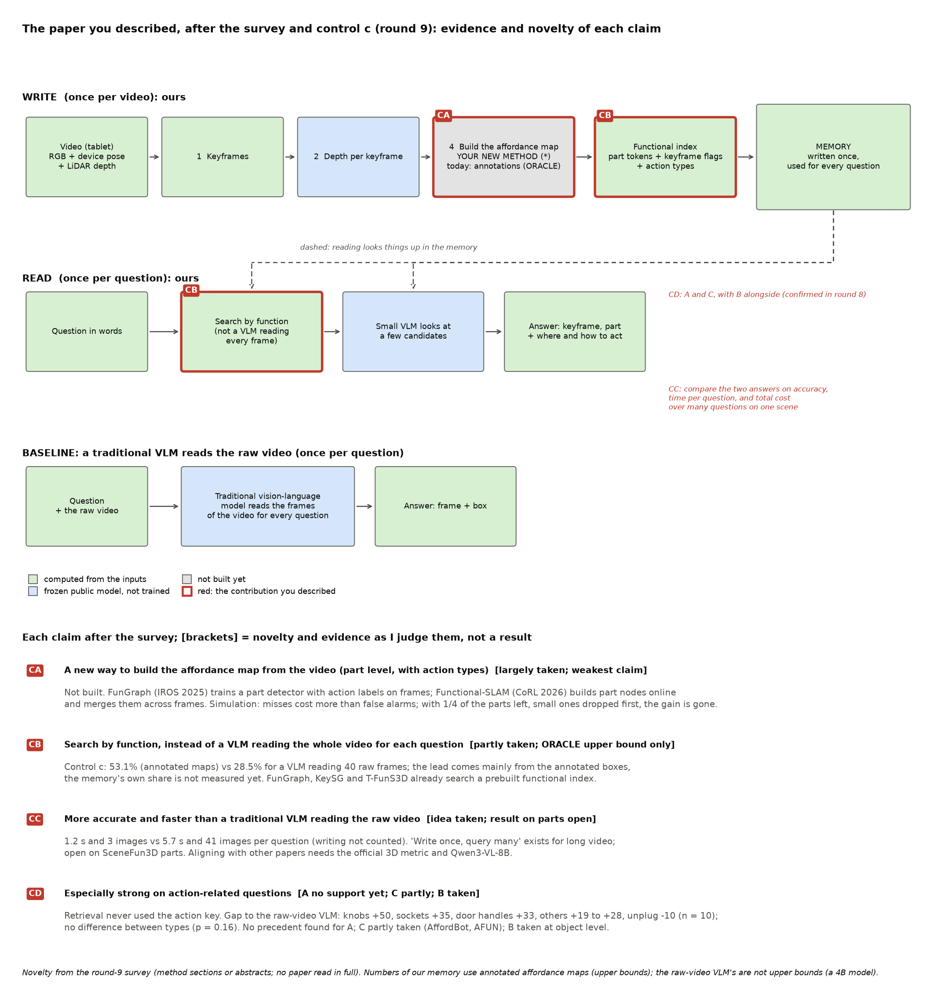
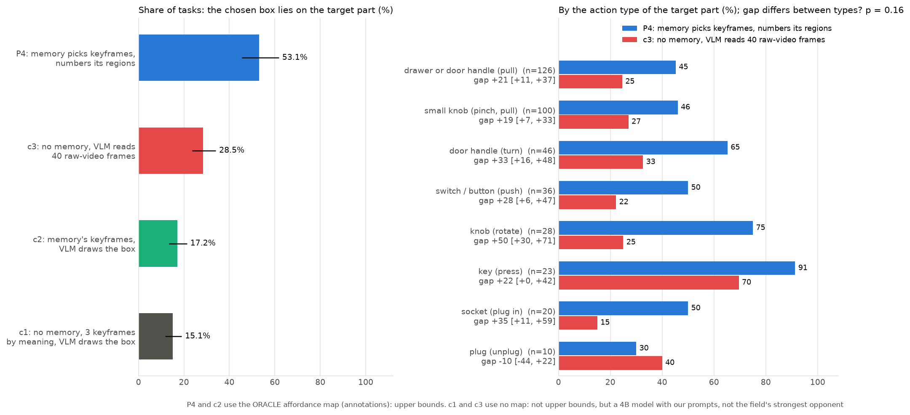

# 第 9 轮：对照 c、漏检模拟和调研的结果，以及论文的贡献该放在哪里

> **2026-11-13。** 这一轮要你看、要你定的内容都在这份文档里。正文是白话；附录是三个方案的完整卡片。
>
> **哪些数字是上限：** 用我们记忆的组（P4、c2）用的是标注出来的 affordance map（ORACLE），是上限。不用记忆的组（c1、c3）没有用标注，不是上限；但它们只是 4B 模型加我们定的读法，不是这个领域最强的对手（见第 4.2 节）。调研里"已有人做过"的判断，大多只读到论文的方法部分、表格或摘要，没有通读全文；用到的数字后面标了读到哪一层。
>
> **交给你之前审过：** 第 8 节是审稿记录。第一轮认为初稿"不够格"，主要是把标注的功劳算到了记忆头上；改过之后第二轮升到"边缘"。
>
> 提案 P-2（改章程）还在等你批。看完这份文档再批更好：问题 1 的选择会影响 P-2 的第 1、3、4 行。

## 0. 一分钟版本

- **对照 c 跑完了**（30 个场景、390 个任务，规则在跑之前写定）：
  - 用我们的记忆（P4，标注的 affordance map），选中的框落在正确部件上的比例是 53.1%；传统视觉语言模型直接读 40 帧原视频（c3）是 28.5%，P4 高 24.6 个百分点。
  - 每个问题（中位数），P4 的模型调用 1.2 秒、看 3 张图；读原视频 5.7 秒、看 41 张图。都不含写入记忆的时间。
  - 按事先的规则：没有一组"接近"P4，"按功能建索引"没有被推翻；P4 的领先只算"阶段 2 有多少余地"。
  - **要说清楚的一点：** 这个领先主要来自标注给出的部件框，不能算成记忆本身的功劳。记忆自己的那部分（挑画面）现在只量到 +2.1 个百分点，而且那一组的读法和读原视频那组不一样。要量出记忆本身值多少，还缺三组对照（问题 7）。
- **按动作类型拆开：** 旋钮 +50、插座 +35、门把手 +33，其余 +19 到 +28，拔插头 −10（只有 10 个任务）；区间大多重叠。检验的结果是动作类型之间看不出不同（p = 0.16）；而且检索根本还没用到动作类型。所以"在动作类问题上格外强"目前没有证据。
- **漏检和误检的模拟**（你批准的 R7-B）：在检索这一步，漏检比误检要紧。误检和真部件一样多时，只少 4 到 5 个百分点；漏掉一半部件，少 7 到 8 个；先丢小部件、只剩四分之一时，优势消失。
- **调研：** 你想要的四项贡献里，CA（新的构建方法）、CB（按功能搜索）、CC（更快更准）都有人部分做过，CA 最弱。CD 里，A（点明动作的问题）没找到先例，但我们自己也还没有证据；C 部分已有人做；B 在物体一级已有人做。
- **要你定的：** 7 个问题（问题 6 分 6a、6b 两个决定），见第 7 节。最要紧的是问题 1（论文的重心）和问题 7（补三组对照）。

## 1. 流程图：每项贡献现在的证据和新颖性

**怎么看：** 方框和第 8 轮一样（流程图画的是论文要做成的样子，所以"功能索引"一格写着动作类型，但现在的检索还没用它）。下面四条，每条的方括号里是我对它"新不新、证据多强"的判断，后面是依据。这些判断来自调研，不是实验结果。

## 2. 对照 c 的结果

**做了什么：** 同样的 390 个任务，同一个视觉语言模型（Qwen3-VL-4B），四种给法，用同一个标准打分：选出或框出的框，中心落在目标部件上（部件向外放宽 8 个像素）才算对。

| 组 | 给模型看什么 | 选对部件 | 选中的画面里有目标 | 每个问题（中位数） |
| --- | --- | --- | --- | --- |
| P4 | 记忆挑出的 3 张关键帧，标注的 affordance 区域加编号框，模型选编号 | 53.1%（45.5–61.7） | 69.2% | 1.2 秒，3 张图 |
| c3 | 不用记忆：均匀取的 40 帧原视频，模型先挑一帧，再在这一帧的原分辨率上框部件 | 28.5%（23.5–34.0） | 54.4% | 5.7 秒，41 张图 |
| c2 | 记忆挑出的 3 张关键帧，不给框，模型一次看 3 张、自己框 | 17.2%（13.4–21.3） | 66.9% | 3.2 秒，3 张图 |
| c1 | 不用记忆：只看整张画面挑的 3 张关键帧，模型一次看 3 张、自己框 | 15.1%（11.7–19.0） | 59.2% | 3.1 秒，3 张图 |

括号里是 95% 置信区间。时间只算模型调用，没有算写入记忆的时间。

**按事先定好的规则读：**

- P4 减 c3 是 +24.6（区间 19.2 到 31.5），P4 减 c1 是 +37.9（31.2 到 45.4）：没有一组"接近"；P4 的领先按规则只算"阶段 2 的余地"。
- P4 减 c2 是 +35.9（29.3 到 43.2）：编号框（框来自标注）带来的，比"挑对画面"多得多。
- c2 减 c1 是 +2.1（−1.1 到 +5.4）：只靠记忆挑画面、让模型自己框，看不出帮助。

**审稿之后的理解：**

- 画面挑对了，模型自己也框不准：c2 选中的画面里有目标的占 66.9%，框对的只有 17.2%。
- 但两种读法不一样：c1、c2 是一次看 3 张图、直接画框；c3 是先挑一帧，再在这一帧的原分辨率上画框。画面挑对时，c3 框对的约 52%（28.5 ÷ 54.4），c2 只有约 26%（17.2 ÷ 66.9）。所以"框不准"有一部分是读法造成的，P4 减 c2 的 +35.9 偏大。
- 在标注的 affordance map 下，P4 的领先主要来自**标注给出的部件框**。记忆本身的价值还没有干净地量出来。
- 2026 年的一篇论文（"Part Grounding, Not Action Knowledge"，我核对过摘要）说视觉语言模型的瓶颈是找到要操作的部件，而不是知道要做什么动作，和这里一致。
- **要量出记忆本身值多少，需要三组新对照**（问题 7）：
  - **c4，同样的标注框，但不用记忆挑画面：** 用 c1 的 3 张画面，把这 3 张上的标注部件加编号框（最多 40 个，顺序和 P4 一样），模型选一个编号。P4 减 c4 是在标注下"记忆挑画面"的价值，而且是上限：记忆挑画面时本身也用到了标注（第 23 节的"关键帧标记"）。
  - **c1'、c2'，c1、c2 换成 c3 的读法：** 模型先在缩小一半的 3 张里挑一张，再在原分辨率上框。c2' 减 c1' 就是在同一种读法下"挑画面"的价值。

**用阶段 1 的旧标准**（框盖住部件的中心就算对，大框容易占便宜）：P4 51.0%，c3 36.9%，c2 40.8%，c1 35.9%。差距变小，可能是因为模型自己画的框往往比部件大。

**按动作类型拆开**（右图；P4 对 c3，任务数 10 个以上的类型，按差距排）：

| 部件 | 任务数 | P4 | 读原视频 | 差（区间） |
| --- | --- | --- | --- | --- |
| 旋钮（转） | 28 | 75.0% | 25.0% | +50.0（29.6 到 71.0） |
| 插座（插） | 20 | 50.0% | 15.0% | +35.0（11.1 到 58.8） |
| 门把手（转） | 46 | 65.2% | 32.6% | +32.6（16.3 到 47.7） |
| 开关、按钮（按） | 36 | 50.0% | 22.2% | +27.8（6.5 到 46.9） |
| 键盘、遥控器按键（按） | 23 | 91.3% | 69.6% | +21.7（0.0 到 41.7） |
| 抽屉或门的拉手（拉） | 126 | 45.2% | 24.6% | +20.6（11.5 到 36.7） |
| 小把手（捏住拉） | 100 | 46.0% | 27.0% | +19.0（6.6 到 32.9） |
| 插头（拔） | 10 | 30.0% | 40.0% | −10.0（−44.4 到 +22.2） |

**这张表只能当描述，有三个原因：**

- **检索没有用动作类型。** 阶段 1 和这批对照里，记忆检索时没有打开"按动作类型匹配"的那一项，所有区域的动作都记成同一类。所以这里的差别不是"按动作建索引"带来的。
- **动作类型之间看不出不同。** 审稿后补做了一个检验（方法在计算之前写进了讨论稿第 24.5 节）：在每个场景内部打乱动作标签 10,000 次，看各类型的差距是否比随机分组更分散。389 个任务、8 个类型，p = 0.16，按事先的读法记为"看不出不同"。
- **SceneFun3D 的每个任务都点明了动作**，所以这是"按动作类型比"，不是"点明动作的问题对没点明的问题"。

要检验"按动作类型建索引有没有用"，要另做一组打开这一项的检索（第 6 节）。

## 3. 漏检和误检的模拟（R7-B）

**问题：** 我们自己建的 affordance map 会漏掉部件（漏检），也会把不能操作的地方当成部件（误检）。漏多少、错多少以内，按功能建的记忆仍然比不按功能建的好？只用 CPU，方法和读法在跑之前写进了讨论稿第 24.6 节。

**做法：** 从 P4 的标注区域里只留一部分（随机丢，或先丢面积最小的）；再从通用分割的区域里取一些当误检混进去。打分和阶段 1 一样，看"第一个关键帧对不对"，和两个参照比：只看整张画面（P0，45.6%）、通用区域（P3，47.4%）。

| 丢法 | 留下的部件 | 没有误检 | 误检 = 0.5 倍 | 误检 = 1 倍 |
| --- | --- | --- | --- | --- |
| 随机丢 | 100% | 66.2% | 62.6% | 61.3% |
| | 50% | 59.0% | 58.4% | 57.6% |
| | 25% | 52.2%（与 P3 看不出差别） | 53.2% | 53.9% |
| 先丢小的 | 50% | 57.9% | 57.0% | 57.7% |
| | 25% | 47.2%（与 P3 看不出差别） | 53.2% | 55.5% |

"0.5 倍"指误检的个数是真部件个数的一半。除了标出的两格，其余都明显好于 P3。完整的表（包括 75% 和 2 倍误检）在讨论稿第 24.6 节。

**按事先的读法：**

- **门槛：** 误检为 0.5 倍时，从留 100% 往下，一直明显好于 P3 的最低比例。两种丢法都是 25%，也就是试到的最低一档。
- **误检：** 留 100%、误检 0.5 倍时仍然明显好于 P3（+15.2，区间 10.4 到 20.3），所以在检索这一步，这套记忆对误检不敏感。

**三点说明：**

- 只留 25% 时，加误检反而让分数上升（先丢小的：47.2% 升到 55.5%）。原因是打分里"没有部件的关键帧扣 3 分"这个常数：部件很少时，很多对的关键帧没有部件、被扣分；误检让更多关键帧不再被扣分。所以 25% 的门槛有一部分是这个常数造成的；没有误检时，先丢小的、只留 25%，就看不出比 P3 好。
- "2 倍误检"那一列，实际平均只有 1.46 倍：通用区域的三次抽样重复很多，去重后不够。0.5 倍、1 倍两列不受影响。
- 第二轮审稿人担心，和目标部件部分重叠的区域也被算成误检，让"对误检不敏感"偏乐观。按更严的规则（中心落在任何部件区域上的都不算误检）重算了一次，规则在计算前写定：结论不变（留 100%、误检 0.5 倍是 63.3% 和 62.3%，原来都是 62.6%）。

**对阶段 2 的意思：** 构建方法要先求找全，尤其是小部件，其次才是少误检。但这只看检索：在模型读编号框那一步，误检的框会直接变成干扰选项，影响可能更大。另外，真实工具的误检常常是整个物体的大框，这里的误检是大小和部件相当的区域。这两点都要用真实工具的输出来量（第 5 节的公共检查）。

## 4. 调研发现了什么

四个调研代理各查一个问题。完整记录在 `helm/evidence/` 里（四个文件，每条都标了读到哪一层）。

### 4.1 从视频建 affordance map，已经有哪些方法

- **"不需要问题、部件级、带动作类型的 affordance map"本身不新。**
  - 在激光扫描的点云上，SceneFun3D 的任务 1 就是这件事。ECCV 2026 挑战赛第二名 TopoField 的 AP25 是 47.6（读到技术报告；两份调研记录对这是测试集还是 30 个验证场景说法不一，没有核实）。
  - 只用带位姿的画面、不用点云，FunGraph 已经做到：用投影的标注训练二维部件检测器，二维 mAP50 是 26.7；现成的开放词表检测器直接用，GroundingDINO 只有 0.7，YOLO-World 是 0.0（都读到论文的表）。
- **SceneFun3D 上最近的强方法，几乎都是每个问题重新处理一遍场景**（Fun3DU、TASA、AffordBot、UniFunc3D、AFFORDMEM、ThinkAfford）：每个问题 37 到 332 秒（读到各论文的表，机器不同）。没找到一个是"建好一次、当索引反复用"并按索引来评测的。
- **可能新在哪里**（调研代理的归纳，不是哪篇论文的说法）：没找到一项工作同时做到"不需要问题、部件级、固定的动作类别、只用视频画面、写入便宜、以找全部件为目标、按对检索的帮助来评测"。每一点单独都有先例，新意只能来自组合。调研不是穷尽的检索。
- **新方法必须比的：** FunGraph；SceneFun3D 任务 1 的基线和 TopoField；UniFunc3D 和 Fun3DU；ThinkAfford；OpenFunGraph。

### 4.2 对手怎么设，才能和其他论文横向对齐（你在第 8 轮问题 4 的要求）

- **SceneFun3D 上，没有论文把"视觉语言模型直接读帧"当作主表里的一行。** 大家报告的都是三维掩码的 AP（官方指标）。最接近的只出现在消融里，例如 UniFunc3D 里 Qwen3-VL-8B 一步到位的 AP25 是 7.64 到 14.38（读到论文的表 2）。
- **在这个领域，"读原视频"的强对手是 UniFunc3D：** 用 Qwen3-VL-8B 读视频画面，AP25 44.04（表 2），每个问题约 53 秒，但那是在 8 张 H100 上量的（表 7）。它的输入是视频画面，三维掩码只在评测时放到扫描上。审稿人认为主表里应该有它，而且要在我们这边用同一套评测重跑。它的代码是否公开，还没核实。
- **要和别人的表并排，我们得把框投到三维、按官方指标打分。** 已发表的 AP25：Fun3DU 33.3，T-FunS3D 34.5，AFFORDMEM 41.66，UniFunc3D-8B 44.04（读到各论文的表）。
- **同一个方法在不同论文里数字差很多。** 例如 Fun3DU 的 AP25，它自己报告 33.3，别人复现出 23.4 和 12.56。所以最好用同一套评测，把对手在我们这边重跑一遍。
- **2026 年论文里默认的开源模型是 Qwen3-VL-8B**，能放进一张 48 GB 的卡。我们现在用的是 4B，偏小。
- **HD-EPIC 上已有开源模型的逐类数字**（例如 Qwen2.5-VL-7B 平均 33.5%，Gemini 1.5 Pro 37.6%）；Qwen3-VL 这一行要我们自己跑。

### 4.3 你想要的四项贡献，撞车检查

| 贡献 | 最接近的已有工作 | 结论 |
| --- | --- | --- |
| CA 新的构建方法 | FunGraph（画面上训练带动作类别的部件检测器）；OP3DSG、KeySG；用"人手碰过的地方"的几项工作；跨画面合并同一物体的掩码已有成熟做法（MaskClustering、OnlineAnySeg 等） | 部分已被做，四项里最弱。剩下的空间：不存融合的三维地图，以"在写入预算内找全"为目标 |
| CB 按功能搜索 | FunGraph、KeySG、T-FunS3D 都是先建功能索引、再按问题搜索 | 部分已被做。剩下的空间：在关键帧的部件 token 上搜索，按动作类型做检索的键（这一点我们还没做） |
| CC 比传统模型更快更准 | "写一次、问很多次"的长视频记忆（2026 年 10 月的 Video-EMem）；T-FunS3D 建一次约 592 秒、之后每个问题 78 秒（读到它的表） | 思路已有人做；在 SceneFun3D 的部件级上还没找到结果。要画"问多少个问题之后更划算"的曲线，同时比读原视频的模型、UniFunc3D 和 T-FunS3D |
| CD-A 点明动作的问题 | 没找到"按动作类型拆开、记忆对读原视频"的比较；上面那篇 2026 年的论文支持背后的机制 | 没找到先例，但我们自己也还没有证据：检索没用动作类型，动作类型之间的差别也看不出来（第 2 节） |
| CD-C 能直接拿去做的回答 | AffordBot（NeurIPS 2025）、AFUN 已经对每个问题给出动作类型、方向或接触点 | 部分已被做。剩下的：从写一次的记忆里给出这些。它也最接近兄弟项目（affordance-vla），只能对着标注打分，不去真的执行 |
| CD-B 问做过什么 | AMEGO（ECCV 2024）、EgoSG（2026）等在物体和设施一级已经做了 | 已被做。部件级还没有，但也没有数据支持 |

我核对过其中三篇的摘要（FunGraph、Video-EMem、"Part Grounding, Not Action Knowledge"），内容与调研描述一致。

### 4.4 B 和 C 能不能做、要多少

**B（问做过什么，HD-EPIC）**

- **数据：** 9 个厨房、41.3 小时、视频共 123.56 GB（文件大小是调研代理量的）。建议先用 P02 这个厨房：242 个"做过什么"类问题，视频 10.24 GB。许可证一处写 CC BY-NC 4.0、一处写 CC BY 4.0，按更严的 CC BY-NC 4.0 来。
- **问题：** 有 6 类问的是过去的事，共 1,900 题，都是 5 选 1。其中两类计数题"盲猜"就很高：永远答"0"能对 40.3%，按常见答案猜能对 56.5%。所以结果要逐类和盲猜比。
- **对手：** 一篇 2026 年的预印本（EgoAdapt）报告 Qwen3-VL-8B 在"物体运动"类上 46.7%，但那是把模型包在它自己的选帧和选项打分里，不是模型直接读原视频；直接读原视频的结果，调研没有找到，要我们自己跑。
- **我们这边：** 事件记忆先用标注的动作区间（只能当上限），和阶段 1 的做法对称。事件记忆在现行章程里属于"边缘"。
- **要你定的一条规则：** HD-EPIC 带有 Aria 眼镜算出的手腕、手掌位置。用它来找"什么时候碰了东西"，算不算允许的输入？章程只写了"设备位姿"。
- **调研代理设计了三步检查，读法都事先定好：**
  - B-0：只用 CPU，下载约 30 MB 标注，看每道题能不能对上标注里的事件。至少 90% 能对上、能复现答案，才往下走。
  - B-1：只用 CPU，用手腕位置找"拿起、放下"的时刻，和标注比。要下载约 20 MB 的手腕数据，以及设备位姿（大小还不知道，开始前核实）。召回在精度 50% 时低于 60%，就说明要用 GPU 的检测器，B 的代价要重新和 A、C 比。B-1 只在问题 4 回答"可以"时才做。
  - B-2：下载 P02 的视频（约 10 GB），GPU 约 0.7 到 2.5 小时（估计），五组对比。用标注事件的记忆要比读原视频至少高 10 个百分点、比"只有时间戳"至少高 5 个（都看区间下沿），才值得继续。

**C（能直接拿去做的回答，SceneFun3D）**

- SceneFun3D 标注了部件的运动类型、轴和起点，可以用来打分（方向的角度误差、接触点是否在部件上、铰链在哪一侧）。
- 一个提醒：在本地一个训练场景上，只用"表面朝向 + 部件类型"推方向，37 个运动里有 29 个在 20 度以内。所以真正能拉开差距的，只有接触点、带铰链的部件，以及不用标注时的动作类别。如果普通视觉语言模型在方向上只差 5 个百分点以内，C 就会并进 A。
- 第一步：C-0 只用 CPU，把标注整理成"动作记录"；C-1 用 GPU 约 0.3 到 1 小时（估计），用 4B 模型（问题 6a 批了再加 8B），比较普通视觉语言模型、简单的几何规则、我们的记忆（用标注的 affordance 区域和动作标签，是上限）和真值。
- C 在围栏内；它最接近兄弟项目 affordance-vla，所以只对着标注打分，不去真的执行。

## 5. 这对你想要的贡献意味着什么：三个方案

你最初的话里有四件事：新颖的 affordance map 方法、不同于传统模型的搜索、更高的效率和准确度、动作方向上格外强。调研表明，第一件最难站住；最后一件我们自己还没有证据。下面三个方案（为了不和 B、C 两个方向混淆，叫甲、乙、丙）的区别，在于论文的重心放在哪里。完整卡片在附录。

| 方案 | 论文的重心 | 构建方法的地位 | 好处 | 风险 |
| --- | --- | --- | --- | --- |
| 甲 | 新的 affordance map 构建方法 | 核心贡献 | 最贴近你最初的说法 | 四项里最弱的一项当重心；要在同样的输入上赢过 FunGraph；很可能要训练（关口 G2）；把章程的贡献类型从"应用"改成"方法" |
| 乙 | 按功能搜索 + 动作类问题 + 代价曲线 | 用现成的部件拼起来，不算新意 | 最快；和章程原来的"应用"类型一致 | 收回了你在第 8 轮同意的"新的构建方法算一项贡献"；审稿人可能觉得增量不够 |
| 丙 | 同乙 | 一项范围很窄的辅助贡献：写入预算固定时把部件找全，并把同一部件在不同画面里归成一条 | 重心放在最可能新的地方，同时保留你想要的构建方法，但只声称它真正新的那部分 | 构建方法的新意窄，现在只有目标、还没有具体做法；工作量在甲和乙之间 |

**B 和 C 放在哪里（我的建议，你可以改）：** 三个方案里，C（能直接拿去做的回答）都作为论文里的一节；B（问做过什么）都并行做，作为横向比较，不进主表。你在第 8 轮说"希望能够同时做 B"是为了平行比较，这是我的理解，没有和你确认过。

**我的建议：丙。** 漏检模拟说明，构建方法最要紧的是找全，尤其是小部件；调研没有找到有人把"写入预算固定时能找全多少"当作目标来量（不是穷尽的检索）；你在第 8 轮也同意构建方法算一项贡献。丙把构建方法的目标定在这一点上，而且只声称这一点。是乙还是丙更合适，下面的公共检查会给出直接的证据；到时候我按结果给建议，由你定。

**三个方案共用的下一步（审稿后重新设计）：** 用现成工具建 affordance map，直接交给记忆，看还剩多少优势。

- **工具：** 能按名字分割的模型（SAM 3）、能"指点"的视觉语言模型（Molmo）；FunGraph 的检测器据一份调研记录是公开的（另一份没确认），开始前核实，并核实它训练用的场景不含我们的 30 个验证场景。在 30 个场景的 40 张关键帧上各跑一次。
- **部件名单：** 事先定好、所有场景共用，和提示词里"部件"的定义是同一张：把手、旋钮、按钮、开关、按键、踏板、插头、插座。不用场景的标注，也不用问题的文字。
- **量什么：**
  - 每个部件的召回：481 个关键帧看得到的部件里，找到了多少。"找到"和打分用同一个标准：框的中心落在部件上（放宽 8 个像素），这样框住整个物体的不算。
  - 每个任务的覆盖：记忆会挑出的画面里，有没有一个落在目标部件上的候选（用标注时是 83.6%）。
  - 误检有多少，动作类别标得对不对。
- **再读图，在同样的 390 个任务上比四组：** 工具版 P4（工具的输出当 affordance map，经过记忆）；工具版 c4（同样的工具候选，但不用记忆挑画面）；工具版 P4 只留对的框（去掉误检，用来把差距拆开）；以及标注版 P4 和 c3。如果问题 6a 批了，这几组都用 8B。
- **读法（跑之前写进讨论稿第 24 节，下面是草案；都按区间读，不按单个数）：**
  - **先看要不要停：** 工具版 P4 减工具版 c4 的区间下沿低于 5 个百分点（记忆比"同样的候选、不用记忆"多不出多少），或者工具版 P4 不明显好于 c3：按功能建索引在真实条件下没有优势，乙和丙都站不住，停下来和你讨论。
  - **再看差多少：** 标注版减工具版的区间上沿低于 10 个百分点，我会建议乙；区间下沿高于 10 个百分点，我会建议丙；介于两者之间记为"说不清"。都交你定。
  - **把差距拆开：** 分成漏检（召回）、误检（只留对的框后补回多少）、动作类别标错三块。丙只针对漏检和归并；如果差距主要来自误检，丙的目标要改。
  - **以哪个工具为准：** 事先定为每个部件召回最高的那个（召回在读图之前就算出来，和读图结果无关）。
- **在全部跑之前，** 先把工具在几张关键帧上的输出给你看。
- **为什么先做它：** 审稿人说，审这类论文的人第一个问题就是"记忆比检测器多给了什么"。这一步是一个三因素对比的第一块：候选从哪里来（标注、现成工具、没有）× 怎么读（经过记忆、不经过记忆的编号框、直接读原视频）。
- **它属于阶段 2**（第 7 轮问题 3：用现成的模型预测 affordance map；你当时的回答是"等问题 4、5 的结果再定"）。问题 4 的对照现在只回来一部分（c 做完了，a、b、d、c+ 还没有），问题 5（R7-B）做完了。批了就是提前开始阶段 2 的这一部分；按你在第 7 轮问题 6 的回答，它在 GPU 队列里排在你的作业后面。
- **围栏：** 围栏内（不训练）。
- **代价：** GPU 约 2 到 3 小时（工具跑 1,200 张关键帧，加上几组读图），模型下载约 10 到 20 GB。都是估计，开始前核实了再报。

## 6. 已批准、正在或马上做的，以及还没做的

**已做完：** 对照 c（第 2 节）；漏检和误检的模拟和它的敏感性检查（第 3 节）；按动作类型的检验（第 2 节）。

**正在做：** 第二批补充对照 a、b、d，和 c+ 的 4B 部分（第 7 轮批准的）。计划在跑之前写进了讨论稿第 24.7 节；先在一个场景上试跑，GPU 排在队列前面。

**我打算做的（只用 CPU，你可以叫停）：** 打开"按动作类型匹配"的检索，看动作类型作为检索的键有没有用。区域的动作类别不能取自标注（标注的动作和任务点明的动作几乎是同一个东西，等于直接按真值筛选）：要么让视觉语言模型给每个框标动作，要么用问题 2 里工具给出的类别。用标注类别跑的那一组只当上限。计划先写进讨论稿第 24 节再跑。

**我自己定的、你可以推翻的（记在账本 D-8）：**
- c+ 的 8B 部分先不跑，等问题 6a：你批的是"在 100 个任务上用 8B"，问题 6a 提议改成全部 390 个任务。
- 漏检模拟里误检的取法：不重复取同一个区域；和部件重合一半以上的区域不算误检。
- 第二批里，全部通用区域的向量在 GPU 作业里顺带算出，而不是第 7 轮写的单独用 CPU 算（结果一样，省时间）。
- 之前的 D-7：试跑后改了提示词（说清"部件"是手碰的小部件），并放宽了回答长度。

**还没做的：** 没有下载任何新模型或数据；P-2 没有写进章程；第二批对照还没有结果；没有跑过 8B；没有打开动作类型的检索；FunGraph 和 UniFunc3D 的代码是否公开没有核实。

## 7. 要你定的 7 个问题

### 问题 1：论文贡献的重心放在哪里？

甲、乙、丙三选一，见第 5 节和附录。**没有默认。** 我建议丙。注意：选乙，就是收回你在第 8 轮问题 2 同意的"新的构建方法算一项贡献"；选甲，就是把章程的贡献类型从"应用"改成"方法"。你选了之后，我按你的选择改写 P-2 的第 1、3、4 行再请你批。如果你对 B、C 放在哪里有不同想法（第 5 节），也请一并写。

### 问题 2：先做"现成工具建图，交给记忆"的检查，批不批？

第 5 节最后一部分。GPU 约 2 到 3 小时，模型下载约 10 到 20 GB（估计），排在你的作业后面。这是阶段 2 的一部分，批了就是提前开始这一部分。三个方案都要先做这一步。**没有默认；** 我建议批，而且建议先做问题 6a，这样读法里用的是 8B。

### 问题 3：B 的头两步（B-0、B-1），批不批？

只用 CPU。B-0 下载约 30 MB 的标注；B-1 下载约 20 MB 的手腕数据和设备位姿（大小未知，开始前核实），而且只在问题 4 回答"可以"时才做。事件记忆在现行章程里是"边缘"，批了就是允许做这两步检查。B-2（下载约 10 GB 视频、GPU 约 0.7 到 2.5 小时）等 B-0、B-1 过了再问你。**没有默认；** 我建议批。

### 问题 4：Aria 眼镜算出的手腕、手掌位置，能不能当输入？

它只在 B-1"不用标注找事件"那一步用到。章程的"固定条件"只写了设备位姿，所以要你定。**没有默认。** 我的看法：可以，它和设备位姿一样，是录制设备自己算出来的，不是人工标注。

### 问题 5：C 的头两步（C-0、C-1），批不批？

C-0 只用 CPU；C-1 用 GPU 约 0.3 到 1 小时（估计），用 4B 模型，排在你的作业后面。**没有默认；** 我建议批。

### 问题 6：怎么和其他论文横向对齐？

你在第 8 轮问题 4 要求"参考其他模型的比较，尽量能够横向对齐"。分两步，请分别定：

- **6a：模型换成 Qwen3-VL-8B。** 在全部 390 个任务上，用 8B 重做 P4 和"不用记忆"的两组（c1、c3），替代原来 c+ 里只做 100 个任务的版本。P4 也换成 8B，是为了不让"模型大小"和"有没有记忆"混在一起。GPU 约 2 到 3 小时，模型下载约 17 GB（估计），属于对照，排在队列前面。**没有默认；** 我建议现在就做。
- **6b：和 UniFunc3D 并排。** 有两种做法：
  - 便宜的：在我们的 390 个任务上跑 UniFunc3D，用我们的二维标准给它挑的画面和掩码打分，不投到三维。
  - 完整的：把我们的框投到激光扫描上，按官方指标打分，再在同一套评测下重跑 UniFunc3D。这里扫描只用来打分，不当方法的输入；但章程只允许把扫描当"评测的真值"，这样用算不算，要你定。
  - 代价：UniFunc3D 报告的每个问题约 53 秒是在 8 张 H100 上量的，在我们的卡上估计要几十个 GPU 小时；投影和评测还要写代码。
  - **没有默认；** 我建议等问题 1 定了重心、问题 2 有了结果再做，先做便宜的那种。

### 问题 7：补三组对照（c4、c1'、c2'），批不批？

见第 2 节。c4：同样的标注框，但不用记忆挑画面；c1'、c2'：c1、c2 换成 c3 的读法。它们回答"记忆本身值多少"，这是审稿人认为最要紧的问题。都用 4B，GPU 约 1 小时（估计），属于对照，排在队列前面；规则在跑之前写进讨论稿第 24 节，读法沿用第 24.3 节（P4 减这一组的区间下沿低于 5 个百分点算"接近"）。**没有默认；** 我建议批。

**怎么回复：** 一行就够，例如"1 丙；2 批；3 批；4 可以；5 批；6a 批，6b 等；7 批"。也可以写在这个文件每个问题下面。

## 8. 审稿记录

两个审稿代理每轮同时看：一个按目标会议审稿，一个按章程核对。章程允许最多三轮。

| 轮次 | 按目标会议的结论 | 阻断 | 主要 | 次要 | 按章程核对 |
| --- | --- | --- | --- | --- | --- |
| 1 | 不够格 | 1 | 6 | 3 | 数字都和来源一致；措辞、围栏标记、你的原话有问题 |
| 2 | 边缘（升了一档） | 0 | 4 | 4 | 决定权、围栏和半径的标记、排队位置、估计的代价有问题 |
| 3 | （审完后填写） | | | | |

**第一轮之后改的：**

| 问题 | 改了什么 |
| --- | --- |
| 阻断：对照量的是标注的价值，不是记忆的价值 | 第 0、2 节改写；补对照交你决定（问题 7） |
| c2 和 c3 的读法不同，"框不准"的说法偏大 | 第 2 节写明；c1'、c2' 交你决定（问题 7） |
| 检索没用动作类型，按动作拆开不能支持 CD-A | 改为"只当描述"；补做了检验（p = 0.16） |
| 丙的"不用点云"是第 7 轮已撤回的区别；写入预算没有定义 | 丙的卡片重写 |
| 读原视频的强对手应该是 UniFunc3D | 写进第 4.2 节、卡片和问题 6b |
| 公共检查只量每帧召回，可能误导 | 改为每个部件的召回、每个任务的覆盖，再把工具输出直接交给记忆 |
| 动作差距写错；"所有数字都是上限"不对；围栏标记、问题 2、3、6 的写法 | 逐条改正 |

**第二轮之后改的：**

| 问题 | 改了什么 |
| --- | --- |
| 公共检查的读法没有用到工具版 c4，没说按区间还是按单个数，没把差距拆开，没定以哪个工具为准 | 第 5 节的读法重写：先看要不要停，再按区间看差多少，把差距拆成三块，事先定工具 |
| 公共检查拿 4B 的 c3 当对手，而 8B 和 UniFunc3D 被推后 | 建议先做 6a；P4 也换 8B；6b 加了便宜的做法 |
| 丙：跨画面合并掩码已有成熟做法；没有同预算的对手；没说哪种用法下写入预算真的受限 | 丙的卡片补上用法、对手和第一步检查；写明现在只有目标、没有做法 |
| 打开动作类型的检索时，区域的动作若取自标注，等于按真值筛选 | 第 6 节写明动作类别的来源 |
| 误检规则偏松 | 按更严的规则重算（计算前写定），结论不变 |
| B、C 放在哪里替你定了；"走乙/走丙"自动换方向；第 6 节有我自己定的事没记账 | 改成我的建议、交你定；记为 D-8 |
| 甲、丙的围栏和半径混在一起；丙也改到环节 6；没写和兄弟项目怎么分开 | 卡片逐条改正 |
| 问题 2 没说排在你的作业后面，没引你第 7 轮的回答；6b 的 GPU 估计太低；扫描怎么用要你定 | 逐条改正 |

**补做的检查：** 动作类型的检验；漏检模拟的敏感性检查。两者的方法都在计算之前写进了讨论稿第 24 节。

**初稿的版本：** 初稿和第二稿在改的时候被覆盖了，没有单独保存；每一轮审稿人提的问题都记在 `helm/REVIEW.md` 里（V-38 起）。

## 9. 术语

| 词 | 意思 |
| --- | --- |
| CA、CB、CC、CD | 你在第 7 轮之后写的四项贡献，第 8 轮起这样编号：CA 新的 affordance map 构建方法；CB 按功能搜索；CC 比传统模型更快更准；CD 在动作方向上格外强（A 点明动作的问题，B 问做过什么，C 能直接拿去做的回答） |
| 甲、乙、丙 | 第 5 节的三个方案，即初稿里的 R9-A、R9-B、R9-C |
| 环节 4、环节 6 | 流程图里"建 affordance map"那一格（现在用的是标注），和"把不同画面里的同一部件归成一条"那一步 |
| 阶段 2 | 用预测的（不是标注的）affordance map 重做阶段 1 的比较 |
| 关口 G2 | 章程里决定"要不要训练写入那一步的模型"的关口，由你定 |
| 围栏内、边缘、围栏外 | 章程里的范围：围栏内的事我可以在预算内做；边缘的事要你批了才做；围栏外的事不做 |
| 半径 | 章程里"现在可以试多远的变体"；现在是"窄"，只做现有规格内的变体 |
| 对照 a、b、c、d、c+ | 第 7 轮批准的补充对照；c 是"不用记忆、让模型自己找"那几组，a、b、d、c+ 是第二批 |
| P4、c1、c2、c3 | 见第 2 节的表；c4、c1'、c2' 是问题 7 提议的三组 |
| D-7、D-8 | 账本里记的、我自己定的决定，你可以推翻 |
| ORACLE、上限 | 用标注代替模型预测；得到的数字是最理想情况下的上限 |
| 区间、区间下沿 | 95% 置信区间；"区间下沿高于 0"就是"明显好于" |
| p 值 | 如果其实没有差别，看到这么大或更大差别的概率；小于 0.05 才算看得出差别 |
| 官方指标、AP25 | SceneFun3D 规定的打分：在三维点云上比较找出的部件和真实部件的重合程度；AP25 是重合 25% 以上算找到 |
| mAP50 | 二维检测的常用指标：框和真实框重合 50% 以上算找到，再在各类之间平均 |
| 召回、误检 | 召回：真实部件里被找出来的比例；误检：把不能操作的地方当成部件 |
| 盲猜 | 不看视频、只看题目和选项就作答能对多少，用来判断题目本身有多容易 |

## 10. 记录在哪里

- **对照 c、按动作的检验、漏检模拟、第二批的计划和记录：** [讨论稿](../../docs/mem/mem分支_问题定义与讨论稿_2026-11-10.md)第 24 节。
- **四份调研记录：** `helm/evidence/field_2026-11-13_*.md`。
- **审稿和账本：** `helm/REVIEW.md`、`helm/LEDGER.md`。
- **代码：** `scripts/split_controls_by_action.py`（按动作拆开和检验）、`scripts/simulate_map_errors.py`（漏检模拟）、`scripts/run_mem_controls.py` 和 `scripts/score_mem_control_a.py`（对照）、`report/pipeline_flowchart.py`（`target_r9`）、`report/mem_phase1_helpers.py`（`controls_figure`）。

---

## 附录：三个方案的完整卡片

### 甲：以新的构建方法为核心

- **是什么：** 设计一个从视频建部件级、带动作类型 affordance map 的新方法，作为论文的主要贡献；搜索、效率和动作类问题作为它的应用。现在只有目标，还没有具体做法。
- **它支持的说法：** "我们提出了一种新的方法，从普通视频建出部件级的功能地图，比已有方法更全、更便宜。"
- **最接近的工作和差别：** FunGraph（读到方法部分和表）已经从画面训练带动作类别的部件检测器；SceneFun3D 任务 1 和 TopoField 在扫描点云上以找全部件为目标。差别只能来自组合：不存融合的三维地图、以写入预算内找全为目标、按检索评测。
- **代价：** 方法设计加实验，估计 4 到 6 周；很可能要训练（关口 G2 由你定），GPU 用量未估。
- **风险和最早的失败迹象：** 新方法赢不了 FunGraph 式的检测器。最早的迹象：问题 2 的检查里，标注版和工具版 P4 的差距区间上沿低于 10 个百分点。
- **第一步检查：** 问题 2 的检查。
- **C 和 B 放在哪里（我的建议）：** C 作为地图的一种用法（从地图给出动作类别和接触点）；B 并行做，作为横向比较。
- **和兄弟项目怎么分开：** 只按记忆的召回和检索来评测，不和 affordance-vla 共用构建方法。
- **围栏和半径：** 不训练时在围栏内，训练写入那一步是边缘（关口 G2）；新方法超出现在"窄"的半径，要 P-2 第 3 行批准。它还把章程的贡献类型从"应用"改成"方法"，超出 P-2 第 1 行的"应用为主"。
- **对其他部分的影响：** 环节 4 是主角；论文的主表是"构建方法对比"，系统对比是次要的。

### 乙：以按功能搜索和动作类问题为核心，构建方法用现成的

- **是什么：** 用现成的部件建 affordance map（例如 FunGraph 式的检测器、开放词表的检测加视觉语言模型标动作），论文的新意放在"按动作类型建索引的搜索"、"动作类问题上格外强"和"问的次数多时更省"。
- **它支持的说法：** "按功能建索引、写一次的记忆，让一个小的视觉语言模型在动作类问题上明显比直接读原视频更准，而且同一个场景问得越多越省。"
- **最接近的工作和差别：** FunGraph、KeySG、T-FunS3D 都先建索引再搜索（读到方法部分）；差别在于按动作类型检索、部件级关键帧 token，以及按动作类型拆开的对比和代价曲线。主表里读原视频的对手要有 UniFunc3D（同一套评测重跑）。
- **代价：** 估计 2 到 3 周；可能不需要训练；GPU 用量未估。
- **风险和最早的失败迹象：** 用现成工具建的 affordance map 时，记忆比"同样的候选、不用记忆"多不出多少；或者打开动作类型的检索后，动作类问题上也没有额外的好处。最早的迹象：问题 2 的检查，以及第 6 节那组只用 CPU 的检索。
- **第一步检查：** 问题 2 的检查。
- **C 和 B 放在哪里（我的建议）：** C 作为"能直接拿去做的回答"一节；B 并行做，作为横向比较。
- **注意：** 这收回了你在第 8 轮问题 2 同意的"新的构建方法算一项贡献"。
- **围栏和半径：** 用现成工具、不训练时在围栏内；如果要用 FunGraph 式自己训练的检测器，那一步是边缘（关口 G2）；B 的事件记忆是边缘。按章程原来的"应用"类型，P-2 第 1 行不需要加方法贡献。
- **对其他部分的影响：** 环节 4 只是工程；论文的主表是"系统对传统视觉语言模型"，按动作类型和问题次数展开。

### 丙：两者结合（建议）

- **是什么：** 论文的重心和乙相同；同时做一个范围很窄的构建方法，只声称两点。现在只有目标，还没有具体做法。
  - **写入预算固定时把部件找全。** 写入预算的定义：每分钟视频最多调用多少次检测器或视觉语言模型（也可以换算成每分钟视频的写入秒数）。比的是同样预算下找到的部件比例。
  - **把同一部件在不同画面里归成一条。** 用关联的碎片程度来量：现在 465 个真实部件被记忆分成了 760 条，平均每个部件 1.63 条；目标是接近 1，而且不把两个部件并成一条。跨画面合并同一物体的掩码已有成熟做法（MaskClustering、OnlineAnySeg、OVI-MAP、EmbodiedSAM，都用带位姿的画面和深度），我们的做法要比它们好，否则这一点不声称。
  - 不声称"不用点云"：第 7 轮已经说过，这一点单独站不住（同样的输入两秒左右就能拼成点云）。
- **写入预算在什么用法下真的受限：** 边走边记、在设备上算，例如戴着眼镜在家里走一圈之后马上要能问（你在第 7 轮选的用例一和用例三）。如果是录完再在服务器上慢慢处理，写入预算就不受限，这一点的意义会变小。
- **它支持的说法：** 在乙的说法之外，加一句"在同样的写入预算下，我们的构建方法找到的部件更全、归并得更准，因此检索和回答更准"。
- **最接近的工作和差别：** 同甲、乙；SceneFun3D 任务 1 和 TopoField 也以找全部件为目标，但在扫描点云上；TopoField、ThinkAfford 报告过找全的程度，但只作为附带诊断，也不看写入预算。
- **同样预算下必须比的：** 同一个工具在均匀抽的画面上跑；FunGraph 的检测器；OP3DSG。归并那一点还要比上面的几种合并做法。
- **代价：** 估计 3 到 5 周；是否训练到关口 G2 由你定；GPU 用量未估。
- **风险和最早的失败迹象：** 两种失败，都能在问题 2 的检查里看到：
  - 标注版和工具版 P4 的差距区间上沿低于 10 个百分点：构建方法没有改进的空间，我会建议改走乙。
  - 记忆比"同样的候选、不用记忆"多不出多少，或者工具版 P4 不明显好于读原视频：按功能建索引在真实条件下没有优势，要停下来重新想。
- **第一步检查：** 问题 2 的检查；再和漏检模拟的结果对照，看现成工具漏掉的是不是小部件。归并那一点，先只用 CPU，在现有的 465 个部件上试一个最简单的按体素合并，看它离 1.63 条能降多少。
- **C 和 B 放在哪里（我的建议）：** 同乙。
- **和兄弟项目怎么分开：** 只按记忆的召回和检索来评测，不和 affordance-vla 共用构建方法。
- **围栏和半径：** 不训练时在围栏内，训练是边缘（关口 G2）；新方法超出现在"窄"的半径，要 P-2 第 3 行批准。P-2 第 3 行现在只写了环节 4，而"归成一条"属于环节 6，要一并改；第 1 行措辞改成"一项范围很窄的方法贡献"。
- **对其他部分的影响：** 论文主表是"系统对传统视觉语言模型"（包括 UniFunc3D）；构建方法有一张自己的表（同样写入预算下的找全程度、关联的碎片程度、对检索的帮助）。
